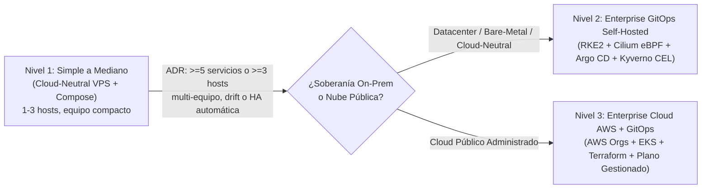

# Arquitecturas De Referencia Por Escala: Compose VPS, Kubernetes GitOps Y Cloud AWS

Establece la taxonomía oficial de las **tres arquitecturas operativas de referencia** en Vigilio según la escala del producto, madurez operativa del equipo, soberanía de datos y presupuesto FinOps. Ningún proyecto debe introducir Kubernetes, mallas de servicios o infraestructura multicuenta sin evidencia métrica ni ADR aprobado.

> **Versiones centralizadas:** consultar [technology/versions.md](../../technology/versions.md).

## Visión General De Los 3 Niveles De Plataforma



| Dimensión | Nivel 1: Simple a Mediano (`compose-vps`) | Nivel 2: Enterprise GitOps Self-Hosted (`k8s-gitops-selfhosted`) | Nivel 3: Enterprise Cloud AWS (`cloud-aws-gitops`) |
|---|---|---|---|
| **Escala objetivo** | Productos nuevos, MVPs serios y cargas medianas (1 a 3 VPS) | Empresas grandes con datacenter propio, bare-metal o soberanía estricta | Empresas grandes sobre nube pública multicuenta (con opción multicloud Azure) |
| **Orquestación** | Docker Compose / Rootless Podman Compose (cero Kubernetes) | Kubernetes (RKE2 / K3s) sin `kube-proxy`, CNI Cilium eBPF + WireGuard | AWS EKS (nodos privados en 3 AZs) + AWS Load Balancer / Gateway |
| **Entrega continua** | CD declarativo push-based (Actions + Ansible + digest inmutable) | **CI construye; Argo CD despliega** + Argo Rollouts canary (cero `kubeconfig` en CI) | **CI construye; Argo CD + Argo Rollouts** despliegan sobre ECR/EKS |
| **Infraestructura base** | Rol Ansible agnóstico (`platform-ops`) sobre hosts Linux endurecidos | Raíces Terraform separadas (red vs. clúster) con hash SHA-256 anti-drift | AWS Organizations (`Security/Core/Workloads OU`) + Terraform + `Infracost` |
| **Borde y TLS** | Caddy con TLS automático y redes aisladas (`edge`, `backend`, `observability`) | MetalLB (BGP/L2) + **Gateway API** + `cert-manager` (sin `ingress-nginx` retirado) | `CloudFront + OAC + WAF + ACM TLS moderno` + ALB privado/público |
| **Datos y mensajería** | PostgreSQL (`pgBackRest` PITR), Valkey, NATS JetStream, S3 compatible (RustFS) | `CloudNativePG` HA síncrono (WAL separado + Barman PITR), NATS HA, Valkey HA, RustFS MNMD | Aurora/RDS PostgreSQL, Valkey Serverless, `Outbox -> SNS -> SQS + DLQ`, Step Functions + DynamoDB |
| **Admisión y runtime** | Distroless non-root (`65532`), `read_only`, `cap_drop: [ALL]`, verificación Cosign pre-pull | **Kyverno CEL** (`ValidatingPolicy` / `ImageValidatingPolicy`) + Pod Security `restricted` + **Tetragon eBPF** | Kyverno/OPA + **EKS Pod Identity / IRSA** (cero IAM keys estáticas) + GuardDuty/Security Hub/Macie |
| **Laboratorio local (`prod-local`)** | Reutiliza el `compose.yaml` productivo sin duplicarlo | Clúster Kind aislado con políticas, observabilidad y Mailpit (+ perfil Tetragon en Linux/WSL2) | Contenedores de dominio + PostgreSQL + emulador ligero **Floci** (S3/SNS/SQS sin LocalStack) |
| **Guía propietaria** | [Entrega Cloud-Neutral Compose](../compose/cloud-neutral-vps-delivery.md) | [Kubernetes On-Prem](../onprem/kubernetes-foundation.md) · [GitOps y Argo CD](../kubernetes/gitops-delivery.md) | [Fundación Cloud AWS](../aws/platform-foundation.md) · [Opciones de Runtime](../cloud/runtime-options.md) |

---

## Invariantes Transversales A Las 3 Arquitecturas (Baseline DevSecOps)

Independientemente del nivel elegido, toda arquitectura Vigilio cumple siete reglas no negociables:

### 1. Cero Carpeta `contracts/` Separada — Propiedad En Cada Módulo
- **Prohibición explícita:** No se crean carpetas `contracts/`, `packages/contracts/` ni repositorios manuales de DTOs paralelos.
- **Fuente única de verdad:** Cada módulo de negocio es dueño de sus schemas estructurales Zod 4 (`<module>/domain/schemas/*.schema.ts`) y de sus contratos HTTP (`<module>/presentation/http/dto/*.dto.ts`), tal como gobiernan [Contratos HTTP en DTOs](../../standards/api/http-dtos-and-contracts.md) y [Contratos HTTP multistack](../../standards/api/contracts.md).
- **Verificación de compatibilidad:** El backend exporta la especificación OpenAPI desde sus DTOs/schemas y ejecuta el gate de compatibilidad (`openapi diff`) en CI antes de promover cualquier cambio; los frontends consumen tipos/clientes verificados sin importar archivos internos del backend por rutas relativas.

### 2. Checkout Multi-Repositorio Sin `package.json` En La Raíz
- La carpeta coordinadora local agrupa repositorios con ciclos de vida, permisos y pipelines independientes (`apps/<service>-impl`, `apps/<service>-web`, despliegue declarativo, infraestructura y `prod-local`).
- La raíz coordinadora **nunca** incluye `package.json`, `pnpm-workspace.yaml` ni `pnpm-lock.yaml` globales para evitar acoplar despliegues o contaminar contextos de compilación OCI.

### 3. Endurecimiento Supply-Chain De `pnpm` Con `packages: []`
Cada repositorio Node/Frontend utiliza `pnpm-workspace.yaml` con `packages: []` exclusivamente como política declarativa de cadena de suministro:

```yaml
packages: []

engineStrict: true
preferFrozenLockfile: true
verifyStoreIntegrity: true
strictStorePkgContentCheck: true
strictDepBuilds: true
dangerouslyAllowAllBuilds: false
minimumReleaseAge: 1440

allowBuilds:
  "@biomejs/biome": true
  esbuild: true
```

### 4. Una Sola Imagen OCI Inmutable Distroless (`glibc`) → Múltiples Entrypoints
- **Backend monolito modular:** Se compila una sola vez sobre base Debian (`glibc`, evitando mezclar binarios nativos como `sharp` compilados en Alpine/`musl`) y se empaqueta con `pnpm deploy --prod` sobre `gcr.io/distroless/nodejs24-debian13:nonroot` (`USER 65532:65532`).
- **Cinco roles desde el mismo digest:** `api` (`dist/src/main.js`), `outbox` (`dist/src/outbox.main.js` con `FOR UPDATE SKIP LOCKED`), `worker` (`dist/src/worker.main.js` con tabla `processed_events` idempotente), `migration` one-shot (`dist/src/database/migrate.js`) y `platform-setup` one-shot (`dist/src/platform/setup.js`).
- **Frontend sin fuga de secretos (`Containerfile.runtime`):** La compilación ocurre en CI fuera de la imagen final; el `Containerfile.runtime` copia únicamente `dist/` y el servidor mínimo estático hacia Distroless non-root, garantizando que ningún token de registro quede persistido en capas OCI.

### 5. Cadena De Suministro Con Evidencia Honesta (SLSA v1.2 + Sigstore)
- BuildKit rootless, Gitleaks, SAST (Semgrep / CodeQL `security-extended`), OpenSSF Scorecard, escaneo Trivy (`HIGH` y `CRITICAL` bloqueantes), SBOM con Syft (CycloneDX/SPDX), triaje OpenVEX con fecha de expiración y firma Cosign keyless mediante OIDC efímero.
- Conforme a [Seguridad de la Cadena de Suministro](../security/supply-chain.md), un JSON generado por el propio script del proyecto **no** certifica SLSA Build L2/L3 por sí solo: hasta contar con procedencia firmada por el plano de control del runner remoto y pruebas de rechazo en admisión, el estado se documenta como **configurado/candidato**.

### 6. Observabilidad Correlacionada Sin PII Y Reglas Probadas Unitariamente
- Flujo unificado: RUM del navegador -> OTel Collector -> Tempo (trazas), Alloy -> Loki (logs estructurados JSON sin tokens ni PII), Prometheus (métricas) -> Grafana y Alertmanager (`smtp_require_tls: true`, inhibición y ruteo por severidad).
- **Cardinalidad acotada:** Queda prohibido incluir `user_id`, correos, tokens, SQL crudo o URLs arbitrarias en labels de métricas.
- **Testing de alertas:** Toda regla de Prometheus/Alertmanager se valida en CI con `promtool check rules` y suites positivas/negativas `promtool test rules` para impedir alertas rotas o falsos positivos.

### 7. Backups 3-2-1 Y Recuperación Ante Desastres Verificada
- Los volúmenes de contenedores y las réplicas síncronas **no son backups**.
- Ninguna estrategia de respaldo se declara completa sin archivo continuo de WAL (PITR en un dominio de fallo independiente) y un **restore drill aislado periódico** que registre evidencia real de RPO y RTO sin tocar datos ni integraciones productivas.

---

## Disparadores Objetivos Para Evolucionar Del Nivel 1 Al Nivel 2 O 3

Mantener **Nivel 1 (`compose-vps`)** mientras 1 a 3 hosts cubran el SLO y la recuperación del estado pese más que el scheduling dinámico de contenedores. Abrir un ADR de migración a Kubernetes/GitOps (**Nivel 2** o **Nivel 3**) únicamente cuando converjan varios de estos disparadores medidos:

1. ** Cinco o más servicios desplegables independientes** o **tres o más hosts** con cambios de topología frecuentes.
2. **Múltiples equipos** que requieren aislamiento duro por namespace, cuotas, políticas de admisión y autoservicio de Review Apps por Merge/Pull Request.
3. **Deriva operativa recurrente** o requisitos regulatorios de reconciliación continua pull-based donde CI no pueda poseer acceso SSH/despliegue hacia producción.
4. **Necesidad demostrada de reprogramación automática multi-nodo**, canarios progresivos gobernados por SLO (`Argo Rollouts`) o autoescalado elástico separado por CPU (`HPA`) y por profundidad de cola (`KEDA`).
5. **Capacidad operativa real 24/7** para mantener control plane, CNI, almacenamiento CSI, upgrades de clúster y rotación de certificados (Nivel 2) o presupuesto aprobado para plano gestionado cloud (Nivel 3).

## ✅ Correcto / ❌ Incorrecto

- ✅ **Correcto:** Iniciar productos simples o medianos con el Nivel 1 (`compose-vps` endurecido, digest inmutable y backups PITR probados) y migrar a Nivel 2 o 3 solo mediante ADR respaldado por métricas de carga, equipo y costo.
- ❌ **Incorrecto:** Desplegar Kubernetes, Argo CD y mallas de servicios para un monolito modular en un solo servidor solo por "hacer GitOps", o crear carpetas `contracts/` manuales que dupliquen los DTOs de los módulos.
- ✅ **Correcto:** Exigir paridad de controles DevSecOps (Distroless non-root, `cap_drop: [ALL]`, `read_only`, SBOM, firma Cosign OIDC, migración one-shot fuera del arranque de réplicas y observabilidad OTel) en los tres niveles.
- ❌ **Incorrecto:** Declarar un laboratorio local o repositorio de manifiestos como "producción probada" antes de contar con evidencia real de red, TLS, backups externos, failover y restore drill ejecutado.
