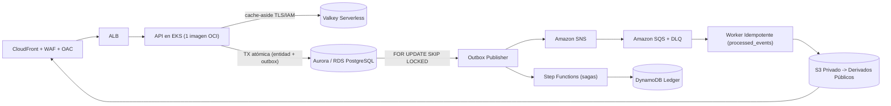

# Fundación De Plataforma Cloud En AWS

Establece la arquitectura base de cuentas, redes, identidad federada, borde, mensajería resiliente, gobernanza IaC/FinOps y seguridad continua requerida para desplegar cargas empresariales de Vigilio en Amazon Web Services (**Nivel 3 `cloud-aws-gitops`** de [Arquitecturas de Referencia por Escala](../architecture/reference-topologies.md)).

## Topología De Cuentas Y Redes

Para minimizar el radio de impacto y garantizar aislamiento contable y de seguridad, se implementa una arquitectura multicuenta mediante AWS Organizations:

```text
AWS Organizations (Root)
├── Security OU (Log Archive, Security Hub CSPM, GuardDuty, Inspector, Macie)
├── Core OU (Network Hub, Transit Gateway, Shared Services)
└── Workloads OU
    ├── Development Account (VPC Dev, 3 AZs)
    ├── Staging Account (VPC Staging, 3 AZs)
    └── Production Account (VPC Prod, 3 AZs Multi-Region Ready)
```

### Diseño De Subredes Por AZ

Cada VPC se segmenta en tres zonas de disponibilidad (AZ) con tres niveles de subredes estrictamente segregados:
1. **Subredes Públicas:** Alojan exclusivamente Load Balancers (ALB / NLB) y NAT Gateways de salida controlada hacia Internet.
2. **Subredes Privadas de Aplicación:** Alojan nodos de EKS, servicios stateless, publicadores outbox y workers sin IPs públicas asignadas.
3. **Subredes Aisladas de Datos:** Alojan clústeres Aurora/RDS PostgreSQL, instancias Valkey Serverless y endpoints privados (VPC Endpoints PrivateLink para S3, DynamoDB, SQS, SNS, ECR, Secrets Manager, KMS) sin ruta hacia Internet.

## Identidad Federada, Borde Y Cero Claves Estáticas

- **Federación OIDC para CI/CD:** Los pipelines de GitHub Actions y GitLab CI se autentican mediante tokens OIDC temporales vinculados a roles IAM con mínimos privilegios. Queda estrictamente prohibida la creación de usuarios IAM estáticos con access keys.
- **EKS Pod Identity / IRSA por Rol de Proceso:** Los pods obtienen permisos mínimos diferenciados por rol (`api`, `outbox`, `worker`) mediante ServiceAccounts dedicadas, eliminando credenciales dentro de contenedores.
- **Autenticación de Clientes con PKCE:** Los frontends públicos autentican usuarios contra un proveedor OIDC gestionado (`Amazon Cognito` o `Microsoft Entra ID`) con flujo `Authorization Code + PKCE`, cliente público sin secret y tokens mantenidos únicamente en memoria volátil.
- **Borde CloudFront + OAC + WAF y Uploads Privados:** En `staging` y `production` se exige dominio propio con certificado ACM (`TLS 1.3` / política moderna), WAF activo y Origin Access Control (`OAC`). Los archivos originales subidos por usuarios permanecen en un bucket S3 privado; el worker escanea, procesa y publica únicamente derivados sanitizados (ej. `WebP` bajo `processed/public/*`).
- **Cifrado KMS CMK Obligatorio:** Todos los datos en reposo (EBS, S3, Aurora/RDS, SQS, SNS, DynamoDB, Secretos) se cifran con claves KMS administradas por el cliente (Customer Managed Keys) con rotación automática anual activada.

## Arquitectura De Datos, Outbox Y Mensajería Resiliente En AWS



1. **Consistencia Transaccional + Outbox:** Las escrituras confirman el cambio de negocio y el evento en la tabla `outbox` dentro de la misma transacción PostgreSQL (usando bloqueos ordenados y aritmética monetaria exacta sin coma flotante). Varios publicadores escalan sin duplicar lectura mediante `FOR UPDATE SKIP LOCKED`.
2. **Entrega Al-Menos-Una-Vez + Idempotencia:** `SNS -> SQS` absorbe picos y desvía mensajes fallidos tras reintentos a una `DLQ` con procedimiento probado de redrive; la tabla `processed_events` convierte entregas duplicadas en `no-op` seguro. Para flujos multi-paso con compensación se emplea `Step Functions` respaldado por un ledger en `DynamoDB`.
3. **Degradación Elegante de Caché:** Las lecturas de alto tráfico emplean `Valkey` en patrón cache-aside con invalidación por generación; una caída del caché degrada de forma controlada a PostgreSQL sin indisponibilidad del endpoint.
4. **Cero Carpeta `contracts/`:** Los contratos Zod 4 y DTOs permanecen dentro de cada módulo de dominio con verificación de compatibilidad OpenAPI diff en CI; la infraestructura se mantiene unificada en Terraform sin mezclar stacks CDK paralelos no gobernados.

## Gobernanza IaC, FinOps Y Seguridad Continua

1. **Gates Obligatorios de Terraform antes de Plan/Apply:**
   - Backend remoto S3 con `use_lockfile = true` y estados separados por entorno (`development`, `staging`, `production`).
   - `terraform fmt -check`, `terraform validate`, contratos nativos `terraform test`, escaneo estático Trivy IaC / Checkov (`0` hallazgos `HIGH`/`CRITICAL`), políticas Conftest/OPA y control de impacto presupuestario con **`Infracost`** en cada Pull Request.
2. **Detección y Respuesta Continua (CSPM):**
   - `AWS CloudTrail` multi-región con validación criptográfica de logs, `AWS Config`, `Security Hub CSPM`, `Amazon Inspector` y `Amazon Macie` activos; los hallazgos `HIGH`/`CRITICAL` se enrutan automáticamente vía `EventBridge` hacia el canal de alertas operativas.
3. **Observabilidad Unificada:** Recolección mediante `AWS Distro for OpenTelemetry (ADOT)` / OTel Collector hacia `X-Ray` y el stack `Prometheus / Loki / Tempo / Grafana` sin PII en atributos ni métricas.
4. **Emulación Local Ligera sin Credenciales Reales:** Para pruebas integradas de S3/SNS/SQS/DLQ en estación de trabajo o CI sin acceso cloud se emplea **Floci** (compatible con slices AWS y Azure en puertos aislados), prohibiendo estrictamente claves `AKIA...` reales.

## Prerrequisitos De Ejecución

1. Cuenta AWS aprovisionada dentro de la OU correspondiente mediante Control Tower o Terraform Account Factory.
2. Terraform CLI fijado según `versions.yaml` y backend remoto S3 con bloqueo activo.
3. Proveedor OIDC configurado en AWS IAM para los repositorios autorizados y entrega en EKS gobernada por Argo CD (sin `kubectl` directo desde CI).
4. Políticas de Control de Servicios (SCPs) aplicadas en la raíz para impedir el desmantelamiento de GuardDuty, Security Hub, CloudTrail y VPC Flow Logs.

## Matriz De Decisiones De Arquitectura AWS

| Criterio | Subredes Públicas | Subredes Privadas (App) | Subredes Aisladas (Data) |
|---|---|---|---|
| Asignación de IP Pública | Restringida (ALB / NAT) | Prohibida | Prohibida |
| Ruteo a Internet por defecto | Internet Gateway (`igw`) | NAT Gateway (`nat-gw`) | Ninguno (Sin salida) |
| Acceso a APIs de AWS | Vía Internet pública | Vía NAT o VPC Endpoints | Exclusivo vía VPC Endpoints (PrivateLink) |
| Cargas de trabajo alojadas | ALB, NLB | Nodos EKS (API, Outbox, Worker) | Aurora/RDS PostgreSQL, Valkey Serverless |

## Pruebas Negativas Y Detección De Fallos

- **Verificación de Inaccesibilidad Pública de Datos:** Prueba automatizada de resolución y conexión TCP a endpoints de Aurora/Valkey desde fuera de la VPC; debe fallar con timeout de red.
- **Bloqueo de Tráfico sin VPC Endpoint:** En subredes aisladas de datos, cualquier conexión hacia endpoints públicos de AWS debe fallar al carecer de ruta a NAT Gateway.
- **Idempotencia y Concurrencia Real:** Prueba integrada con dos transacciones concurrentes sobre el mismo inventario en PostgreSQL y entrega duplicada del mismo mensaje SQS verificando cero sobreventa y procesamiento único.
- **Detección de Violaciones IAM:** Alertas automáticas ante llamadas `CreateAccessKey` en cuentas productivas con revocación inmediata.

## Procedimiento De Rollback Y Recuperación

1. **Rollback de Aplicación vs. Infraestructura:** Los fallos de versión de aplicación se revierten instantáneamente mediante Argo Rollouts / revert del digest OCI en GitOps sin tocar Terraform; los cambios de red o datos respetan estrategias expand-contract y nunca destruyen VPCs o bases con dependencias activas.
2. **Redrive de DLQ y Restore Drill:** Antes de certificar producción se ejecuta un ejercicio documentado de reprocesamiento controlado desde `DLQ` y un restore drill PITR de RDS/Aurora en instancia aislada midiendo RPO/RTO.
3. **Rotación de Emergencia de Roles OIDC:** En caso de compromiso de un pipeline, actualizar la condición `sub` de la política de confianza IAM y revocar sesiones activas inmediatamente.

## Evidencia Requerida Para Gates

- Escaneo IaC (Trivy / Checkov / Conftest) con `0` hallazgos `HIGH`/`CRITICAL` y reporte `Infracost` aprobado.
- Estado `ACTIVE` verificable en CloudTrail multi-región, Security Hub y VPC Flow Logs; `publicly_accessible = false` en toda base de datos.
- Evidencia diferenciada entre validaciones estáticas/locales (`PASS`) y planes autenticados cloud pendientes de credenciales (`BLOCKED` / `NOT_RUN`, jamás reportados como `PASS`).

## ✅ Correcto / ❌ Incorrecto

- ✅ **Correcto:** Enrutar el tráfico interno mediante VPC Endpoints (PrivateLink), usar Pod Identity/IRSA por proceso, mantener originales S3 privados detrás de CloudFront OAC + WAF y garantizar entrega confiable con `Outbox -> SNS -> SQS + DLQ`.
- ❌ **Incorrecto:** Desplegar bases RDS con `publicly_accessible = true`, usar IAM access keys estáticas, exponer buckets de uploads crudos al público o duplicar infraestructura entre Terraform y CDK sin ADR.
- ✅ **Correcto:** Cifrar EBS, S3, Aurora, SQS y DynamoDB con claves KMS CMK con rotación anual y validar costos con `Infracost` antes de aplicar cambios.
- ❌ **Incorrecto:** Usar claves por defecto sin auditoría o declarar una arquitectura cloud lista para producción sin haber probado rollback, redrive de DLQ y restore drill PITR.
