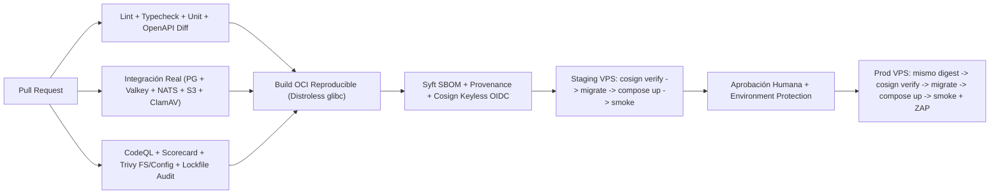

# Entrega Cloud-Neutral Con Docker Y Podman Compose (Proyectos Simples A Medianos)

Define la arquitectura normativa de **Nivel 1 (`compose-vps`)** para proyectos simples a medianos que operan sobre 1 a 3 servidores Linux (VPS o dedicados) utilizando **Docker Compose o Rootless Podman Compose**, sin introducir Kubernetes, Helm, Argo CD ni bloqueo con un proveedor de nube específico.

> **Relación con otras topologías:** consultar [Arquitecturas de Referencia por Escala](../architecture/reference-topologies.md) para los disparadores con ADR hacia Kubernetes GitOps On-Prem o AWS EKS.

## Fronteras De Los 5 Repositorios (Sin Monorepo Raíz Ni `contracts/`)

El entorno de trabajo agrupa cinco repositorios Git con historiales, lockfiles y permisos separados. La carpeta raíz actúa únicamente como coordinador local (sin `package.json` ni `pnpm-workspace.yaml`):

```text
workspace-checkout/               # Coordinador local (PROHIBIDO package.json o contracts/ en raíz)
├── apps/
│   ├── <product>-impl/           # 1. Monolito modular backend (1 imagen OCI -> 5 entrypoints)
│   └── <product>-web/            # 2. Frontend independiente + Containerfile.runtime sin secretos
├── <product>-deploy/             # 3. Runtime declarativo: 1 solo compose.yaml + Caddy + Observabilidad
├── platform-ops/                 # 4. Ansible reutilizable y agnóstico al producto (Rootless Podman)
└── prod-local/                   # 5. Orquestador local que reutiliza <product>-deploy/compose/compose.yaml
```

### Reglas De Separación De Responsabilidades
1. **Reutilizable vs. Específico del Producto:** `platform-ops` (preparación de hosts Linux, `subuid/subgid`, `linger`, firewall, timers systemd y Podman rootless validados con `meta/argument_specs.yml`) y los workflows compartidos de CI son **100% agnósticos al negocio**: jamás contienen nombres de productos, dominios ni reglas de alertas de negocio.
2. **Observabilidad Co-Versionada en `<product>-deploy`:** Las configuraciones de OpenTelemetry Collector, Prometheus, Alertmanager, Grafana, Alloy, Loki, Tempo y Blackbox viven en `<product>-deploy/observability/` porque los dashboards, umbrales y alertas evolucionan acoplados a los SLOs del producto.
3. **Cero Carpeta `contracts/`:** Dentro de `<product>-impl`, los schemas Zod 4 y DTOs viven exclusivamente dentro de cada módulo de dominio (`domain/schemas/` y `presentation/http/dto/`), validando compatibilidad con OpenAPI diff en CI según [Contratos HTTP en DTOs](../../standards/api/http-dtos-and-contracts.md). Ambos repositorios de aplicación aplican endurecimiento supply-chain en `pnpm-workspace.yaml` con `packages: []`.

---

## Un Único `compose.yaml` Endurecido Para Staging Y Producción

Queda prohibido mantener copias divergentes (`docker-compose.staging.yml`, `docker-compose.prod.yml`). Un **único archivo declarativo** gobierna ambos entornos inyectando diferencias mediante `ENV_FILE` y referencias inmutables de imagen:

```yaml
name: ${COMPOSE_PROJECT_NAME:-app}

x-backend: &backend
  image: ${REGISTRY_HOST:?set REGISTRY_HOST}/${REGISTRY_NAMESPACE:?set REGISTRY_NAMESPACE}/app-impl@${IMAGE_DIGEST:?use an immutable sha256 digest}
  env_file: ${ENV_FILE:-.env.production}
  restart: unless-stopped
  networks: [backend]
  depends_on:
    postgres: { condition: service_healthy }
    nats: { condition: service_healthy }
    valkey: { condition: service_healthy }
  security_opt: [no-new-privileges:true]
  cap_drop: [ALL]
  read_only: true
  tmpfs: ["/tmp:size=64m,noexec,nosuid"]
  logging:
    driver: journald
    options:
      tag: "{{.Name}}"

services:
  caddy:
    image: caddy:2.11.7-alpine
    ports:
      - "${CADDY_BIND_ADDRESS:-0.0.0.0}:80:80"
      - "${CADDY_BIND_ADDRESS:-0.0.0.0}:443:443"
      - "${CADDY_BIND_ADDRESS:-0.0.0.0}:443:443/udp"
    volumes:
      - ./Caddyfile:/etc/caddy/Caddyfile:ro
      - caddy-data:/data
      - caddy-config:/config
    networks: [edge, backend, observability]
    restart: unless-stopped
    security_opt: [no-new-privileges:true]
    cap_drop: [ALL]
    cap_add: [NET_BIND_SERVICE]

  web:
    image: ${REGISTRY_HOST:?set REGISTRY_HOST}/${REGISTRY_NAMESPACE:?set REGISTRY_NAMESPACE}/app-web@${WEB_IMAGE_DIGEST:?use an immutable sha256 digest}
    env_file: ${ENV_FILE:-.env.production}
    networks: [edge]
    restart: unless-stopped
    read_only: true
    tmpfs: ["/tmp:size=16m,noexec,nosuid"]
    security_opt: [no-new-privileges:true]
    cap_drop: [ALL]

  api:
    <<: *backend
    networks: [edge, backend, observability]

  outbox:
    <<: *backend
    command: ["dist/src/outbox.main.js"]
    networks: [backend, observability]

  worker:
    <<: *backend
    command: ["dist/src/worker.main.js"]
    networks: [backend, observability]

  migration:
    <<: *backend
    command: ["dist/src/database/migrate.js"]
    restart: "no"
    profiles: [tools]
```

### Controles Obligatorios En Runtime Compose
- **Segmentación de redes:** `edge` (solo Caddy, web y API), `backend` (datos, colas y procesos internos sin exposición pública) y `observability` (telemetría interna). Ningún puerto de PostgreSQL, Valkey, NATS o almacenamiento S3 compatible se publica en `0.0.0.0`.
- **Separación de migraciones:** `migration` y `platform-setup` se ejecutan bajo `profiles: [tools]` con `restart: "no"` **antes** de actualizar las réplicas de `api`, `outbox` y `worker`, nunca dentro del arranque normal del servidor HTTP.
- **Compilación frontend sin secretos (`Containerfile.runtime`):** La imagen web parte de `gcr.io/distroless/nodejs24-debian13:nonroot` (`USER 65532:65532`) y recibe únicamente los artefactos estáticos ya compilados (`dist/`) más el servidor mínimo de runtime.

---

## Flujo DevSecOps Completo Sin Kubernetes



1. **Verificación Estática de Configuración Multi-Entorno:** En cada PR y gate local se valida la interpolación de `staging` y `production` sin necesitar acceso a los servidores (`podman compose --env-file environments/staging.env.example -f compose/compose.yaml config --quiet`).
2. **Promoción Inmutable:** Producción jamás reconstruye código fuente; verifica con `cosign verify` la misma firma OIDC y despliega exactamente el mismo digest validado en `staging`.
3. **Secretos Fuera de Git y de las Capas OCI:** Las credenciales residen únicamente en GitHub/GitLab Protected Environments y en el archivo `.env.<ambiente>` con permisos `0600` del usuario rootless en el host.

---

## Escalabilidad Gradual Y Recuperación Ante Desastres (3-2-1)

### 1. Backups Reales Vs. Persistencia Local
- Un volumen de Compose o un segundo contenedor en el mismo disco **no es un backup** (comparten el mismo dominio de fallo ante pérdida del host, corrupción lógica o ransomware).
- **Estándar PostgreSQL:** Configurar `pgBackRest` con base backup periódico + archivo continuo de WAL (PITR) cifrado hacia un repositorio S3-compatible ubicado en un **host o proveedor independiente**, acompañado de un **restore drill semanal automatizado** en una instancia aislada sin salida a integraciones reales.

### 2. Secuencia De Escalamiento Antes De Evaluar Kubernetes
Escalar por cuellos de botella medidos, no por intuición:
1. **Optimización de base de datos:** Índices validados con `EXPLAIN (ANALYZE, BUFFERS)`, autovacuum y control de transacciones largas.
2. **Presupuesto de conexiones:** Introducir `PgBouncer` cuando el número de procesos (`api` + `worker` + `outbox`) sature conexiones PostgreSQL antes que CPU.
3. **Escalado horizontal stateless:** Añadir un segundo nodo de aplicación detrás de balanceador DNS/L4 manteniendo datos separados del contenedor efímero; `outbox` escala de forma segura gracias a `FOR UPDATE SKIP LOCKED` y `worker` escala según la edad/volumen del backlog con idempotencia en `processed_events`.
4. **Alta disponibilidad de estado:** Hot standby PostgreSQL en host distinto con streaming WAL, NATS JetStream con factor de réplica `R3` en 3 nodos y almacenamiento de objetos multi-nodo (`MNMD`) solo cuando el RTO/RPO del negocio no pueda cumplirse mediante restauración PITR.

## ✅ Correcto / ❌ Incorrecto

- ✅ **Correcto:** Operar un único `compose.yaml` endurecido (`read_only: true`, `cap_drop: [ALL]`, non-root) compartido entre `staging`, `production` y `prod-local`, promoviendo el mismo digest OCI firmado.
- ❌ **Incorrecto:** Duplicar archivos Compose por ambiente, ejecutar migraciones automáticamente en cada arranque de contenedor HTTP o exponer puertos de bases de datos al exterior del VPS.
- ✅ **Correcto:** Mantener `platform-ops` (Ansible) libre de nombres de aplicaciones y ejecutar simulacros periódicos de restauración `pgBackRest` PITR fuera del servidor productivo.
- ❌ **Incorrecto:** Confiar en `restart: unless-stopped` o en volúmenes locales como plan de recuperación ante desastres, o migrar a Kubernetes sin cumplir los disparadores de [Arquitecturas de Referencia por Escala](../architecture/reference-topologies.md).
