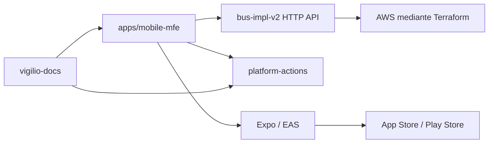

# Documentación Arquitectónica Frontend Mobile MFE 2026

> **Compatibilidad y precedencia (2026-10-25):** el texto que sigue conserva el baseline **histórico** Expo SDK 56 de la plantilla materializada. **La release estable pública es Expo SDK 58** (RN 0.88 y React 19.3.0); NO se ha demostrado que `apps/mobile-mfe` haya migrado. Leer [guía propietaria Expo](../../../technology/libraries/expo.md) y [versiones centrales](../../../technology/versions.md); ejecutar `expo install --check`, Expo Doctor, builds EAS y pruebas nativas antes de cambiar el baseline del consumidor.

Guía canónica para aplicaciones móviles con Expo SDK 56, React Native 0.85, React 19.2, Expo
Router, NativeWind 4, TanStack Query 5, Preact Signals, React Hook Form, Zod, Jest y Maestro.
`apps/mobile-mfe` es la referencia ejecutable; esta sección define las decisiones que deben
mantenerse al crear una aplicación real.

## Fuentes de verdad

1. Contratos HTTP y OpenAPI publicados por el backend.
2. Código y pruebas de la aplicación consumidora.
3. Workflows reutilizables fijados a SHA en `platform-actions`.
4. ADR, threat model y estas guías.

Una captura, un diagrama o una afirmación de “producción” no reemplaza evidencia ejecutable.

## Qué significa MFE en mobile

`mobile-mfe` describe una plantilla modular por dominios y ownership. No implica Module Federation
en runtime ni descargar JavaScript arbitrario desde otros equipos. Una sola app nativa mantiene un
shell, navegación y binario firmados; las features se aíslan mediante APIs públicas, contratos y
límites de dependencia. Un super-app con módulos nativos separados necesita un ADR específico.

## Relación entre proyectos

Terraform, Kubernetes, S3, colas y bases de datos pertenecen a backend/plataforma. La app consume
contratos; no contiene credenciales cloud ni administra infraestructura.

## Índice canónico

1. [Contratos, Zod, formularios y TanStack](contracts/1-contratos-zod-formularios-tanstack.md)
2. [Skills, agentes, OpenSpec y DevSecOps](governance/2-skills-agentes-openspec-devsecops.md)
3. [Arquitectura, estructura, estado y navegación](architecture/3-arquitectura-estructura-estado-navegacion.md)
4. [Flujo local, entornos y runtime config](runtime/4-flujo-local-entornos-runtime-config.md)
5. [HTTP, autenticación, deep links y uploads](http/5-http-auth-deep-links-uploads.md)
6. [Golden path de una feature mobile](features/6-golden-path-feature-mobile.md)
7. [Testing con Jest, RNTL y Maestro](testing/7-testing-jest-rntl-maestro.md)
8. [Accesibilidad, rendimiento y calidad nativa](quality/8-accesibilidad-rendimiento-calidad.md)
9. [Seguridad, hardening y privacidad](security/9-seguridad-hardening-privacidad.md)
10. [Observabilidad mobile, SLI y SLO](observability/10-observabilidad-mobile-sli-slo.md)
11. [Tooling, pnpm, Biome y supply chain](quality/11-tooling-pnpm-biome-supply-chain.md)
12. [DevSecOps, CI/CD y GitHub](delivery/12-devsecops-cicd-github.md)
13. [EAS, tiendas, OTA y FinOps](delivery/13-eas-stores-ota-finops.md)
14. [Gobierno, releases y ownership](governance/14-gobierno-releases-ownership.md)
15. [Evaluación, roadmap y operación](governance/15-evaluacion-roadmap-operacion.md)
16. [Design system, NativeWind y tokens](ui/16-design-system-nativewind-tokens.md)
17. [Scaffold de una aplicación mobile](features/17-scaffold-app-feature.md)

## Owners

- Mobile Platform: toolchain, Expo/EAS, navegación raíz y observabilidad.
- Feature teams: dominio, UX, contratos, pruebas y runbook de su feature.
- Backend: compatibilidad de contratos, auth y políticas de upload.
- Security/SRE: controles, privacidad, SLO y respuesta a incidentes.

## Regla principal

Una plantilla local puede demostrar ingeniería, pero solo se declara operativa después de compilar
binarios firmados, ejecutar recorridos Maestro en dispositivos representativos, comprobar telemetría
y ensayar rollback de build/OTA con evidencia.

## ✅ Correcto / ❌ Incorrecto: revisión 2026

- ✅ **Correcto:** Validar deep links y permisos, controlar secretos, estados offline, accesibilidad y pruebas en dispositivos.
- ❌ **Incorrecto:** Guardar secretos permanentes sin protección, depender sólo del happy path o ignorar permisos/OTA por ambiente.
- **Al recibir código existente:** primero caracterizar el comportamiento, después refactorizar en pasos comprobables. [Guía canónica de modernización](../../../standards/engineering/refactoring-existing-code.md).
## Identidad y alcance del stack

**Mobile MFE** es el nombre histórico del proyecto móvil modular basado en Expo/React Native. No implica microfrontends web cargados dinámicamente, ni actualización nativa independiente de cada módulo; EAS OTA respeta límites del runtime nativo.

- Cada documento completo se ha **trasladado íntegramente** bajo una carpeta de responsabilidad; no se sustituyó por resúmenes.
- DDD, seguridad, testing y DevSecOps universales viven en `foundations/` y `standards/`; aquí solo vive el código específico de este stack.
- Versiones y compatibilidad: [registro único](../../../technology/versions.md). No repetir valores de versión en guías operativas.

| Tema | Guía completa |
|---|---|
| Arquitectura | [Arquitectura](architecture/3-arquitectura-estructura-estado-navegacion.md) |
| Contratos | [Contratos](contracts/1-contratos-zod-formularios-tanstack.md) |
| Feature | [Feature](features/6-golden-path-feature-mobile.md) |
| Testing | [Testing](testing/7-testing-jest-rntl-maestro.md) |
| Seguridad | [Seguridad](security/9-seguridad-hardening-privacidad.md) |

✅ Correcto: respetar stack, toolchain, contratos y pruebas propios.

❌ Incorrecto: tratar Expo como microfrontend web, instalar dependencias sin compatibilidad o duplicar políticas transversales.

## Cobertura completa y navegación por escenario

- [Matriz aplicable de prácticas, riesgos y aceptación](testing/e2e-maestro.md) — seleccionar todas las pertinentes; una guía breve o un índice no equivalen a una implementación terminada.

✅ Correcto: seguir el estándar y registrar evidencia. ❌ Incorrecto: detenerse en los primeros tres ejemplos.

## Dependencias versionadas del stack

No duplicar aquí APIs externas; cuando se use una librería, abrir su documentación canónica:

- [expo](../../../technology/libraries/expo.md)
- [react-native](../../../technology/libraries/react-native.md)
- [expo-router](../../../technology/libraries/expo-router.md)
- [expo-image-picker](../../../technology/libraries/expo-image-picker.md)
- [expo-file-system](../../../technology/libraries/expo-file-system.md)
- [expo-secure-store](../../../technology/libraries/expo-secure-store.md)

✅ Correcto: comprobar compatibilidad real con runtime y lockfile. ❌ Incorrecto: copiar snippets legacy de un framework distinto.
