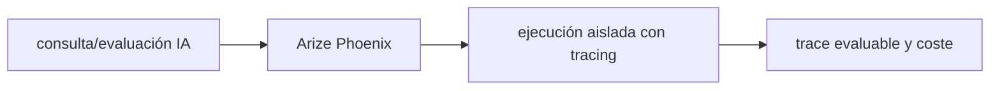

# Arize Phoenix — Vigilio línea compatible OpenTelemetry/LLM SDK

## Qué es, qué hace y cuándo usarla

Plataforma abierta para inspeccionar trazas, evaluaciones y calidad de aplicaciones LLM/RAG. Se integra en observabilidad de IA, no reemplaza el control de acceso a los datos.

**Ubicación en Vigilio:** usa esta dependencia en su stack propietario; otras skills deben enlazar esta guía, no duplicar sus reglas. **Versión:** la indicada en el encabezado es la línea documentada; consultar `technology/versions.md` y el lockfile antes de copiar APIs o aprobar un upgrade.

> **Guía propia de Arize Phoenix (ai).** Estado a **2026-10-25**: línea compatible OpenTelemetry/LLM SDK. Versión del proyecto consumidor = `pnpm-lock.yaml` / `composer.lock` / imagen o manifest. Fuente: [documentación oficial](https://docs.arize.com/phoenix). Fuente normativa transversal de versiones: [versions.md](../versions.md). **No implica instalación automática ni upgrade aprobado.**

## Objetivo, responsabilidad y dónde usar

Eval dataset, tracing y regression tests; no datos sensibles crudos.

**Uso:** aplicar solo si está declarada y resulta pertinente al consumidor; ver [política de adopción y DRY](README.md).

### Diagrama de integración (Mermaid)



El flujo muestra la **responsabilidad arquitectónica** de la librería; no representa llamadas reales de red para todas las operaciones.


## Instalación o verificación

```bash
usar quickstart oficial por SDK
```

**Gate de instalación:** consultar [procedimiento compartido](README.md#protocolo-de-adopción-y-actualización); estos comandos son indicativos, no ejecuciones sobre un consumidor.

## ✅ Correcto — uso actual y ejemplo de referencia

**Nota técnica (no es código ejecutable):** Spans OpenInference para retrieve/rerank/generate, correlacionar modelo/version, prompt, resultados y calidad.

**Por qué:** Eval dataset, tracing y regression tests; no datos sensibles crudos.

## ❌ Incorrecto — patrón legacy, inseguro o mal ubicado

**Nota técnica (no es código ejecutable):** ❌ evaluar RAG solo por latencia sin recall/factualidad.

**Riesgo:** confundir versiones o responsabilidades y obtener un contrato incorrecto.

## Nuevas capacidades, migración y breaking changes

Versionar instrumentación OpenInference/OTEL, compat framework y collector.

Aplicar el [protocolo de migración común](README.md#protocolo-de-adopción-y-actualización), sin asumir que una release nueva está desplegada.

## Buenas prácticas, seguridad, rendimiento y operación

Consultar la [política transversal de librerías](README.md) para seguridad, versionado, evidencia y revisión de contratos. Para esta librería, además, aplicar las verificaciones concretas que se detallan a continuación.

## Gates de aceptación y compatibilidad

Recall@k, hallucination detection, PII, costo y latencia.

Estado de prueba de estos ejemplos documentales: **NOT_RUN** en aplicaciones consumidoras; ver [criterios de evidencia](README.md#criterios-de-validación).


## Referencias

- [Documentación oficial y migración de Arize Phoenix](https://docs.arize.com/phoenix)
- [Matriz y baseline de versiones](../versions.md)
- [Calidad de código canónica](../../foundations/engineering/code-quality.md)


## Recetario operativo ampliado — arize-phoenix (2026-10-25)

### API actual: dos tareas reales que debe saber ejecutar una skill

1. **Envolver ejecución LLM en spans OpenTelemetry y asociar session_id en atributo de span, no en métrica.**
2. **Evaluar traces para datasets de RAG con feedback independiente de las trazas y costo por request.**

### Migración desde versiones anteriores: decisión concreta

- **Qué cambia o se debe revisar:** SDK/OTel versionados juntos; no asumir esquema de span fijo en versiones distintas.

### Responsabilidades y capas

Observabilidad IA: evaluación y traces; no ejecutar inferencia ni elegir embeddings aquí.

**✅ Correcto:** mantener la integración encapsulada, alinear los nombres del negocio con Vigilio y depender de un contrato estable.

**❌ Incorrecto:** importar internals de la librería desde Domain, declarar `any` para resolver un upgrade, o duplicar reglas ya propietarias de otra tecnología.

### Seguridad, resiliencia y rendimiento

- Trazas pueden contener prompts, PII y documentos: redacción, RBAC, retención y sampling.

### Test de aceptación específico y evidencia mínima

- **Escenario comprobable:** Generar trace de retrieval→generation con correlation ID y comprobar redacción/atributos sin secretos.


## Guía operativa detallada — 8 casos y 4 antipatrones

### Ocho ejemplos de la API y casos de uso relevantes

Los fragmentos siguientes ilustran **operaciones independientes**. Variables, imports, provider, extensión y configuración se completan en el proyecto consumidor; **no están certificados como un archivo único compilable**. Cuando hay comentarios `#`, son pasos de integración o configuración y no APIs inventadas.

#### Ejemplo 1. Despliegue local

**✅ Correcto — despliegue local**

```typescript
docker run -p 6006:6006 arizephoenix/phoenix:latest
```


#### Ejemplo 2. Exportador OTLP

**✅ Correcto — exportador otlp**

```typescript
export OTEL_EXPORTER_OTLP_ENDPOINT=http://localhost:6006
```


#### Ejemplo 3. SDK tracing

**✅ Correcto — sdk tracing**

```typescript
from phoenix.otel import register
```


#### Ejemplo 4. Registrar instrumentación

**✅ Correcto — registrar instrumentación**

```typescript
tracer_provider = register(project_name="vigilio-rag")
```


#### Ejemplo 5. Span del retrieval

**✅ Correcto — span del retrieval**

```typescript
with tracer.start_as_current_span("rag.retrieve"): retrieve(query)
```


#### Ejemplo 6. Atributos discretos

**✅ Correcto — atributos discretos**

```typescript
span.set_attribute("rag.stage", "retrieval")
```


#### Ejemplo 7. Evaluar calidad

**✅ Correcto — evaluar calidad**

**Nota técnica (no es código ejecutable):** Evaluar respuestas contra dataset etiquetado; guardar puntuación separada del span.


#### Ejemplo 8. Revisar proyecto

**✅ Correcto — revisar proyecto**

**Nota técnica (no es código ejecutable):** UI Phoenix: proyecto -> traces -> filtro latency/errors; restringir acceso.


### Cuatro antipatrones frecuentes y su sustitución

#### Antipatrón 1 — riesgo y alternativa

**❌ Incorrecto**

```typescript
trace.set_attribute("user.email", email)
```

**Por qué está mal:** El patrón «trace.set_attribute("user.email", email)» es riesgoso: la telemetría puede perder trazabilidad, crecer en cardinalidad o filtrar valores sensibles.

**✅ Correcto**

```typescript
span.set_attribute("user.scope", "authenticated")
```

**Por qué mejora:** El patrón «span.set_attribute("user.scope", "authenticated")» mejora el caso: la observabilidad conserva contexto útil sin usar identificadores sensibles como etiquetas masivas.

#### Antipatrón 2 — riesgo y alternativa

**❌ Incorrecto — Guardar prompt completo con PII.**

**Por qué está mal:** El patrón «Guardar prompt completo con PII» es riesgoso: los secretos o datos privados quedan expuestos en código, logs o artefactos de despliegue.

**✅ Correcto — Redactar atributos antes de exportar.**

**Por qué mejora:** El patrón «Redactar atributos antes de exportar» mejora el caso: las credenciales quedan fuera del código o bajo un mecanismo de acceso controlado.

#### Antipatrón 3 — riesgo y alternativa

**❌ Incorrecto — Trace id como label de métrica.**

**Por qué está mal:** El patrón «Trace id como label de métrica» es riesgoso: la telemetría puede perder trazabilidad, crecer en cardinalidad o filtrar valores sensibles.

**✅ Correcto — Trace id solo en span/log correlacionado.**

**Por qué mejora:** El patrón «Trace id solo en span/log correlacionado» mejora el caso: la observabilidad conserva contexto útil sin usar identificadores sensibles como etiquetas masivas.

#### Antipatrón 4 — riesgo y alternativa

**❌ Incorrecto — Habilitar UI pública sin auth.**

**Por qué está mal:** Omite un control operativo necesario, por lo que el comportamiento puede ser inseguro o difícil de verificar.

**✅ Correcto — Limitar acceso por RBAC/red.**

**Por qué mejora:** El patrón «Limitar acceso por RBAC/red» mejora el caso: se fuerza autorización en el borde/servidor y se limita el acceso por recurso.

### Versión estable, breaking changes y verificación

- **Versión estable exacta:** no se declara un parche universal cuando no hay verificación específica de su registry/release. Consultar el encabezado de esta guía, `technology/versions.md` y el manifiesto del servicio. **Estado de patch: VERIFY_LOCKFILE**.
- **Migración:** identificar major anterior, APIs retiradas/cambiadas, peer dependencies, requisitos de runtime, cambios de tipos, ejecución CI y plan de rollback. Si no hay prueba sobre el consumidor, **NOT_RUN**, no PASS.
- **Versiones previas:** el ejemplo marcado ❌ en esta guía explica al menos una incompatibilidad o un uso obsoleto; no trasplantar APIs de otras versiones.
- **Tests:** probar al menos happy path, error, seguridad/permiso y compatibilidad con el runtime donde aplique; solo activar nuevas capacidades mediante una PR versionada.

### Fuentes oficiales y referencias al final

- [Referencia propia oficial](https://docs.arize.com/phoenix)
- [Matriz canónica de versiones](../versions.md)
- [Política de adopción de librerías](README.md)

## Guía de compatibilidad y evaluación por versión (2026-10-25)

**Estado del patch exacto:** `VERIFY_LOCKFILE`. La guía documenta la familia de APIs; **no se ha verificado hoy el patch estable preciso de esta dependencia**. Consultar la fuente oficial enlazada al inicio y el lockfile antes de generar código o aprobar un upgrade.

### Checklist específico de esta librería

- **Migración/compatibilidad:** SDK/OTel versionados juntos; no asumir esquema de span fijo en versiones distintas.
- **Prueba propia:** Generar trace de retrieval→generation con correlation ID y comprobar redacción/atributos sin secretos.
- **Límite de responsabilidad:** usar esta librería solo en su adaptador o capa propietaria; consultar los ejemplos de API y antipatrones anteriores antes de cambiar llamadas públicas.

**Gate de aprobación:** leer la referencia oficial y resolver la versión del consumidor, ejecutar typecheck y pruebas específicas, registrar PASS/FAIL/NOT_RUN/BLOCKED. No confundir esta guía con validación de un consumidor real. [Procedimiento único de adopción](README.md#protocolo-de-adopción-y-actualización).

## Integración IA/RAG moderna — 2026

La comparación frente a Langfuse se decide por evaluación/operación real, no instalar dos sistemas de tracing por defecto. Ver [observabilidad IA](../../standards/ai/observabilidad-llm.md).

✅ **Correcto:** revisar API instalada/digest, seguridad y datos del consumidor. ❌ **Incorrecto:** copiar endpoint legacy o presentar pruebas documentales como compilación real.
