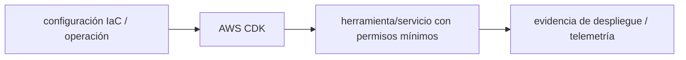

# AWS CDK — Vigilio v2 línea por lockfile

## Qué es, qué hace y cuándo usarla

Framework de infraestructura como código: define recursos AWS con TypeScript y sintetiza plantillas CloudFormation. El código vive en plataforma/IaC, nunca en el dominio NestJS o Laravel.

**Ubicación en Vigilio:** usa esta dependencia en su stack propietario; otras skills deben enlazar esta guía, no duplicar sus reglas. **Versión:** la indicada en el encabezado es la línea documentada; consultar `technology/versions.md` y el lockfile antes de copiar APIs o aprobar un upgrade.

> **Guía propia de AWS CDK (platform).** Estado a **2026-10-25**: v2 línea por lockfile. Versión del proyecto consumidor = `pnpm-lock.yaml` / `composer.lock` / imagen o manifest. Fuente: [documentación oficial](https://docs.aws.amazon.com/cdk/v2/guide/home.html). Fuente normativa transversal de versiones: [versions.md](../versions.md). **No implica instalación automática ni upgrade aprobado.**

## Objetivo, responsabilidad y dónde usar

Documentar AWS únicamente en platform/aws y platform/iac; frameworks enlazan.

**Uso:** aplicar solo si está declarada y resulta pertinente al consumidor; ver [política de adopción y DRY](README.md).

### Diagrama de integración (Mermaid)



El flujo muestra la **responsabilidad arquitectónica** de la librería; no representa llamadas reales de red para todas las operaciones.


## Instalación o verificación

```bash
pnpm add -D aws-cdk && pnpm add aws-cdk-lib constructs
```

**Gate de instalación:** consultar [procedimiento compartido](README.md#protocolo-de-adopción-y-actualización); estos comandos son indicativos, no ejecuciones sobre un consumidor.

## ✅ Correcto — uso actual y ejemplo de referencia

**Nota técnica (no es código ejecutable):** IaC seguro: mínimos permisos, tags, outputs explícitos cdk synth && cdk diff en CI antes de deploy.

**Por qué:** Documentar AWS únicamente en platform/aws y platform/iac; frameworks enlazan.

## ❌ Incorrecto — patrón legacy, inseguro o mal ubicado

**Nota técnica (no es código ejecutable):** ❌ despliegue directo sin diff ni roles OIDC por ambiente.

**Riesgo:** confundir versiones o responsabilidades y obtener un contrato incorrecto.

## Nuevas capacidades, migración y breaking changes

CDK v1→v2 centraliza aws-cdk-lib; constructs independiente. No usar paquetes @aws-cdk/aws-* v1 en nuevos stacks v2.

Aplicar el [protocolo de migración común](README.md#protocolo-de-adopción-y-actualización), sin asumir que una release nueva está desplegada.

## Buenas prácticas, seguridad, rendimiento y operación

Consultar la [política transversal de librerías](README.md) para seguridad, versionado, evidencia y revisión de contratos. Para esta librería, además, aplicar las verificaciones concretas que se detallan a continuación.

## Gates de aceptación y compatibilidad

cdk synth/diff, cfn-nag/checkov, policy-as-code, IAM least privilege, costo y drift.

Estado de prueba de estos ejemplos documentales: **NOT_RUN** en aplicaciones consumidoras; ver [criterios de evidencia](README.md#criterios-de-validación).


## Referencias

- [Documentación oficial y migración de AWS CDK](https://docs.aws.amazon.com/cdk/v2/guide/home.html)
- [Matriz y baseline de versiones](../versions.md)
- [Calidad de código canónica](../../foundations/engineering/code-quality.md)


## Recetario operativo ampliado — aws-cdk (2026-10-25)

### API actual: dos tareas reales que debe saber ejecutar una skill

1. **Definir stacks y constructs reutilizables; `cdk synth` antes de `cdk diff` y `cdk deploy`.**
2. **Usar context/parameters tipados, políticas IAM mínimas y aprobaciones para cambios destructivos.**

### Migración desde versiones anteriores: decisión concreta

- **Qué cambia o se debe revisar:** CDK v2: paquetes `aws-cdk-lib` y `constructs`, no paquetes `@aws-cdk/aws-*` de v1.

### Responsabilidades y capas

Plataforma AWS; el handler Nest/Laravel está en sus propias guías.

**✅ Correcto:** mantener la integración encapsulada, alinear los nombres del negocio con Vigilio y depender de un contrato estable.

**❌ Incorrecto:** importar internals de la librería desde Domain, declarar `any` para resolver un upgrade, o duplicar reglas ya propietarias de otra tecnología.

### Seguridad, resiliencia y rendimiento

- Changesets pueden eliminar DB/buckets: termination protection, snapshots y revisión IAM.

### Test de aceptación específico y evidencia mínima

- **Escenario comprobable:** Validar synth, assertions de template, cdk diff con roles temporales y drift posterior.


## Guía operativa detallada — 8 casos y 4 antipatrones

### Ocho ejemplos de la API y casos de uso relevantes

Los fragmentos siguientes ilustran **operaciones independientes**. Variables, imports, provider, extensión y configuración se completan en el proyecto consumidor; **no están certificados como un archivo único compilable**. Cuando hay comentarios `#`, son pasos de integración o configuración y no APIs inventadas.

#### Ejemplo 1. Iniciar TypeScript

**✅ Correcto — iniciar typescript**

```bash
npx cdk init app --language typescript
```


#### Ejemplo 2. Synth local

**✅ Correcto — synth local**

```bash
npx cdk synth
```


#### Ejemplo 3. Detectar cambios

**✅ Correcto — detectar cambios**

```bash
npx cdk diff --all
```


#### Ejemplo 4. Desplegar entorno

**✅ Correcto — desplegar entorno**

```bash
npx cdk deploy MyStack --require-approval broadening
```


#### Ejemplo 5. Bucket privado

**✅ Correcto — bucket privado**

```typescript
new s3.Bucket(this, 'Uploads', { blockPublicAccess: s3.BlockPublicAccess.BLOCK_ALL });
```


#### Ejemplo 6. Retención logs

**✅ Correcto — retención logs**

```typescript
new logs.LogGroup(this, 'ApiLogs', { retention: logs.RetentionDays.ONE_MONTH });
```


#### Ejemplo 7. Output ARN

**✅ Correcto — output arn**

```typescript
new cdk.CfnOutput(this, 'BucketName', { value: bucket.bucketName });
```


#### Ejemplo 8. Test template

**✅ Correcto — test template**

```typescript
Template.fromStack(stack).hasResourceProperties('AWS::S3::Bucket', {});
```


### Cuatro antipatrones frecuentes y su sustitución

#### Antipatrón 1 — riesgo y alternativa

**❌ Incorrecto**

```bash
npx cdk deploy --all # sin diff
```

**Por qué está mal:** Omite un control operativo necesario, por lo que el comportamiento puede ser inseguro o difícil de verificar.

**✅ Correcto**

```bash
npx cdk diff --all # y aprobación previa
```

**Por qué mejora:** `cdk diff` permite revisar reemplazos de recursos y ampliaciones de IAM; ejecutar después el despliegue con aprobación explícita, no automatizar un `deploy --all` indiscriminado.

#### Antipatrón 2 — riesgo y alternativa

**❌ Incorrecto**

```typescript
new s3.Bucket(this, "uploads", { publicReadAccess: true })
```

**Por qué está mal:** `publicReadAccess: true` hace que las cargas sean públicas; sin decisión de negocio y controles de acceso, se pueden filtrar archivos.

**✅ Correcto**

```typescript
new s3.Bucket(this, "uploads", { blockPublicAccess: s3.BlockPublicAccess.BLOCK_ALL })
```

**Por qué mejora:** `BLOCK_ALL` impide configuraciones de acceso público por ACL y policy. Completar con cifrado, TLS y autorización de aplicación.

#### Antipatrón 3 — riesgo y alternativa

**❌ Incorrecto — Secrets como string en construct.**

**Por qué está mal:** Expone credenciales o confunde autenticación con autorización; puede ocasionar filtración o acceso indebido.

**✅ Correcto — Referenciar Secrets Manager y usar `grantRead()` mediante IAM, sin valores secretos en `cdk synth`.**

**Por qué mejora:** El secreto se obtiene en runtime bajo permisos limitados; el valor no termina embebido en CloudFormation. Ver ejemplo TypeScript completo abajo.

#### Antipatrón 4 — riesgo y alternativa

**❌ Incorrecto — Borrar stateful resources sin snapshot.**

**Por qué está mal:** Puede destruir datos o recursos antes de verificar dependencias, recuperación y política de retención.

**✅ Correcto — Evaluar `RemovalPolicy.RETAIN` para buckets persistentes y `RemovalPolicy.SNAPSHOT` para RDS si el recurso lo soporta.**

**Por qué mejora:** Impide que la eliminación de un stack destruya datos en producción; hay que probar restauración, retención y costes de almacenamiento. Véanse los ejemplos TypeScript completos de abajo.

## Ejemplo integral de AWS CDK v2 — seguridad y ciclo de vida

**Qué resuelve:** desplegar un bucket de cargas privado, mantener su contenido ante la eliminación del stack y conceder a un worker acceso **solo de lectura** a un secreto existente. Cada decisión se revisa con `cdk synth` y `cdk diff` antes de desplegar.

**✅ Correcto — stack TypeScript (fragmento completo de un construct CDK v2)**

```typescript
import { RemovalPolicy, Stack, type StackProps } from 'aws-cdk-lib';
import * as s3 from 'aws-cdk-lib/aws-s3';
import * as lambda from 'aws-cdk-lib/aws-lambda';
import * as secretsmanager from 'aws-cdk-lib/aws-secretsmanager';
import { Construct } from 'constructs';

export class UploadsStack extends Stack {
  constructor(scope: Construct, id: string, props?: StackProps) {
    super(scope, id, props);

    const uploads_bucket = new s3.Bucket(this, 'Uploads', {
      blockPublicAccess: s3.BlockPublicAccess.BLOCK_ALL,
      encryption: s3.BucketEncryption.S3_MANAGED,
      enforceSSL: true,
      versioned: true,
      removalPolicy: RemovalPolicy.RETAIN,
      autoDeleteObjects: false,
    });

    const worker = new lambda.Function(this, 'UploadsWorker', {
      runtime: lambda.Runtime.NODEJS_22_X,
      handler: 'index.handler',
      code: lambda.Code.fromAsset('dist/worker'),
    });

    const database_secret = secretsmanager.Secret.fromSecretNameV2(
      this,
      'DatabaseSecret',
      'prod/app/database',
    );
    database_secret.grantRead(worker);
    worker.addEnvironment('DATABASE_SECRET_NAME', database_secret.secretName);
    uploads_bucket.grantReadWrite(worker);
  }
}
```

El secreto **no se lee durante `cdk synth`**: el worker lo obtiene en runtime con IAM. `grantReadWrite` sobre S3 solo es adecuado si el worker necesita leer y escribir; de lo contrario usar permisos menores. La lectura de Secrets Manager mediante ARN parcial puede requerir ajustes; consultar la referencia oficial.

### Antipatrón 3 — secreto incrustado en infraestructura

**❌ Incorrecto:** entregar contraseñas en variables de entorno del template genera exposición en CloudFormation, logs y repositorios.

```typescript
new lambda.Function(this, 'UnsafeWorker', {
  runtime: lambda.Runtime.NODEJS_22_X,
  handler: 'index.handler',
  code: lambda.Code.fromAsset('dist/worker'),
  environment: { DATABASE_PASSWORD: 'plaintext-example-password' },
});
```

**✅ Correcto:** importar un secreto existente, conceder únicamente `grantRead` al worker y pasar **el nombre**, no el valor, a su entorno. Ver stack anterior. El handler resuelve el secreto en runtime con permisos IAM.

### Antipatrón 4 — destruir estado persistente sin política de recuperación

**❌ Incorrecto:** `DESTROY` + `autoDeleteObjects` puede borrar definitivamente contenido S3 durante un cambio de stack.

```typescript
new s3.Bucket(this, 'UnsafeUploads', {
  removalPolicy: RemovalPolicy.DESTROY,
  autoDeleteObjects: true,
});
```

**✅ Correcto:** para datos de producción conservar el bucket y su contenido; probar backups/restores y evaluar Object Lock si existen requisitos de retención.

```typescript
new s3.Bucket(this, 'ProtectedUploads', {
  blockPublicAccess: s3.BlockPublicAccess.BLOCK_ALL,
  versioned: true,
  removalPolicy: RemovalPolicy.RETAIN,
  autoDeleteObjects: false,
});
```

**Matiz:** S3 no tiene snapshots RDS. Para RDS la política puede ser `RemovalPolicy.SNAPSHOT` y `deletionProtection`; no trasladar esas propiedades a S3. `RETAIN` protege el recurso ante destrucción del stack, **no constituye por sí solo un backup**.

**Verificación:** `npx cdk synth`, `npx cdk diff`, tests de plantilla (`aws-cdk-lib/assertions`), aprobaciones IAM y comprobación de recursos retenidos en staging.

**Referencias oficiales:** [Bucket/BlockPublicAccess](https://docs.aws.amazon.com/cdk/api/v2/docs/aws-cdk-lib.aws_s3.Bucket.html), [políticas de eliminación](https://docs.aws.amazon.com/cdk/v2/guide/resources.html), [Secrets Manager en CDK](https://docs.aws.amazon.com/cdk/api/v2/docs/aws-cdk-lib.aws_secretsmanager-readme.html).

### Versión estable, breaking changes y verificación

- **Versión estable exacta:** no se declara un parche universal cuando no hay verificación específica de su registry/release. Consultar el encabezado de esta guía, `technology/versions.md` y el manifiesto del servicio. **Estado de patch: VERIFY_LOCKFILE**.
- **Migración:** identificar major anterior, APIs retiradas/cambiadas, peer dependencies, requisitos de runtime, cambios de tipos, ejecución CI y plan de rollback. Si no hay prueba sobre el consumidor, **NOT_RUN**, no PASS.
- **Versiones previas:** el ejemplo marcado ❌ en esta guía explica al menos una incompatibilidad o un uso obsoleto; no trasplantar APIs de otras versiones.
- **Tests:** probar al menos happy path, error, seguridad/permiso y compatibilidad con el runtime donde aplique; solo activar nuevas capacidades mediante una PR versionada.

### Fuentes oficiales y referencias al final

- [Referencia propia oficial](https://docs.aws.amazon.com/cdk/v2/guide/home.html)
- [Matriz canónica de versiones](../versions.md)
- [Política de adopción de librerías](README.md)

## Guía de compatibilidad y evaluación por versión (2026-10-25)

**Estado del patch exacto:** `VERIFY_LOCKFILE`. La guía documenta la familia de APIs; **no se ha verificado hoy el patch estable preciso de esta dependencia**. Consultar la fuente oficial enlazada al inicio y el lockfile antes de generar código o aprobar un upgrade.

### Checklist específico de esta librería

- **Migración/compatibilidad:** CDK v2: paquetes `aws-cdk-lib` y `constructs`, no paquetes `@aws-cdk/aws-*` de v1.
- **Prueba propia:** Validar synth, assertions de template, cdk diff con roles temporales y drift posterior.
- **Límite de responsabilidad:** usar esta librería solo en su adaptador o capa propietaria; consultar los ejemplos de API y antipatrones anteriores antes de cambiar llamadas públicas.

**Gate de aprobación:** leer la referencia oficial y resolver la versión del consumidor, ejecutar typecheck y pruebas específicas, registrar PASS/FAIL/NOT_RUN/BLOCKED. No confundir esta guía con validación de un consumidor real. [Procedimiento único de adopción](README.md#protocolo-de-adopción-y-actualización).

