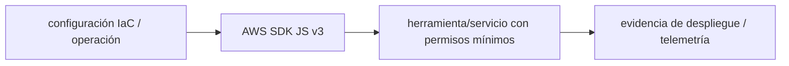

# AWS SDK JS v3 — guía version-aware Vigilio

## Qué es, qué hace y cuándo usarla

SDK modular de AWS para que adaptadores de infraestructura hablen con S3, SQS y otros servicios. Usa clientes y comandos, políticas IAM mínimas y credenciales por la cadena de proveedores.

**Ubicación en Vigilio:** usa esta dependencia en su stack propietario; otras skills deben enlazar esta guía, no duplicar sus reglas. **Versión:** la indicada en el encabezado es la línea documentada; consultar `technology/versions.md` y el lockfile antes de copiar APIs o aprobar un upgrade.

**Stack propietario:** Plataforma / DevSecOps. **Versión objetivo:** línea modular v3; package pins separados; versión instalada siempre desde lockfile/manifest. [Documentación oficial](https://docs.aws.amazon.com/sdk-for-javascript/v3/developer-guide/welcome.html). [Matriz de versiones](../versions.md).

## Responsabilidad y arquitectura

IAM Roles/OIDC, presigned URLs de corta vida, no enviar secretos al frontend, timeout y retry bounded.

No duplicar las reglas generales de SOLID, DDD y manejo de dependencias: [política de librerías](README.md). Al crear código, leer el API de la versión instalada, no solo un ejemplo de blog.

### Diagrama de integración (Mermaid)



El flujo muestra la **responsabilidad arquitectónica** de la librería; no representa llamadas reales de red para todas las operaciones.


## ✅ Correcto — ejemplo actual

```typescript
import { S3Client, PutObjectCommand } from '@aws-sdk/client-s3';
const s3Client = new S3Client({region:process.env.AWS_REGION});
await s3Client.send(new PutObjectCommand({Bucket:bucket,Key:key,Body:content}));
```

## ❌ Incorrecto — legado o mal uso

```typescript
// ❌ AWS SDK v2 monolítico / llaves estáticas embebidas
const AWS = require('aws-sdk');
AWS.config.update({accessKeyId:'SECRET'});
```

## Migración, nuevas APIs y compatibilidad

v2→v3 cambia client.send(new Command(...)), paquetes modulares, credential chain y middleware. Verificar Node runtime.

## Calidad, seguridad, performance y verificaciones

Test LocalStack/mocks con contrato, IAM minimum, multipart, S3 error, observabilidad y costos.

La adopción exige manifest/lockfile, pruebas runtime, seguridad, CI y rollback. Resultado real en consumidores de esta guía: **NOT_RUN**. No instalar nuevas dependencias solamente por estar catalogadas.

## Fuentes

- [Página oficial y referencias](https://docs.aws.amazon.com/sdk-for-javascript/v3/developer-guide/welcome.html)
- [Protocolo de adopción](README.md#protocolo-de-adopción-y-actualización)
- [Calidad transversal](../../foundations/engineering/code-quality.md)


## Recetario operativo ampliado — aws-sdk-v3 (2026-10-25)

### API actual: dos tareas reales que debe saber ejecutar una skill

1. **Utilizar cliente modular `S3Client` con `send(new PutObjectCommand(...))` y AbortSignal.**
2. **Configurar retries, timeouts, credenciales por rol y presigned URLs en adapter aislado.**

### Migración desde versiones anteriores: decisión concreta

- **Qué cambia o se debe revisar:** AWS SDK JS v3 usa paquetes `@aws-sdk/client-*`; `new AWS.S3()` de v2 no es API v3.

### Responsabilidades y capas

Capa infrastructure/adapters/cloud, no Controller/Domain ni componentes web con credenciales.

**✅ Correcto:** mantener la integración encapsulada, alinear los nombres del negocio con Vigilio y depender de un contrato estable.

**❌ Incorrecto:** importar internals de la librería desde Domain, declarar `any` para resolver un upgrade, o duplicar reglas ya propietarias de otra tecnología.

### Seguridad, resiliencia y rendimiento

- No descargar objetos enteros en memoria si hay streaming; cifrado, IAM least privilege y región.

### Test de aceptación específico y evidencia mínima

- **Escenario comprobable:** Mock de cliente para unit; integración contra emulador/entorno aislado y política IAM probada.


## Guía operativa detallada — 8 casos y 4 antipatrones

### Ocho ejemplos de la API y casos de uso relevantes

Los fragmentos siguientes ilustran **operaciones independientes**. Variables, imports, provider, extensión y configuración se completan en el proyecto consumidor; **no están certificados como un archivo único compilable**. Cuando hay comentarios `#`, son pasos de integración o configuración y no APIs inventadas.

#### Ejemplo 1. Cliente modular

**✅ Correcto — cliente modular**

```typescript
const s3Client = new S3Client({ region: process.env.AWS_REGION });
```


#### Ejemplo 2. Listar objetos

**✅ Correcto — listar objetos**

```typescript
await s3Client.send(new ListObjectsV2Command({ Bucket: bucket }));
```


#### Ejemplo 3. Subir objeto

**✅ Correcto — subir objeto**

```typescript
await s3Client.send(new PutObjectCommand({ Bucket: bucket, Key: key, Body: content }));
```


#### Ejemplo 4. Descargar objeto

**✅ Correcto — descargar objeto**

```typescript
await s3Client.send(new GetObjectCommand({ Bucket: bucket, Key: key }));
```


#### Ejemplo 5. Eliminar objeto

**✅ Correcto — eliminar objeto**

```typescript
await s3Client.send(new DeleteObjectCommand({ Bucket: bucket, Key: key }));
```


#### Ejemplo 6. AbortSignal

**✅ Correcto — abortsignal**

```typescript
await s3Client.send(command, { abortSignal: abort_controller.signal });
```


#### Ejemplo 7. URL firmada

**✅ Correcto — url firmada**

```typescript
await getSignedUrl(s3Client, new GetObjectCommand({ Bucket: bucket, Key: key }), { expiresIn: 60 });
```


#### Ejemplo 8. Liberar recursos

**✅ Correcto — liberar recursos**

```typescript
s3Client.destroy();
```


### Cuatro antipatrones frecuentes y su sustitución

#### Antipatrón 1 — riesgo y alternativa

**❌ Incorrecto**

```typescript
const AWS = require("aws-sdk")
```

**Por qué está mal:** El patrón «const AWS = require("aws-sdk")» es riesgoso: mezcla responsabilidades de interfaz y navegación o genera comportamiento inconsistente.

**✅ Correcto**

```typescript
import { S3Client } from "@aws-sdk/client-s3"
```

**Por qué mejora:** El patrón «import { S3Client } from "@aws-sdk/client-s3"» mejora el caso: la interfaz utiliza la API adecuada y separa presentación, estado y comunicación.

#### Antipatrón 2 — riesgo y alternativa

**❌ Incorrecto**

```typescript
new S3Client({ credentials: { accessKeyId: "SECRET" } })
```

**Por qué está mal:** Expone credenciales o confunde autenticación con autorización; puede ocasionar filtración o acceso indebido.

**✅ Correcto**

```typescript
new S3Client({ region: process.env.AWS_REGION })
```

**Por qué mejora:** El patrón «new S3Client({ region: process.env.AWS_REGION })» mejora el caso: las credenciales quedan fuera del código o bajo un mecanismo de acceso controlado.

#### Antipatrón 3 — riesgo y alternativa

**❌ Incorrecto**

```typescript
await s3Client.send(command) # sin límites
```

**Por qué está mal:** Omite un control operativo necesario, por lo que el comportamiento puede ser inseguro o difícil de verificar.

**✅ Correcto**

```typescript
await s3Client.send(command, { abortSignal: controller.signal })
```

**Por qué mejora:** El patrón «await s3Client.send(command, { abortSignal: controller.signal })» mejora el caso: la alternativa «await s3Client.send(command, { abortSignal: controller.signal })» establece el comportamiento esperado de aws-sdk-v3.

#### Antipatrón 4 — riesgo y alternativa

**❌ Incorrecto**

```typescript
const data = await response.Body?.transformToByteArray() # siempre en memoria
```

**Por qué está mal:** El patrón «const data = await response.Body?.transformToByteArray() # siempre en memoria» es riesgoso: puede elevar el coste de runtime, causar fallos de despliegue o empaquetar dependencias no deseadas.

**✅ Correcto — Stream para blobs grandes.**

**Por qué mejora:** El patrón «Stream para blobs grandes» mejora el caso: el build y los recursos se verifican mediante gates de despliegue y rendimiento.

### Versión estable, breaking changes y verificación

- **Versión estable exacta:** no se declara un parche universal cuando no hay verificación específica de su registry/release. Consultar el encabezado de esta guía, `technology/versions.md` y el manifiesto del servicio. **Estado de patch: VERIFY_LOCKFILE**.
- **Migración:** identificar major anterior, APIs retiradas/cambiadas, peer dependencies, requisitos de runtime, cambios de tipos, ejecución CI y plan de rollback. Si no hay prueba sobre el consumidor, **NOT_RUN**, no PASS.
- **Versiones previas:** el ejemplo marcado ❌ en esta guía explica al menos una incompatibilidad o un uso obsoleto; no trasplantar APIs de otras versiones.
- **Tests:** probar al menos happy path, error, seguridad/permiso y compatibilidad con el runtime donde aplique; solo activar nuevas capacidades mediante una PR versionada.

### Fuentes oficiales y referencias al final

- [Referencia propia oficial](https://docs.aws.amazon.com/sdk-for-javascript/v3/developer-guide/welcome.html)
- [Matriz canónica de versiones](../versions.md)
- [Política de adopción de librerías](README.md)

## Guía de compatibilidad y evaluación por versión (2026-10-25)

**Estado del patch exacto:** `VERIFY_LOCKFILE`. La guía documenta la familia de APIs; **no se ha verificado hoy el patch estable preciso de esta dependencia**. Consultar la fuente oficial enlazada al inicio y el lockfile antes de generar código o aprobar un upgrade.

### Checklist específico de esta librería

- **Migración/compatibilidad:** AWS SDK JS v3 usa paquetes `@aws-sdk/client-*`; `new AWS.S3()` de v2 no es API v3.
- **Prueba propia:** Mock de cliente para unit; integración contra emulador/entorno aislado y política IAM probada.
- **Límite de responsabilidad:** usar esta librería solo en su adaptador o capa propietaria; consultar los ejemplos de API y antipatrones anteriores antes de cambiar llamadas públicas.

**Gate de aprobación:** leer la referencia oficial y resolver la versión del consumidor, ejecutar typecheck y pruebas específicas, registrar PASS/FAIL/NOT_RUN/BLOCKED. No confundir esta guía con validación de un consumidor real. [Procedimiento único de adopción](README.md#protocolo-de-adopción-y-actualización).

## Ejemplo SDK v3 modular: permisos mínimos e I/O cancelable

```typescript
import { S3Client, GetObjectCommand } from '@aws-sdk/client-s3';

const s3_client = new S3Client({ region: process.env.AWS_REGION });
const result = await s3_client.send(new GetObjectCommand({
  Bucket: bucket_name,
  Key: object_key,
}));
```

`bucket_name` y `object_key` se originan en configuración/entrada **autorizada** y se validan antes; AWS IAM roles/OIDC proporciona credenciales, no hardcodear `accessKeyId`. Stream de `Body` debe consumirse/cerrarse correctamente según runtime. ✅ Correcto: cliente modular y IAM least privilege; ❌ Incorrecto: usar `aws-sdk` v2 en código nuevo o crear cliente por cada fila. [AWS v3](https://docs.aws.amazon.com/sdk-for-javascript/v3/developer-guide/welcome.html).
