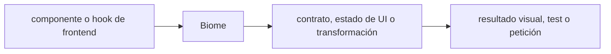

# Biome — Vigilio 2.6.x (verificar patch en release oficial)

## Qué es, qué hace y cuándo usarla

Analizador y formateador de JavaScript/TypeScript. Aplica reglas y formato reproducibles en CI; no sustituye typecheck ni pruebas.

**Ubicación en Vigilio:** usa esta dependencia en su stack propietario; otras skills deben enlazar esta guía, no duplicar sus reglas. **Versión:** la indicada en el encabezado es la línea documentada; consultar `technology/versions.md` y el lockfile antes de copiar APIs o aprobar un upgrade.

> **Guía propia de Biome (toolchain).** Estado a **2026-10-25**: 2.6.x (verificar patch en release oficial). Versión del proyecto consumidor = `pnpm-lock.yaml` / `composer.lock` / imagen o manifest. Fuente: [documentación oficial](https://biomejs.dev/guides/getting-started/). Fuente normativa transversal de versiones: [versions.md](../versions.md). **No implica instalación automática ni upgrade aprobado.**

## Objetivo, responsabilidad y dónde usar

Reglas TypeScript strict y no any; excepciones justificadas. Biome no sustituye tsc, tests de seguridad ni análisis de contratos.

**Uso:** aplicar solo si está declarada y resulta pertinente al consumidor; ver [política de adopción y DRY](README.md).

### Diagrama de integración (Mermaid)



El flujo muestra la **responsabilidad arquitectónica** de la librería; no representa llamadas reales de red para todas las operaciones.


## Instalación o verificación

```bash
pnpm add -D @biomejs/biome
```

**Gate de instalación:** consultar [procedimiento compartido](README.md#protocolo-de-adopción-y-actualización); estos comandos son indicativos, no ejecuciones sobre un consumidor.

## ✅ Correcto — uso actual y ejemplo de referencia

```typescript
// biome.json
{ "$schema": "https://biomejs.dev/schemas/2.0.0/schema.json", "formatter": { "enabled": true }, "linter": { "enabled": true } }
// npx biome check --write src
// pnpm exec biome ci .
```

**Por qué:** Reglas TypeScript strict y no any; excepciones justificadas. Biome no sustituye tsc, tests de seguridad ni análisis de contratos.

## ❌ Incorrecto — patrón legacy, inseguro o mal ubicado

**Nota técnica (no es código ejecutable):** ❌ reemplazar indiscriminadamente reglas ESLint sin revisar equivalencias ❌ deshabilitar lint para silenciar errores reales.

**Riesgo:** confundir versiones o responsabilidades y obtener un contrato incorrecto.

## Nuevas capacidades, migración y breaking changes

Biome 1→2 cambia arquitectura de config, extensiones y reglas; migrar con herramienta oficial, comparar supresiones y formatter.

Aplicar el [protocolo de migración común](README.md#protocolo-de-adopción-y-actualización), sin asumir que una release nueva está desplegada.

## Buenas prácticas, seguridad, rendimiento y operación

Consultar la [política transversal de librerías](README.md) para seguridad, versionado, evidencia y revisión de contratos. Para esta librería, además, aplicar las verificaciones concretas que se detallan a continuación.

## Gates de aceptación y compatibilidad

Biome check/ci, typecheck separado, snapshots de formato, CI sin auto-fix silencioso.

Estado de prueba de estos ejemplos documentales: **NOT_RUN** en aplicaciones consumidoras; ver [criterios de evidencia](README.md#criterios-de-validación).


## Referencias

- [Documentación oficial y migración de Biome](https://biomejs.dev/guides/getting-started/)
- [Matriz y baseline de versiones](../versions.md)
- [Calidad de código canónica](../../foundations/engineering/code-quality.md)


## Recetario operativo ampliado — biome (2026-10-25)

### API actual: dos tareas reales que debe saber ejecutar una skill

1. **`biome check` inspecciona; `biome ci` falla en CI y no escribe código.**
2. **Conservar las reglas de naming acordadas mediante configuración; usar overrides por formato/framework.**

### Migración desde versiones anteriores: decisión concreta

- **Qué cambia o se debe revisar:** Configuraciones de Biome v1→v2 pueden cambiar schema/opciones; ejecutar `biome migrate` en migración controlada.

### Responsabilidades y capas

Tooling estático; no reemplaza tsc ni tests runtime.

**✅ Correcto:** mantener la integración encapsulada, alinear los nombres del negocio con Vigilio y depender de un contrato estable.

**❌ Incorrecto:** importar internals de la librería desde Domain, declarar `any` para resolver un upgrade, o duplicar reglas ya propietarias de otra tecnología.

### Seguridad, resiliencia y rendimiento

- Autofix de imports masivo puede alterar semántica; revisar git diff y reproducibilidad.

### Test de aceptación específico y evidencia mínima

- **Escenario comprobable:** Ejecutar biome ci, typecheck y tests; incluir `biome.json` fijado en PR.

### Ejemplo de integración vigente (fragmento adicional)

```bash
pnpm exec biome ci .
pnpm exec tsc --noEmit
pnpm exec vitest run
# Biome no prueba contratos HTTP ni lógica de dominio.
```

**Nota:** los fragmentos muestran la API específica y requieren imports/providers/fixtures del consumidor; no se certifica compilación por el solo hecho de aparecer aquí.


## Guía operativa detallada — 8 casos y 4 antipatrones

### Ocho ejemplos de la API y casos de uso relevantes

Los fragmentos siguientes ilustran **operaciones independientes**. Variables, imports, provider, extensión y configuración se completan en el proyecto consumidor; **no están certificados como un archivo único compilable**. Cuando hay comentarios `#`, son pasos de integración o configuración y no APIs inventadas.

#### Ejemplo 1. Inicializar

**✅ Correcto — inicializar**

```typescript
pnpm exec biome init
```


#### Ejemplo 2. Revisar sin escribir

**✅ Correcto — revisar sin escribir**

```typescript
pnpm exec biome check .
```


#### Ejemplo 3. Gate CI

**✅ Correcto — gate ci**

```typescript
pnpm exec biome ci .
```


#### Ejemplo 4. Aplicar fixes seguros

**✅ Correcto — aplicar fixes seguros**

```typescript
pnpm exec biome check --write .
```


#### Ejemplo 5. Formatear

**✅ Correcto — formatear**

```typescript
pnpm exec biome format --write src/
```


#### Ejemplo 6. Lint

**✅ Correcto — lint**

```typescript
pnpm exec biome lint src/
```


#### Ejemplo 7. Migration config

**✅ Correcto — migration config**

```typescript
pnpm exec biome migrate --write
```


#### Ejemplo 8. Config de alcance

**✅ Correcto — config de alcance**

**Nota técnica (no es código ejecutable):** Biome.json: { "files": { "includes": ["src/**", "!**/dist/**"] } }.


### Cuatro antipatrones frecuentes y su sustitución

#### Antipatrón 1 — riesgo y alternativa

**❌ Incorrecto**

```typescript
pnpm biome check --write . # en CI
```

**Por qué está mal:** El patrón «pnpm biome check --write . # en CI» es riesgoso: puede publicar cambios sin evidencia suficiente ni una revisión del impacto.

**✅ Correcto**

```typescript
pnpm biome ci .
```

**Por qué mejora:** El patrón «pnpm biome ci .» mejora el caso: el cambio pasa por gates automáticos y aprobación de riesgos operativos.

#### Antipatrón 2 — riesgo y alternativa

**❌ Incorrecto — Ignorar src/** entero por error.**

**Por qué está mal:** El patrón «Ignorar src/» es riesgoso: la elección «Ignorar src/» puede incumplir los requisitos operativos de biome.

**✅ Correcto — Configurar files.includes por áreas justificadas.**

**Por qué mejora:** El patrón «Configurar files.includes por áreas justificadas» mejora el caso: la alternativa «Configurar files.includes por áreas justificadas» establece el comportamiento esperado de biome.

#### Antipatrón 3 — riesgo y alternativa

**❌ Incorrecto — Sustituir tsc con biome.**

**Por qué está mal:** El patrón «Sustituir tsc con biome» es riesgoso: puede publicar cambios sin evidencia suficiente ni una revisión del impacto.

**✅ Correcto**

```typescript
pnpm biome ci . && pnpm tsc --noEmit
```

**Por qué mejora:** El patrón «pnpm biome ci . && pnpm tsc --noEmit» mejora el caso: el cambio pasa por gates automáticos y aprobación de riesgos operativos.

#### Antipatrón 4 — riesgo y alternativa

**❌ Incorrecto — Auto-fix sin revisar diff.**

**Por qué está mal:** Omite un control operativo necesario, por lo que el comportamiento puede ser inseguro o difícil de verificar.

**✅ Correcto**

```typescript
git diff --check # tras aplicar fixes
```

**Por qué mejora:** El patrón «git diff --check # tras aplicar fixes» mejora el caso: el cambio pasa por gates automáticos y aprobación de riesgos operativos.

### Versión estable, breaking changes y verificación

- **Versión estable exacta:** no se declara un parche universal cuando no hay verificación específica de su registry/release. Consultar el encabezado de esta guía, `technology/versions.md` y el manifiesto del servicio. **Estado de patch: VERIFY_LOCKFILE**.
- **Migración:** identificar major anterior, APIs retiradas/cambiadas, peer dependencies, requisitos de runtime, cambios de tipos, ejecución CI y plan de rollback. Si no hay prueba sobre el consumidor, **NOT_RUN**, no PASS.
- **Versiones previas:** el ejemplo marcado ❌ en esta guía explica al menos una incompatibilidad o un uso obsoleto; no trasplantar APIs de otras versiones.
- **Tests:** probar al menos happy path, error, seguridad/permiso y compatibilidad con el runtime donde aplique; solo activar nuevas capacidades mediante una PR versionada.

### Fuentes oficiales y referencias al final

- [Referencia propia oficial](https://biomejs.dev/guides/getting-started/)
- [Matriz canónica de versiones](../versions.md)
- [Política de adopción de librerías](README.md)

## Guía de compatibilidad y evaluación por versión (2026-10-25)

**Estado del patch exacto:** `VERIFY_LOCKFILE`. La guía documenta la familia de APIs; **no se ha verificado hoy el patch estable preciso de esta dependencia**. Consultar la fuente oficial enlazada al inicio y el lockfile antes de generar código o aprobar un upgrade.

### Checklist específico de esta librería

- **Migración/compatibilidad:** Configuraciones de Biome v1→v2 pueden cambiar schema/opciones; ejecutar `biome migrate` en migración controlada.
- **Prueba propia:** Ejecutar biome ci, typecheck y tests; incluir `biome.json` fijado en PR.
- **Límite de responsabilidad:** usar esta librería solo en su adaptador o capa propietaria; consultar los ejemplos de API y antipatrones anteriores antes de cambiar llamadas públicas.

**Gate de aprobación:** leer la referencia oficial y resolver la versión del consumidor, ejecutar typecheck y pruebas específicas, registrar PASS/FAIL/NOT_RUN/BLOCKED. No confundir esta guía con validación de un consumidor real. [Procedimiento único de adopción](README.md#protocolo-de-adopción-y-actualización).

