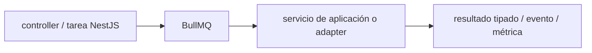

# BullMQ — Vigilio v6 (moderna) / v5 (LTS) compatible con Valkey y Redis

## Qué es, qué hace y cuándo usarla

Colas y trabajadores sobre Redis/Valkey compatibles para trabajos asíncronos. Exige idempotencia, backoff acotado y observabilidad de reintentos.

**Ubicación en Vigilio:** usa esta dependencia en su stack propietario; otras skills deben enlazar esta guía, no duplicar sus reglas. **Versión:** la indicada en el encabezado es la línea documentada; consultar `technology/versions.md` y el lockfile antes de copiar APIs o aprobar un upgrade.

> **Guía propia de BullMQ (backend-node).** Estado a **2026-11-01**: línea moderna v6 / estable v5 (compatible con Valkey 8.1 LTS y Redis 7.x). Versión del proyecto consumidor = `pnpm-lock.yaml` / `composer.lock` / imagen o manifest. Fuente: [documentación oficial](https://docs.bullmq.io/). Fuente normativa transversal de versiones: [versions.md](../versions.md). **No implica instalación automática ni upgrade aprobado.**

## Objetivo, responsabilidad y dónde usar

Outbox, DLQ, backpressure, visibility/lock, replays controlados.

**Uso:** aplicar solo si está declarada y resulta pertinente al consumidor; ver [política de adopción y DRY](README.md).

### Diagrama de integración (Mermaid)



El flujo muestra la **responsabilidad arquitectónica** de la librería; no representa llamadas reales de red para todas las operaciones.


## Instalación o verificación

```bash
pnpm add bullmq
```

**Gate de instalación:** consultar [procedimiento compartido](README.md#protocolo-de-adopción-y-actualización); estos comandos son indicativos, no ejecuciones sobre un consumidor.

## ✅ Correcto — uso actual y ejemplo de referencia

```typescript
// Definir job semántico, idempotente y con retry acotado
await queue.add('processProduct',{product_id,tenant_id},{jobId:event_id,attempts:4,backoff:{type:'exponential',delay:1000}});
```

**Por qué:** Outbox, DLQ, backpressure, visibility/lock, replays controlados.

## ❌ Incorrecto — patrón legacy, inseguro o mal ubicado

```typescript
// ❌ reintentos infinitos de pago externo no idempotente
await queue.add('charge',payload,{attempts:99999});
```

**Riesgo:** confundir versiones o responsabilidades y obtener un contrato incorrecto.

## Nuevas capacidades, migración y breaking changes

BullMQ v5+ separa Workers/QueueEvents y configuraciones; comprobar versión exacta de client Redis.

Aplicar el [protocolo de migración común](README.md#protocolo-de-adopción-y-actualización), sin asumir que una release nueva está desplegada.

## Buenas prácticas, seguridad, rendimiento y operación

Consultar la [política transversal de librerías](README.md) para seguridad, versionado, evidencia y revisión de contratos. Para esta librería, además, aplicar las verificaciones concretas que se detallan a continuación.

## Gates de aceptación y compatibilidad

Test duplicados, crash-after-commit, timeout, memory, retry y poison messages.

Estado de prueba de estos ejemplos documentales: **NOT_RUN** en aplicaciones consumidoras; ver [criterios de evidencia](README.md#criterios-de-validación).


## Referencias

- [Documentación oficial y migración de BullMQ](https://docs.bullmq.io/)
- [Matriz y baseline de versiones](../versions.md)
- [Calidad de código canónica](../../foundations/engineering/code-quality.md)


## Recetario operativo ampliado — bullmq (2026-10-25)

### API actual: dos tareas reales que debe saber ejecutar una skill

1. **Distinguir `Queue.add`, `Worker`, `QueueEvents` y `FlowProducer` cuando existan dependencias.**
2. **Usar `jobId` idempotente, backoff acotado, concurrencia limitada y métricas de reintentos.**

### Migración desde versiones anteriores: decisión concreta

- **Qué cambia o se debe revisar:** Migrar APIs de repetición/job schedulers según major efectiva; no asumir repeatable antigua.

### Responsabilidades y capas

Infraestructura workers / adapters; lógica del negocio vive en Application.

**✅ Correcto:** mantener la integración encapsulada, alinear los nombres del negocio con Vigilio y depender de un contrato estable.

**❌ Incorrecto:** importar internals de la librería desde Domain, declarar `any` para resolver un upgrade, o duplicar reglas ya propietarias de otra tecnología.

### Seguridad, resiliencia y rendimiento

- Valkey/Redis, lock renew, poison messages; jobs al menos una vez, nunca asumir exactly-once.

### Test de aceptación específico y evidencia mínima

- **Escenario comprobable:** Integración enqueue→worker→ACK, reintento, DLQ/failed, shutdown y tenant isolation.


## Guía operativa detallada — 8 casos y 4 antipatrones

### Ocho ejemplos de la API y casos de uso relevantes

Los fragmentos siguientes ilustran **operaciones independientes**. Variables, imports, provider, extensión y configuración se completan en el proyecto consumidor; **no están certificados como un archivo único compilable**. Cuando hay comentarios `#`, son pasos de integración o configuración y no APIs inventadas.

#### Ejemplo 1. Queue

**✅ Correcto — queue**

```typescript
const queue = new Queue('emails', { connection });
```


#### Ejemplo 2. Encolar

**✅ Correcto — encolar**

```typescript
await queue.add('sendWelcome', { user_id }, { jobId: event_id });
```


#### Ejemplo 3. Worker

**✅ Correcto — worker**

```typescript
const worker = new Worker('emails', async (job) => sendWelcome(job.data), { connection });
```


#### Ejemplo 4. Reintentos

**✅ Correcto — reintentos**

```typescript
await queue.add('sendWelcome', payload, { attempts: 3, backoff: { type: 'exponential', delay: 1000 } });
```


#### Ejemplo 5. Prioridad

**✅ Correcto — prioridad**

```typescript
await queue.add('urgent', payload, { priority: 1 });
```


#### Ejemplo 6. Leer job

**✅ Correcto — leer job**

```typescript
const job = await Job.fromId(queue, job_id);
```


#### Ejemplo 7. Eventos

**✅ Correcto — eventos**

```typescript
const queue_events = new QueueEvents('emails', { connection });
```


#### Ejemplo 8. Shutdown

**✅ Correcto — shutdown**

```typescript
await worker.close(); await queue.close();
```


### Cuatro antipatrones frecuentes y su sustitución

#### Antipatrón 1 — riesgo y alternativa

**❌ Incorrecto**

```typescript
await queue.add("send", payload) # sin identidad de evento
```

**Por qué está mal:** Omite un control operativo necesario, por lo que el comportamiento puede ser inseguro o difícil de verificar.

**✅ Correcto**

```typescript
await queue.add("send", payload, { jobId: event_id })
```

**Por qué mejora:** El patrón «await queue.add("send", payload, { jobId: event_id })» mejora el caso: la ejecución se controla con idempotencia, límites y evidencia de errores.

#### Antipatrón 2 — riesgo y alternativa

**❌ Incorrecto**

```typescript
new Worker("send", handler, { connection, concurrency: 10000 })
```

**Por qué está mal:** El patrón «new Worker("send", handler, { connection, concurrency: 10000 })» es riesgoso: puede duplicar efectos, perder trabajos o saturar consumidores durante reintentos.

**✅ Correcto**

```typescript
new Worker("send", handler, { connection, concurrency: 8 })
```

**Por qué mejora:** El patrón «new Worker("send", handler, { connection, concurrency: 8 })» mejora el caso: la ejecución se controla con idempotencia, límites y evidencia de errores.

#### Antipatrón 3 — riesgo y alternativa

**❌ Incorrecto — Confiar en exactly-once.**

**Por qué está mal:** El patrón «Confiar en exactly-once» es riesgoso: la consulta puede producir resultados incorrectos, lentitud o aislamiento insuficiente de datos.

**✅ Correcto — Idempotencia en DB + jobId.**

**Por qué mejora:** El patrón «Idempotencia en DB + jobId» mejora el caso: la consulta o el contrato se valida y mide sobre datos representativos.

#### Antipatrón 4 — riesgo y alternativa

**❌ Incorrecto — Terminar proceso sin close.**

**Por qué está mal:** Omite un control operativo necesario, por lo que el comportamiento puede ser inseguro o difícil de verificar.

**✅ Correcto**

```typescript
await worker.close(); await queue.close();
```

**Por qué mejora:** El patrón «await worker.close(); await queue.close()» mejora el caso: la ejecución se controla con idempotencia, límites y evidencia de errores.

### Versión estable, breaking changes y verificación

- **Versión estable exacta:** no se declara un parche universal cuando no hay verificación específica de su registry/release. Consultar el encabezado de esta guía, `technology/versions.md` y el manifiesto del servicio. **Estado de patch: VERIFY_LOCKFILE**.
- **Migración:** identificar major anterior, APIs retiradas/cambiadas, peer dependencies, requisitos de runtime, cambios de tipos, ejecución CI y plan de rollback. Si no hay prueba sobre el consumidor, **NOT_RUN**, no PASS.
- **Versiones previas:** el ejemplo marcado ❌ en esta guía explica al menos una incompatibilidad o un uso obsoleto; no trasplantar APIs de otras versiones.
- **Tests:** probar al menos happy path, error, seguridad/permiso y compatibilidad con el runtime donde aplique; solo activar nuevas capacidades mediante una PR versionada.

### Fuentes oficiales y referencias al final

- [Referencia propia oficial](https://docs.bullmq.io/)
- [Matriz canónica de versiones](../versions.md)
- [Política de adopción de librerías](README.md)

## Guía de compatibilidad y evaluación por versión (2026-10-25)

**Estado del patch exacto:** `VERIFY_LOCKFILE`. La guía documenta la familia de APIs; **no se ha verificado hoy el patch estable preciso de esta dependencia**. Consultar la fuente oficial enlazada al inicio y el lockfile antes de generar código o aprobar un upgrade.

### Checklist específico de esta librería

- **Migración/compatibilidad:** Migrar APIs de repetición/job schedulers según major efectiva; no asumir repeatable antigua.
- **Prueba propia:** Integración enqueue→worker→ACK, reintento, DLQ/failed, shutdown y tenant isolation.
- **Límite de responsabilidad:** usar esta librería solo en su adaptador o capa propietaria; consultar los ejemplos de API y antipatrones anteriores antes de cambiar llamadas públicas.

**Gate de aprobación:** leer la referencia oficial y resolver la versión del consumidor, ejecutar typecheck y pruebas específicas, registrar PASS/FAIL/NOT_RUN/BLOCKED. No confundir esta guía con validación de un consumidor real. [Procedimiento único de adopción](README.md#protocolo-de-adopción-y-actualización).

