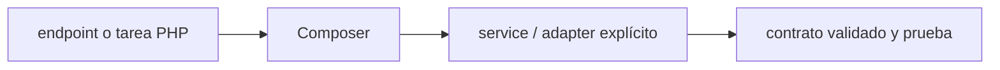

# Composer — Vigilio 2.x (instalada según composer.lock)

## Qué es, qué hace y cuándo usarla

Gestor de dependencias y autoload de PHP. El composer.lock fija versiones concretas para instalaciones reproducibles, y composer audit descubre avisos.

**Ubicación en Vigilio:** usa esta dependencia en su stack propietario; otras skills deben enlazar esta guía, no duplicar sus reglas. **Versión:** la indicada en el encabezado es la línea documentada; consultar `technology/versions.md` y el lockfile antes de copiar APIs o aprobar un upgrade.

> **Guía propia de Composer (backend-php).** Estado a **2026-10-25**: 2.x (instalada según composer.lock). Versión del proyecto consumidor = `pnpm-lock.yaml` / `composer.lock` / imagen o manifest. Fuente: [documentación oficial](https://getcomposer.org/doc/). Fuente normativa transversal de versiones: [versions.md](../versions.md). **No implica instalación automática ni upgrade aprobado.**

## Objetivo, responsabilidad y dónde usar

Build reproducible, scripts/plugins permitidos, provenance, registro privado.

**Uso:** aplicar solo si está declarada y resulta pertinente al consumidor; ver [política de adopción y DRY](README.md).

### Diagrama de integración (Mermaid)



El flujo muestra la **responsabilidad arquitectónica** de la librería; no representa llamadas reales de red para todas las operaciones.


## Instalación o verificación

```bash
composer install --no-interaction --prefer-dist
```

**Gate de instalación:** consultar [procedimiento compartido](README.md#protocolo-de-adopción-y-actualización); estos comandos son indicativos, no ejecuciones sobre un consumidor.

## ✅ Correcto — uso actual y ejemplo de referencia

```bash
composer validate --strict
composer install --no-interaction --prefer-dist --no-progress
composer audit --locked
composer check-platform-reqs
```

**Por qué:** Build reproducible, scripts/plugins permitidos, provenance, registro privado.

## ❌ Incorrecto — patrón legacy, inseguro o mal ubicado

```bash
// ❌ release con composer update sin revisar lockfile
composer update --ignore-platform-reqs
```

**Riesgo:** confundir versiones o responsabilidades y obtener un contrato incorrecto.

## Nuevas capacidades, migración y breaking changes

No inferir versiones instaladas de composer.json; composer.lock define paquetes, plataforma PHP y plugins.

Aplicar el [protocolo de migración común](README.md#protocolo-de-adopción-y-actualización), sin asumir que una release nueva está desplegada.

## Buenas prácticas, seguridad, rendimiento y operación

Consultar la [política transversal de librerías](README.md) para seguridad, versionado, evidencia y revisión de contratos. Para esta librería, además, aplicar las verificaciones concretas que se detallan a continuación.

## Gates de aceptación y compatibilidad

Gate sin cambios de lock inesperados, auditoría y platform reqs.

Estado de prueba de estos ejemplos documentales: **NOT_RUN** en aplicaciones consumidoras; ver [criterios de evidencia](README.md#criterios-de-validación).


## Referencias

- [Documentación oficial y migración de Composer](https://getcomposer.org/doc/)
- [Matriz y baseline de versiones](../versions.md)
- [Calidad de código canónica](../../foundations/engineering/code-quality.md)


## Recetario operativo ampliado — composer (2026-10-25)

### API actual: dos tareas reales que debe saber ejecutar una skill

1. **`composer install --no-interaction --prefer-dist --no-progress` en CI con lock de verdad.**
2. **`composer audit`, scripts controlados, plataforma PHP fijada y autoload PSR-4.**

### Migración desde versiones anteriores: decisión concreta

- **Qué cambia o se debe revisar:** No sustituir install por update en release; rangos `^` se resuelven antes del lock.

### Responsabilidades y capas

Toolchain PHP compartido; sin mezclar con pnpm/npm.

**✅ Correcto:** mantener la integración encapsulada, alinear los nombres del negocio con Vigilio y depender de un contrato estable.

**❌ Incorrecto:** importar internals de la librería desde Domain, declarar `any` para resolver un upgrade, o duplicar reglas ya propietarias de otra tecnología.

### Seguridad, resiliencia y rendimiento

- Scripts Composer ejecutan código; revisar scripts/plugins y credenciales de registries.

### Test de aceptación específico y evidencia mínima

- **Escenario comprobable:** `composer validate --strict`; `composer install`; `composer audit`; `composer check-platform-reqs`.


## Guía operativa detallada — 8 casos y 4 antipatrones

### Ocho ejemplos de la API y casos de uso relevantes

Los fragmentos siguientes ilustran **operaciones independientes**. Variables, imports, provider, extensión y configuración se completan en el proyecto consumidor; **no están certificados como un archivo único compilable**. Cuando hay comentarios `#`, son pasos de integración o configuración y no APIs inventadas.

#### Ejemplo 1. Reproducir lockfile

**✅ Correcto — reproducir lockfile**

```bash
composer install --no-interaction --prefer-dist
```


#### Ejemplo 2. Validar archivo

**✅ Correcto — validar archivo**

```bash
composer validate --strict
```


#### Ejemplo 3. Auditoría advisories

**✅ Correcto — auditoría advisories**

```bash
composer audit
```


#### Ejemplo 4. Dependencias directas

**✅ Correcto — dependencias directas**

```bash
composer show --direct
```


#### Ejemplo 5. Requisitos entorno

**✅ Correcto — requisitos entorno**

```bash
composer check-platform-reqs
```


#### Ejemplo 6. Optimizar autoload

**✅ Correcto — optimizar autoload**

```bash
composer dump-autoload --optimize
```


#### Ejemplo 7. Actualizar una dependencia

**✅ Correcto — actualizar una dependencia**

```bash
composer update vendor/package --with-dependencies
```


#### Ejemplo 8. Diagnóstico

**✅ Correcto — diagnóstico**

```bash
composer diagnose
```


### Cuatro antipatrones frecuentes y su sustitución

#### Antipatrón 1 — riesgo y alternativa

**❌ Incorrecto**

```bash
composer update # dentro de pipeline de release
```

**Por qué está mal:** El patrón «composer update # dentro de pipeline de release» es riesgoso: puede publicar cambios sin evidencia suficiente ni una revisión del impacto.

**✅ Correcto**

```bash
composer install --no-interaction --prefer-dist
```

**Por qué mejora:** El patrón «composer install --no-interaction --prefer-dist» mejora el caso: el cambio pasa por gates automáticos y aprobación de riesgos operativos.

#### Antipatrón 2 — riesgo y alternativa

**❌ Incorrecto — Composer.lock ignorado en Git.**

**Por qué está mal:** El patrón «Composer.lock ignorado en Git» es riesgoso: puede mezclar firmas incompatibles o ejecutar una API retirada en la versión instalada.

**✅ Correcto — Versionar composer.lock para aplicaciones.**

**Por qué mejora:** El patrón «Versionar composer.lock para aplicaciones» mejora el caso: se utiliza la API apropiada para el major documentado y se comprueba el lockfile.

#### Antipatrón 3 — riesgo y alternativa

**❌ Incorrecto**

```bash
composer install --ignore-platform-reqs
```

**Por qué está mal:** El patrón «composer install --ignore-platform-reqs» es riesgoso: puede aceptar entradas inválidas o duplicar contratos difíciles de mantener.

**✅ Correcto**

```bash
composer check-platform-reqs
```

**Por qué mejora:** El patrón «composer check-platform-reqs» mejora el caso: el contrato queda tipado y validado en el borde que recibe datos externos.

#### Antipatrón 4 — riesgo y alternativa

**❌ Incorrecto — Ejecutar plugin sin revisión.**

**Por qué está mal:** Omite un control operativo necesario, por lo que el comportamiento puede ser inseguro o difícil de verificar.

**✅ Correcto — Revisar allow-plugins/scripts e IAM runner.**

**Por qué mejora:** Separa permisos y secretos del código de negocio y permite comprobar el acceso mínimo.

### Versión estable, breaking changes y verificación

- **Versión estable exacta:** no se declara un parche universal cuando no hay verificación específica de su registry/release. Consultar el encabezado de esta guía, `technology/versions.md` y el manifiesto del servicio. **Estado de patch: VERIFY_LOCKFILE**.
- **Migración:** identificar major anterior, APIs retiradas/cambiadas, peer dependencies, requisitos de runtime, cambios de tipos, ejecución CI y plan de rollback. Si no hay prueba sobre el consumidor, **NOT_RUN**, no PASS.
- **Versiones previas:** el ejemplo marcado ❌ en esta guía explica al menos una incompatibilidad o un uso obsoleto; no trasplantar APIs de otras versiones.
- **Tests:** probar al menos happy path, error, seguridad/permiso y compatibilidad con el runtime donde aplique; solo activar nuevas capacidades mediante una PR versionada.

### Fuentes oficiales y referencias al final

- [Referencia propia oficial](https://getcomposer.org/doc/)
- [Matriz canónica de versiones](../versions.md)
- [Política de adopción de librerías](README.md)

## Guía de compatibilidad y evaluación por versión (2026-10-25)

**Estado del patch exacto:** `VERIFY_LOCKFILE`. La guía documenta la familia de APIs; **no se ha verificado hoy el patch estable preciso de esta dependencia**. Consultar la fuente oficial enlazada al inicio y el lockfile antes de generar código o aprobar un upgrade.

### Checklist específico de esta librería

- **Migración/compatibilidad:** No sustituir install por update en release; rangos `^` se resuelven antes del lock.
- **Prueba propia:** `composer validate --strict`; `composer install`; `composer audit`; `composer check-platform-reqs`.
- **Límite de responsabilidad:** usar esta librería solo en su adaptador o capa propietaria; consultar los ejemplos de API y antipatrones anteriores antes de cambiar llamadas públicas.

**Gate de aprobación:** leer la referencia oficial y resolver la versión del consumidor, ejecutar typecheck y pruebas específicas, registrar PASS/FAIL/NOT_RUN/BLOCKED. No confundir esta guía con validación de un consumidor real. [Procedimiento único de adopción](README.md#protocolo-de-adopción-y-actualización).

