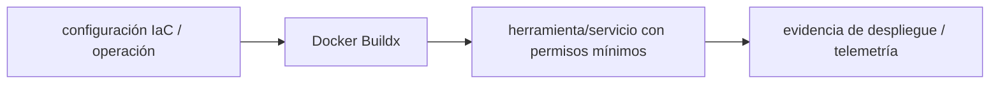

# Docker Buildx — Vigilio línea Docker Engine/BuildKit por runner

## Qué es, qué hace y cuándo usarla

Herramienta de Docker BuildKit para builds reproducibles, multi-plataforma y caché remota. Mantiene secrets fuera de las capas e imágenes base por digest.

**Ubicación en Vigilio:** usa esta dependencia en su stack propietario; otras skills deben enlazar esta guía, no duplicar sus reglas. **Versión:** la indicada en el encabezado es la línea documentada; consultar `technology/versions.md` y el lockfile antes de copiar APIs o aprobar un upgrade.

> **Guía propia de Docker Buildx (platform).** Estado a **2026-10-25**: línea Docker Engine/BuildKit por runner. Versión del proyecto consumidor = `pnpm-lock.yaml` / `composer.lock` / imagen o manifest. Fuente: [documentación oficial](https://docs.docker.com/build/buildx/). Fuente normativa transversal de versiones: [versions.md](../versions.md). **No implica instalación automática ni upgrade aprobado.**

## Objetivo, responsabilidad y dónde usar

multi-stage y rootless/non-root, cache remota sin secretos, reproducibilidad.

**Uso:** aplicar solo si está declarada y resulta pertinente al consumidor; ver [política de adopción y DRY](README.md).

### Diagrama de integración (Mermaid)



El flujo muestra la **responsabilidad arquitectónica** de la librería; no representa llamadas reales de red para todas las operaciones.


## Instalación o verificación

```bash
docker buildx version
```

**Gate de instalación:** consultar [procedimiento compartido](README.md#protocolo-de-adopción-y-actualización); estos comandos son indicativos, no ejecuciones sobre un consumidor.

## ✅ Correcto — uso actual y ejemplo de referencia

```bash
docker buildx build --platform linux/amd64,linux/arm64 --provenance=true --sbom=true -t registry/app:sha --push .
```

**Por qué:** multi-stage y rootless/non-root, cache remota sin secretos, reproducibilidad.

## ❌ Incorrecto — patrón legacy, inseguro o mal ubicado

**Nota técnica (no es código ejecutable):** ❌ tag latest sin digest ni escaneo ni multi-stage.

**Riesgo:** confundir versiones o responsabilidades y obtener un contrato incorrecto.

## Nuevas capacidades, migración y breaking changes

BuildKit features evolucionan por runner; fijar imágenes base por digest y runtime.

Aplicar el [protocolo de migración común](README.md#protocolo-de-adopción-y-actualización), sin asumir que una release nueva está desplegada.

## Buenas prácticas, seguridad, rendimiento y operación

Consultar la [política transversal de librerías](README.md) para seguridad, versionado, evidencia y revisión de contratos. Para esta librería, además, aplicar las verificaciones concretas que se detallan a continuación.

## Gates de aceptación y compatibilidad

SBOM, vulnerability scan, size, non-root, digest verification.

Estado de prueba de estos ejemplos documentales: **NOT_RUN** en aplicaciones consumidoras; ver [criterios de evidencia](README.md#criterios-de-validación).


## Referencias

- [Documentación oficial y migración de Docker Buildx](https://docs.docker.com/build/buildx/)
- [Matriz y baseline de versiones](../versions.md)
- [Calidad de código canónica](../../foundations/engineering/code-quality.md)


## Recetario operativo ampliado — docker-buildx (2026-10-25)

### API actual: dos tareas reales que debe saber ejecutar una skill

1. **Multi-stage: separar builder de runtime y copiar solo artefactos finales.**
2. **BuildKit cache mounts y `--platform` explícito cuando se generan imágenes multi-arquitectura.**

### Migración desde versiones anteriores: decisión concreta

- **Qué cambia o se debe revisar:** Evitar cache legacy `docker build` implícita sin Buildx/BuildKit reproducibles; fijar digest base.

### Responsabilidades y capas

Plataforma build: no definir DTOs de Laravel/Nest dentro del Dockerfile.

**✅ Correcto:** mantener la integración encapsulada, alinear los nombres del negocio con Vigilio y depender de un contrato estable.

**❌ Incorrecto:** importar internals de la librería desde Domain, declarar `any` para resolver un upgrade, o duplicar reglas ya propietarias de otra tecnología.

### Seguridad, resiliencia y rendimiento

- Secrets solo `--secret`/OIDC; nunca ARG/ENV con token persistente en imagen.

### Test de aceptación específico y evidencia mínima

- **Escenario comprobable:** Build linux/amd64 y arm64 si aplica; SBOM, scan, image diff, run como usuario sin root.


## Guía operativa detallada — 8 casos y 4 antipatrones

### Ocho ejemplos de la API y casos de uso relevantes

Los fragmentos siguientes ilustran **operaciones independientes**. Variables, imports, provider, extensión y configuración se completan en el proyecto consumidor; **no están certificados como un archivo único compilable**. Cuando hay comentarios `#`, son pasos de integración o configuración y no APIs inventadas.

#### Ejemplo 1. Crear builder

**✅ Correcto — crear builder**

```bash
docker buildx create --name vigilio-builder --use
```


#### Ejemplo 2. Verificar

**✅ Correcto — verificar**

```bash
docker buildx inspect --bootstrap
```


#### Ejemplo 3. Build single arch

**✅ Correcto — build single arch**

```bash
docker buildx build --platform linux/amd64 -t vigilio/api:test .
```


#### Ejemplo 4. Build multiarch

**✅ Correcto — build multiarch**

```bash
docker buildx build --platform linux/amd64,linux/arm64 -t example/api:1.0 --push .
```


#### Ejemplo 5. Cache registry

**✅ Correcto — cache registry**

```bash
docker buildx build --cache-to type=registry,ref=example/api:cache,mode=max .
```


#### Ejemplo 6. Usar cache previa

**✅ Correcto — usar cache previa**

```bash
docker buildx build --cache-from type=registry,ref=example/api:cache .
```


#### Ejemplo 7. Secret build

**✅ Correcto — secret build**

```bash
docker buildx build --secret id=npmrc,src=.npmrc .
```


#### Ejemplo 8. Salida OCI

**✅ Correcto — salida oci**

```bash
docker buildx build --output type=oci,dest=api.oci.tar .
```


### Cuatro antipatrones frecuentes y su sustitución

#### Antipatrón 1 — riesgo y alternativa

**❌ Incorrecto**

```bash
ARG TOKEN=supersecret
```

**Por qué está mal:** Expone credenciales o confunde autenticación con autorización; puede ocasionar filtración o acceso indebido.

**✅ Correcto**

```bash
docker buildx build --secret id=token,src=token.txt .
```

**Por qué mejora:** Separa permisos y secretos del código de negocio y permite comprobar el acceso mínimo.

#### Antipatrón 2 — riesgo y alternativa

**❌ Incorrecto**

```bash
FROM node:latest
```

**Por qué está mal:** El patrón «FROM node:latest» es riesgoso: puede mezclar firmas incompatibles o ejecutar una API retirada en la versión instalada.

**✅ Correcto**

```bash
FROM node:XX@sha256:<digest-validado>
```

**Por qué mejora:** Convierte la condición en un control verificable mediante validación o pruebas.

#### Antipatrón 3 — riesgo y alternativa

**❌ Incorrecto**

```bash
docker buildx build --platform linux/amd64,linux/arm64 --load .
```

**Por qué está mal:** El patrón «docker buildx build --platform linux/amd64,linux/arm64 --load .» es riesgoso: puede elevar el coste de runtime, causar fallos de despliegue o empaquetar dependencias no deseadas.

**✅ Correcto**

```bash
docker buildx build --platform linux/amd64,linux/arm64 --push .
```

**Por qué mejora:** El patrón «docker buildx build --platform linux/amd64,linux/arm64 --push .» mejora el caso: el build y los recursos se verifican mediante gates de despliegue y rendimiento.

#### Antipatrón 4 — riesgo y alternativa

**❌ Incorrecto — Copiar .env dentro de imagen.**

**Por qué está mal:** El patrón «Copiar .env dentro de imagen» es riesgoso: los secretos o datos privados quedan expuestos en código, logs o artefactos de despliegue.

**✅ Correcto — Secretos runtime externos.**

**Por qué mejora:** Separa permisos y secretos del código de negocio y permite comprobar el acceso mínimo.

### Versión estable, breaking changes y verificación

- **Versión estable exacta:** no se declara un parche universal cuando no hay verificación específica de su registry/release. Consultar el encabezado de esta guía, `technology/versions.md` y el manifiesto del servicio. **Estado de patch: VERIFY_LOCKFILE**.
- **Migración:** identificar major anterior, APIs retiradas/cambiadas, peer dependencies, requisitos de runtime, cambios de tipos, ejecución CI y plan de rollback. Si no hay prueba sobre el consumidor, **NOT_RUN**, no PASS.
- **Versiones previas:** el ejemplo marcado ❌ en esta guía explica al menos una incompatibilidad o un uso obsoleto; no trasplantar APIs de otras versiones.
- **Tests:** probar al menos happy path, error, seguridad/permiso y compatibilidad con el runtime donde aplique; solo activar nuevas capacidades mediante una PR versionada.

### Fuentes oficiales y referencias al final

- [Referencia propia oficial](https://docs.docker.com/build/buildx/)
- [Matriz canónica de versiones](../versions.md)
- [Política de adopción de librerías](README.md)

## Guía de compatibilidad y evaluación por versión (2026-10-25)

**Estado del patch exacto:** `VERIFY_LOCKFILE`. La guía documenta la familia de APIs; **no se ha verificado hoy el patch estable preciso de esta dependencia**. Consultar la fuente oficial enlazada al inicio y el lockfile antes de generar código o aprobar un upgrade.

### Checklist específico de esta librería

- **Migración/compatibilidad:** Evitar cache legacy `docker build` implícita sin Buildx/BuildKit reproducibles; fijar digest base.
- **Prueba propia:** Build linux/amd64 y arm64 si aplica; SBOM, scan, image diff, run como usuario sin root.
- **Límite de responsabilidad:** usar esta librería solo en su adaptador o capa propietaria; consultar los ejemplos de API y antipatrones anteriores antes de cambiar llamadas públicas.

**Gate de aprobación:** leer la referencia oficial y resolver la versión del consumidor, ejecutar typecheck y pruebas específicas, registrar PASS/FAIL/NOT_RUN/BLOCKED. No confundir esta guía con validación de un consumidor real. [Procedimiento único de adopción](README.md#protocolo-de-adopción-y-actualización).

