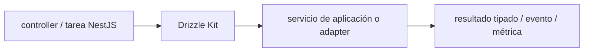

# Drizzle Kit — Vigilio línea compatible con Drizzle ORM 0.45.x

## Qué es, qué hace y cuándo usarla

CLI de migraciones y cambios de esquema de Drizzle. Genera, revisa y ejecuta migraciones SQL; no debe aplicar pushes irreversibles directamente en producción.

**Ubicación en Vigilio:** usa esta dependencia en su stack propietario; otras skills deben enlazar esta guía, no duplicar sus reglas. **Versión:** la indicada en el encabezado es la línea documentada; consultar `technology/versions.md` y el lockfile antes de copiar APIs o aprobar un upgrade.

> **Guía propia de Drizzle Kit (backend-node).** Estado a **2026-10-25**: línea compatible con Drizzle ORM 0.45.x. Versión del proyecto consumidor = `pnpm-lock.yaml` / `composer.lock` / imagen o manifest. Fuente: [documentación oficial](https://orm.drizzle.team/docs/kit-overview). Fuente normativa transversal de versiones: [versions.md](../versions.md). **No implica instalación automática ni upgrade aprobado.**

## Objetivo, responsabilidad y dónde usar

Migrations versionadas e inmutables; expand/contract; rollback y locks.

**Uso:** aplicar solo si está declarada y resulta pertinente al consumidor; ver [política de adopción y DRY](README.md).

### Diagrama de integración (Mermaid)



El flujo muestra la **responsabilidad arquitectónica** de la librería; no representa llamadas reales de red para todas las operaciones.


## Instalación o verificación

```bash
pnpm add -D drizzle-kit
```

**Gate de instalación:** consultar [procedimiento compartido](README.md#protocolo-de-adopción-y-actualización); estos comandos son indicativos, no ejecuciones sobre un consumidor.

## ✅ Correcto — uso actual y ejemplo de referencia

**Nota técnica (no es código ejecutable):** Scripts CI pnpm drizzle-kit generate pnpm drizzle-kit migrate Revisar SQL generado antes del deploy.

**Por qué:** Migrations versionadas e inmutables; expand/contract; rollback y locks.

## ❌ Incorrecto — patrón legacy, inseguro o mal ubicado

**Nota técnica (no es código ejecutable):** ❌ ejecutar push sobre producción sin revisar diff de schema.

**Riesgo:** confundir versiones o responsabilidades y obtener un contrato incorrecto.

## Nuevas capacidades, migración y breaking changes

Mantener kit/drizzle compatible; changes mayores pueden alterar snapshots y migrations.

Aplicar el [protocolo de migración común](README.md#protocolo-de-adopción-y-actualización), sin asumir que una release nueva está desplegada.

## Buenas prácticas, seguridad, rendimiento y operación

Consultar la [política transversal de librerías](README.md) para seguridad, versionado, evidencia y revisión de contratos. Para esta librería, además, aplicar las verificaciones concretas que se detallan a continuación.

## Gates de aceptación y compatibilidad

Prueba migración DB efímera, replay, constraints, plan y permisos mínimos.

Estado de prueba de estos ejemplos documentales: **NOT_RUN** en aplicaciones consumidoras; ver [criterios de evidencia](README.md#criterios-de-validación).


## Referencias

- [Documentación oficial y migración de Drizzle Kit](https://orm.drizzle.team/docs/kit-overview)
- [Matriz y baseline de versiones](../versions.md)
- [Calidad de código canónica](../../foundations/engineering/code-quality.md)


## Recetario operativo ampliado — drizzle-kit (2026-10-25)

### API actual: dos tareas reales que debe saber ejecutar una skill

1. **Mantener archivos `*.table.ts` como ownership de SQL y generar migraciones revisables.**
2. **Usar `drizzle-kit generate`, `migrate`, `check` por comandos soportados por la versión instalada.**

### Migración desde versiones anteriores: decisión concreta

- **Qué cambia o se debe revisar:** No aplicar `push` directamente a producción para cambios destructivos; migrar con scripts SQL.

### Responsabilidades y capas

Herramienta de migración; diferente de schema de dominio Zod y DTO HTTP.

**✅ Correcto:** mantener la integración encapsulada, alinear los nombres del negocio con Vigilio y depender de un contrato estable.

**❌ Incorrecto:** importar internals de la librería desde Domain, declarar `any` para resolver un upgrade, o duplicar reglas ya propietarias de otra tecnología.

### Seguridad, resiliencia y rendimiento

- Indexes/constraints/locks y backward-compatible expand-contract en tablas grandes.

### Test de aceptación específico y evidencia mínima

- **Escenario comprobable:** Prueba clean DB, migrate forward, explain plan, rollback/roll-forward ensayado.

### Ejemplo de integración vigente (fragmento adicional)

```bash
pnpm exec drizzle-kit generate
# Inspeccionar migration SQL y aprobación expand/contract
pnpm exec drizzle-kit migrate
pnpm exec drizzle-kit check
```

**Nota:** los fragmentos muestran la API específica y requieren imports/providers/fixtures del consumidor; no se certifica compilación por el solo hecho de aparecer aquí.


## Guía operativa detallada — 8 casos y 4 antipatrones

### Ocho ejemplos de la API y casos de uso relevantes

Los fragmentos siguientes ilustran **operaciones independientes**. Variables, imports, provider, extensión y configuración se completan en el proyecto consumidor; **no están certificados como un archivo único compilable**. Cuando hay comentarios `#`, son pasos de integración o configuración y no APIs inventadas.

#### Ejemplo 1. Definir config

**✅ Correcto — definir config**

```bash
export default defineConfig({ dialect: 'postgresql', schema: './src/**/*.table.ts', out: './drizzle', dbCredentials: { url: process.env.DATABASE_URL! } });
```


#### Ejemplo 2. Generar migración

**✅ Correcto — generar migración**

```bash
pnpm drizzle-kit generate
```


#### Ejemplo 3. Aplicar migración

**✅ Correcto — aplicar migración**

```bash
pnpm drizzle-kit migrate
```


#### Ejemplo 4. Comprobar esquema

**✅ Correcto — comprobar esquema**

```bash
pnpm drizzle-kit check
```


#### Ejemplo 5. Explorar base

**✅ Correcto — explorar base**

```bash
pnpm drizzle-kit studio
```


#### Ejemplo 6. Consultar ayuda

**✅ Correcto — consultar ayuda**

```bash
pnpm drizzle-kit --help
```


#### Ejemplo 7. Auditar SQL generado

**✅ Correcto — auditar sql generado**

**Nota técnica (no es código ejecutable):** Revisar archivos drizzle/*.sql antes de merge; prohibir DROP accidental.


#### Ejemplo 8. Drift

**✅ Correcto — drift**

**Nota técnica (no es código ejecutable):** Gate: comparar esquema real, archivos SQL y snapshots en entorno efímero.


### Cuatro antipatrones frecuentes y su sustitución

#### Antipatrón 1 — riesgo y alternativa

**❌ Incorrecto**

```bash
pnpm drizzle-kit push # directamente en prod
```

**Por qué está mal:** El patrón «pnpm drizzle-kit push # directamente en prod» es riesgoso: la consulta puede producir resultados incorrectos, lentitud o aislamiento insuficiente de datos.

**✅ Correcto**

```bash
pnpm drizzle-kit generate # revisar SQL + migrate
```

**Por qué mejora:** El patrón «pnpm drizzle-kit generate # revisar SQL + migrate» mejora el caso: la consulta o el contrato se valida y mide sobre datos representativos.

#### Antipatrón 2 — riesgo y alternativa

**❌ Incorrecto — Borrar migraciones aplicadas.**

**Por qué está mal:** Puede destruir datos o recursos antes de verificar dependencias, recuperación y política de retención.

**✅ Correcto — Migración forward-only revisada.**

**Por qué mejora:** El patrón «Migración forward-only revisada» mejora el caso: se exige revisión de cambios, retención y un plan de reversión o recuperación.

#### Antipatrón 3 — riesgo y alternativa

**❌ Incorrecto — Aplicar DROP de columna en release único.**

**Por qué está mal:** Puede destruir datos o recursos antes de verificar dependencias, recuperación y política de retención.

**✅ Correcto — Expand/contract con etapas.**

**Por qué mejora:** El patrón «Expand/contract con etapas» mejora el caso: se exige revisión de cambios, retención y un plan de reversión o recuperación.

#### Antipatrón 4 — riesgo y alternativa

**❌ Incorrecto — Olvidar constraints únicas.**

**Por qué está mal:** Omite un control operativo necesario, por lo que el comportamiento puede ser inseguro o difícil de verificar.

**✅ Correcto — Añadir índices y probar contra PostgreSQL real.**

**Por qué mejora:** El patrón «Añadir índices y probar contra PostgreSQL real» mejora el caso: la consulta o el contrato se valida y mide sobre datos representativos.

### Versión estable, breaking changes y verificación

- **Versión estable exacta:** no se declara un parche universal cuando no hay verificación específica de su registry/release. Consultar el encabezado de esta guía, `technology/versions.md` y el manifiesto del servicio. **Estado de patch: VERIFY_LOCKFILE**.
- **Migración:** identificar major anterior, APIs retiradas/cambiadas, peer dependencies, requisitos de runtime, cambios de tipos, ejecución CI y plan de rollback. Si no hay prueba sobre el consumidor, **NOT_RUN**, no PASS.
- **Versiones previas:** el ejemplo marcado ❌ en esta guía explica al menos una incompatibilidad o un uso obsoleto; no trasplantar APIs de otras versiones.
- **Tests:** probar al menos happy path, error, seguridad/permiso y compatibilidad con el runtime donde aplique; solo activar nuevas capacidades mediante una PR versionada.

### Fuentes oficiales y referencias al final

- [Referencia propia oficial](https://orm.drizzle.team/docs/kit-overview)
- [Matriz canónica de versiones](../versions.md)
- [Política de adopción de librerías](README.md)

## Guía de compatibilidad y evaluación por versión (2026-10-25)

**Estado del patch exacto:** `VERIFY_LOCKFILE`. La guía documenta la familia de APIs; **no se ha verificado hoy el patch estable preciso de esta dependencia**. Consultar la fuente oficial enlazada al inicio y el lockfile antes de generar código o aprobar un upgrade.

### Checklist específico de esta librería

- **Migración/compatibilidad:** No aplicar `push` directamente a producción para cambios destructivos; migrar con scripts SQL.
- **Prueba propia:** Prueba clean DB, migrate forward, explain plan, rollback/roll-forward ensayado.
- **Límite de responsabilidad:** usar esta librería solo en su adaptador o capa propietaria; consultar los ejemplos de API y antipatrones anteriores antes de cambiar llamadas públicas.

**Gate de aprobación:** leer la referencia oficial y resolver la versión del consumidor, ejecutar typecheck y pruebas específicas, registrar PASS/FAIL/NOT_RUN/BLOCKED. No confundir esta guía con validación de un consumidor real. [Procedimiento único de adopción](README.md#protocolo-de-adopción-y-actualización).

