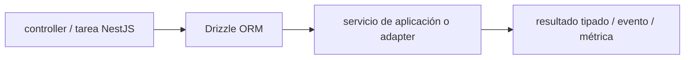

# Drizzle ORM — Vigilio 0.45.4 estable; 1.0.0-rc no es estable

## Qué es, qué hace y cuándo usarla

ORM TypeScript SQL-first para consultas tipadas y definición de tablas. Es un adaptador de persistencia: los casos de uso no importan tablas directamente.

**Ubicación en Vigilio:** usa esta dependencia en su stack propietario; otras skills deben enlazar esta guía, no duplicar sus reglas. **Versión:** la indicada en el encabezado es la línea documentada; consultar `technology/versions.md` y el lockfile antes de copiar APIs o aprobar un upgrade.

> **Guía propia de Drizzle ORM (backend-node).** Estado a **2026-10-25**: 0.45.4 estable; 1.0.0-rc no es estable. Versión del proyecto consumidor = `pnpm-lock.yaml` / `composer.lock` / imagen o manifest. Fuente: [documentación oficial](https://orm.drizzle.team/docs/overview). Fuente normativa transversal de versiones: [versions.md](../versions.md). **No implica instalación automática ni upgrade aprobado.**

## Objetivo, responsabilidad y dónde usar

Drizzle solo infraestructura; Repo Port y Application separados. Filtros tenant en cada query y guard SQL para actualizaciones concurrentes.

**Uso:** aplicar solo si está declarada y resulta pertinente al consumidor; ver [política de adopción y DRY](README.md).

### Diagrama de integración (Mermaid)



El flujo muestra la **responsabilidad arquitectónica** de la librería; no representa llamadas reales de red para todas las operaciones.


## Instalación o verificación

```bash
pnpm add drizzle-orm pg
```

**Gate de instalación:** consultar [procedimiento compartido](README.md#protocolo-de-adopción-y-actualización); estos comandos son indicativos, no ejecuciones sobre un consumidor.

## ✅ Correcto — uso actual y ejemplo de referencia

```typescript
import { pgTable, uuid, varchar, pgEnum } from 'drizzle-orm/pg-core';
export const productSchema=z.object({product_type:z.enum(['inclusion','exclusion'])});
export const productTypeEnum=pgEnum('product_type',productSchema.shape.product_type.options);
export const products=pgTable('products',{id:uuid().primaryKey(),tenant_id:uuid().notNull(),nro_poliza:varchar({length:30}).notNull(),product_type:productTypeEnum().notNull()});
// no repetir nombre de columna cuando coincide con la key
```

**Por qué:** Drizzle solo infraestructura; Repo Port y Application separados. Filtros tenant en cada query y guard SQL para actualizaciones concurrentes.

## ❌ Incorrecto — patrón legacy, inseguro o mal ubicado

```typescript
const products=pgTable('products',{nro_poliza:varchar('nro_poliza',{length:30})});
// ❌ repetición innecesaria en Drizzle actual cuando key coincide
```

**Riesgo:** confundir versiones o responsabilidades y obtener un contrato incorrecto.

## Nuevas capacidades, migración y breaking changes

0.45 estable vs 1.0 RC: no adoptar RC como baseline. Comprobar breaking en drivers y relaciones antes de migración. Las operaciones SQL `update()/delete()` son APIs del ORM, no nombres de casos de uso DDD.

Aplicar el [protocolo de migración común](README.md#protocolo-de-adopción-y-actualización), sin asumir que una release nueva está desplegada.

## Buenas prácticas, seguridad, rendimiento y operación

Consultar la [política transversal de librerías](README.md) para seguridad, versionado, evidencia y revisión de contratos. Para esta librería, además, aplicar las verificaciones concretas que se detallan a continuación.

## Gates de aceptación y compatibilidad

drizzle-kit check/migration; transacciones y locks; índice único, typed query, filtros tenant, load tests y rollback.

Estado de prueba de estos ejemplos documentales: **NOT_RUN** en aplicaciones consumidoras; ver [criterios de evidencia](README.md#criterios-de-validación).


## Drizzle Postgres y DDD

```typescript
export const productTypeEnum = pgEnum('product_type',productSchema.shape.product_type.options);
export const productStatusEnum = pgEnum('product_status',productSchema.shape.estado.options);
export const products = pgTable('products',{
 id: uuid().primaryKey(),
 tenant_id: uuid().notNull(),
 nro_poliza: varchar({length:30}).notNull(),
 product_type: productTypeEnum().notNull(),
 estado: productStatusEnum().notNull(),
});
```

### Persistencia correcta

```typescript
const changed = await db.update(products).set({nro_poliza})
  .where(and(eq(products.id,product_id),eq(products.tenant_id,tenant_id),eq(products.estado,'pendiente')))
  .returning({id:products.id});
if (!changed.length) throw new ProductStateConflictError();
```

- `update()`/`delete()` son APIs válidas del ORM, pero Application usa métodos semánticos `changeProductDetails()`/`removeProduct()`.
- Filtrar por `tenant_id` siempre, usar `ORDER BY` determinista en paginación y reducir N+1.
- Migraciones revisadas; `pgEnum` proviene de Zod cuando es la fuente de reglas de estados, no duplicar arrays.
- `0.45.4` estable; **no** instalar por accidente `1.0.0-rc.*` solo porque aparezca más nuevo en releases.

## Referencias

- [Documentación oficial y migración de Drizzle ORM](https://orm.drizzle.team/docs/overview)
- [Matriz y baseline de versiones](../versions.md)
- [Calidad de código canónica](../../foundations/engineering/code-quality.md)


## Recetario operativo ampliado — drizzle-orm (2026-10-25)

### API actual: dos tareas reales que debe saber ejecutar una skill

1. **Preferir `select({...}).from(table).where(eq(...))`, `and` y `returning()`.**
2. **Usar transacciones para unidad atómica, queries preparadas, filtros tenant obligatorios.**

### Migración desde versiones anteriores: decisión concreta

- **Qué cambia o se debe revisar:** Drizzle 1.0 RC sigue distinta de la estable 0.45.x; no copiar API RC sin opt-in.

### Responsabilidades y capas

Repository adapters, nunca dentro de Domain o DTO.

**✅ Correcto:** mantener la integración encapsulada, alinear los nombres del negocio con Vigilio y depender de un contrato estable.

**❌ Incorrecto:** importar internals de la librería desde Domain, declarar `any` para resolver un upgrade, o duplicar reglas ya propietarias de otra tecnología.

### Seguridad, resiliencia y rendimiento

- Batch pequeño, índices, EXPLAIN; evitar N+1 y aislamiento roto entre tenants.

### Test de aceptación específico y evidencia mínima

- **Escenario comprobable:** Test integration PostgreSQL, locking concurrente, SQL generated y profiling con índices.

### Ejemplo de integración vigente (fragmento adicional)

```typescript
export const products = pgTable('products', {
  id: uuid().primaryKey(),
  tenant_id: uuid().notNull(),
  estado: pgEnum('product_status', productSchema.shape.estado.options)().notNull(),
});
const rows = await db.select().from(products)
  .where(and(eq(products.tenant_id, tenant_id), eq(products.estado, 'pendiente')))
  .limit(25);
```

**Nota:** los fragmentos muestran la API específica y requieren imports/providers/fixtures del consumidor; no se certifica compilación por el solo hecho de aparecer aquí.

### Drizzle 0.45.x vs 1.0 RC: gate de estabilidad

- La rama 0.45.4 se mantiene como referencia estable en este catálogo; 1.0 RC no se convierte automáticamente en baseline.
- `pgTable` infiere columna desde la key JS cuando coincide: no escribir `varchar('nro_poliza')` redundante.
- `pgEnum(..., productSchema.shape.product_type.options)` reutiliza Zod para evitar duplicar estados; comprobar el soporte del driver.
- No generar columnas dinámicas desde input HTTP, usar query builder tipado y filtros tenant.
- Migraciones con drizzle-kit versionado junto al ORM y PostgreSQL real en tests.


## Guía operativa detallada — 8 casos y 4 antipatrones

### Ocho ejemplos de la API y casos de uso relevantes

Los fragmentos siguientes ilustran **operaciones independientes**. Variables, imports, provider, extensión y configuración se completan en el proyecto consumidor; **no están certificados como un archivo único compilable**. Cuando hay comentarios `#`, son pasos de integración o configuración y no APIs inventadas.

#### Ejemplo 1. Select tipado

**✅ Correcto — select tipado**

```typescript
await database.select({ id: products.id }).from(products);
```


#### Ejemplo 2. Filtro seguro

**✅ Correcto — filtro seguro**

```typescript
await database.select().from(products).where(eq(products.tenant_id, tenant_id));
```


#### Ejemplo 3. AND

**✅ Correcto — and**

```typescript
where(and(eq(products.tenant_id, tenant_id), eq(products.estado, 'pendiente')))
```


#### Ejemplo 4. Insert RETURNING

**✅ Correcto — insert returning**

```typescript
await database.insert(products).values(product).returning();
```


#### Ejemplo 5. Update condicional

**✅ Correcto — update condicional**

```typescript
await database.update(products).set({ estado: 'procesado' }).where(eq(products.id, product_id)).returning();
```


#### Ejemplo 6. Upsert

**✅ Correcto — upsert**

```typescript
await database.insert(products).values(rows).onConflictDoUpdate({ target: products.id, set: { estado: 'procesado' } });
```


#### Ejemplo 7. Transacción

**✅ Correcto — transacción**

```typescript
await database.transaction(async (tx) => { await tx.insert(outbox).values(event); });
```


#### Ejemplo 8. SQL parametrizado

**✅ Correcto — sql parametrizado**

```typescript
await database.execute(sql`select * from products where tenant_id = ${tenant_id}`);
```


### Cuatro antipatrones frecuentes y su sustitución

#### Antipatrón 1 — riesgo y alternativa

**❌ Incorrecto**

```typescript
sql.raw(`select * from products where id = ${id}`)
```

**Por qué está mal:** El patrón «sql.raw(`select * from products where id = ${id}`)» es riesgoso: la consulta puede producir resultados incorrectos, lentitud o aislamiento insuficiente de datos.

**✅ Correcto**

```typescript
sql`select * from products where id = ${id}`
```

**Por qué mejora:** El patrón «sql`select * from products where id = ${id}`» mejora el caso: la consulta o el contrato se valida y mide sobre datos representativos.

#### Antipatrón 2 — riesgo y alternativa

**❌ Incorrecto**

```typescript
varchar("nro_poliza", { length: 30 }) # redundante si campo igual
```

**Por qué está mal:** El patrón «varchar("nro_poliza", { length: 30 }) # redundante si campo igual» es riesgoso: la elección «varchar("nro_poliza", { length: 30 }) # redundante si campo igual» puede incumplir los requisitos operativos de drizzle-orm.

**✅ Correcto**

```typescript
nro_poliza: varchar({ length: 30 })
```

**Por qué mejora:** El patrón «nro_poliza: varchar({ length: 30 })» mejora el caso: la alternativa «nro_poliza: varchar({ length: 30 })» establece el comportamiento esperado de drizzle-orm.

#### Antipatrón 3 — riesgo y alternativa

**❌ Incorrecto**

```typescript
database.select().from(products) # sin tenant
```

**Por qué está mal:** Omite un control operativo necesario, por lo que el comportamiento puede ser inseguro o difícil de verificar.

**✅ Correcto**

```typescript
database.select().from(products).where(eq(products.tenant_id, tenant_id))
```

**Por qué mejora:** El patrón «database.select().from(products).where(eq(products.tenant_id, tenant_id))» mejora el caso: se fuerza autorización en el borde/servidor y se limita el acceso por recurso.

#### Antipatrón 4 — riesgo y alternativa

**❌ Incorrecto — Update no condicionado en estado.**

**Por qué está mal:** El patrón «Update no condicionado en estado» es riesgoso: puede permitir acceso a recursos no autorizados o de otro tenant.

**✅ Correcto — WHERE id + tenant_id + estado + returning().**

**Por qué mejora:** El patrón «WHERE id + tenant_id + estado + returning()» mejora el caso: se fuerza autorización en el borde/servidor y se limita el acceso por recurso.

### Versión estable, breaking changes y verificación

- **Versión estable exacta:** no se declara un parche universal cuando no hay verificación específica de su registry/release. Consultar el encabezado de esta guía, `technology/versions.md` y el manifiesto del servicio. **Estado de patch: VERIFY_LOCKFILE**.
- **Migración:** identificar major anterior, APIs retiradas/cambiadas, peer dependencies, requisitos de runtime, cambios de tipos, ejecución CI y plan de rollback. Si no hay prueba sobre el consumidor, **NOT_RUN**, no PASS.
- **Versiones previas:** el ejemplo marcado ❌ en esta guía explica al menos una incompatibilidad o un uso obsoleto; no trasplantar APIs de otras versiones.
- **Tests:** probar al menos happy path, error, seguridad/permiso y compatibilidad con el runtime donde aplique; solo activar nuevas capacidades mediante una PR versionada.

### Fuentes oficiales y referencias al final

- [Referencia propia oficial](https://orm.drizzle.team/docs/overview)
- [Matriz canónica de versiones](../versions.md)
- [Política de adopción de librerías](README.md)

## Guía de compatibilidad y evaluación por versión (2026-10-25)

**Release contrastada para esta familia:** `0.45.4`. Fuente: [publicación oficial](https://www.npmjs.com/package/drizzle-orm?activeTab=versions). **Cambio clave:** 0.45 estable; no instalar 1.0 RC como estable.

### Checklist específico de esta librería

- Definir tablas en `*.table.ts`; `nro_poliza: varchar({length:30})` sin repetir el nombre.
- Derivar pgEnum desde `productSchema.shape.product_type.options`; fijar semántica en schemas de dominio.
- Cada `UPDATE/DELETE` multi-tenant debe filtrar tenant + invariantes en SQL, especialmente bajo concurrencia.
- Usar COPY/streaming para ingest masiva cuando convenga; no construir arrays de millones de filas.

**Gate de aprobación:** leer la referencia oficial y resolver la versión del consumidor, ejecutar typecheck y pruebas específicas, registrar PASS/FAIL/NOT_RUN/BLOCKED. No confundir esta guía con validación de un consumidor real. [Procedimiento único de adopción](README.md#protocolo-de-adopción-y-actualización).

## Drizzle 0.45: enums reutilizados y aislamiento tenant en escritura

```typescript
import { pgTable, pgEnum, uuid, varchar, uniqueIndex } from 'drizzle-orm/pg-core';
import { and, eq } from 'drizzle-orm';
import { productSchema } from '../../domain/schemas/product.schema';

export const productTypeEnum = pgEnum('product_type', productSchema.shape.product_type.options);
export const productStatusEnum = pgEnum('product_status', productSchema.shape.estado.options);
export const products = pgTable('products', {
  id: uuid().primaryKey(),
  tenant_id: uuid().notNull(),
  nro_poliza: varchar({ length: 30 }).notNull(),
  product_type: productTypeEnum().notNull(),
  estado: productStatusEnum().notNull(),
}, (t) => [uniqueIndex('products_tenant_policy_uq').on(t.tenant_id, t.nro_poliza)]);

// El repository aplica una condición atómica al cambiar estado:
async function markProcessed(db: AppDatabase, product_id: string, tenant_id: string) {
  return db.update(products).set({ estado: 'procesado' })
    .where(and(eq(products.id, product_id), eq(products.tenant_id, tenant_id), eq(products.estado, 'pendiente')))
    .returning({ id: products.id });
}
```

`AppDatabase` es el tipo del adapter Drizzle de la app, no un tipo publicado por la librería; derivarlo de la instancia real. **❌ Incorrecto:** repetir `nro_poliza: varchar('nro_poliza')` cuando coincide; separar el enum SQL de los valores Zod sin una migración; confiar solo en un if previo al UPDATE. [Documentación Drizzle](https://orm.drizzle.team/docs/column-types/pg).
