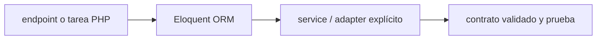

# Eloquent ORM — Vigilio Laravel 13.x, adaptador de infraestructura

## Qué es, qué hace y cuándo usarla

ORM de Laravel para modelos de persistencia, relaciones y scopes de consultas. No equivale a una entidad DDD con invariantes.

**Ubicación en Vigilio:** usa esta dependencia en su stack propietario; otras skills deben enlazar esta guía, no duplicar sus reglas. **Versión:** la indicada en el encabezado es la línea documentada; consultar `technology/versions.md` y el lockfile antes de copiar APIs o aprobar un upgrade.

> **Guía propia de Eloquent ORM (backend-php).** Estado a **2026-10-25**: Laravel 13.x, adaptador de infraestructura. Versión del proyecto consumidor = `pnpm-lock.yaml` / `composer.lock` / imagen o manifest. Fuente: [documentación oficial](https://laravel.com/docs/13.x/eloquent). Fuente normativa transversal de versiones: [versions.md](../versions.md). **No implica instalación automática ni upgrade aprobado.**

## Objetivo, responsabilidad y dónde usar

Repository Port devuelve modelos dominio/lectura; eager loading, casts, DB transactions, evitar model callbacks ocultos.

**Uso:** aplicar solo si está declarada y resulta pertinente al consumidor; ver [política de adopción y DRY](README.md).

### Diagrama de integración (Mermaid)



El flujo muestra la **responsabilidad arquitectónica** de la librería; no representa llamadas reales de red para todas las operaciones.


## Instalación o verificación

```bash
incluido en laravel/framework
```

**Gate de instalación:** consultar [procedimiento compartido](README.md#protocolo-de-adopción-y-actualización); estos comandos son indicativos, no ejecuciones sobre un consumidor.

## ✅ Correcto — uso actual y ejemplo de referencia

```php
// query tenant-scoped, columnas explícitas e índices
ProductRecord::query()->where('tenant_id',$tenant_id)
  ->where('estado','pendiente')->orderBy('id')->limit(25)->get();
```

**Por qué:** Repository Port devuelve modelos dominio/lectura; eager loading, casts, DB transactions, evitar model callbacks ocultos.

## ❌ Incorrecto — patrón legacy, inseguro o mal ubicado

```php
// ❌ N+1 y find(id) sin tenant
ProductRecord::find($product_id);
```

**Riesgo:** confundir versiones o responsabilidades y obtener un contrato incorrecto.

## Nuevas capacidades, migración y breaking changes

Las APIs de ORM update/delete siguen siendo válidas dentro de Infrastructure aunque casos de uso sean semánticos.

Aplicar el [protocolo de migración común](README.md#protocolo-de-adopción-y-actualización), sin asumir que una release nueva está desplegada.

## Buenas prácticas, seguridad, rendimiento y operación

Consultar la [política transversal de librerías](README.md) para seguridad, versionado, evidencia y revisión de contratos. Para esta librería, además, aplicar las verificaciones concretas que se detallan a continuación.

## Gates de aceptación y compatibilidad

Explains, N+1 detección, authz, migración schema, índices y soft deletes si el negocio los exige.

Estado de prueba de estos ejemplos documentales: **NOT_RUN** en aplicaciones consumidoras; ver [criterios de evidencia](README.md#criterios-de-validación).


## Referencias

- [Documentación oficial y migración de Eloquent ORM](https://laravel.com/docs/13.x/eloquent)
- [Matriz y baseline de versiones](../versions.md)
- [Calidad de código canónica](../../foundations/engineering/code-quality.md)


## Recetario operativo ampliado — eloquent (2026-10-25)

### API actual: dos tareas reales que debe saber ejecutar una skill

1. **Definir casts en modelo Record y transformar explícitamente a entidades de dominio.**
2. **Usar `with()` contra N+1, `cursor`/`lazyById` para volumen y `chunkById` en mutaciones.**

### Migración desde versiones anteriores: decisión concreta

- **Qué cambia o se debe revisar:** Builder `update/delete` son APIs correctas de Eloquent; no renombrarlas por regla DDD.

### Responsabilidades y capas

Eloquent solo infraestructura, `ProductEntity` propio no extiende Model.

**✅ Correcto:** mantener la integración encapsulada, alinear los nombres del negocio con Vigilio y depender de un contrato estable.

**❌ Incorrecto:** importar internals de la librería desde Domain, declarar `any` para resolver un upgrade, o duplicar reglas ya propietarias de otra tecnología.

### Seguridad, resiliencia y rendimiento

- Mass assignment, scopes globales mal configurados, eager load excesivo.

### Test de aceptación específico y evidencia mínima

- **Escenario comprobable:** Pest Feature con DB real, query log/N+1, transacción y tenant ownership.


## Guía operativa detallada — 8 casos y 4 antipatrones

### Ocho ejemplos de la API y casos de uso relevantes

Los fragmentos siguientes ilustran **operaciones independientes**. Variables, imports, provider, extensión y configuración se completan en el proyecto consumidor; **no están certificados como un archivo único compilable**. Cuando hay comentarios `#`, son pasos de integración o configuración y no APIs inventadas.

#### Ejemplo 1. Filtro tenant

**✅ Correcto — filtro tenant**

```php
ProductRecord::query()->where('tenant_id', $tenant_id)->get();
```


#### Ejemplo 2. Evitar N+1

**✅ Correcto — evitar n+1**

```php
ProductRecord::with('category')->where('tenant_id', $tenant_id)->get();
```


#### Ejemplo 3. Paginación

**✅ Correcto — paginación**

```php
ProductRecord::where('tenant_id', $tenant_id)->paginate(25);
```


#### Ejemplo 4. Carga en lotes

**✅ Correcto — carga en lotes**

```php
ProductRecord::where('tenant_id', $tenant_id)->chunkById(1000, fn ($chunk) => processChunk($chunk));
```


#### Ejemplo 5. Lectura streaming

**✅ Correcto — lectura streaming**

```php
ProductRecord::where('tenant_id', $tenant_id)->cursor();
```


#### Ejemplo 6. Transacción

**✅ Correcto — transacción**

```php
DB::transaction(fn () => $this->persistAggregate($product));
```


#### Ejemplo 7. Update condicional

**✅ Correcto — update condicional**

```php
ProductRecord::whereKey($product_id)->where('estado', 'pendiente')->update(['estado' => 'procesado']);
```


#### Ejemplo 8. Casts enum

**✅ Correcto — casts enum**

```php
protected function casts(): array { return ['estado' => ProductStatus::class]; }
```


### Cuatro antipatrones frecuentes y su sustitución

#### Antipatrón 1 — riesgo y alternativa

**❌ Incorrecto**

```php
ProductRecord::all() # sin tenant
```

**Por qué está mal:** Omite un control operativo necesario, por lo que el comportamiento puede ser inseguro o difícil de verificar.

**✅ Correcto**

```php
ProductRecord::where("tenant_id", $tenant_id)->get()
```

**Por qué mejora:** El patrón «ProductRecord::where("tenant_id", $tenant_id)->get()» mejora el caso: se fuerza autorización en el borde/servidor y se limita el acceso por recurso.

#### Antipatrón 2 — riesgo y alternativa

**❌ Incorrecto**

```php
foreach ($products as $p) echo $p->category->name; // N+1
```

**Por qué está mal:** El patrón «foreach ($products as $p) echo $p->category->name; // N+1» es riesgoso: la elección «foreach ($products as $p) echo $p->category->name; // N+1» puede incumplir los requisitos operativos de eloquent.

**✅ Correcto**

```php
ProductRecord::with("category")->get()
```

**Por qué mejora:** El patrón «ProductRecord::with("category")->get()» mejora el caso: la alternativa «ProductRecord::with("category")->get()» establece el comportamiento esperado de eloquent.

#### Antipatrón 3 — riesgo y alternativa

**❌ Incorrecto**

```php
ProductRecord::create($request->all())
```

**Por qué está mal:** El patrón «ProductRecord::create($request->all())» es riesgoso: puede elevar el coste de runtime, causar fallos de despliegue o empaquetar dependencias no deseadas.

**✅ Correcto**

```php
ProductRecord::create($validated_fields)
```

**Por qué mejora:** Convierte la condición en un control verificable mediante validación o pruebas.

#### Antipatrón 4 — riesgo y alternativa

**❌ Incorrecto — Model Eloquent dentro de Domain.**

**Por qué está mal:** El patrón «Model Eloquent dentro de Domain» es riesgoso: la elección «Model Eloquent dentro de Domain» puede incumplir los requisitos operativos de eloquent.

**✅ Correcto — Mapear a ProductEntity independiente.**

**Por qué mejora:** El patrón «Mapear a ProductEntity independiente» mejora el caso: la alternativa «Mapear a ProductEntity independiente» establece el comportamiento esperado de eloquent.

### Versión estable, breaking changes y verificación

- **Versión estable exacta:** no se declara un parche universal cuando no hay verificación específica de su registry/release. Consultar el encabezado de esta guía, `technology/versions.md` y el manifiesto del servicio. **Estado de patch: VERIFY_LOCKFILE**.
- **Migración:** identificar major anterior, APIs retiradas/cambiadas, peer dependencies, requisitos de runtime, cambios de tipos, ejecución CI y plan de rollback. Si no hay prueba sobre el consumidor, **NOT_RUN**, no PASS.
- **Versiones previas:** el ejemplo marcado ❌ en esta guía explica al menos una incompatibilidad o un uso obsoleto; no trasplantar APIs de otras versiones.
- **Tests:** probar al menos happy path, error, seguridad/permiso y compatibilidad con el runtime donde aplique; solo activar nuevas capacidades mediante una PR versionada.

### Fuentes oficiales y referencias al final

- [Referencia propia oficial](https://laravel.com/docs/13.x/eloquent)
- [Matriz canónica de versiones](../versions.md)
- [Política de adopción de librerías](README.md)

## Guía de compatibilidad y evaluación por versión (2026-10-25)

**Estado del patch exacto:** `VERIFY_LOCKFILE`. La guía documenta la familia de APIs; **no se ha verificado hoy el patch estable preciso de esta dependencia**. Consultar la fuente oficial enlazada al inicio y el lockfile antes de generar código o aprobar un upgrade.

### Checklist específico de esta librería

- **Migración/compatibilidad:** Builder `update/delete` son APIs correctas de Eloquent; no renombrarlas por regla DDD.
- **Prueba propia:** Pest Feature con DB real, query log/N+1, transacción y tenant ownership.
- **Límite de responsabilidad:** usar esta librería solo en su adaptador o capa propietaria; consultar los ejemplos de API y antipatrones anteriores antes de cambiar llamadas públicas.

**Gate de aprobación:** leer la referencia oficial y resolver la versión del consumidor, ejecutar typecheck y pruebas específicas, registrar PASS/FAIL/NOT_RUN/BLOCKED. No confundir esta guía con validación de un consumidor real. [Procedimiento único de adopción](README.md#protocolo-de-adopción-y-actualización).

