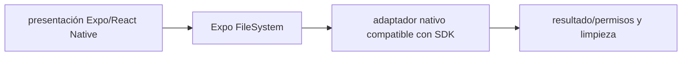

# Expo FileSystem — Vigilio API orientada a File/Directory en SDK moderno

## Qué es, qué hace y cuándo usarla

API de archivos en Expo/React Native. Gestiona lectura, escritura y almacenamiento local; los permisos y el ciclo de vida deben respetar la plataforma.

**Ubicación en Vigilio:** usa esta dependencia en su stack propietario; otras skills deben enlazar esta guía, no duplicar sus reglas. **Versión:** la indicada en el encabezado es la línea documentada; consultar `technology/versions.md` y el lockfile antes de copiar APIs o aprobar un upgrade.

> **Guía propia de Expo FileSystem (mobile).** Estado a **2026-10-25**: API orientada a File/Directory en SDK moderno. Versión del proyecto consumidor = `pnpm-lock.yaml` / `composer.lock` / imagen o manifest. Fuente: [documentación oficial](https://docs.expo.dev/versions/latest/sdk/filesystem/). Fuente normativa transversal de versiones: [versions.md](../versions.md). **No implica instalación automática ni upgrade aprobado.**

## Objetivo, responsabilidad y dónde usar

Adaptador files compartido con picker, limpieza de archivos temporales y controles privacidad.

**Uso:** aplicar solo si está declarada y resulta pertinente al consumidor; ver [política de adopción y DRY](README.md).

### Diagrama de integración (Mermaid)



El flujo muestra la **responsabilidad arquitectónica** de la librería; no representa llamadas reales de red para todas las operaciones.


## Instalación o verificación

```bash
npx expo install expo-file-system
```

**Gate de instalación:** consultar [procedimiento compartido](README.md#protocolo-de-adopción-y-actualización); estos comandos son indicativos, no ejecuciones sobre un consumidor.

## ✅ Correcto — uso actual y ejemplo de referencia

```typescript
import { File, Directory, Paths } from 'expo-file-system';
const dir = new Directory(Paths.cache, 'uploads');
// Manejar existencia, permisos, tamaño y cleanup según SDK. 
```

**Por qué:** Adaptador files compartido con picker, limpieza de archivos temporales y controles privacidad.

## ❌ Incorrecto — patrón legacy, inseguro o mal ubicado

**Nota técnica (no es código ejecutable):** ❌ invocar APIs legacy en raíz sin revisar deprecación de SDK FileSystem.readAsStringAsync(path) usado sin compat legacy.

**Riesgo:** confundir versiones o responsabilidades y obtener un contrato incorrecto.

## Nuevas capacidades, migración y breaking changes

Las APIs modernas incluyen objetos File/Directory/Paths; APIs históricas pueden vivir en expo-file-system/legacy; verificar método exacto del SDK.

Aplicar el [protocolo de migración común](README.md#protocolo-de-adopción-y-actualización), sin asumir que una release nueva está desplegada.

## Buenas prácticas, seguridad, rendimiento y operación

Consultar la [política transversal de librerías](README.md) para seguridad, versionado, evidencia y revisión de contratos. Para esta librería, además, aplicar las verificaciones concretas que se detallan a continuación.

## Gates de aceptación y compatibilidad

Test iOS/Android, sandbox, espacio libre y cancelación.

Estado de prueba de estos ejemplos documentales: **NOT_RUN** en aplicaciones consumidoras; ver [criterios de evidencia](README.md#criterios-de-validación).


## Referencias

- [Documentación oficial y migración de Expo FileSystem](https://docs.expo.dev/versions/latest/sdk/filesystem/)
- [Matriz y baseline de versiones](../versions.md)
- [Calidad de código canónica](../../foundations/engineering/code-quality.md)


## Recetario operativo ampliado — expo-file-system (2026-10-25)

### API actual: dos tareas reales que debe saber ejecutar una skill

1. **Nueva API `File` / `Directory` para rutas, lectura/escritura y almacenamiento local.**
2. **Gestionar permisos, cuota y directorios persistentes vs caché temporal.**

### Migración desde versiones anteriores: decisión concreta

- **Qué cambia o se debe revisar:** Evitar `FileSystem.readAsStringAsync` importado de entrada principal cuando está deprecado; legacy explícito solo migración.

### Responsabilidades y capas

Adapter `src/services/files`, nunca componente de dominio o contratos API.

**✅ Correcto:** mantener la integración encapsulada, alinear los nombres del negocio con Vigilio y depender de un contrato estable.

**❌ Incorrecto:** importar internals de la librería desde Domain, declarar `any` para resolver un upgrade, o duplicar reglas ya propietarias de otra tecnología.

### Seguridad, resiliencia y rendimiento

- No persistir secretos sin secure storage; limpiar archivos temporales al cancelar.

### Test de aceptación específico y evidencia mínima

- **Escenario comprobable:** Probar permisos, offline, disk full, migración de rutas y eliminación/revocación.

### Ejemplo de integración vigente (fragmento adicional)

```typescript
import { File, Directory, Paths } from 'expo-file-system';
const documents_dir = new Directory(Paths.document, 'uploads');
if (!documents_dir.exists) documents_dir.create();
const cached_file = new File(documents_dir, 'receipt.txt');
cached_file.write('Referencia no sensible');
// No usar readAsStringAsync legacy sin import explícito y plan de migración.
```

**Nota:** los fragmentos muestran la API específica y requieren imports/providers/fixtures del consumidor; no se certifica compilación por el solo hecho de aparecer aquí.


## Guía operativa detallada — 8 casos y 4 antipatrones

### Ocho ejemplos de la API y casos de uso relevantes

Los fragmentos siguientes ilustran **operaciones independientes**. Variables, imports, provider, extensión y configuración se completan en el proyecto consumidor; **no están certificados como un archivo único compilable**. Cuando hay comentarios `#`, son pasos de integración o configuración y no APIs inventadas.

#### Ejemplo 1. Import actual

**✅ Correcto — import actual**

```typescript
import { File, Directory, Paths } from 'expo-file-system';
```


#### Ejemplo 2. Archivo caché

**✅ Correcto — archivo caché**

```typescript
const file = new File(Paths.cache, 'products.json');
```


#### Ejemplo 3. Crear

**✅ Correcto — crear**

```typescript
file.create({ overwrite: true });
```


#### Ejemplo 4. Escribir

**✅ Correcto — escribir**

```typescript
file.write(JSON.stringify(data));
```


#### Ejemplo 5. Leer

**✅ Correcto — leer**

```typescript
const text = await file.text();
```


#### Ejemplo 6. Directorio

**✅ Correcto — directorio**

```typescript
const directory = new Directory(Paths.document, 'exports');
```


#### Ejemplo 7. Crear directorio

**✅ Correcto — crear directorio**

```typescript
directory.create({ intermediates: true, idempotent: true });
```


#### Ejemplo 8. Eliminar temporal

**✅ Correcto — eliminar temporal**

```typescript
file.delete();
```


### Cuatro antipatrones frecuentes y su sustitución

#### Antipatrón 1 — riesgo y alternativa

**❌ Incorrecto**

```typescript
FileSystem.readAsStringAsync(uri) // legacy en import principal
```

**Por qué está mal:** Reutiliza una firma o convención de otra versión sin verificar compatibilidad con la línea documentada.

**✅ Correcto**

```typescript
new File(uri).text()
```

**Por qué mejora:** El patrón «new File(uri).text()» mejora el caso: se utiliza la API apropiada para el major documentado y se comprueba el lockfile.

#### Antipatrón 2 — riesgo y alternativa

**❌ Incorrecto**

```typescript
const file = new File(Paths.cache, "secret-token")
```

**Por qué está mal:** Expone credenciales o confunde autenticación con autorización; puede ocasionar filtración o acceso indebido.

**✅ Correcto — Tokens en SecureStore, no caché de archivos.**

**Por qué mejora:** El patrón «Tokens en SecureStore, no caché de archivos» mejora el caso: las credenciales quedan fuera del código o bajo un mecanismo de acceso controlado.

#### Antipatrón 3 — riesgo y alternativa

**❌ Incorrecto — No gestionar disk-full.**

**Por qué está mal:** El patrón «No gestionar disk-full» es riesgoso: la elección «No gestionar disk-full» puede incumplir los requisitos operativos de expo-file-system.

**✅ Correcto — Capturar error y limpiar caché temporal.**

**Por qué mejora:** El patrón «Capturar error y limpiar caché temporal» mejora el caso: la alternativa «Capturar error y limpiar caché temporal» establece el comportamiento esperado de expo-file-system.

#### Antipatrón 4 — riesgo y alternativa

**❌ Incorrecto — Importar SDK en domain/.**

**Por qué está mal:** El patrón «Importar SDK en domain/» es riesgoso: la elección «Importar SDK en domain/» puede incumplir los requisitos operativos de expo-file-system.

**✅ Correcto — Adapter src/services/files.**

**Por qué mejora:** El patrón «Adapter src/services/files» mejora el caso: la alternativa «Adapter src/services/files» establece el comportamiento esperado de expo-file-system.

### Versión estable, breaking changes y verificación

- **Versión estable exacta:** no se declara un parche universal cuando no hay verificación específica de su registry/release. Consultar el encabezado de esta guía, `technology/versions.md` y el manifiesto del servicio. **Estado de patch: VERIFY_LOCKFILE**.
- **Migración:** identificar major anterior, APIs retiradas/cambiadas, peer dependencies, requisitos de runtime, cambios de tipos, ejecución CI y plan de rollback. Si no hay prueba sobre el consumidor, **NOT_RUN**, no PASS.
- **Versiones previas:** el ejemplo marcado ❌ en esta guía explica al menos una incompatibilidad o un uso obsoleto; no trasplantar APIs de otras versiones.
- **Tests:** probar al menos happy path, error, seguridad/permiso y compatibilidad con el runtime donde aplique; solo activar nuevas capacidades mediante una PR versionada.

### Fuentes oficiales y referencias al final

- [Referencia propia oficial](https://docs.expo.dev/versions/latest/sdk/filesystem/)
- [Matriz canónica de versiones](../versions.md)
- [Política de adopción de librerías](README.md)

## Guía de compatibilidad y evaluación por versión (2026-10-25)

**Estado del patch exacto:** `VERIFY_LOCKFILE`. La guía documenta la familia de APIs; **no se ha verificado hoy el patch estable preciso de esta dependencia**. Consultar la fuente oficial enlazada al inicio y el lockfile antes de generar código o aprobar un upgrade.

### Checklist específico de esta librería

- API actual utiliza File, Directory, Paths; imports legacy explícitos solo en transición.
- El filesystem es adapter en `src/services/files`, no Domain ni DTO del negocio.
- Comprobar permisos/quotas/limpieza y APIs de File/Directory según SDK 58.

**Gate de aprobación:** leer la referencia oficial y resolver la versión del consumidor, ejecutar typecheck y pruebas específicas, registrar PASS/FAIL/NOT_RUN/BLOCKED. No confundir esta guía con validación de un consumidor real. [Procedimiento único de adopción](README.md#protocolo-de-adopción-y-actualización).

