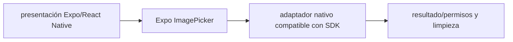

# Expo ImagePicker — Vigilio versión seleccionada por Expo SDK 58 (migración desde 57)

## Qué es, qué hace y cuándo usarla

Selector de fotografías y vídeo de Expo con permisos de plataforma. Solo selecciona medios: la validación, los límites y la subida segura son procesos separados.

**Ubicación en Vigilio:** usa esta dependencia en su stack propietario; otras skills deben enlazar esta guía, no duplicar sus reglas. **Versión:** la indicada en el encabezado es la línea documentada; consultar `technology/versions.md` y el lockfile antes de copiar APIs o aprobar un upgrade.

> **Guía propia de Expo ImagePicker (mobile).** Estado a **2026-10-25**: versión seleccionada por Expo SDK 58 (migración desde 57). Versión del proyecto consumidor = `pnpm-lock.yaml` / `composer.lock` / imagen o manifest. Fuente: [documentación oficial](https://docs.expo.dev/versions/latest/sdk/imagepicker/). Fuente normativa transversal de versiones: [versions.md](../versions.md). **No implica instalación automática ni upgrade aprobado.**

## Objetivo, responsabilidad y dónde usar

Adaptador platform en services/files, no lógica en feature dominio.

**Uso:** aplicar solo si está declarada y resulta pertinente al consumidor; ver [política de adopción y DRY](README.md).

### Diagrama de integración (Mermaid)



El flujo muestra la **responsabilidad arquitectónica** de la librería; no representa llamadas reales de red para todas las operaciones.


## Instalación o verificación

```bash
npx expo install expo-image-picker
```

**Gate de instalación:** consultar [procedimiento compartido](README.md#protocolo-de-adopción-y-actualización); estos comandos son indicativos, no ejecuciones sobre un consumidor.

## ✅ Correcto — uso actual y ejemplo de referencia

```typescript
import * as ImagePicker from 'expo-image-picker';
const permission = await ImagePicker.requestMediaLibraryPermissionsAsync();
if (permission.granted) {
 const result = await ImagePicker.launchImageLibraryAsync({mediaTypes:['images'],quality:0.8});
 if (!result.canceled) await uploadAsset(result.assets[0]);
}
```

**Por qué:** Adaptador platform en services/files, no lógica en feature dominio.

## ❌ Incorrecto — patrón legacy, inseguro o mal ubicado

**Nota técnica (no es código ejecutable):** ❌ usar nombre de propiedad o permissions legacy sin consultar SDK ❌ pasar URI local sin validar tamaño/tipo/consent.

**Riesgo:** confundir versiones o responsabilidades y obtener un contrato incorrecto.

## Nuevas capacidades, migración y breaking changes

API de permisos y resultados cambia entre SDK: usar `result.canceled`, `result.assets`; no migrar a través de versiones sin tests.

Aplicar el [protocolo de migración común](README.md#protocolo-de-adopción-y-actualización), sin asumir que una release nueva está desplegada.

## Buenas prácticas, seguridad, rendimiento y operación

Consultar la [política transversal de librerías](README.md) para seguridad, versionado, evidencia y revisión de contratos. Para esta librería, además, aplicar las verificaciones concretas que se detallan a continuación.

## Gates de aceptación y compatibilidad

Tests permiso denegado, canceled, tamaño/MIME, upload y background.

Estado de prueba de estos ejemplos documentales: **NOT_RUN** en aplicaciones consumidoras; ver [criterios de evidencia](README.md#criterios-de-validación).


## Referencias

- [Documentación oficial y migración de Expo ImagePicker](https://docs.expo.dev/versions/latest/sdk/imagepicker/)
- [Matriz y baseline de versiones](../versions.md)
- [Calidad de código canónica](../../foundations/engineering/code-quality.md)


## Recetario operativo ampliado — expo-image-picker (2026-10-25)

### API actual: dos tareas reales que debe saber ejecutar una skill

1. **Pedir permisos según necesidad con `requestMediaLibraryPermissionsAsync`.**
2. **`launchImageLibraryAsync` devuelve `canceled` y `assets`; validar mime/size antes de upload.**

### Migración desde versiones anteriores: decisión concreta

- **Qué cambia o se debe revisar:** Dejar de depender de `cancelled` y campos antiguos del resultado en SDK modernos.

### Responsabilidades y capas

Adapter de dispositivo al uploader, no al Application Service.

**✅ Correcto:** mantener la integración encapsulada, alinear los nombres del negocio con Vigilio y depender de un contrato estable.

**❌ Incorrecto:** importar internals de la librería desde Domain, declarar `any` para resolver un upgrade, o duplicar reglas ya propietarias de otra tecnología.

### Seguridad, resiliencia y rendimiento

- Nunca confiar en extensión o MIME del dispositivo sin verificar servidor.

### Test de aceptación específico y evidencia mínima

- **Escenario comprobable:** E2E iOS/Android: rechazo permisos, cancelación, HEIC, tamaño y falta de memoria.


## Guía operativa detallada — 8 casos y 4 antipatrones

### Ocho ejemplos de la API y casos de uso relevantes

Los fragmentos siguientes ilustran **operaciones independientes**. Variables, imports, provider, extensión y configuración se completan en el proyecto consumidor; **no están certificados como un archivo único compilable**. Cuando hay comentarios `#`, son pasos de integración o configuración y no APIs inventadas.

#### Ejemplo 1. Import

**✅ Correcto — import**

```typescript
import * as ImagePicker from 'expo-image-picker';
```


#### Ejemplo 2. Solicitar permiso

**✅ Correcto — solicitar permiso**

```typescript
await ImagePicker.requestMediaLibraryPermissionsAsync();
```


#### Ejemplo 3. Abrir galería

**✅ Correcto — abrir galería**

```typescript
await ImagePicker.launchImageLibraryAsync({ mediaTypes: ['images'], allowsEditing: true });
```


#### Ejemplo 4. Detectar cancelación

**✅ Correcto — detectar cancelación**

```typescript
if (result.canceled) return;
```


#### Ejemplo 5. Seleccionar asset

**✅ Correcto — seleccionar asset**

```typescript
const asset = result.assets[0];
```


#### Ejemplo 6. Foto cámara

**✅ Correcto — foto cámara**

```typescript
await ImagePicker.launchCameraAsync({ mediaTypes: ['images'] });
```


#### Ejemplo 7. Tamaño archivo

**✅ Correcto — tamaño archivo**

```typescript
if (asset.fileSize && asset.fileSize > max_bytes) throw new Error('Too large');
```


#### Ejemplo 8. Normalizar URI

**✅ Correcto — normalizar uri**

```typescript
const uri = asset.uri; // validar server-side al subir
```


### Cuatro antipatrones frecuentes y su sustitución

#### Antipatrón 1 — riesgo y alternativa

**❌ Incorrecto**

```typescript
if (result.cancelled) return;
```

**Por qué está mal:** El patrón «if (result.cancelled) return» es riesgoso: la elección «if (result.cancelled) return» puede incumplir los requisitos operativos de expo-image-picker.

**✅ Correcto**

```typescript
if (result.canceled) return;
```

**Por qué mejora:** El patrón «if (result.canceled) return» mejora el caso: la alternativa «if (result.canceled) return» establece el comportamiento esperado de expo-image-picker.

#### Antipatrón 2 — riesgo y alternativa

**❌ Incorrecto**

```typescript
const uri = result.uri;
```

**Por qué está mal:** El patrón «const uri = result.uri» es riesgoso: la elección «const uri = result.uri» puede incumplir los requisitos operativos de expo-image-picker.

**✅ Correcto**

```typescript
const uri = result.assets[0].uri;
```

**Por qué mejora:** El patrón «const uri = result.assets[0].uri» mejora el caso: la alternativa «const uri = result.assets[0].uri» establece el comportamiento esperado de expo-image-picker.

#### Antipatrón 3 — riesgo y alternativa

**❌ Incorrecto — Confiar solo en extensión local.**

**Por qué está mal:** El patrón «Confiar solo en extensión local» es riesgoso: la elección «Confiar solo en extensión local» puede incumplir los requisitos operativos de expo-image-picker.

**✅ Correcto — Verificar MIME y bytes en servidor.**

**Por qué mejora:** El patrón «Verificar MIME y bytes en servidor» mejora el caso: la alternativa «Verificar MIME y bytes en servidor» establece el comportamiento esperado de expo-image-picker.

#### Antipatrón 4 — riesgo y alternativa

**❌ Incorrecto — Pedir permiso sin necesidad.**

**Por qué está mal:** Omite un control operativo necesario, por lo que el comportamiento puede ser inseguro o difícil de verificar.

**✅ Correcto — Solicitarlo al iniciar flujo de selección.**

**Por qué mejora:** El patrón «Solicitarlo al iniciar flujo de selección» mejora el caso: se fuerza autorización en el borde/servidor y se limita el acceso por recurso.

### Versión estable, breaking changes y verificación

- **Versión estable exacta:** no se declara un parche universal cuando no hay verificación específica de su registry/release. Consultar el encabezado de esta guía, `technology/versions.md` y el manifiesto del servicio. **Estado de patch: VERIFY_LOCKFILE**.
- **Migración:** identificar major anterior, APIs retiradas/cambiadas, peer dependencies, requisitos de runtime, cambios de tipos, ejecución CI y plan de rollback. Si no hay prueba sobre el consumidor, **NOT_RUN**, no PASS.
- **Versiones previas:** el ejemplo marcado ❌ en esta guía explica al menos una incompatibilidad o un uso obsoleto; no trasplantar APIs de otras versiones.
- **Tests:** probar al menos happy path, error, seguridad/permiso y compatibilidad con el runtime donde aplique; solo activar nuevas capacidades mediante una PR versionada.

### Fuentes oficiales y referencias al final

- [Referencia propia oficial](https://docs.expo.dev/versions/latest/sdk/imagepicker/)
- [Matriz canónica de versiones](../versions.md)
- [Política de adopción de librerías](README.md)

## Guía de compatibilidad y evaluación por versión (2026-10-25)

**Estado del patch exacto:** `VERIFY_LOCKFILE`. La guía documenta la familia de APIs; **no se ha verificado hoy el patch estable preciso de esta dependencia**. Consultar la fuente oficial enlazada al inicio y el lockfile antes de generar código o aprobar un upgrade.

### Checklist específico de esta librería

- **Migración/compatibilidad:** Dejar de depender de `cancelled` y campos antiguos del resultado en SDK modernos.
- **Prueba propia:** E2E iOS/Android: rechazo permisos, cancelación, HEIC, tamaño y falta de memoria.
- **Límite de responsabilidad:** usar esta librería solo en su adaptador o capa propietaria; consultar los ejemplos de API y antipatrones anteriores antes de cambiar llamadas públicas.

**Gate de aprobación:** leer la referencia oficial y resolver la versión del consumidor, ejecutar typecheck y pruebas específicas, registrar PASS/FAIL/NOT_RUN/BLOCKED. No confundir esta guía con validación de un consumidor real. [Procedimiento único de adopción](README.md#protocolo-de-adopción-y-actualización).

