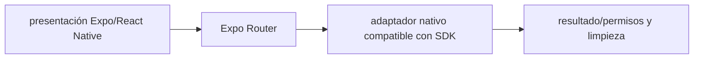

# Expo Router — Vigilio versión compatible con Expo SDK 58 (migración desde 57)

## Qué es, qué hace y cuándo usarla

Enrutamiento basado en archivos para Expo y React Native, con navegación web/móvil. Las rutas no reemplazan los permisos del backend.

**Ubicación en Vigilio:** usa esta dependencia en su stack propietario; otras skills deben enlazar esta guía, no duplicar sus reglas. **Versión:** la indicada en el encabezado es la línea documentada; consultar `technology/versions.md` y el lockfile antes de copiar APIs o aprobar un upgrade.

> **Guía propia de Expo Router (mobile).** Estado a **2026-10-25**: versión compatible con Expo SDK 58 (migración desde 57). Versión del proyecto consumidor = `pnpm-lock.yaml` / `composer.lock` / imagen o manifest. Fuente: [documentación oficial](https://docs.expo.dev/router/introduction/). Fuente normativa transversal de versiones: [versions.md](../versions.md). **No implica instalación automática ni upgrade aprobado.**

## Objetivo, responsabilidad y dónde usar

Navegación/deep links/modal y auth gating en presentación, no reglas de negocio.

**Uso:** aplicar solo si está declarada y resulta pertinente al consumidor; ver [política de adopción y DRY](README.md).

### Diagrama de integración (Mermaid)



El flujo muestra la **responsabilidad arquitectónica** de la librería; no representa llamadas reales de red para todas las operaciones.


## Instalación o verificación

```bash
npx expo install expo-router
```

**Gate de instalación:** consultar [procedimiento compartido](README.md#protocolo-de-adopción-y-actualización); estos comandos son indicativos, no ejecuciones sobre un consumidor.

## ✅ Correcto — uso actual y ejemplo de referencia

```typescript
// app/products/[product_id].tsx
// validar product_id en el borde de ruta; cargar datos desde hook semántico
const { product_id } = useLocalSearchParams<{product_id:string}>();
```

**Por qué:** Navegación/deep links/modal y auth gating en presentación, no reglas de negocio.

## ❌ Incorrecto — patrón legacy, inseguro o mal ubicado

**Nota técnica (no es código ejecutable):** ❌ usar parámetro de navegación como autorización confiar en product_id sin confirmar tenant/backend.

**Riesgo:** confundir versiones o responsabilidades y obtener un contrato incorrecto.

## Nuevas capacidades, migración y breaking changes

Expo Router file-based: distinguir app/ routes de src/features; SDK define versión compatible.

Aplicar el [protocolo de migración común](README.md#protocolo-de-adopción-y-actualización), sin asumir que una release nueva está desplegada.

## Buenas prácticas, seguridad, rendimiento y operación

Consultar la [política transversal de librerías](README.md) para seguridad, versionado, evidencia y revisión de contratos. Para esta librería, además, aplicar las verificaciones concretas que se detallan a continuación.

## Gates de aceptación y compatibilidad

Test deep links, params, auth redirects y cold start.

Estado de prueba de estos ejemplos documentales: **NOT_RUN** en aplicaciones consumidoras; ver [criterios de evidencia](README.md#criterios-de-validación).


## Referencias

- [Documentación oficial y migración de Expo Router](https://docs.expo.dev/router/introduction/)
- [Matriz y baseline de versiones](../versions.md)
- [Calidad de código canónica](../../foundations/engineering/code-quality.md)


## Recetario operativo ampliado — expo-router (2026-10-25)

### API actual: dos tareas reales que debe saber ejecutar una skill

1. **File-based routing y layouts; usar `Link` / `router.push` con typed routes si están habilitadas.**
2. **Separar guardas de presentación de autorización real en servidor.**

### Migración desde versiones anteriores: decisión concreta

- **Qué cambia o se debe revisar:** No mezclar API de React Navigation directamente sin adapter consciente de Expo Router.

### Responsabilidades y capas

Navegación mobile; features no deciden tokens o políticas de servidor.

**✅ Correcto:** mantener la integración encapsulada, alinear los nombres del negocio con Vigilio y depender de un contrato estable.

**❌ Incorrecto:** importar internals de la librería desde Domain, declarar `any` para resolver un upgrade, o duplicar reglas ya propietarias de otra tecnología.

### Seguridad, resiliencia y rendimiento

- Deep link, race con auth hydration, acciones bloqueadas por permisos de negocio.

### Test de aceptación específico y evidencia mínima

- **Escenario comprobable:** Prueba deeplink frío, navegación atrás, sesión expirada, params no válidos.


## Guía operativa detallada — 8 casos y 4 antipatrones

### Ocho ejemplos de la API y casos de uso relevantes

Los fragmentos siguientes ilustran **operaciones independientes**. Variables, imports, provider, extensión y configuración se completan en el proyecto consumidor; **no están certificados como un archivo único compilable**. Cuando hay comentarios `#`, son pasos de integración o configuración y no APIs inventadas.

#### Ejemplo 1. Ruta archivo

**✅ Correcto — ruta archivo**

**Nota técnica (no es código ejecutable):** App/products/[product_id].tsx.


#### Ejemplo 2. Enlace tipado

**✅ Correcto — enlace tipado**

```typescript
import { Link } from 'expo-router';
```


#### Ejemplo 3. Navegar

**✅ Correcto — navegar**

```typescript
router.push('/products');
```


#### Ejemplo 4. Parámetros

**✅ Correcto — parámetros**

```typescript
const { product_id } = useLocalSearchParams<{ product_id: string }>();
```


#### Ejemplo 5. Volver

**✅ Correcto — volver**

```typescript
router.back();
```


#### Ejemplo 6. Reemplazar

**✅ Correcto — reemplazar**

```typescript
router.replace('/login');
```


#### Ejemplo 7. Layout

**✅ Correcto — layout**

```typescript
export default function Layout() { return <Stack />; }
```


#### Ejemplo 8. Deep link

**✅ Correcto — deep link**

**Nota técnica (no es código ejecutable):** Probar app://products/<uuid> contra la configuración de scheme.


### Cuatro antipatrones frecuentes y su sustitución

#### Antipatrón 1 — riesgo y alternativa

**❌ Incorrecto**

```typescript
router.push(`/products/${unchecked_id}`)
```

**Por qué está mal:** El patrón «router.push(`/products/${unchecked_id}`)» es riesgoso: puede aceptar entradas inválidas o duplicar contratos difíciles de mantener.

**✅ Correcto — Validar/encode el parámetro antes de navegar.**

**Por qué mejora:** Convierte la condición en un control verificable mediante validación o pruebas.

#### Antipatrón 2 — riesgo y alternativa

**❌ Incorrecto — Guard UI como authz servidor.**

**Por qué está mal:** El patrón «Guard UI como authz servidor» es riesgoso: puede permitir acceso a recursos no autorizados o de otro tenant.

**✅ Correcto — Backend valida permisos por recurso.**

**Por qué mejora:** Separa permisos y secretos del código de negocio y permite comprobar el acceso mínimo.

#### Antipatrón 3 — riesgo y alternativa

**❌ Incorrecto — Router en Domain.**

**Por qué está mal:** El patrón «Router en Domain» es riesgoso: puede publicar cambios sin evidencia suficiente ni una revisión del impacto.

**✅ Correcto — Navegación en presentation.**

**Por qué mejora:** El patrón «Navegación en presentation» mejora el caso: el cambio pasa por gates automáticos y aprobación de riesgos operativos.

#### Antipatrón 4 — riesgo y alternativa

**❌ Incorrecto — No testear deep links.**

**Por qué está mal:** El patrón «No testear deep links» es riesgoso: la implementación puede fallar sin que el flujo crítico o la accesibilidad lo detecte.

**✅ Correcto — E2E frío + login hidratado.**

**Por qué mejora:** El patrón «E2E frío + login hidratado» mejora el caso: el comportamiento se verifica con pruebas y criterios observables.

### Versión estable, breaking changes y verificación

- **Versión estable exacta:** no se declara un parche universal cuando no hay verificación específica de su registry/release. Consultar el encabezado de esta guía, `technology/versions.md` y el manifiesto del servicio. **Estado de patch: VERIFY_LOCKFILE**.
- **Migración:** identificar major anterior, APIs retiradas/cambiadas, peer dependencies, requisitos de runtime, cambios de tipos, ejecución CI y plan de rollback. Si no hay prueba sobre el consumidor, **NOT_RUN**, no PASS.
- **Versiones previas:** el ejemplo marcado ❌ en esta guía explica al menos una incompatibilidad o un uso obsoleto; no trasplantar APIs de otras versiones.
- **Tests:** probar al menos happy path, error, seguridad/permiso y compatibilidad con el runtime donde aplique; solo activar nuevas capacidades mediante una PR versionada.

### Fuentes oficiales y referencias al final

- [Referencia propia oficial](https://docs.expo.dev/router/introduction/)
- [Matriz canónica de versiones](../versions.md)
- [Política de adopción de librerías](README.md)

## Guía de compatibilidad y evaluación por versión (2026-10-25)

**Estado del patch exacto:** `VERIFY_LOCKFILE`. La guía documenta la familia de APIs; **no se ha verificado hoy el patch estable preciso de esta dependencia**. Consultar la fuente oficial enlazada al inicio y el lockfile antes de generar código o aprobar un upgrade.

### Checklist específico de esta librería

- Seleccionar `expo-router` compatible con SDK 58 usando `npx expo install`, no `npm i ...@latest` sin matriz.
- Autenticación y permisos son validaciones de backend; el guard de ruta solo controla UX.
- Pruebas de deep-link, navegación de auth y recarga fría iOS/Android.

**Gate de aprobación:** leer la referencia oficial y resolver la versión del consumidor, ejecutar typecheck y pruebas específicas, registrar PASS/FAIL/NOT_RUN/BLOCKED. No confundir esta guía con validación de un consumidor real. [Procedimiento único de adopción](README.md#protocolo-de-adopción-y-actualización).

