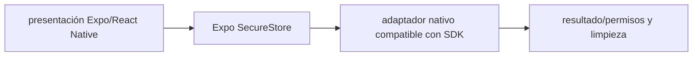

# Expo SecureStore — Vigilio línea SDK 58 compatible según `npx expo install --check`

## Qué es, qué hace y cuándo usarla

Almacenamiento seguro de secretos pequeños mediante mecanismos protegidos del sistema móvil. No equivale a AsyncStorage ni debe guardar datos grandes.

**Ubicación en Vigilio:** usa esta dependencia en su stack propietario; otras skills deben enlazar esta guía, no duplicar sus reglas. **Versión:** la indicada en el encabezado es la línea documentada; consultar `technology/versions.md` y el lockfile antes de copiar APIs o aprobar un upgrade.

> **Guía propia de Expo SecureStore (mobile).** Estado a **2026-10-25**: línea SDK 58 compatible según `npx expo install --check`. Versión del proyecto consumidor = `pnpm-lock.yaml` / `composer.lock` / imagen o manifest. Fuente: [documentación oficial](https://docs.expo.dev/versions/latest/sdk/securestore/). Fuente normativa transversal de versiones: [versions.md](../versions.md). **No implica instalación automática ni upgrade aprobado.**

## Objetivo, responsabilidad y dónde usar

Secrets en SecureStore, rotación/token lifecycle; el backend valida cada request.

**Uso:** aplicar solo si está declarada y resulta pertinente al consumidor; ver [política de adopción y DRY](README.md).

### Diagrama de integración (Mermaid)



El flujo muestra la **responsabilidad arquitectónica** de la librería; no representa llamadas reales de red para todas las operaciones.


## Instalación o verificación

```bash
npx expo install expo-secure-store
```

**Gate de instalación:** consultar [procedimiento compartido](README.md#protocolo-de-adopción-y-actualización); estos comandos son indicativos, no ejecuciones sobre un consumidor.

## ✅ Correcto — uso actual y ejemplo de referencia

```typescript
import * as SecureStore from 'expo-secure-store';
await SecureStore.setItemAsync('session_token',token);
const token_value = await SecureStore.getItemAsync('session_token');
```

**Por qué:** Secrets en SecureStore, rotación/token lifecycle; el backend valida cada request.

## ❌ Incorrecto — patrón legacy, inseguro o mal ubicado

**Nota técnica (no es código ejecutable):** ❌ almacenar tokens sensibles en AsyncStorage sin threat model.

**Riesgo:** confundir versiones o responsabilidades y obtener un contrato incorrecto.

## Nuevas capacidades, migración y breaking changes

Revisar Keychain/Keystore y backup/reinstall behavior, opciones biométricas y uso offline.

Aplicar el [protocolo de migración común](README.md#protocolo-de-adopción-y-actualización), sin asumir que una release nueva está desplegada.

## Buenas prácticas, seguridad, rendimiento y operación

Consultar la [política transversal de librerías](README.md) para seguridad, versionado, evidencia y revisión de contratos. Para esta librería, además, aplicar las verificaciones concretas que se detallan a continuación.

## Gates de aceptación y compatibilidad

Test logout, reset, errores de biometría, backups y device unlock.

Estado de prueba de estos ejemplos documentales: **NOT_RUN** en aplicaciones consumidoras; ver [criterios de evidencia](README.md#criterios-de-validación).


## Referencias

- [Documentación oficial y migración de Expo SecureStore](https://docs.expo.dev/versions/latest/sdk/securestore/)
- [Matriz y baseline de versiones](../versions.md)
- [Calidad de código canónica](../../foundations/engineering/code-quality.md)


## Recetario operativo ampliado — expo-secure-store (2026-10-25)

### API actual: dos tareas reales que debe saber ejecutar una skill

1. **Persistir claves de sesión con `SecureStore.setItemAsync/getItemAsync/deleteItemAsync`.**
2. **Tratar biometría y disponibilidad como estados del dispositivo, no como seguridad de API.**

### Migración desde versiones anteriores: decisión concreta

- **Qué cambia o se debe revisar:** AsyncStorage no equivale a secure storage; revisar migraciones de token entre storage.

### Responsabilidades y capas

Servicio auth/secure-storage; sin importar a contracts compartidos.

**✅ Correcto:** mantener la integración encapsulada, alinear los nombres del negocio con Vigilio y depender de un contrato estable.

**❌ Incorrecto:** importar internals de la librería desde Domain, declarar `any` para resolver un upgrade, o duplicar reglas ya propietarias de otra tecnología.

### Seguridad, resiliencia y rendimiento

- Backup Android, reinstalación iOS y expiración; nunca logs de tokens.

### Test de aceptación específico y evidencia mínima

- **Escenario comprobable:** Probar cold start, logout, biometría cancelada, acceso sin datos.


## Guía operativa detallada — 8 casos y 4 antipatrones

### Ocho ejemplos de la API y casos de uso relevantes

Los fragmentos siguientes ilustran **operaciones independientes**. Variables, imports, provider, extensión y configuración se completan en el proyecto consumidor; **no están certificados como un archivo único compilable**. Cuando hay comentarios `#`, son pasos de integración o configuración y no APIs inventadas.

#### Ejemplo 1. Import

**✅ Correcto — import**

```typescript
import * as SecureStore from 'expo-secure-store';
```


#### Ejemplo 2. Guardar

**✅ Correcto — guardar**

```typescript
await SecureStore.setItemAsync('refresh_token', token);
```


#### Ejemplo 3. Leer

**✅ Correcto — leer**

```typescript
const token = await SecureStore.getItemAsync('refresh_token');
```


#### Ejemplo 4. Eliminar

**✅ Correcto — eliminar**

```typescript
await SecureStore.deleteItemAsync('refresh_token');
```


#### Ejemplo 5. Comprobar soporte

**✅ Correcto — comprobar soporte**

```typescript
const available = await SecureStore.isAvailableAsync();
```


#### Ejemplo 6. Proteger biométricamente

**✅ Correcto — proteger biométricamente**

```typescript
await SecureStore.setItemAsync('secret', value, { requireAuthentication: true });
```


#### Ejemplo 7. No guardar JSON arbitrario

**✅ Correcto — no guardar json arbitrario**

**Nota técnica (no es código ejecutable):** Guardar la mínima credencial, no datos de negocio masivos.


#### Ejemplo 8. Cerrar sesión

**✅ Correcto — cerrar sesión**

```typescript
await SecureStore.deleteItemAsync('refresh_token');
```


### Cuatro antipatrones frecuentes y su sustitución

#### Antipatrón 1 — riesgo y alternativa

**❌ Incorrecto**

```typescript
AsyncStorage.setItem("refresh_token", token)
```

**Por qué está mal:** Expone credenciales o confunde autenticación con autorización; puede ocasionar filtración o acceso indebido.

**✅ Correcto**

```typescript
SecureStore.setItemAsync("refresh_token", token)
```

**Por qué mejora:** El patrón «SecureStore.setItemAsync("refresh_token", token)» mejora el caso: las credenciales quedan fuera del código o bajo un mecanismo de acceso controlado.

#### Antipatrón 2 — riesgo y alternativa

**❌ Incorrecto**

```typescript
console.log(token)
```

**Por qué está mal:** Expone credenciales o confunde autenticación con autorización; puede ocasionar filtración o acceso indebido.

**✅ Correcto — Jamás loggear credenciales.**

**Por qué mejora:** El patrón «Jamás loggear credenciales» mejora el caso: las credenciales quedan fuera del código o bajo un mecanismo de acceso controlado.

#### Antipatrón 3 — riesgo y alternativa

**❌ Incorrecto — Guardar objetos grandes como texto.**

**Por qué está mal:** El patrón «Guardar objetos grandes como texto» es riesgoso: los secretos o datos privados quedan expuestos en código, logs o artefactos de despliegue.

**✅ Correcto — Almacenar solo datos secretos pequeños.**

**Por qué mejora:** Separa permisos y secretos del código de negocio y permite comprobar el acceso mínimo.

#### Antipatrón 4 — riesgo y alternativa

**❌ Incorrecto — Olvidar revocar logout.**

**Por qué está mal:** Omite un control operativo necesario, por lo que el comportamiento puede ser inseguro o difícil de verificar.

**✅ Correcto**

```typescript
await SecureStore.deleteItemAsync("refresh_token")
```

**Por qué mejora:** El patrón «await SecureStore.deleteItemAsync("refresh_token")» mejora el caso: las credenciales quedan fuera del código o bajo un mecanismo de acceso controlado.

### Versión estable, breaking changes y verificación

- **Versión estable exacta:** no se declara un parche universal cuando no hay verificación específica de su registry/release. Consultar el encabezado de esta guía, `technology/versions.md` y el manifiesto del servicio. **Estado de patch: VERIFY_LOCKFILE**.
- **Migración:** identificar major anterior, APIs retiradas/cambiadas, peer dependencies, requisitos de runtime, cambios de tipos, ejecución CI y plan de rollback. Si no hay prueba sobre el consumidor, **NOT_RUN**, no PASS.
- **Versiones previas:** el ejemplo marcado ❌ en esta guía explica al menos una incompatibilidad o un uso obsoleto; no trasplantar APIs de otras versiones.
- **Tests:** probar al menos happy path, error, seguridad/permiso y compatibilidad con el runtime donde aplique; solo activar nuevas capacidades mediante una PR versionada.

### Fuentes oficiales y referencias al final

- [Referencia propia oficial](https://docs.expo.dev/versions/latest/sdk/securestore/)
- [Matriz canónica de versiones](../versions.md)
- [Política de adopción de librerías](README.md)

## Guía de compatibilidad y evaluación por versión (2026-10-25)

**Estado del patch exacto:** `VERIFY_LOCKFILE`. La guía documenta la familia de APIs; **no se ha verificado hoy el patch estable preciso de esta dependencia**. Consultar la fuente oficial enlazada al inicio y el lockfile antes de generar código o aprobar un upgrade.

### Checklist específico de esta librería

- **Migración/compatibilidad:** AsyncStorage no equivale a secure storage; revisar migraciones de token entre storage.
- **Prueba propia:** Probar cold start, logout, biometría cancelada, acceso sin datos.
- **Límite de responsabilidad:** usar esta librería solo en su adaptador o capa propietaria; consultar los ejemplos de API y antipatrones anteriores antes de cambiar llamadas públicas.

**Gate de aprobación:** leer la referencia oficial y resolver la versión del consumidor, ejecutar typecheck y pruebas específicas, registrar PASS/FAIL/NOT_RUN/BLOCKED. No confundir esta guía con validación de un consumidor real. [Procedimiento único de adopción](README.md#protocolo-de-adopción-y-actualización).

