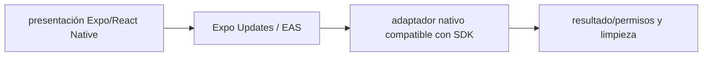

# Expo Updates / EAS — Vigilio línea SDK 58 compatible según `npx expo install --check`

## Qué es, qué hace y cuándo usarla

Entrega y control de actualizaciones OTA de Expo. Distingue runtimeVersion de la actualización JS para evitar incompatibilidades nativas.

**Ubicación en Vigilio:** usa esta dependencia en su stack propietario; otras skills deben enlazar esta guía, no duplicar sus reglas. **Versión:** la indicada en el encabezado es la línea documentada; consultar `technology/versions.md` y el lockfile antes de copiar APIs o aprobar un upgrade.

> **Guía propia de Expo Updates / EAS (mobile).** Estado a **2026-10-25**: línea SDK 58 compatible según `npx expo install --check`. Versión del proyecto consumidor = `pnpm-lock.yaml` / `composer.lock` / imagen o manifest. Fuente: [documentación oficial](https://docs.expo.dev/versions/latest/sdk/updates/). Fuente normativa transversal de versiones: [versions.md](../versions.md). **No implica instalación automática ni upgrade aprobado.**

## Objetivo, responsabilidad y dónde usar

Rollouts controlados, rollback y telemetría crash.

**Uso:** aplicar solo si está declarada y resulta pertinente al consumidor; ver [política de adopción y DRY](README.md).

### Diagrama de integración (Mermaid)



El flujo muestra la **responsabilidad arquitectónica** de la librería; no representa llamadas reales de red para todas las operaciones.


## Instalación o verificación

```bash
npx expo install expo-updates
```

**Gate de instalación:** consultar [procedimiento compartido](README.md#protocolo-de-adopción-y-actualización); estos comandos son indicativos, no ejecuciones sobre un consumidor.

## ✅ Correcto — uso actual y ejemplo de referencia

**Nota técnica (no es código ejecutable):** OTA sólo cambios JS compatibles con runtimeVersion EAS update --branch production tras pruebas/canary.

**Por qué:** Rollouts controlados, rollback y telemetría crash.

## ❌ Incorrecto — patrón legacy, inseguro o mal ubicado

**Nota técnica (no es código ejecutable):** ❌ publicar OTA con cambios nativos incompatibles con binary desplegado.

**Riesgo:** confundir versiones o responsabilidades y obtener un contrato incorrecto.

## Nuevas capacidades, migración y breaking changes

runtimeVersion limita compatibilidad; nuevas native modules requieren build de tiendas.

Aplicar el [protocolo de migración común](README.md#protocolo-de-adopción-y-actualización), sin asumir que una release nueva está desplegada.

## Buenas prácticas, seguridad, rendimiento y operación

Consultar la [política transversal de librerías](README.md) para seguridad, versionado, evidencia y revisión de contratos. Para esta librería, además, aplicar las verificaciones concretas que se detallan a continuación.

## Gates de aceptación y compatibilidad

Smoke por canal, EAS builds, matrices Android/iOS y pruebas OTA.

Estado de prueba de estos ejemplos documentales: **NOT_RUN** en aplicaciones consumidoras; ver [criterios de evidencia](README.md#criterios-de-validación).


## Referencias

- [Documentación oficial y migración de Expo Updates / EAS](https://docs.expo.dev/versions/latest/sdk/updates/)
- [Matriz y baseline de versiones](../versions.md)
- [Calidad de código canónica](../../foundations/engineering/code-quality.md)


## Recetario operativo ampliado — expo-updates (2026-10-25)

### API actual: dos tareas reales que debe saber ejecutar una skill

1. **Separar actualizaciones JS OTA de cambios nativos que necesitan nueva build.**
2. **Definir channels, runtimeVersion y rollout gradual con rollback.**

### Migración desde versiones anteriores: decisión concreta

- **Qué cambia o se debe revisar:** No publicar OTA que requiera nuevos módulos nativos sin runtime compatible.

### Responsabilidades y capas

Release engineering mobile, no ámbito de entidad DDD.

**✅ Correcto:** mantener la integración encapsulada, alinear los nombres del negocio con Vigilio y depender de un contrato estable.

**❌ Incorrecto:** importar internals de la librería desde Domain, declarar `any` para resolver un upgrade, o duplicar reglas ya propietarias de otra tecnología.

### Seguridad, resiliencia y rendimiento

- Rollout canario, firma y compat SDK; evitar actualizar binarios y OTA a la vez.

### Test de aceptación específico y evidencia mínima

- **Escenario comprobable:** Prueba upgrade y downgrade canario en canal staging con observabilidad de crashes.


## Guía operativa detallada — 8 casos y 4 antipatrones

### Ocho ejemplos de la API y casos de uso relevantes

Los fragmentos siguientes ilustran **operaciones independientes**. Variables, imports, provider, extensión y configuración se completan en el proyecto consumidor; **no están certificados como un archivo único compilable**. Cuando hay comentarios `#`, son pasos de integración o configuración y no APIs inventadas.

#### Ejemplo 1. Config runtime

**✅ Correcto — config runtime**

**Nota técnica (no es código ejecutable):** App.json: { "expo": { "runtimeVersion": { "policy": "appVersion" } } }.


#### Ejemplo 2. Canal staging

**✅ Correcto — canal staging**

```typescript
eas update --channel staging --message 'Candidate'
```


#### Ejemplo 3. Canal producción

**✅ Correcto — canal producción**

```typescript
eas update --channel production --message 'Release approved'
```


#### Ejemplo 4. Chequear OTA

**✅ Correcto — chequear ota**

```typescript
const update = await Updates.checkForUpdateAsync();
```


#### Ejemplo 5. Descargar

**✅ Correcto — descargar**

```typescript
if (update.isAvailable) await Updates.fetchUpdateAsync();
```


#### Ejemplo 6. Aplicar

**✅ Correcto — aplicar**

```typescript
await Updates.reloadAsync();
```


#### Ejemplo 7. Leer canal

**✅ Correcto — leer canal**

```typescript
const channel = Updates.channel;
```


#### Ejemplo 8. Control compat

**✅ Correcto — control compat**

**Nota técnica (no es código ejecutable):** Cambio nativo -> nueva build; JS compatible -> OTA.


### Cuatro antipatrones frecuentes y su sustitución

#### Antipatrón 1 — riesgo y alternativa

**❌ Incorrecto**

```typescript
eas update --channel production # JS incompatible con nativo
```

**Por qué está mal:** El patrón «eas update --channel production # JS incompatible con nativo» es riesgoso: puede mezclar firmas incompatibles o ejecutar una API retirada en la versión instalada.

**✅ Correcto — Usar nueva build cuando cambien módulos nativos.**

**Por qué mejora:** El patrón «Usar nueva build cuando cambien módulos nativos» mejora el caso: se utiliza la API apropiada para el major documentado y se comprueba el lockfile.

#### Antipatrón 2 — riesgo y alternativa

**❌ Incorrecto — RuntimeVersion fijo para siempre.**

**Por qué está mal:** El patrón «RuntimeVersion fijo para siempre» es riesgoso: puede mezclar firmas incompatibles o ejecutar una API retirada en la versión instalada.

**✅ Correcto — Versión runtime vinculada a binario.**

**Por qué mejora:** El patrón «Versión runtime vinculada a binario» mejora el caso: se utiliza la API apropiada para el major documentado y se comprueba el lockfile.

#### Antipatrón 3 — riesgo y alternativa

**❌ Incorrecto — Desplegar OTA sin stage.**

**Por qué está mal:** Omite un control operativo necesario, por lo que el comportamiento puede ser inseguro o difícil de verificar.

**✅ Correcto**

```typescript
eas update --channel staging
```

**Por qué mejora:** El patrón «eas update --channel staging» mejora el caso: la alternativa «eas update --channel staging» establece el comportamiento esperado de expo-updates.

#### Antipatrón 4 — riesgo y alternativa

**❌ Incorrecto — Publicar 100% usuarios sin rollback.**

**Por qué está mal:** Omite un control operativo necesario, por lo que el comportamiento puede ser inseguro o difícil de verificar.

**✅ Correcto — Rollout controlado + health metrics.**

**Por qué mejora:** El patrón «Rollout controlado + health metrics» mejora el caso: se fuerza autorización en el borde/servidor y se limita el acceso por recurso.

### Versión estable, breaking changes y verificación

- **Versión estable exacta:** no se declara un parche universal cuando no hay verificación específica de su registry/release. Consultar el encabezado de esta guía, `technology/versions.md` y el manifiesto del servicio. **Estado de patch: VERIFY_LOCKFILE**.
- **Migración:** identificar major anterior, APIs retiradas/cambiadas, peer dependencies, requisitos de runtime, cambios de tipos, ejecución CI y plan de rollback. Si no hay prueba sobre el consumidor, **NOT_RUN**, no PASS.
- **Versiones previas:** el ejemplo marcado ❌ en esta guía explica al menos una incompatibilidad o un uso obsoleto; no trasplantar APIs de otras versiones.
- **Tests:** probar al menos happy path, error, seguridad/permiso y compatibilidad con el runtime donde aplique; solo activar nuevas capacidades mediante una PR versionada.

### Fuentes oficiales y referencias al final

- [Referencia propia oficial](https://docs.expo.dev/versions/latest/sdk/updates/)
- [Matriz canónica de versiones](../versions.md)
- [Política de adopción de librerías](README.md)

## Guía de compatibilidad y evaluación por versión (2026-10-25)

**Estado del patch exacto:** `VERIFY_LOCKFILE`. La guía documenta la familia de APIs; **no se ha verificado hoy el patch estable preciso de esta dependencia**. Consultar la fuente oficial enlazada al inicio y el lockfile antes de generar código o aprobar un upgrade.

### Checklist específico de esta librería

- OTA solo entrega JS/assets compatibles con runtime nativo previamente publicado.
- Fijar `runtimeVersion`, canales y rollout; medir fallos y rollback en EAS.
- La transición SDK57→58 requiere nuevo binario para APIs nativas.

**Gate de aprobación:** leer la referencia oficial y resolver la versión del consumidor, ejecutar typecheck y pruebas específicas, registrar PASS/FAIL/NOT_RUN/BLOCKED. No confundir esta guía con validación de un consumidor real. [Procedimiento único de adopción](README.md#protocolo-de-adopción-y-actualización).

