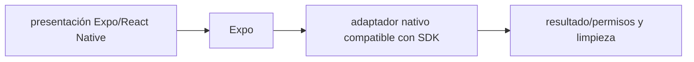

# Expo — Vigilio SDK 58 (RN 0.88 + React 19.3.0)

## Qué es, qué hace y cuándo usarla

SDK y herramienta de desarrollo de aplicaciones React Native. Coordina versiones compatibles de React Native, React y módulos nativos por SDK.

**Ubicación en Vigilio:** usa esta dependencia en su stack propietario; otras skills deben enlazar esta guía, no duplicar sus reglas. **Versión:** la indicada en el encabezado es la línea documentada; consultar `technology/versions.md` y el lockfile antes de copiar APIs o aprobar un upgrade.

> **Guía propia de Expo (mobile).** Estado a **2026-10-25**: SDK 58; RN 0.88 + React 19.3.0. Versión del proyecto consumidor = `pnpm-lock.yaml` / `composer.lock` / imagen o manifest. Fuente: [documentación oficial](https://docs.expo.dev/versions/latest/). Fuente normativa transversal de versiones: [versions.md](../versions.md). **No implica instalación automática ni upgrade aprobado.**

## Objetivo, responsabilidad y dónde usar

Separar feature negocio de `src/services/files/` adaptadores. OTA no reemplaza build nativo cuando cambia código nativo.

**Uso:** aplicar solo si está declarada y resulta pertinente al consumidor; ver [política de adopción y DRY](README.md).

### Diagrama de integración (Mermaid)



El flujo muestra la **responsabilidad arquitectónica** de la librería; no representa llamadas reales de red para todas las operaciones.


## Instalación o verificación

```bash
npx create-expo-app@latest && npx expo install --check
```

**Gate de instalación:** consultar [procedimiento compartido](README.md#protocolo-de-adopción-y-actualización); estos comandos son indicativos, no ejecuciones sobre un consumidor.

## ✅ Correcto — uso actual y ejemplo de referencia

**Nota técnica (no es código ejecutable):** Instalar módulos compatibles: npx expo install expo-image-picker expo-file-system expo-secure-store npx expo-doctor npx expo prebuild sólo si aplica y con control de diff.

**Por qué:** Separar feature negocio de `src/services/files/` adaptadores. OTA no reemplaza build nativo cuando cambia código nativo.

## ❌ Incorrecto — patrón legacy, inseguro o mal ubicado

```typescript
// ❌ instalar React Native 0.88 manualmente dentro de Expo SDK 57
pnpm add react-native@latest
```

**Riesgo:** confundir versiones o responsabilidades y obtener un contrato incorrecto.

## Nuevas capacidades, migración y breaking changes

Histórico SDK 56→57: RN 0.86 y React 19.2.3. Vigente 57→58: RN 0.88/React 19.3.0, Strict TypeScript API, cambios en Scene Lifecycle iOS 27 y APIs retiradas. Revisar changelog oficial y EAS.

Aplicar el [protocolo de migración común](README.md#protocolo-de-adopción-y-actualización), sin asumir que una release nueva está desplegada.

## Buenas prácticas, seguridad, rendimiento y operación

Consultar la [política transversal de librerías](README.md) para seguridad, versionado, evidencia y revisión de contratos. Para esta librería, además, aplicar las verificaciones concretas que se detallan a continuación.

## Gates de aceptación y compatibilidad

expo install --check, expo-doctor, EAS build Android/iOS, permissions, OTA runtimeVersion y tests de interfaz.

Estado de prueba de estos ejemplos documentales: **NOT_RUN** en aplicaciones consumidoras; ver [criterios de evidencia](README.md#criterios-de-validación).


## Compatibilidad histórica: Expo SDK 57 (para migrar a 58)

| Pieza | Valor de SDK 57 |
|---|---|
| Expo | 57 |
| React Native | 0.86 |
| React | 19.2.3 |
| Node mínimo | 22.13.x |

✅ Correcto: `npx expo install --check` y `npx expo-doctor` antes de actualizar módulos; luego EAS Build y smoke iOS/Android.

❌ Incorrecto: `pnpm add react-native@latest` sin cambiar SDK; mezclar parches web React 19.3.x arbitrarios dentro de SDK 58.

### Flujo recomendado

- `app/` solo rutas Expo Router.
- `src/features/products/services/*.api.ts`: operaciones HTTP semánticas.
- `src/features/products/hooks/use-list-products-query.ts`: estado servidor, con Query.
- `src/services/files/`: picker/filesystem (adaptadores) no Domain.
- `src/services/auth/`: SecureStore, sesión y rotación; logout limpia cache Query.
- `eas.json`: canales, runtimeVersion y evidencia de builds; OTA requiere binario compatible.

## Referencias

- [Documentación oficial y migración de Expo](https://docs.expo.dev/versions/latest/)
- [Matriz y baseline de versiones](../versions.md)
- [Calidad de código canónica](../../foundations/engineering/code-quality.md)


## Recetario operativo ampliado — expo (2026-10-25)

### API actual: dos tareas reales que debe saber ejecutar una skill

1. **Usar `npx expo install --check` para resolver SDK, React y React Native conjuntamente.**
2. **Config plugins/EAS profiles versionados y builds reproducibles.**

### Migración desde versiones anteriores: decisión concreta

- **Qué cambia o se debe revisar:** SDK 58 define RN 0.88/React 19.3.0; SDK 57 fue RN 0.86/React 19.2.3. No actualizar RN independientemente.

### Responsabilidades y capas

App native+JS, los contratos Zod siguen browser-safe.

**✅ Correcto:** mantener la integración encapsulada, alinear los nombres del negocio con Vigilio y depender de un contrato estable.

**❌ Incorrecto:** importar internals de la librería desde Domain, declarar `any` para resolver un upgrade, o duplicar reglas ya propietarias de otra tecnología.

### Seguridad, resiliencia y rendimiento

- Config plugins pueden requerir prebuild; revisar permisos y store review.

### Test de aceptación específico y evidencia mínima

- **Escenario comprobable:** `expo-doctor`, Android/iOS build, OTA canario y smoke de permisos.

### SDK57: adopción sin romper React Native

- Expo SDK 57 empareja React Native 0.86 y React 19.2.3 (compatibilidad del catálogo); no subir RN a una rama standalone por iniciativa propia.
- `npx expo install --check`, `expo-doctor`, plugins nativos y EAS build real antes de OTA.
- Probar autenticación, permisos, filesystem, deep links y Reanimated en iOS y Android.
- Fuente: https://docs.expo.dev/versions/latest/


## Guía operativa detallada — 8 casos y 4 antipatrones

### Ocho ejemplos de la API y casos de uso relevantes

Los fragmentos siguientes ilustran **operaciones independientes**. Variables, imports, provider, extensión y configuración se completan en el proyecto consumidor; **no están certificados como un archivo único compilable**. Cuando hay comentarios `#`, son pasos de integración o configuración y no APIs inventadas.

#### Ejemplo 1. Crear app

**✅ Correcto — crear app**

```bash
npx create-expo-app@latest
```


#### Ejemplo 2. Doctor

**✅ Correcto — doctor**

```bash
npx expo-doctor
```


#### Ejemplo 3. Compat SDK

**✅ Correcto — compat sdk**

```bash
npx expo install --check
```


#### Ejemplo 4. Instalar module

**✅ Correcto — instalar module**

```bash
npx expo install expo-secure-store
```


#### Ejemplo 5. Arranque

**✅ Correcto — arranque**

```bash
npx expo start
```


#### Ejemplo 6. Run Android

**✅ Correcto — run android**

```bash
npx expo run:android
```


#### Ejemplo 7. Run iOS

**✅ Correcto — run ios**

```bash
npx expo run:ios
```


#### Ejemplo 8. Build EAS

**✅ Correcto — build eas**

```bash
eas build --platform android --profile preview
```


### Cuatro antipatrones frecuentes y su sustitución

#### Antipatrón 1 — riesgo y alternativa

**❌ Incorrecto**

```bash
npm install react-native@latest # fuera de matriz Expo
```

**Por qué está mal:** El patrón «npm install react-native@latest # fuera de matriz Expo» es riesgoso: puede mezclar firmas incompatibles o ejecutar una API retirada en la versión instalada.

**✅ Correcto**

```bash
npx expo install --check
```

**Por qué mejora:** El patrón «npx expo install --check» mejora el caso: se utiliza la API apropiada para el major documentado y se comprueba el lockfile.

#### Antipatrón 2 — riesgo y alternativa

**❌ Incorrecto**

```bash
npm install expo-camera@latest
```

**Por qué está mal:** El patrón «npm install expo-camera@latest» es riesgoso: puede mezclar firmas incompatibles o ejecutar una API retirada en la versión instalada.

**✅ Correcto**

```bash
npx expo install expo-camera
```

**Por qué mejora:** El patrón «npx expo install expo-camera» mejora el caso: se utiliza la API apropiada para el major documentado y se comprueba el lockfile.

#### Antipatrón 3 — riesgo y alternativa

**❌ Incorrecto — Omitir expo-doctor.**

**Por qué está mal:** Omite un control operativo necesario, por lo que el comportamiento puede ser inseguro o difícil de verificar.

**✅ Correcto**

```bash
npx expo-doctor
```

**Por qué mejora:** El patrón «npx expo-doctor» mejora el caso: la alternativa «npx expo-doctor» establece el comportamiento esperado de expo.

#### Antipatrón 4 — riesgo y alternativa

**❌ Incorrecto — Probar solo web.**

**Por qué está mal:** El patrón «Probar solo web» es riesgoso: puede elevar el coste de runtime, causar fallos de despliegue o empaquetar dependencias no deseadas.

**✅ Correcto — Builds iOS/Android antes de liberar.**

**Por qué mejora:** El patrón «Builds iOS/Android antes de liberar» mejora el caso: el build y los recursos se verifican mediante gates de despliegue y rendimiento.

### Versión estable, breaking changes y verificación

- **Versión estable exacta:** no se declara un parche universal cuando no hay verificación específica de su registry/release. Consultar el encabezado de esta guía, `technology/versions.md` y el manifiesto del servicio. **Estado de patch: VERIFY_LOCKFILE**.
- **Migración:** identificar major anterior, APIs retiradas/cambiadas, peer dependencies, requisitos de runtime, cambios de tipos, ejecución CI y plan de rollback. Si no hay prueba sobre el consumidor, **NOT_RUN**, no PASS.
- **Versiones previas:** el ejemplo marcado ❌ en esta guía explica al menos una incompatibilidad o un uso obsoleto; no trasplantar APIs de otras versiones.
- **Tests:** probar al menos happy path, error, seguridad/permiso y compatibilidad con el runtime donde aplique; solo activar nuevas capacidades mediante una PR versionada.

### Fuentes oficiales y referencias al final

- [Referencia propia oficial](https://docs.expo.dev/versions/latest/)
- [Matriz canónica de versiones](../versions.md)
- [Política de adopción de librerías](README.md)

## Guía de compatibilidad y evaluación por versión (2026-10-25)

**Release contrastada para esta familia:** `SDK 58 / RN 0.88 / React 19.3.0`. Fuente: [publicación oficial](https://expo.dev/changelog/sdk-58). **Cambio clave:** SDK 58 lanzado 2026-10-15; iOS 27/scene lifecycle y APIs RN removidas; Expo Go no garantizada en tiendas aún.

### Checklist específico de esta librería

- SDK 58 corresponde a RN 0.88 y React 19.3.0; no actualizar cada paquete de forma individual.
- Ejecutar `npx expo install --check` y `npx expo-doctor`; compilar iOS/Android con EAS antes de aprobar.
- RN Strict TypeScript API: reemplazar imports de `react-native/Libraries/*`; `InteractionManager` retirado, usar `requestIdleCallback`.
- iOS 27 usa scene lifecycle; revisar AppDelegate y módulos nativos; OTA no reemplaza build nativo.

**Gate de aprobación:** leer la referencia oficial y resolver la versión del consumidor, ejecutar typecheck y pruebas específicas, registrar PASS/FAIL/NOT_RUN/BLOCKED. No confundir esta guía con validación de un consumidor real. [Procedimiento único de adopción](README.md#protocolo-de-adopción-y-actualización).

## Checklist de upgrade real: SDK 57 → 58

**Combinación oficial SDK 58:** React Native **0.88**, React **19.3.0**, iOS 27 scene lifecycle. No sustituir React por el patch web 19.3.1 sin pasar `expo install --check`.

```bash
npx expo install --check
npx expo-doctor
# Revisar con Git el diff de package.json, pnpm-lock.yaml, app config y plugins nativos.
# Recompilar app nativa con EAS: una OTA no actualiza módulos nativos.
```

**✅ Correcto:** eliminar imports internos `react-native/Libraries/*` y comprobar los tipos strict RN; cambiar `InteractionManager` retirado por una estrategia apropiada como `requestIdleCallback`; verificar renderizado iOS scene lifecycle, enlaces, auth, archivos, cámara, notificaciones, OTA y ambos stores. **❌ Incorrecto:** actualizar solo RN 0.88 en un proyecto Expo SDK 57 y dar por estable el binario. [Expo 58](https://expo.dev/changelog/sdk-58) · [guía migración](https://expo.dev/blog/how-to-upgrade-to-sdk-58).
