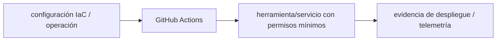

# GitHub Actions — Vigilio Actions por commit SHA/verificada

## Qué es, qué hace y cuándo usarla

Automatización CI/CD desde workflows YAML en GitHub. Gestiona gates, permisos por job, despliegues con OIDC y artefactos verificables.

**Ubicación en Vigilio:** usa esta dependencia en su stack propietario; otras skills deben enlazar esta guía, no duplicar sus reglas. **Versión:** la indicada en el encabezado es la línea documentada; consultar `technology/versions.md` y el lockfile antes de copiar APIs o aprobar un upgrade.

> **Guía propia de GitHub Actions (platform).** Estado a **2026-10-25**: Actions por commit SHA/verificada. Versión del proyecto consumidor = `pnpm-lock.yaml` / `composer.lock` / imagen o manifest. Fuente: [documentación oficial](https://docs.github.com/en/actions). Fuente normativa transversal de versiones: [versions.md](../versions.md). **No implica instalación automática ni upgrade aprobado.**

## Objetivo, responsabilidad y dónde usar

OIDC cloud, environment approvals, artifact provenance, CI por stack y reusable workflows.

**Uso:** aplicar solo si está declarada y resulta pertinente al consumidor; ver [política de adopción y DRY](README.md).

### Diagrama de integración (Mermaid)



El flujo muestra la **responsabilidad arquitectónica** de la librería; no representa llamadas reales de red para todas las operaciones.


## Instalación o verificación

```bash
usar reusable workflows de plataforma
```

**Gate de instalación:** consultar [procedimiento compartido](README.md#protocolo-de-adopción-y-actualización); estos comandos son indicativos, no ejecuciones sobre un consumidor.

## ✅ Correcto — uso actual y ejemplo de referencia

```typescript
permissions:
  contents: read
jobs:
  test:
    runs-on: ubuntu-latest
    steps:
      - uses: actions/checkout@<sha-aprobado>
      - run: echo "Run typecheck/tests with lockfile"
```

**Por qué:** OIDC cloud, environment approvals, artifact provenance, CI por stack y reusable workflows.

## ❌ Incorrecto — patrón legacy, inseguro o mal ubicado

```typescript
permissions: write-all
# ❌ token con privilegios amplios por defecto
```

**Riesgo:** confundir versiones o responsabilidades y obtener un contrato incorrecto.

## Nuevas capacidades, migración y breaking changes

Acciones cambian majors, runners y Node interno; pin SHA con Dependabot y verificación de permisos.

Aplicar el [protocolo de migración común](README.md#protocolo-de-adopción-y-actualización), sin asumir que una release nueva está desplegada.

## Buenas prácticas, seguridad, rendimiento y operación

Consultar la [política transversal de librerías](README.md) para seguridad, versionado, evidencia y revisión de contratos. Para esta librería, además, aplicar las verificaciones concretas que se detallan a continuación.

## Gates de aceptación y compatibilidad

Test pipeline en PR, permissions, fork security, reproducible builds y rollback.

Estado de prueba de estos ejemplos documentales: **NOT_RUN** en aplicaciones consumidoras; ver [criterios de evidencia](README.md#criterios-de-validación).


## Referencias

- [Documentación oficial y migración de GitHub Actions](https://docs.github.com/en/actions)
- [Matriz y baseline de versiones](../versions.md)
- [Calidad de código canónica](../../foundations/engineering/code-quality.md)


## Recetario operativo ampliado — github-actions (2026-10-25)

### API actual: dos tareas reales que debe saber ejecutar una skill

1. **Versionar jobs con least permissions y pin SHA para third-party actions sensibles.**
2. **Cache key con lockfile; matrix de tests y deploy solo tras gates requeridos.**

### Migración desde versiones anteriores: decisión concreta

- **Qué cambia o se debe revisar:** No usar `pull_request_target` con checkout de PR no confiable y credenciales.

### Responsabilidades y capas

Orquestación CI; implementaciones Nest/Laravel permanecen en guías propias.

**✅ Correcto:** mantener la integración encapsulada, alinear los nombres del negocio con Vigilio y depender de un contrato estable.

**❌ Incorrecto:** importar internals de la librería desde Domain, declarar `any` para resolver un upgrade, o duplicar reglas ya propietarias de otra tecnología.

### Seguridad, resiliencia y rendimiento

- Supply chain: no imprimir secrets; OIDC e environment protection para deploy.

### Test de aceptación específico y evidencia mínima

- **Escenario comprobable:** Verificar protección de rama, PR adversarial, lockfile, artifact attestations.

### Ejemplo de integración vigente (fragmento adicional)

```yaml
permissions: { contents: read }
on: [pull_request]
jobs:
  validate:
    runs-on: ubuntu-latest
    steps:
      - uses: actions/checkout@<PINNED_FULL_COMMIT_SHA>
      - run: echo 'Sustituir el SHA de ejemplo por uno auditado antes de ejecutar' 
```

**Nota:** los fragmentos muestran la API específica y requieren imports/providers/fixtures del consumidor; no se certifica compilación por el solo hecho de aparecer aquí.

### Pin real obligatorio

El marcador `<PINNED_FULL_COMMIT_SHA>` es *ilustrativo*, jamás un valor ejecutable. Sustituirlo por el SHA completo que el equipo haya validado en repositorio oficial. En CI real usar `pull_request` con permisos mínimos y environments protegidos.


## Guía operativa detallada — 8 casos y 4 antipatrones

### Ocho ejemplos de la API y casos de uso relevantes

Los fragmentos siguientes ilustran **operaciones independientes**. Variables, imports, provider, extensión y configuración se completan en el proyecto consumidor; **no están certificados como un archivo único compilable**. Cuando hay comentarios `#`, son pasos de integración o configuración y no APIs inventadas.

#### Ejemplo 1. Trigger PR

**✅ Correcto — trigger pr**

```yaml
on: { pull_request: {} }
```


#### Ejemplo 2. Permisos mínimos

**✅ Correcto — permisos mínimos**

```yaml
permissions: { contents: read }
```


#### Ejemplo 3. Checkout

**✅ Correcto — checkout**

```yaml
uses: actions/checkout@<SHA_VALIDADO>
```


#### Ejemplo 4. Setup Node

**✅ Correcto — setup node**

```yaml
uses: actions/setup-node@<SHA_VALIDADO>
```


#### Ejemplo 5. Cache pnpm

**✅ Correcto — cache pnpm**

```yaml
with: { cache: pnpm }
```


#### Ejemplo 6. Quality

**✅ Correcto — quality**

```yaml
run: pnpm ci && pnpm typecheck && pnpm test
```


#### Ejemplo 7. Environment protection

**✅ Correcto — environment protection**

```yaml
environment: production
```


#### Ejemplo 8. OIDC

**✅ Correcto — oidc**

```yaml
permissions: { id-token: write, contents: read }
```


### Cuatro antipatrones frecuentes y su sustitución

#### Antipatrón 1 — riesgo y alternativa

**❌ Incorrecto**

```yaml
uses: vendor/action@main
```

**Por qué está mal:** El patrón «uses: vendor/action@main» es riesgoso: la elección «uses: vendor/action@main» puede incumplir los requisitos operativos de github-actions.

**✅ Correcto**

```yaml
uses: vendor/action@<SHA-auditado>
```

**Por qué mejora:** El patrón «uses: vendor/action@<SHA-auditado>» mejora el caso: la alternativa «uses: vendor/action@<SHA-auditado>» establece el comportamiento esperado de github-actions.

#### Antipatrón 2 — riesgo y alternativa

**❌ Incorrecto**

```yaml
permissions: write-all
```

**Por qué está mal:** El patrón «permissions: write-all» es riesgoso: puede permitir acceso a recursos no autorizados o de otro tenant.

**✅ Correcto**

```yaml
permissions: { contents: read }
```

**Por qué mejora:** El patrón «permissions: { contents: read }» mejora el caso: se fuerza autorización en el borde/servidor y se limita el acceso por recurso.

#### Antipatrón 3 — riesgo y alternativa

**❌ Incorrecto — PR externo con pull_request_target+checkout.**

**Por qué está mal:** El patrón «PR externo con pull_request_target+checkout» es riesgoso: puede elevar el coste de runtime, causar fallos de despliegue o empaquetar dependencias no deseadas.

**✅ Correcto — Pull_request sin privilegios para código no confiable.**

**Por qué mejora:** El patrón «Pull_request sin privilegios para código no confiable» mejora el caso: el build y los recursos se verifican mediante gates de despliegue y rendimiento.

#### Antipatrón 4 — riesgo y alternativa

**❌ Incorrecto**

```yaml
echo "$TOKEN"
```

**Por qué está mal:** Expone credenciales o confunde autenticación con autorización; puede ocasionar filtración o acceso indebido.

**✅ Correcto — Usar OIDC y nunca imprimir secretos.**

**Por qué mejora:** Separa permisos y secretos del código de negocio y permite comprobar el acceso mínimo.

### Versión estable, breaking changes y verificación

- **Versión estable exacta:** no se declara un parche universal cuando no hay verificación específica de su registry/release. Consultar el encabezado de esta guía, `technology/versions.md` y el manifiesto del servicio. **Estado de patch: VERIFY_LOCKFILE**.
- **Migración:** identificar major anterior, APIs retiradas/cambiadas, peer dependencies, requisitos de runtime, cambios de tipos, ejecución CI y plan de rollback. Si no hay prueba sobre el consumidor, **NOT_RUN**, no PASS.
- **Versiones previas:** el ejemplo marcado ❌ en esta guía explica al menos una incompatibilidad o un uso obsoleto; no trasplantar APIs de otras versiones.
- **Tests:** probar al menos happy path, error, seguridad/permiso y compatibilidad con el runtime donde aplique; solo activar nuevas capacidades mediante una PR versionada.

### Fuentes oficiales y referencias al final

- [Referencia propia oficial](https://docs.github.com/en/actions)
- [Matriz canónica de versiones](../versions.md)
- [Política de adopción de librerías](README.md)

## Guía de compatibilidad y evaluación por versión (2026-10-25)

**Estado del patch exacto:** `VERIFY_LOCKFILE`. La guía documenta la familia de APIs; **no se ha verificado hoy el patch estable preciso de esta dependencia**. Consultar la fuente oficial enlazada al inicio y el lockfile antes de generar código o aprobar un upgrade.

### Checklist específico de esta librería

- **Migración/compatibilidad:** No usar `pull_request_target` con checkout de PR no confiable y credenciales.
- **Prueba propia:** Verificar protección de rama, PR adversarial, lockfile, artifact attestations.
- **Límite de responsabilidad:** usar esta librería solo en su adaptador o capa propietaria; consultar los ejemplos de API y antipatrones anteriores antes de cambiar llamadas públicas.

**Gate de aprobación:** leer la referencia oficial y resolver la versión del consumidor, ejecutar typecheck y pruebas específicas, registrar PASS/FAIL/NOT_RUN/BLOCKED. No confundir esta guía con validación de un consumidor real. [Procedimiento único de adopción](README.md#protocolo-de-adopción-y-actualización).

