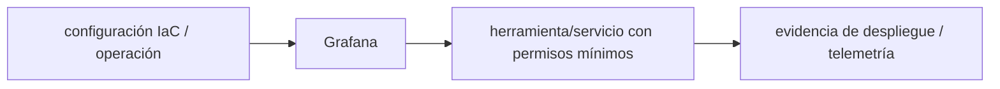

# Grafana — Vigilio línea OSS/Cloud según despliegue

## Qué es, qué hace y cuándo usarla

Visualización y exploración de métricas, logs y trazas con data sources. Paneles y alertas deben usar métricas estables y etiquetas de cardinalidad controlada.

**Ubicación en Vigilio:** usa esta dependencia en su stack propietario; otras skills deben enlazar esta guía, no duplicar sus reglas. **Versión:** la indicada en el encabezado es la línea documentada; consultar `technology/versions.md` y el lockfile antes de copiar APIs o aprobar un upgrade.

> **Guía propia de Grafana (observability).** Estado a **2026-10-25**: línea OSS/Cloud según despliegue. Versión del proyecto consumidor = `pnpm-lock.yaml` / `composer.lock` / imagen o manifest. Fuente: [documentación oficial](https://grafana.com/docs/grafana/latest/). Fuente normativa transversal de versiones: [versions.md](../versions.md). **No implica instalación automática ni upgrade aprobado.**

## Objetivo, responsabilidad y dónde usar

Paneles orientados a SLO, Grafana Faro para RUM frontend cuando justificado.

**Uso:** aplicar solo si está declarada y resulta pertinente al consumidor; ver [política de adopción y DRY](README.md).

### Diagrama de integración (Mermaid)



El flujo muestra la **responsabilidad arquitectónica** de la librería; no representa llamadas reales de red para todas las operaciones.


## Instalación o verificación

```bash
provision dashboards y datasources como código
```

**Gate de instalación:** consultar [procedimiento compartido](README.md#protocolo-de-adopción-y-actualización); estos comandos son indicativos, no ejecuciones sobre un consumidor.

## ✅ Correcto — uso actual y ejemplo de referencia

**Nota técnica (no es código ejecutable):** Dashboard: error-rate, p95 latency, throughput por ruta Vincular trace_id del log con trazas mediante datasource.

**Por qué:** Paneles orientados a SLO, Grafana Faro para RUM frontend cuando justificado.

## ❌ Incorrecto — patrón legacy, inseguro o mal ubicado

**Nota técnica (no es código ejecutable):** ❌ dashboards sin origen de datos ni ownership, o credenciales incrustadas.

**Riesgo:** confundir versiones o responsabilidades y obtener un contrato incorrecto.

## Nuevas capacidades, migración y breaking changes

Dashboards, alerting y provisioning tienen migraciones; no asumir compat de plugins antiguas.

Aplicar el [protocolo de migración común](README.md#protocolo-de-adopción-y-actualización), sin asumir que una release nueva está desplegada.

## Buenas prácticas, seguridad, rendimiento y operación

Consultar la [política transversal de librerías](README.md) para seguridad, versionado, evidencia y revisión de contratos. Para esta librería, además, aplicar las verificaciones concretas que se detallan a continuación.

## Gates de aceptación y compatibilidad

Test filtros tiempo, datasources, permisos, costes de queries y alertas.

Estado de prueba de estos ejemplos documentales: **NOT_RUN** en aplicaciones consumidoras; ver [criterios de evidencia](README.md#criterios-de-validación).


## Referencias

- [Documentación oficial y migración de Grafana](https://grafana.com/docs/grafana/latest/)
- [Matriz y baseline de versiones](../versions.md)
- [Calidad de código canónica](../../foundations/engineering/code-quality.md)


## Recetario operativo ampliado — grafana (2026-10-25)

### API actual: dos tareas reales que debe saber ejecutar una skill

1. **Separar dashboards de métricas, logs y trazas y enlazar por correlation ID.**
2. **Provisionar dashboards/alertas como código; definir SLO y acciones por alerta.**

### Migración desde versiones anteriores: decisión concreta

- **Qué cambia o se debe revisar:** API de datasources cambia por versión/Cloud; exportar provisioning compatible.

### Responsabilidades y capas

Observabilidad plataforma: no crear controladores de negocio aquí.

**✅ Correcto:** mantener la integración encapsulada, alinear los nombres del negocio con Vigilio y depender de un contrato estable.

**❌ Incorrecto:** importar internals de la librería desde Domain, declarar `any` para resolver un upgrade, o duplicar reglas ya propietarias de otra tecnología.

### Seguridad, resiliencia y rendimiento

- Evitar dashboards con cardinalidad alta y PII en labels.

### Test de aceptación específico y evidencia mínima

- **Escenario comprobable:** Prueba datasource health, alert rules, retention, panel al fallar exporter.


## Guía operativa detallada — 8 casos y 4 antipatrones

### Ocho ejemplos de la API y casos de uso relevantes

Los fragmentos siguientes ilustran **operaciones independientes**. Variables, imports, provider, extensión y configuración se completan en el proyecto consumidor; **no están certificados como un archivo único compilable**. Cuando hay comentarios `#`, son pasos de integración o configuración y no APIs inventadas.

#### Ejemplo 1. Datasource Prometheus

**✅ Correcto — datasource prometheus**

**Nota técnica (no es código ejecutable):** Provisioning YAML: type: prometheus; url: http://prometheus:9090.


#### Ejemplo 2. Panel latencia

**✅ Correcto — panel latencia**

```yaml
histogram_quantile(0.95, sum by (le) (rate(http_request_duration_seconds_bucket[5m])))
```


#### Ejemplo 3. Errores HTTP

**✅ Correcto — errores http**

```yaml
sum(rate(http_requests_total{status=~"5.."}[5m]))
```


#### Ejemplo 4. Correlación trazas

**✅ Correcto — correlación trazas**

**Nota técnica (no es código ejecutable):** Enlazar exemplar trace_id en datasource Tempo.


#### Ejemplo 5. Variable ambiente

**✅ Correcto — variable ambiente**

**Nota técnica (no es código ejecutable):** Dashboard variable env con allowlist, nunca tenant_id ilimitado.


#### Ejemplo 6. Alert rule

**✅ Correcto — alert rule**

**Nota técnica (no es código ejecutable):** Alertar error ratio sostenido, vincular runbook.


#### Ejemplo 7. Provisioning

**✅ Correcto — provisioning**

**Nota técnica (no es código ejecutable):** Dashboards JSON provisionados desde Git.


#### Ejemplo 8. SLO

**✅ Correcto — slo**

**Nota técnica (no es código ejecutable):** Panel con budget/error rate y tendencia 30 días.


### Cuatro antipatrones frecuentes y su sustitución

#### Antipatrón 1 — riesgo y alternativa

**❌ Incorrecto**

```yaml
sum by (tenant_id) (rate(requests_total[5m]))
```

**Por qué está mal:** El patrón «sum by (tenant_id) (rate(requests_total[5m]))» es riesgoso: puede permitir acceso a recursos no autorizados o de otro tenant.

**✅ Correcto**

```yaml
sum by (route) (rate(requests_total[5m]))
```

**Por qué mejora:** El patrón «sum by (route) (rate(requests_total[5m]))» mejora el caso: se fuerza autorización en el borde/servidor y se limita el acceso por recurso.

#### Antipatrón 2 — riesgo y alternativa

**❌ Incorrecto — Dashboard editado solo en UI.**

**Por qué está mal:** El patrón «Dashboard editado solo en UI» es riesgoso: puede mezclar firmas incompatibles o ejecutar una API retirada en la versión instalada.

**✅ Correcto — Provisioning versionado en Git.**

**Por qué mejora:** El patrón «Provisioning versionado en Git» mejora el caso: se utiliza la API apropiada para el major documentado y se comprueba el lockfile.

#### Antipatrón 3 — riesgo y alternativa

**❌ Incorrecto — Alerta sin runbook.**

**Por qué está mal:** Omite un control operativo necesario, por lo que el comportamiento puede ser inseguro o difícil de verificar.

**✅ Correcto — Regla con owner, SLO y runbook.**

**Por qué mejora:** El patrón «Regla con owner, SLO y runbook» mejora el caso: la alternativa «Regla con owner, SLO y runbook» establece el comportamiento esperado de grafana.

#### Antipatrón 4 — riesgo y alternativa

**❌ Incorrecto — Poner PII en panel compartido.**

**Por qué está mal:** El patrón «Poner PII en panel compartido» es riesgoso: los secretos o datos privados quedan expuestos en código, logs o artefactos de despliegue.

**✅ Correcto — Filtrar/masking + RBAC.**

**Por qué mejora:** El patrón «Filtrar/masking + RBAC» mejora el caso: las credenciales quedan fuera del código o bajo un mecanismo de acceso controlado.

### Versión estable, breaking changes y verificación

- **Versión estable exacta:** no se declara un parche universal cuando no hay verificación específica de su registry/release. Consultar el encabezado de esta guía, `technology/versions.md` y el manifiesto del servicio. **Estado de patch: VERIFY_LOCKFILE**.
- **Migración:** identificar major anterior, APIs retiradas/cambiadas, peer dependencies, requisitos de runtime, cambios de tipos, ejecución CI y plan de rollback. Si no hay prueba sobre el consumidor, **NOT_RUN**, no PASS.
- **Versiones previas:** el ejemplo marcado ❌ en esta guía explica al menos una incompatibilidad o un uso obsoleto; no trasplantar APIs de otras versiones.
- **Tests:** probar al menos happy path, error, seguridad/permiso y compatibilidad con el runtime donde aplique; solo activar nuevas capacidades mediante una PR versionada.

### Fuentes oficiales y referencias al final

- [Referencia propia oficial](https://grafana.com/docs/grafana/latest/)
- [Matriz canónica de versiones](../versions.md)
- [Política de adopción de librerías](README.md)

## Guía de compatibilidad y evaluación por versión (2026-10-25)

**Estado del patch exacto:** `VERIFY_LOCKFILE`. La guía documenta la familia de APIs; **no se ha verificado hoy el patch estable preciso de esta dependencia**. Consultar la fuente oficial enlazada al inicio y el lockfile antes de generar código o aprobar un upgrade.

### Checklist específico de esta librería

- **Migración/compatibilidad:** API de datasources cambia por versión/Cloud; exportar provisioning compatible.
- **Prueba propia:** Prueba datasource health, alert rules, retention, panel al fallar exporter.
- **Límite de responsabilidad:** usar esta librería solo en su adaptador o capa propietaria; consultar los ejemplos de API y antipatrones anteriores antes de cambiar llamadas públicas.

**Gate de aprobación:** leer la referencia oficial y resolver la versión del consumidor, ejecutar typecheck y pruebas específicas, registrar PASS/FAIL/NOT_RUN/BLOCKED. No confundir esta guía con validación de un consumidor real. [Procedimiento único de adopción](README.md#protocolo-de-adopción-y-actualización).

