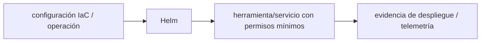

# Helm — Vigilio 3.x o 4.x según cluster/chart, gate de upgrade

## Qué es, qué hace y cuándo usarla

Gestor de charts y releases Kubernetes. Las plantillas y values describen despliegue; los secretos no deben quedar en repositorio.

**Ubicación en Vigilio:** usa esta dependencia en su stack propietario; otras skills deben enlazar esta guía, no duplicar sus reglas. **Versión:** la indicada en el encabezado es la línea documentada; consultar `technology/versions.md` y el lockfile antes de copiar APIs o aprobar un upgrade.

> **Guía propia de Helm (platform).** Estado a **2026-10-25**: 3.x o 4.x según cluster/chart, gate de upgrade. Versión del proyecto consumidor = `pnpm-lock.yaml` / `composer.lock` / imagen o manifest. Fuente: [documentación oficial](https://helm.sh/docs/). Fuente normativa transversal de versiones: [versions.md](../versions.md). **No implica instalación automática ni upgrade aprobado.**

## Objetivo, responsabilidad y dónde usar

Charts para configuración del cluster, no como fuente de reglas de negocio.

**Uso:** aplicar solo si está declarada y resulta pertinente al consumidor; ver [política de adopción y DRY](README.md).

### Diagrama de integración (Mermaid)



El flujo muestra la **responsabilidad arquitectónica** de la librería; no representa llamadas reales de red para todas las operaciones.


## Instalación o verificación

```bash
helm version
```

**Gate de instalación:** consultar [procedimiento compartido](README.md#protocolo-de-adopción-y-actualización); estos comandos son indicativos, no ejecuciones sobre un consumidor.

## ✅ Correcto — uso actual y ejemplo de referencia

```typescript
helm lint chart/
helm template release chart/ -f values-prod.yaml > rendered.yaml
```

**Por qué:** Charts para configuración del cluster, no como fuente de reglas de negocio.

## ❌ Incorrecto — patrón legacy, inseguro o mal ubicado

**Nota técnica (no es código ejecutable):** ❌ secrets en values.yaml commiteados.

**Riesgo:** confundir versiones o responsabilidades y obtener un contrato incorrecto.

## Nuevas capacidades, migración y breaking changes

Helm 3→4 revisar CLI/plugins/charts y capabilities; no fijar major sin compat.

Aplicar el [protocolo de migración común](README.md#protocolo-de-adopción-y-actualización), sin asumir que una release nueva está desplegada.

## Buenas prácticas, seguridad, rendimiento y operación

Consultar la [política transversal de librerías](README.md) para seguridad, versionado, evidencia y revisión de contratos. Para esta librería, además, aplicar las verificaciones concretas que se detallan a continuación.

## Gates de aceptación y compatibilidad

helm lint/template, schema values, kubeconform, canary.

Estado de prueba de estos ejemplos documentales: **NOT_RUN** en aplicaciones consumidoras; ver [criterios de evidencia](README.md#criterios-de-validación).


## Referencias

- [Documentación oficial y migración de Helm](https://helm.sh/docs/)
- [Matriz y baseline de versiones](../versions.md)
- [Calidad de código canónica](../../foundations/engineering/code-quality.md)


## Recetario operativo ampliado — helm (2026-10-25)

### API actual: dos tareas reales que debe saber ejecutar una skill

1. **Usar chart values con schema y `helm lint`, `helm template --debug` antes de deploy.**
2. **Rollouts por env y secrets externos; fijar chart+image digest.**

### Migración desde versiones anteriores: decisión concreta

- **Qué cambia o se debe revisar:** Helm 3→4 requiere verificar plugins/hook compatibility, no asumir automática.

### Responsabilidades y capas

K8s packaging; no inventar dominio Nest/Laravel dentro del chart.

**✅ Correcto:** mantener la integración encapsulada, alinear los nombres del negocio con Vigilio y depender de un contrato estable.

**❌ Incorrecto:** importar internals de la librería desde Domain, declarar `any` para resolver un upgrade, o duplicar reglas ya propietarias de otra tecnología.

### Seguridad, resiliencia y rendimiento

- CRDs y delete hooks pueden romper despliegues; diffs y rollback plan.

### Test de aceptación específico y evidencia mínima

- **Escenario comprobable:** Prueba install/upgrade en cluster efímero y helm diff/admission policies.


## Guía operativa detallada — 8 casos y 4 antipatrones

### Ocho ejemplos de la API y casos de uso relevantes

Los fragmentos siguientes ilustran **operaciones independientes**. Variables, imports, provider, extensión y configuración se completan en el proyecto consumidor; **no están certificados como un archivo único compilable**. Cuando hay comentarios `#`, son pasos de integración o configuración y no APIs inventadas.

#### Ejemplo 1. Lint

**✅ Correcto — lint**

```bash
helm lint ./chart
```


#### Ejemplo 2. Renderizar

**✅ Correcto — renderizar**

```bash
helm template vigilio ./chart -f values-staging.yaml
```


#### Ejemplo 3. Instalar

**✅ Correcto — instalar**

```bash
helm install vigilio ./chart -n apps --create-namespace
```


#### Ejemplo 4. Actualizar

**✅ Correcto — actualizar**

```bash
helm upgrade vigilio ./chart -n apps --atomic
```


#### Ejemplo 5. Rollback

**✅ Correcto — rollback**

```bash
helm rollback vigilio 1 -n apps
```


#### Ejemplo 6. Ver historial

**✅ Correcto — ver historial**

```bash
helm history vigilio -n apps
```


#### Ejemplo 7. Inspeccionar valores

**✅ Correcto — inspeccionar valores**

```bash
helm show values ./chart
```


#### Ejemplo 8. Diff previa

**✅ Correcto — diff previa**

```bash
helm diff upgrade vigilio ./chart -f values-prod.yaml
```


### Cuatro antipatrones frecuentes y su sustitución

#### Antipatrón 1 — riesgo y alternativa

**❌ Incorrecto**

```bash
helm upgrade app ./chart # sin lint/template
```

**Por qué está mal:** Omite un control operativo necesario, por lo que el comportamiento puede ser inseguro o difícil de verificar.

**✅ Correcto**

```bash
helm lint ./chart && helm template app ./chart
```

**Por qué mejora:** El patrón «helm lint ./chart && helm template app ./chart» mejora el caso: el build y los recursos se verifican mediante gates de despliegue y rendimiento.

#### Antipatrón 2 — riesgo y alternativa

**❌ Incorrecto — Values.yaml con contraseñas plaintext.**

**Por qué está mal:** El patrón «Values.yaml con contraseñas plaintext» es riesgoso: los secretos o datos privados quedan expuestos en código, logs o artefactos de despliegue.

**✅ Correcto — External Secrets/secret manager.**

**Por qué mejora:** Separa permisos y secretos del código de negocio y permite comprobar el acceso mínimo.

#### Antipatrón 3 — riesgo y alternativa

**❌ Incorrecto**

```bash
helm upgrade app ./chart # sin rollback seguro
```

**Por qué está mal:** Omite un control operativo necesario, por lo que el comportamiento puede ser inseguro o difícil de verificar.

**✅ Correcto**

```bash
helm upgrade app ./chart --atomic
```

**Por qué mejora:** El patrón «helm upgrade app ./chart --atomic» mejora el caso: el build y los recursos se verifican mediante gates de despliegue y rendimiento.

#### Antipatrón 4 — riesgo y alternativa

**❌ Incorrecto — Salto helm3→4 sin probar plugins.**

**Por qué está mal:** Omite un control operativo necesario, por lo que el comportamiento puede ser inseguro o difícil de verificar.

**✅ Correcto — Validar plugins y hooks en clúster staging.**

**Por qué mejora:** Convierte la condición en un control verificable mediante validación o pruebas.

### Versión estable, breaking changes y verificación

- **Versión estable exacta:** no se declara un parche universal cuando no hay verificación específica de su registry/release. Consultar el encabezado de esta guía, `technology/versions.md` y el manifiesto del servicio. **Estado de patch: VERIFY_LOCKFILE**.
- **Migración:** identificar major anterior, APIs retiradas/cambiadas, peer dependencies, requisitos de runtime, cambios de tipos, ejecución CI y plan de rollback. Si no hay prueba sobre el consumidor, **NOT_RUN**, no PASS.
- **Versiones previas:** el ejemplo marcado ❌ en esta guía explica al menos una incompatibilidad o un uso obsoleto; no trasplantar APIs de otras versiones.
- **Tests:** probar al menos happy path, error, seguridad/permiso y compatibilidad con el runtime donde aplique; solo activar nuevas capacidades mediante una PR versionada.

### Fuentes oficiales y referencias al final

- [Referencia propia oficial](https://helm.sh/docs/)
- [Matriz canónica de versiones](../versions.md)
- [Política de adopción de librerías](README.md)

## Guía de compatibilidad y evaluación por versión (2026-10-25)

**Estado del patch exacto:** `VERIFY_LOCKFILE`. La guía documenta la familia de APIs; **no se ha verificado hoy el patch estable preciso de esta dependencia**. Consultar la fuente oficial enlazada al inicio y el lockfile antes de generar código o aprobar un upgrade.

### Checklist específico de esta librería

- **Migración/compatibilidad:** Helm 3→4 requiere verificar plugins/hook compatibility, no asumir automática.
- **Prueba propia:** Prueba install/upgrade en cluster efímero y helm diff/admission policies.
- **Límite de responsabilidad:** usar esta librería solo en su adaptador o capa propietaria; consultar los ejemplos de API y antipatrones anteriores antes de cambiar llamadas públicas.

**Gate de aprobación:** leer la referencia oficial y resolver la versión del consumidor, ejecutar typecheck y pruebas específicas, registrar PASS/FAIL/NOT_RUN/BLOCKED. No confundir esta guía con validación de un consumidor real. [Procedimiento único de adopción](README.md#protocolo-de-adopción-y-actualización).

