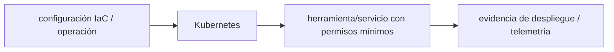

# Kubernetes — Vigilio versión exacta del cluster/compatibility matrix

## Qué es, qué hace y cuándo usarla

Orquestador de contenedores. Gestiona deployments, health probes, recursos, seguridad, políticas y rollouts sin asumir que un pod es una VM.

**Ubicación en Vigilio:** usa esta dependencia en su stack propietario; otras skills deben enlazar esta guía, no duplicar sus reglas. **Versión:** la indicada en el encabezado es la línea documentada; consultar `technology/versions.md` y el lockfile antes de copiar APIs o aprobar un upgrade.

> **Guía propia de Kubernetes (platform).** Estado a **2026-10-25**: versión exacta del cluster/compatibility matrix. Versión del proyecto consumidor = `pnpm-lock.yaml` / `composer.lock` / imagen o manifest. Fuente: [documentación oficial](https://kubernetes.io/docs/). Fuente normativa transversal de versiones: [versions.md](../versions.md). **No implica instalación automática ni upgrade aprobado.**

## Objetivo, responsabilidad y dónde usar

GitOps, probes, RBAC, network policies, quotas, observability, cost.

**Uso:** aplicar solo si está declarada y resulta pertinente al consumidor; ver [política de adopción y DRY](README.md).

### Diagrama de integración (Mermaid)



El flujo muestra la **responsabilidad arquitectónica** de la librería; no representa llamadas reales de red para todas las operaciones.


## Instalación o verificación

```bash
kubectl version --client
```

**Gate de instalación:** consultar [procedimiento compartido](README.md#protocolo-de-adopción-y-actualización); estos comandos son indicativos, no ejecuciones sobre un consumidor.

## ✅ Correcto — uso actual y ejemplo de referencia

**Nota técnica (no es código ejecutable):** Definir requests/limits, probes y rollout kubectl diff -f manifests/ && kubectl apply -f manifests/.

**Por qué:** GitOps, probes, RBAC, network policies, quotas, observability, cost.

## ❌ Incorrecto — patrón legacy, inseguro o mal ubicado

**Nota técnica (no es código ejecutable):** ❌ deployment sin readiness o sin requests/limits en producción.

**Riesgo:** confundir versiones o responsabilidades y obtener un contrato incorrecto.

## Nuevas capacidades, migración y breaking changes

API deprecations por minor de cluster: kubectl convert, admission policy y chart compat.

Aplicar el [protocolo de migración común](README.md#protocolo-de-adopción-y-actualización), sin asumir que una release nueva está desplegada.

## Buenas prácticas, seguridad, rendimiento y operación

Consultar la [política transversal de librerías](README.md) para seguridad, versionado, evidencia y revisión de contratos. Para esta librería, además, aplicar las verificaciones concretas que se detallan a continuación.

## Gates de aceptación y compatibilidad

kubectl auth can-i, server-side dry-run, policy tests, canary y rollback.

Estado de prueba de estos ejemplos documentales: **NOT_RUN** en aplicaciones consumidoras; ver [criterios de evidencia](README.md#criterios-de-validación).


## Referencias

- [Documentación oficial y migración de Kubernetes](https://kubernetes.io/docs/)
- [Matriz y baseline de versiones](../versions.md)
- [Calidad de código canónica](../../foundations/engineering/code-quality.md)


## Recetario operativo ampliado — kubernetes (2026-10-25)

### API actual: dos tareas reales que debe saber ejecutar una skill

1. **Configurar readiness/startup/liveness diferentes y requests/limits medidos.**
2. **Pod security, namespace y workload identity; manifests declarativos GitOps.**

### Migración desde versiones anteriores: decisión concreta

- **Qué cambia o se debe revisar:** Versión del API-server define deprecaciones; usar `kubectl api-resources` y audit.

### Responsabilidades y capas

Infra cluster: los pipelines PHP/Node enlazan aquí.

**✅ Correcto:** mantener la integración encapsulada, alinear los nombres del negocio con Vigilio y depender de un contrato estable.

**❌ Incorrecto:** importar internals de la librería desde Domain, declarar `any` para resolver un upgrade, o duplicar reglas ya propietarias de otra tecnología.

### Seguridad, resiliencia y rendimiento

- No guardar credenciales en ConfigMap; HPA sin métricas fiables es inseguro.

### Test de aceptación específico y evidencia mínima

- **Escenario comprobable:** kubectl dry-run server, policy check, rollout canario, chaos/termination.


## Guía operativa detallada — 8 casos y 4 antipatrones

### Ocho ejemplos de la API y casos de uso relevantes

Los fragmentos siguientes ilustran **operaciones independientes**. Variables, imports, provider, extensión y configuración se completan en el proyecto consumidor; **no están certificados como un archivo único compilable**. Cuando hay comentarios `#`, son pasos de integración o configuración y no APIs inventadas.

#### Ejemplo 1. Ver despliegue

**✅ Correcto — ver despliegue**

```bash
kubectl get deployments -n apps
```


#### Ejemplo 2. Rollout estado

**✅ Correcto — rollout estado**

```bash
kubectl rollout status deploy/api -n apps
```


#### Ejemplo 3. Logs limitados

**✅ Correcto — logs limitados**

```bash
kubectl logs deployment/api -n apps --tail=100
```


#### Ejemplo 4. Salud readiness

**✅ Correcto — salud readiness**

**Nota técnica (no es código ejecutable):** ReadinessProbe: httpGet: { path: /health/ready, port: 3000 }.


#### Ejemplo 5. Recursos

**✅ Correcto — recursos**

**Nota técnica (no es código ejecutable):** Resources: { requests: {cpu: 100m, memory: 128Mi}, limits: {memory: 512Mi} }.


#### Ejemplo 6. Secret externo

**✅ Correcto — secret externo**

**Nota técnica (no es código ejecutable):** External Secrets Operator / CSI en vez de YAML plaintext.


#### Ejemplo 7. HPA

**✅ Correcto — hpa**

```bash
kubectl autoscale deployment api --cpu-percent=70 --min=2 --max=10
```


#### Ejemplo 8. Revertir

**✅ Correcto — revertir**

```bash
kubectl rollout undo deployment/api -n apps
```


### Cuatro antipatrones frecuentes y su sustitución

#### Antipatrón 1 — riesgo y alternativa

**❌ Incorrecto**

```bash
kubectl apply -f secret-plaintext.yaml
```

**Por qué está mal:** Expone credenciales o confunde autenticación con autorización; puede ocasionar filtración o acceso indebido.

**✅ Correcto — External Secret / CSI, no secrets en Git.**

**Por qué mejora:** Separa permisos y secretos del código de negocio y permite comprobar el acceso mínimo.

#### Antipatrón 2 — riesgo y alternativa

**❌ Incorrecto — Replicas=1 sin readiness.**

**Por qué está mal:** Omite un control operativo necesario, por lo que el comportamiento puede ser inseguro o difícil de verificar.

**✅ Correcto — ReadinessProbe + recursos medidos.**

**Por qué mejora:** El patrón «ReadinessProbe + recursos medidos» mejora el caso: la alternativa «ReadinessProbe + recursos medidos» establece el comportamiento esperado de kubernetes.

#### Antipatrón 3 — riesgo y alternativa

**❌ Incorrecto**

```bash
kubectl rollout restart deploy/api # a ciegas
```

**Por qué está mal:** El patrón «kubectl rollout restart deploy/api # a ciegas» es riesgoso: puede elevar el coste de runtime, causar fallos de despliegue o empaquetar dependencias no deseadas.

**✅ Correcto**

```bash
kubectl rollout status deploy/api -n apps
```

**Por qué mejora:** El patrón «kubectl rollout status deploy/api -n apps» mejora el caso: el build y los recursos se verifican mediante gates de despliegue y rendimiento.

#### Antipatrón 4 — riesgo y alternativa

**❌ Incorrecto — Tag imagen latest.**

**Por qué está mal:** El patrón «Tag imagen latest» es riesgoso: puede mezclar firmas incompatibles o ejecutar una API retirada en la versión instalada.

**✅ Correcto — Digest inmutable por release.**

**Por qué mejora:** El patrón «Digest inmutable por release» mejora el caso: se utiliza la API apropiada para el major documentado y se comprueba el lockfile.

### Versión estable, breaking changes y verificación

- **Versión estable exacta:** no se declara un parche universal cuando no hay verificación específica de su registry/release. Consultar el encabezado de esta guía, `technology/versions.md` y el manifiesto del servicio. **Estado de patch: VERIFY_LOCKFILE**.
- **Migración:** identificar major anterior, APIs retiradas/cambiadas, peer dependencies, requisitos de runtime, cambios de tipos, ejecución CI y plan de rollback. Si no hay prueba sobre el consumidor, **NOT_RUN**, no PASS.
- **Versiones previas:** el ejemplo marcado ❌ en esta guía explica al menos una incompatibilidad o un uso obsoleto; no trasplantar APIs de otras versiones.
- **Tests:** probar al menos happy path, error, seguridad/permiso y compatibilidad con el runtime donde aplique; solo activar nuevas capacidades mediante una PR versionada.

### Fuentes oficiales y referencias al final

- [Referencia propia oficial](https://kubernetes.io/docs/)
- [Matriz canónica de versiones](../versions.md)
- [Política de adopción de librerías](README.md)

## Guía de compatibilidad y evaluación por versión (2026-10-25)

**Estado del patch exacto:** `VERIFY_LOCKFILE`. La guía documenta la familia de APIs; **no se ha verificado hoy el patch estable preciso de esta dependencia**. Consultar la fuente oficial enlazada al inicio y el lockfile antes de generar código o aprobar un upgrade.

### Checklist específico de esta librería

- **Migración/compatibilidad:** Versión del API-server define deprecaciones; usar `kubectl api-resources` y audit.
- **Prueba propia:** kubectl dry-run server, policy check, rollout canario, chaos/termination.
- **Límite de responsabilidad:** usar esta librería solo en su adaptador o capa propietaria; consultar los ejemplos de API y antipatrones anteriores antes de cambiar llamadas públicas.

**Gate de aprobación:** leer la referencia oficial y resolver la versión del consumidor, ejecutar typecheck y pruebas específicas, registrar PASS/FAIL/NOT_RUN/BLOCKED. No confundir esta guía con validación de un consumidor real. [Procedimiento único de adopción](README.md#protocolo-de-adopción-y-actualización).

