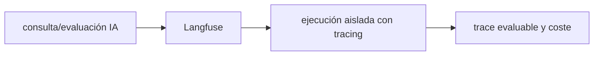

# Langfuse — Vigilio línea self-hosted/cloud de proyecto

## Qué es, qué hace y cuándo usarla

Observabilidad y evaluaciones de aplicaciones LLM: trazas, generaciones, prompts y métricas de costo. Evita enviar PII o prompts sensibles sin controles.

**Ubicación en Vigilio:** usa esta dependencia en su stack propietario; otras skills deben enlazar esta guía, no duplicar sus reglas. **Versión:** la indicada en el encabezado es la línea documentada; consultar `technology/versions.md` y el lockfile antes de copiar APIs o aprobar un upgrade.

> **Guía propia de Langfuse (ai).** Estado a **2026-10-25**: línea self-hosted/cloud de proyecto. Versión del proyecto consumidor = `pnpm-lock.yaml` / `composer.lock` / imagen o manifest. Fuente: [documentación oficial](https://langfuse.com/docs). Fuente normativa transversal de versiones: [versions.md](../versions.md). **No implica instalación automática ni upgrade aprobado.**

## Objetivo, responsabilidad y dónde usar

LLMOps observability, trazabilidad RAG, datasets de eval y FinOps.

**Uso:** aplicar solo si está declarada y resulta pertinente al consumidor; ver [política de adopción y DRY](README.md).

### Diagrama de integración (Mermaid)



El flujo muestra la **responsabilidad arquitectónica** de la librería; no representa llamadas reales de red para todas las operaciones.


## Instalación o verificación

```bash
revisar SDK oficial compatible con runtime
```

**Gate de instalación:** consultar [procedimiento compartido](README.md#protocolo-de-adopción-y-actualización); estos comandos son indicativos, no ejecuciones sobre un consumidor.

## ✅ Correcto — uso actual y ejemplo de referencia

**Nota técnica (no es código ejecutable):** Registrar: trace de petición LLM, prompt version, costo tokens, latencia, calidad, feedback sin incluir PII cruda.

**Por qué:** LLMOps observability, trazabilidad RAG, datasets de eval y FinOps.

## ❌ Incorrecto — patrón legacy, inseguro o mal ubicado

**Nota técnica (no es código ejecutable):** ❌ loggear secretos y documentos completos de usuarios por defecto.

**Riesgo:** confundir versiones o responsabilidades y obtener un contrato incorrecto.

## Nuevas capacidades, migración y breaking changes

La API evoluciona entre SDK v2/v3; verificar imports específicos antes de copiar ejemplos.

Aplicar el [protocolo de migración común](README.md#protocolo-de-adopción-y-actualización), sin asumir que una release nueva está desplegada.

## Buenas prácticas, seguridad, rendimiento y operación

Consultar la [política transversal de librerías](README.md) para seguridad, versionado, evidencia y revisión de contratos. Para esta librería, además, aplicar las verificaciones concretas que se detallan a continuación.

## Gates de aceptación y compatibilidad

Eval retrieval, costo por operación, latencia, redacción PII y retención.

Estado de prueba de estos ejemplos documentales: **NOT_RUN** en aplicaciones consumidoras; ver [criterios de evidencia](README.md#criterios-de-validación).


## Referencias

- [Documentación oficial y migración de Langfuse](https://langfuse.com/docs)
- [Matriz y baseline de versiones](../versions.md)
- [Calidad de código canónica](../../foundations/engineering/code-quality.md)


## Recetario operativo ampliado — langfuse (2026-10-25)

### API actual: dos tareas reales que debe saber ejecutar una skill

1. **Modelar traces y scores de LLM por interacción y workflow, no por log plano.**
2. **Versionar prompts/datasets/evaluators; registrar token/cost por proveedor.**

### Migración desde versiones anteriores: decisión concreta

- **Qué cambia o se debe revisar:** API SDK v2/v3 puede tener cambios en tracing, escoger adapter vigente por lock.

### Responsabilidades y capas

Observabilidad IA, no fuente de verdad para documentos ni autorización.

**✅ Correcto:** mantener la integración encapsulada, alinear los nombres del negocio con Vigilio y depender de un contrato estable.

**❌ Incorrecto:** importar internals de la librería desde Domain, declarar `any` para resolver un upgrade, o duplicar reglas ya propietarias de otra tecnología.

### Seguridad, resiliencia y rendimiento

- Redactar prompts/PII, sampling y permisos de proyecto.

### Test de aceptación específico y evidencia mínima

- **Escenario comprobable:** Trace retrieval/generation y feedback vinculado, comparación prompt version.


## Guía operativa detallada — 8 casos y 4 antipatrones

### Ocho ejemplos de la API y casos de uso relevantes

Los fragmentos siguientes ilustran **operaciones independientes**. Variables, imports, provider, extensión y configuración se completan en el proyecto consumidor; **no están certificados como un archivo único compilable**. Cuando hay comentarios `#`, son pasos de integración o configuración y no APIs inventadas.

#### Ejemplo 1. Instanciar cliente

**✅ Correcto — instanciar cliente**

```typescript
const langfuse = new Langfuse({ secretKey: process.env.LANGFUSE_SECRET_KEY });
```


#### Ejemplo 2. Asociar trace

**✅ Correcto — asociar trace**

**Nota técnica (no es código ejecutable):** Usar trace/span API de SDK instalado: revisar semconv y versión fijada.


#### Ejemplo 3. Medir tokens

**✅ Correcto — medir tokens**

**Nota técnica (no es código ejecutable):** Adjuntar promptTokens/completionTokens a generación.


#### Ejemplo 4. Evaluar retrieval

**✅ Correcto — evaluar retrieval**

**Nota técnica (no es código ejecutable):** Registrar dataset y score verificable por query.


#### Ejemplo 5. Aislar entorno

**✅ Correcto — aislar entorno**

**Nota técnica (no es código ejecutable):** Separar proyectos dev/staging/prod en el servidor.


#### Ejemplo 6. Anonimizar usuario

**✅ Correcto — anonimizar usuario**

**Nota técnica (no es código ejecutable):** Hashear identificadores; no registrar email en traces.


#### Ejemplo 7. Control retention

**✅ Correcto — control retention**

**Nota técnica (no es código ejecutable):** Configurar periodo de retención por proyecto/plan.


#### Ejemplo 8. Flush

**✅ Correcto — flush**

```typescript
await langfuse.flushAsync();
```


### Cuatro antipatrones frecuentes y su sustitución

#### Antipatrón 1 — riesgo y alternativa

**❌ Incorrecto**

```typescript
trace({ input: raw_patient_record })
```

**Por qué está mal:** El patrón «trace({ input: raw_patient_record })» es riesgoso: los secretos o datos privados quedan expuestos en código, logs o artefactos de despliegue.

**✅ Correcto — Redactar PII y secretos antes de enviar.**

**Por qué mejora:** Separa permisos y secretos del código de negocio y permite comprobar el acceso mínimo.

#### Antipatrón 2 — riesgo y alternativa

**❌ Incorrecto — Usar client sin flush al cierre.**

**Por qué está mal:** Omite un control operativo necesario, por lo que el comportamiento puede ser inseguro o difícil de verificar.

**✅ Correcto**

```typescript
await langfuse.flushAsync() # si API compatible en lockfile
```

**Por qué mejora:** El patrón «await langfuse.flushAsync() # si API compatible en lockfile» mejora el caso: se utiliza la API apropiada para el major documentado y se comprueba el lockfile.

#### Antipatrón 3 — riesgo y alternativa

**❌ Incorrecto — Omitir costes/tokens.**

**Por qué está mal:** Expone credenciales o confunde autenticación con autorización; puede ocasionar filtración o acceso indebido.

**✅ Correcto — Guardar consumo por modelo y operación.**

**Por qué mejora:** El patrón «Guardar consumo por modelo y operación» mejora el caso: las credenciales quedan fuera del código o bajo un mecanismo de acceso controlado.

#### Antipatrón 4 — riesgo y alternativa

**❌ Incorrecto — SDK sin verificar major.**

**Por qué está mal:** Omite un control operativo necesario, por lo que el comportamiento puede ser inseguro o difícil de verificar.

**✅ Correcto — Revisar firma y SDK instalado, documentar NOT_RUN.**

**Por qué mejora:** El patrón «Revisar firma y SDK instalado, documentar NOT_RUN» mejora el caso: se utiliza la API apropiada para el major documentado y se comprueba el lockfile.

### Versión estable, breaking changes y verificación

- **Versión estable exacta:** no se declara un parche universal cuando no hay verificación específica de su registry/release. Consultar el encabezado de esta guía, `technology/versions.md` y el manifiesto del servicio. **Estado de patch: VERIFY_LOCKFILE**.
- **Migración:** identificar major anterior, APIs retiradas/cambiadas, peer dependencies, requisitos de runtime, cambios de tipos, ejecución CI y plan de rollback. Si no hay prueba sobre el consumidor, **NOT_RUN**, no PASS.
- **Versiones previas:** el ejemplo marcado ❌ en esta guía explica al menos una incompatibilidad o un uso obsoleto; no trasplantar APIs de otras versiones.
- **Tests:** probar al menos happy path, error, seguridad/permiso y compatibilidad con el runtime donde aplique; solo activar nuevas capacidades mediante una PR versionada.

### Fuentes oficiales y referencias al final

- [Referencia propia oficial](https://langfuse.com/docs)
- [Matriz canónica de versiones](../versions.md)
- [Política de adopción de librerías](README.md)

## Guía de compatibilidad y evaluación por versión (2026-10-25)

**Estado del patch exacto:** `VERIFY_LOCKFILE`. La guía documenta la familia de APIs; **no se ha verificado hoy el patch estable preciso de esta dependencia**. Consultar la fuente oficial enlazada al inicio y el lockfile antes de generar código o aprobar un upgrade.

### Checklist específico de esta librería

- **Migración/compatibilidad:** API SDK v2/v3 puede tener cambios en tracing, escoger adapter vigente por lock.
- **Prueba propia:** Trace retrieval/generation y feedback vinculado, comparación prompt version.
- **Límite de responsabilidad:** usar esta librería solo en su adaptador o capa propietaria; consultar los ejemplos de API y antipatrones anteriores antes de cambiar llamadas públicas.

**Gate de aprobación:** leer la referencia oficial y resolver la versión del consumidor, ejecutar typecheck y pruebas específicas, registrar PASS/FAIL/NOT_RUN/BLOCKED. No confundir esta guía con validación de un consumidor real. [Procedimiento único de adopción](README.md#protocolo-de-adopción-y-actualización).

## Integración IA/RAG moderna — 2026

Langfuse ofrece observabilidad (traces) **y** datasets/experiments/scores para evaluación. La captura de inputs/outputs debe someterse a política de privacidad; [evals canónicos](../../standards/ai/evaluacion-calidad.md), [datos oficiales](https://langfuse.com/docs/evaluation/overview).

✅ **Correcto:** revisar API instalada/digest, seguridad y datos del consumidor. ❌ **Incorrecto:** copiar endpoint legacy o presentar pruebas documentales como compilación real.
