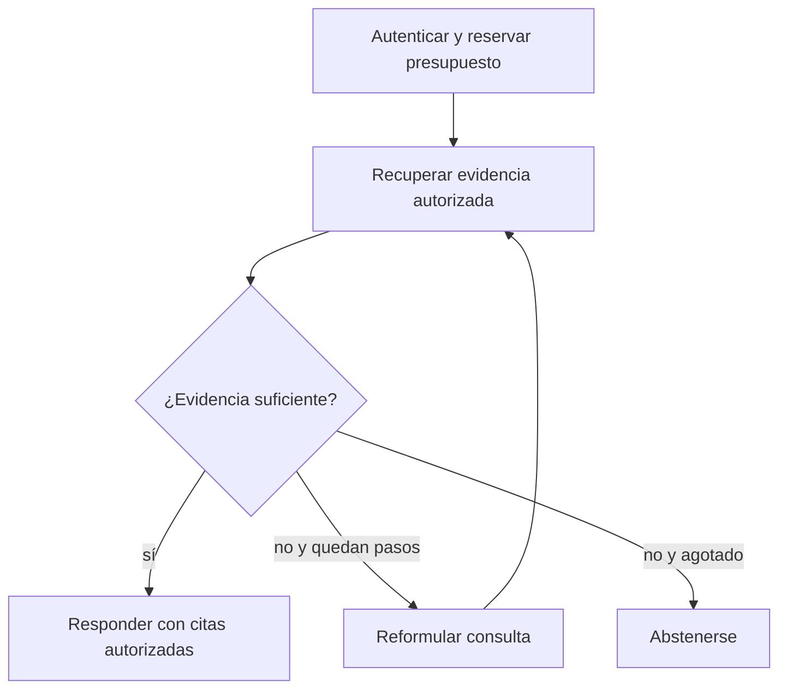

# LangGraph JS — grafos con estado, checkpoints y herramientas

**Revisión:** 2026-10-25. **Línea estable JS verificada:** `@langchain/langgraph` 1.5.x (comprobar el tag `latest` y pin exacto del consumidor antes de instalar); el paquete Python tiene versiones independientes. [Registro npm](https://www.npmjs.com/package/@langchain/langgraph). **LangGraph es opcional:** no convertir RAG sencillo en un sistema de agentes sin motivo.

**Propietario:** API de orquestación LangGraph JS. Seguridad global de tools en [agentes](../../standards/ai/agentes-tools.md); selección de arquitectura en [decisiones AI](../../foundations/ai/seleccion-arquitectura-2026.md).

## 1. Cuándo usarlo

- Workflows con varios nodos y decisiones, estado durable, reanudación tras fallo, human-in-the-loop y herramientas con efectos laterales.
- No usarlo para un único endpoint de búsqueda con pipeline secuencial `authorize → retrieve → rerank → generate` sin branching.
- Una herramienta debe validar inputs, revisar permisos **en cada ejecución**, limitar llamadas externas y proteger efectos idempotentes.
- Los checkpoints no son una solución automática a transacciones distribuidas, ni el estado del grafo sustituye la base de datos de negocio.

## 2. Dependencias y contrato de versión

```bash
# Candidato para un servicio Node separado; fijar versión exacta aprobada en lockfile.
pnpm add @langchain/langgraph@1.5 @langchain/core
pnpm why @langchain/langgraph
```

Si la aplicación usa NestJS y no necesita agentes, **no** instalar LangGraph solo porque la documentación existe. Verificar `exports`, requisitos de Node, compatibilidad con la biblioteca de modelos y checkpointers; no copiar `Annotation.Root` legado si el proyecto ha adoptado una API nueva sin revisión.

## 3. Grafo funcional mínimo con API actual

La documentación oficial actual expone `StateSchema`, `StateGraph`, `START`, `END` y `MessagesValue`. Este fragmento crea una respuesta de prueba: **no** hace búsqueda ni accede a herramientas reales.

```typescript
import {
  StateSchema,
  MessagesValue,
  type GraphNode,
  StateGraph,
  START,
  END,
} from '@langchain/langgraph';

const AgentState = new StateSchema({ messages: MessagesValue });

const reply: GraphNode<typeof AgentState> = (_state) => ({
  messages: [{ role: 'ai', content: 'No hay evidencia suficiente todavía.' }],
});

const graph = new StateGraph(AgentState)
  .addNode('reply', reply)
  .addEdge(START, 'reply')
  .addEdge('reply', END)
  .compile();

const result = await graph.invoke({
  messages: [{ role: 'user', content: '¿Dónde se encuentra la póliza?' }],
});
console.log(result.messages);
```

`GraphNode` y la forma del estado están ligados a la release de LangGraph documentada; es obligatorio ejecutar typecheck tras fijar la dependencia real. **El resultado no es una respuesta fundamentada**: falta un nodo de búsqueda autorizado.

## 4. Estructura recomendada en Vigilio

```text
src/ai/
├── application/
│   ├── services/answer-question.service.ts
│   └── ports/authorized-retriever.port.ts
├── infrastructure/
│   ├── langgraph/answer-question.graph.ts
│   ├── checkpoint/checkpoint-store.ts
│   └── tools/approved-search.tool.ts
└── presentation/http/
    └── dto/answer-question.request.dto.ts
```

La entidad de dominio no importa LangGraph, prompts ni herramientas externas. Controller autentica y manda un comando tipado, Application establece autorización y presupuesto, infraestructura implementa el grafo.



El diagrama es una arquitectura objetivo, **no** un grafo ya implementado por el ejemplo mínimo.

## 5. Estado y decisiones de branching

El estado debe ser pequeño y serializable. Los IDs autorizados deben venir del contexto de sesión y verificarse en el adaptador, no aceptarse porque el LLM los redactó.

```typescript
// Contrato interno, no un schema Zod HTTP ni una clase LangGraph.
export type AgentSearchState = {
  query: string;
  actor_id: string;
  tenant_id: string;
  steps_used: number;
  evidence_ids: readonly string[];
};

export function canRetrySearch(state: AgentSearchState, max_steps: number): boolean {
  return state.steps_used < max_steps && state.evidence_ids.length === 0;
}
```

- Cada nodo incrementa `steps_used` con un límite **externo al modelo**; controlar tiempo, costo, concurrencia y fallos.
- No inferir que `thread_id` es autorización. Una persona no debe poder reanudar el checkpoint de otra por conocer su ID.
- Los outputs que contienen documentos privados necesitan cifrado, TTL, redactores de PII y política de borrado.

## 6. Checkpointer y human-in-the-loop

- Elegir checkpointer compatible con la versión del SDK y los requisitos de durabilidad de la aplicación; el ejemplo `compile()` anterior es **sin persistencia**.
- Se requiere un identificador de thread confiable y tenant/actor asociados al checkpoint y a su ACL; revalidar al reanudar.
- Interrumpir antes de operaciones irreversibles y guardar la aprobación fuera del texto del prompt; validar expiración, owner y alcance.
- Tools de escritura son idempotentes por `idempotency_key` y transaction/outbox cuando aplique. La reanudación puede repetir ejecuciones y el sistema debe soportarlo.
- Diseñar compensación/reconciliación para efectos de terceros; no prometer exactamente-una-vez por usar checkpoints.

## 7. Cambios de API y migración desde tutoriales anteriores

| Fragmento encontrado | Regla en proyectos nuevos |
|---|---|
| `Annotation.Root(...)` de guías antiguas | Evaluar migración a `StateSchema`/`MessagesValue` cuando la release fijada lo soporta; **no** hacer reemplazo ciego |
| Llamada a `.addNode()` sin compile | Se requiere `.compile()` antes de `invoke()` |
| Nodo con SQL arbitrario generado | Sustituir por puerto de búsqueda autorizado y SQL parametrizado |
| Tool que confía en `tenant_id` del prompt | Inyectar tenant desde auth y verificar permisos en runtime |
| Promesa de persistencia sin checkpointer | Declarar estado efímero y configurar checkpointer explícito |
| Loop de búsqueda ilimitado | Cortar con contador y presupuesto independientes del LLM |

**Nota:** la documentación actual aún mantiene mecanismos de compatibilidad en algunas referencias; un tutorial antiguo no es automáticamente inválido para su versión anterior. Las migraciones requieren verificación de firmas y de estado serializado, más pruebas de reanudación.

## 8. ✅ Correcto / ❌ Incorrecto

**✅ Correcto:** grafo mínimo y determinista cuando basta; añadir nodos solo por decisión comprobable, scopes autorizados y límites de pasos independientes del prompt.

**❌ Incorrecto:** creer que una instrucción «no accedas a datos privados» equivale a ACL; ejecutar Tools de envío de dinero sin aprobación verificable; reintentar nodos con efectos laterales sin idempotencia.

**✅ Correcto:** tests unitarios de cada nodo, gates sobre checkpointer, simulación de fallo en mitad del flujo, trazas redactadas y recuperación después de reiniciar worker.

**❌ Incorrecto:** guardar cadenas de conexión, tokens y pasajes sensibles en state/checkpoint sin necesidad; confiar en `thread_id` arbitrario desde cliente.

## 9. Checklist de adopción y QA

1. Registrar qué decisión/branching justifica LangGraph frente a un servicio simple.
2. Resolver versión `@langchain/langgraph`, `@langchain/core`, adapters y checkpointer **por lockfile**.
3. `pnpm exec tsc --noEmit`, unit de nodos, fixtures de branching y límites de pasos.
4. Probar requests entre tenants y reanudación de checkpoint ajeno: siempre bloquear.
5. Simular timeouts, herramientas repetidas, caídas entre checkpoint/efecto externo y reanudación manual.
6. Medir calidad RAG/citas vs baseline, latencia p95, cantidad de pasos y costos por pregunta.
7. Marcar NOT_RUN si solo se revisaron docs; no publicar una integración como productiva sin runners.

## Fuentes y guías relacionadas

- [LangGraph JS oficial — overview](https://docs.langchain.com/oss/javascript/langgraph/overview)
- [Paquete y releases npm](https://www.npmjs.com/package/@langchain/langgraph)
- [Seguridad de agentes y tools](../../standards/ai/agentes-tools.md)
- [Selección de arquitectura](../../foundations/ai/seleccion-arquitectura-2026.md)
