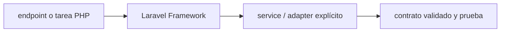

# Laravel Framework — Vigilio 13.39.0 estable (PHP 8.3–8.5 oficialmente)

## Qué es, qué hace y cuándo usarla

Framework PHP para HTTP, contenedor de dependencias, colas y aplicaciones. Controllers delgados coordinan Application; Eloquent permanece infraestructura.

**Ubicación en Vigilio:** usa esta dependencia en su stack propietario; otras skills deben enlazar esta guía, no duplicar sus reglas. **Versión:** la indicada en el encabezado es la línea documentada; consultar `technology/versions.md` y el lockfile antes de copiar APIs o aprobar un upgrade.

> **Guía propia de Laravel Framework (backend-php).** Estado a **2026-11-01**: 13.39.0 estable (PHP 8.3–8.5 oficialmente). Versión del proyecto consumidor = `pnpm-lock.yaml` / `composer.lock` / imagen o manifest. Fuente: [documentación oficial](https://laravel.com/docs/13.x/releases). Fuente normativa transversal de versiones: [versions.md](../versions.md). **No implica instalación automática ni upgrade aprobado.**

## Objetivo, responsabilidad y dónde usar

Domain entities y enums; Application service semántico; Eloquent en Infrastructure; Spatie Data en Presentation.

**Uso:** aplicar solo si está declarada y resulta pertinente al consumidor; ver [política de adopción y DRY](README.md).

### Diagrama de integración (Mermaid)



El flujo muestra la **responsabilidad arquitectónica** de la librería; no representa llamadas reales de red para todas las operaciones.


## Instalación o verificación

```bash
composer require laravel/framework:^13
```

**Gate de instalación:** consultar [procedimiento compartido](README.md#protocolo-de-adopción-y-actualización); estos comandos son indicativos, no ejecuciones sobre un consumidor.

## ✅ Correcto — uso actual y ejemplo de referencia

```php
// Controller delgado y semántico
public function registerProduct(RegisterProductData $input): ProductResponseData {
  $product = $this->product_service->registerProduct($input->nro_poliza);
  return ProductResponseData::from($product);
}
```

**Por qué:** Domain entities y enums; Application service semántico; Eloquent en Infrastructure; Spatie Data en Presentation.

## ❌ Incorrecto — patrón legacy, inseguro o mal ubicado

```php
// ❌ lógica SQL y negocio directamente en controller
public function store(Request $request){ ProductRecord::create($request->all()); }
```

**Riesgo:** confundir versiones o responsabilidades y obtener un contrato incorrecto.

## Nuevas capacidades, migración y breaking changes

12→13: requiere revisar upgrade guide y ecosystem (PHP, Spatie Data, Sanctum/Horizon/queue). No mezclar APIs futuras de 13 sin confirmar docs específicas.

Aplicar el [protocolo de migración común](README.md#protocolo-de-adopción-y-actualización), sin asumir que una release nueva está desplegada.

## Buenas prácticas, seguridad, rendimiento y operación

Consultar la [política transversal de librerías](README.md) para seguridad, versionado, evidencia y revisión de contratos. Para esta librería, además, aplicar las verificaciones concretas que se detallan a continuación.

## Gates de aceptación y compatibilidad

Feature tests authn/authz, DB migrations, 409, tenancy, jobs/queue, static analysis y php version.

Estado de prueba de estos ejemplos documentales: **NOT_RUN** en aplicaciones consumidoras; ver [criterios de evidencia](README.md#criterios-de-validación).


## Flujo de una feature Laravel con DDD pragmático

```php
final class ProductController {
  public function __construct(private readonly ProductService $product_service) {}
  public function registerProduct(RegisterProductData $input): ProductResponseData {
    return ProductResponseData::from($this->product_service->registerProduct($input->nro_poliza));
  }
}
```

- `Presentation/Http/Data`: Spatie DTO Request/Response, sin lógica de dominio.
- `Application/Services`: `registerProduct()`, `listProducts()`, `cancelOrder()`.
- `Domain/Entities`: `OrderEntity::cancel()`, invariantes y enums PHP nativos.
- `Application/Ports`: interfaces de repositorio; `Infrastructure/Persistence`: Eloquent.
- `routes/api.php`: REST paths y methods semánticos; AuthN en middleware, AuthZ con policies por recurso.
- CI: Composer audit, Pint, PHPStan/Larastan, Pest, PostgreSQL, deployment con gating.

✅ Correcto: DB transacción con bloqueo/conditional update para invariantes concurrentes. ❌ Incorrecto: Eloquent query en Controller y `$request->all()` como contrato.

## Referencias

- [Documentación oficial y migración de Laravel Framework](https://laravel.com/docs/13.x/releases)
- [Matriz y baseline de versiones](../versions.md)
- [Calidad de código canónica](../../foundations/engineering/code-quality.md)


## Recetario operativo ampliado — laravel-framework (2026-10-25)

### API actual: dos tareas reales que debe saber ejecutar una skill

1. **Rutas semánticas en `routes/api.php`, service container para puertos, middleware/policies.**
2. **Queue/jobs/transacciones, rate limits, FormRequest/Spatie según contrato.**

### Migración desde versiones anteriores: decisión concreta

- **Qué cambia o se debe revisar:** Laravel 13 vs 12 verificar changes y PHP min, evitar CRUD genérico en Application.

### Responsabilidades y capas

Framework HTTP/Application, Domain libre de Facades/Eloquent.

**✅ Correcto:** mantener la integración encapsulada, alinear los nombres del negocio con Vigilio y depender de un contrato estable.

**❌ Incorrecto:** importar internals de la librería desde Domain, declarar `any` para resolver un upgrade, o duplicar reglas ya propietarias de otra tecnología.

### Seguridad, resiliencia y rendimiento

- Mass assignment, multi-tenancy, policies y errores consistentes.

### Test de aceptación específico y evidencia mínima

- **Escenario comprobable:** Pest Feature para authn/authz, DatabaseTransactions y migraciones.

### Ejemplo de integración vigente (fragmento adicional)

```php
Route::middleware('auth:sanctum')->get('/products', [ProductController::class, 'listProducts']);
final readonly class ProductService {
    public function __construct(private ProductRepository $product_repository) {}
    public function listProducts(ProductCriteria $criteria): ProductPage {
        return $this->product_repository->findByCriteria($criteria);
    }
}
```

**Nota:** los fragmentos muestran la API específica y requieren imports/providers/fixtures del consumidor; no se certifica compilación por el solo hecho de aparecer aquí.


## Guía operativa detallada — 8 casos y 4 antipatrones

### Ocho ejemplos de la API y casos de uso relevantes

Los fragmentos siguientes ilustran **operaciones independientes**. Variables, imports, provider, extensión y configuración se completan en el proyecto consumidor; **no están certificados como un archivo único compilable**. Cuando hay comentarios `#`, son pasos de integración o configuración y no APIs inventadas.

#### Ejemplo 1. Ruta semántica

**✅ Correcto — ruta semántica**

```php
Route::get('/products', [ProductController::class, 'listProducts']);
```


#### Ejemplo 2. Middleware auth

**✅ Correcto — middleware auth**

```php
Route::middleware('auth:sanctum')->group(fn () => require base_path('routes/private.php'));
```


#### Ejemplo 3. Validación

**✅ Correcto — validación**

```php
$validated = $request->validate(['email' => ['required', 'email']]);
```


#### Ejemplo 4. Transacción

**✅ Correcto — transacción**

```php
DB::transaction(fn () => $this->approvePolicy($policy_id));
```


#### Ejemplo 5. Container DI

**✅ Correcto — container di**

```php
$this->app->bind(ProductRepository::class, EloquentProductRepository::class);
```


#### Ejemplo 6. Queue job

**✅ Correcto — queue job**

```php
ProcessProduct::dispatch($product_id)->onQueue('products');
```


#### Ejemplo 7. Rate limiter

**✅ Correcto — rate limiter**

```php
RateLimiter::for('api', fn (Request $request) => Limit::perMinute(60)->by($request->user()?->id ?? $request->ip()));
```


#### Ejemplo 8. Respuesta JSON

**✅ Correcto — respuesta json**

```php
return response()->json($payload, 201);
```


### Cuatro antipatrones frecuentes y su sustitución

#### Antipatrón 1 — riesgo y alternativa

**❌ Incorrecto**

```php
Route::post("/products", [Controller::class, "store"])
```

**Por qué está mal:** El patrón «Route::post("/products", [Controller::class, "store"])» es riesgoso: mezcla responsabilidades de interfaz y navegación o genera comportamiento inconsistente.

**✅ Correcto**

```php
Route::post("/products", [ProductController::class, "registerProduct"])
```

**Por qué mejora:** El patrón «Route::post("/products", [ProductController::class, "registerProduct"])» mejora el caso: la interfaz utiliza la API adecuada y separa presentación, estado y comunicación.

#### Antipatrón 2 — riesgo y alternativa

**❌ Incorrecto**

```php
ProductRecord::create($request->all())
```

**Por qué está mal:** El patrón «ProductRecord::create($request->all())» es riesgoso: puede elevar el coste de runtime, causar fallos de despliegue o empaquetar dependencias no deseadas.

**✅ Correcto**

```php
ProductRecord::create($request->validated())
```

**Por qué mejora:** Convierte la condición en un control verificable mediante validación o pruebas.

#### Antipatrón 3 — riesgo y alternativa

**❌ Incorrecto — Controller ejecuta reglas de dominio.**

**Por qué está mal:** El patrón «Controller ejecuta reglas de dominio» es riesgoso: la elección «Controller ejecuta reglas de dominio» puede incumplir los requisitos operativos de laravel-framework.

**✅ Correcto — ProductService + ProductEntity.**

**Por qué mejora:** El patrón «ProductService + ProductEntity» mejora el caso: la alternativa «ProductService + ProductEntity» establece el comportamiento esperado de laravel-framework.

#### Antipatrón 4 — riesgo y alternativa

**❌ Incorrecto — Confiar en auth:sanctum como autorización.**

**Por qué está mal:** El patrón «Confiar en auth:sanctum como autorización» es riesgoso: puede permitir acceso a recursos no autorizados o de otro tenant.

**✅ Correcto — Policy por tenant/recurso.**

**Por qué mejora:** Separa permisos y secretos del código de negocio y permite comprobar el acceso mínimo.

### Versión estable, breaking changes y verificación

- **Release estable contrastada en fuente pública (25-10-2026):** `13.x estable`. Esto **no** significa que el consumidor ya la tenga instalada.
- **Referencia de versiones/releases:** [Laravel Framework releases](https://laravel.com/framework/docs/releases).
- **API actual:** [documentación oficial específica](https://laravel.com/docs/13.x).
- **Migración:** identificar major anterior, APIs retiradas/cambiadas, peer dependencies, requisitos de runtime, cambios de tipos, ejecución CI y plan de rollback. Si no hay prueba sobre el consumidor, **NOT_RUN**, no PASS.
- **Versiones previas:** el ejemplo marcado ❌ en esta guía explica al menos una incompatibilidad o un uso obsoleto; no trasplantar APIs de otras versiones.
- **Tests:** probar al menos happy path, error, seguridad/permiso y compatibilidad con el runtime donde aplique; solo activar nuevas capacidades mediante una PR versionada.

### Fuentes oficiales y referencias al final

- [Referencia propia oficial](https://laravel.com/docs/13.x/releases)
- [Release o guía oficial](https://laravel.com/framework/docs/releases)
- [Release o guía oficial](https://laravel.com/docs/13.x)
- [Matriz canónica de versiones](../versions.md)
- [Política de adopción de librerías](README.md)

## Guía de compatibilidad y evaluación por versión (2026-10-25)

**Release contrastada para esta familia:** `Laravel 13.x`. Fuente: [publicación oficial](https://laravel.com/docs/13.x/releases). **Cambio clave:** Laravel 13 permite PHP 8.3–8.5; lockfile fija parche exacto.

### Checklist específico de esta librería

- Laravel 13 soporta PHP 8.3–8.5; usar PHP/Pest/Spatie solo cuando Composer resuelva peers.
- Autorización con Policies/Gates; DTO Spatie no reemplaza autorización de usuario/tenant.
- Transacciones y locks/CAS para invariantes concurrentes; eventos/outbox después del commit.

**Gate de aprobación:** leer la referencia oficial y resolver la versión del consumidor, ejecutar typecheck y pruebas específicas, registrar PASS/FAIL/NOT_RUN/BLOCKED. No confundir esta guía con validación de un consumidor real. [Procedimiento único de adopción](README.md#protocolo-de-adopción-y-actualización).

## Pipeline Laravel 13 reproducible (PHP 8.3–8.5)

```bash
composer validate --strict
composer install --no-interaction --prefer-dist --no-progress
composer audit
vendor/bin/pint --test
vendor/bin/phpstan analyse
php artisan test
php artisan route:list
```

Los binarios Pint/PHPStan y los tests solo corren si esos paquetes están realmente instalados y configurados. Integración PostgreSQL real y migraciones deben probarse en staging. ✅ Correcto: Policies/Gates, scope tenant, DB transaction/CAS en invariantes concurrentes, Spatie Data para DTOs. ❌ Incorrecto: instalar Laravel 13 y Pest 5 sin comprobar versión PHP o interpretar Eloquent como Domain Entity. [Laravel 13](https://laravel.com/docs/13.x/releases).
