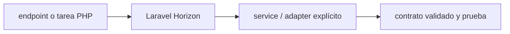

# Laravel Horizon — Vigilio rama compatible Laravel 13; requiere Redis

## Qué es, qué hace y cuándo usarla

Panel y supervisor de workers Laravel sobre colas Redis. Ayuda a gestionar throughput, reintentos y fallos, pero no reemplaza idempotencia.

**Ubicación en Vigilio:** usa esta dependencia en su stack propietario; otras skills deben enlazar esta guía, no duplicar sus reglas. **Versión:** la indicada en el encabezado es la línea documentada; consultar `technology/versions.md` y el lockfile antes de copiar APIs o aprobar un upgrade.

> **Guía propia de Laravel Horizon (backend-php).** Estado a **2026-10-25**: rama compatible Laravel 13; requiere Redis. Versión del proyecto consumidor = `pnpm-lock.yaml` / `composer.lock` / imagen o manifest. Fuente: [documentación oficial](https://laravel.com/docs/13.x/horizon). Fuente normativa transversal de versiones: [versions.md](../versions.md). **No implica instalación automática ni upgrade aprobado.**

## Objetivo, responsabilidad y dónde usar

Jobs transaccionales con outbox, permisos dashboard, colas separadas para workloads.

**Uso:** aplicar solo si está declarada y resulta pertinente al consumidor; ver [política de adopción y DRY](README.md).

### Diagrama de integración (Mermaid)



El flujo muestra la **responsabilidad arquitectónica** de la librería; no representa llamadas reales de red para todas las operaciones.


## Instalación o verificación

```bash
composer require laravel/horizon
```

**Gate de instalación:** consultar [procedimiento compartido](README.md#protocolo-de-adopción-y-actualización); estos comandos son indicativos, no ejecuciones sobre un consumidor.

## ✅ Correcto — uso actual y ejemplo de referencia

**Nota técnica (no es código ejecutable):** Horizon supervisa workers Redis, colas priorizadas, métricas y retries. Jobs deben ser idempotentes; job_id correlacionado y backoff acotado.

**Por qué:** Jobs transaccionales con outbox, permisos dashboard, colas separadas para workloads.

## ❌ Incorrecto — patrón legacy, inseguro o mal ubicado

**Nota técnica (no es código ejecutable):** ❌ usar Horizon como supervisor de SQS nativo sin Redis Horizon depende de Redis queues.

**Riesgo:** confundir versiones o responsabilidades y obtener un contrato incorrecto.

## Nuevas capacidades, migración y breaking changes

Revisar compat Laravel y phpredis/valkey/redis server. No confundir con Laravel queue SQS.

Aplicar el [protocolo de migración común](README.md#protocolo-de-adopción-y-actualización), sin asumir que una release nueva está desplegada.

## Buenas prácticas, seguridad, rendimiento y operación

Consultar la [política transversal de librerías](README.md) para seguridad, versionado, evidencia y revisión de contratos. Para esta librería, además, aplicar las verificaciones concretas que se detallan a continuación.

## Gates de aceptación y compatibilidad

Test retries, attempts, timeouts, failover y Horizon auth.

Estado de prueba de estos ejemplos documentales: **NOT_RUN** en aplicaciones consumidoras; ver [criterios de evidencia](README.md#criterios-de-validación).


## Referencias

- [Documentación oficial y migración de Laravel Horizon](https://laravel.com/docs/13.x/horizon)
- [Matriz y baseline de versiones](../versions.md)
- [Calidad de código canónica](../../foundations/engineering/code-quality.md)


## Recetario operativo ampliado — laravel-horizon (2026-10-25)

### API actual: dos tareas reales que debe saber ejecutar una skill

1. **Horizon gestiona colas Redis y supervisores con balance y métricas.**
2. **Asignar queues/priorities/timeouts por env, monitorear job throughput/failures.**

### Migración desde versiones anteriores: decisión concreta

- **Qué cambia o se debe revisar:** Horizon es para Redis, no para driver SQS puro sin arquitectura distinta.

### Responsabilidades y capas

Queue operations Laravel; los trabajos semánticos en Application.

**✅ Correcto:** mantener la integración encapsulada, alinear los nombres del negocio con Vigilio y depender de un contrato estable.

**❌ Incorrecto:** importar internals de la librería desde Domain, declarar `any` para resolver un upgrade, o duplicar reglas ya propietarias de otra tecnología.

### Seguridad, resiliencia y rendimiento

- Retries + idempotencia, jobs sensibles y dashboard protegido.

### Test de aceptación específico y evidencia mínima

- **Escenario comprobable:** Simular worker detenido, retry fail y colas saturadas; dashboards auth.


## Guía operativa detallada — 8 casos y 4 antipatrones

### Ocho ejemplos de la API y casos de uso relevantes

Los fragmentos siguientes ilustran **operaciones independientes**. Variables, imports, provider, extensión y configuración se completan en el proyecto consumidor; **no están certificados como un archivo único compilable**. Cuando hay comentarios `#`, son pasos de integración o configuración y no APIs inventadas.

#### Ejemplo 1. Instalar

**✅ Correcto — instalar**

```bash
composer require laravel/horizon
```


#### Ejemplo 2. Publicar

**✅ Correcto — publicar**

```bash
php artisan horizon:install
```


#### Ejemplo 3. Workers

**✅ Correcto — workers**

```bash
php artisan horizon
```


#### Ejemplo 4. Supervisor configuración

**✅ Correcto — supervisor configuración**

**Nota técnica (no es código ejecutable):** Config/horizon.php: 'balance' => 'auto'.


#### Ejemplo 5. Queues

**✅ Correcto — queues**

**Nota técnica (no es código ejecutable):** 'queue' => ['default', 'emails'].


#### Ejemplo 6. Reintentar

**✅ Correcto — reintentar**

```bash
php artisan horizon:retry all
```


#### Ejemplo 7. Estado

**✅ Correcto — estado**

```bash
php artisan horizon:status
```


#### Ejemplo 8. Deploy

**✅ Correcto — deploy**

```bash
php artisan horizon:terminate
```


### Cuatro antipatrones frecuentes y su sustitución

#### Antipatrón 1 — riesgo y alternativa

**❌ Incorrecto**

```bash
php artisan queue:work # supervisado junto con horizon sin control
```

**Por qué está mal:** Omite un control operativo necesario, por lo que el comportamiento puede ser inseguro o difícil de verificar.

**✅ Correcto**

```bash
php artisan horizon
```

**Por qué mejora:** El patrón «php artisan horizon» mejora el caso: la ejecución se controla con idempotencia, límites y evidencia de errores.

#### Antipatrón 2 — riesgo y alternativa

**❌ Incorrecto — Jobs no idempotentes.**

**Por qué está mal:** El patrón «Jobs no idempotentes» es riesgoso: la consulta puede producir resultados incorrectos, lentitud o aislamiento insuficiente de datos.

**✅ Correcto — Event_id como clave y UNIQUE en DB.**

**Por qué mejora:** El patrón «Event_id como clave y UNIQUE en DB» mejora el caso: la consulta o el contrato se valida y mide sobre datos representativos.

#### Antipatrón 3 — riesgo y alternativa

**❌ Incorrecto — Deploy sin reiniciar trabajadores.**

**Por qué está mal:** Omite un control operativo necesario, por lo que el comportamiento puede ser inseguro o difícil de verificar.

**✅ Correcto**

```bash
php artisan horizon:terminate
```

**Por qué mejora:** El patrón «php artisan horizon:terminate» mejora el caso: la ejecución se controla con idempotencia, límites y evidencia de errores.

#### Antipatrón 4 — riesgo y alternativa

**❌ Incorrecto — Exponer dashboard Horizon pública.**

**Por qué está mal:** El patrón «Exponer dashboard Horizon pública» es riesgoso: puede permitir acceso a recursos no autorizados o de otro tenant.

**✅ Correcto — Autorización Gate y acceso interno.**

**Por qué mejora:** Convierte la condición en un control verificable mediante validación o pruebas.

### Versión estable, breaking changes y verificación

- **Versión estable exacta:** no se declara un parche universal cuando no hay verificación específica de su registry/release. Consultar el encabezado de esta guía, `technology/versions.md` y el manifiesto del servicio. **Estado de patch: VERIFY_LOCKFILE**.
- **Migración:** identificar major anterior, APIs retiradas/cambiadas, peer dependencies, requisitos de runtime, cambios de tipos, ejecución CI y plan de rollback. Si no hay prueba sobre el consumidor, **NOT_RUN**, no PASS.
- **Versiones previas:** el ejemplo marcado ❌ en esta guía explica al menos una incompatibilidad o un uso obsoleto; no trasplantar APIs de otras versiones.
- **Tests:** probar al menos happy path, error, seguridad/permiso y compatibilidad con el runtime donde aplique; solo activar nuevas capacidades mediante una PR versionada.

### Fuentes oficiales y referencias al final

- [Referencia propia oficial](https://laravel.com/docs/13.x/horizon)
- [Matriz canónica de versiones](../versions.md)
- [Política de adopción de librerías](README.md)

## Guía de compatibilidad y evaluación por versión (2026-10-25)

**Estado del patch exacto:** `VERIFY_LOCKFILE`. La guía documenta la familia de APIs; **no se ha verificado hoy el patch estable preciso de esta dependencia**. Consultar la fuente oficial enlazada al inicio y el lockfile antes de generar código o aprobar un upgrade.

### Checklist específico de esta librería

- **Migración/compatibilidad:** Horizon es para Redis, no para driver SQS puro sin arquitectura distinta.
- **Prueba propia:** Simular worker detenido, retry fail y colas saturadas; dashboards auth.
- **Límite de responsabilidad:** usar esta librería solo en su adaptador o capa propietaria; consultar los ejemplos de API y antipatrones anteriores antes de cambiar llamadas públicas.

**Gate de aprobación:** leer la referencia oficial y resolver la versión del consumidor, ejecutar typecheck y pruebas específicas, registrar PASS/FAIL/NOT_RUN/BLOCKED. No confundir esta guía con validación de un consumidor real. [Procedimiento único de adopción](README.md#protocolo-de-adopción-y-actualización).

