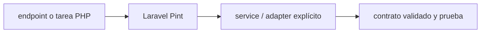

# Laravel Pint — Vigilio línea compatible con PHP/Laravel del proyecto

## Qué es, qué hace y cuándo usarla

Formateador opinado de PHP para Laravel, integrado en CI. Mantiene estilo consistente; no valida reglas de dominio.

**Ubicación en Vigilio:** usa esta dependencia en su stack propietario; otras skills deben enlazar esta guía, no duplicar sus reglas. **Versión:** la indicada en el encabezado es la línea documentada; consultar `technology/versions.md` y el lockfile antes de copiar APIs o aprobar un upgrade.

> **Guía propia de Laravel Pint (backend-php).** Estado a **2026-10-25**: línea compatible con PHP/Laravel del proyecto. Versión del proyecto consumidor = `pnpm-lock.yaml` / `composer.lock` / imagen o manifest. Fuente: [documentación oficial](https://laravel.com/docs/13.x/pint). Fuente normativa transversal de versiones: [versions.md](../versions.md). **No implica instalación automática ni upgrade aprobado.**

## Objetivo, responsabilidad y dónde usar

Formateo no reemplaza análisis estático o tests; reglas compartidas PHP.

**Uso:** aplicar solo si está declarada y resulta pertinente al consumidor; ver [política de adopción y DRY](README.md).

### Diagrama de integración (Mermaid)



El flujo muestra la **responsabilidad arquitectónica** de la librería; no representa llamadas reales de red para todas las operaciones.


## Instalación o verificación

```bash
composer require --dev laravel/pint
```

**Gate de instalación:** consultar [procedimiento compartido](README.md#protocolo-de-adopción-y-actualización); estos comandos son indicativos, no ejecuciones sobre un consumidor.

## ✅ Correcto — uso actual y ejemplo de referencia

```php
./vendor/bin/pint --test
# En desarrollo: ./vendor/bin/pint
```

**Por qué:** Formateo no reemplaza análisis estático o tests; reglas compartidas PHP.

## ❌ Incorrecto — patrón legacy, inseguro o mal ubicado

**Nota técnica (no es código ejecutable):** ❌ formato manual inconsistente y sin gate ❌ autoformatear al vuelo durante release prod.

**Riesgo:** confundir versiones o responsabilidades y obtener un contrato incorrecto.

## Nuevas capacidades, migración y breaking changes

Actualizar ruleset/versión de PHP con cambios sintácticos, sin mutaciones semánticas.

Aplicar el [protocolo de migración común](README.md#protocolo-de-adopción-y-actualización), sin asumir que una release nueva está desplegada.

## Buenas prácticas, seguridad, rendimiento y operación

Consultar la [política transversal de librerías](README.md) para seguridad, versionado, evidencia y revisión de contratos. Para esta librería, además, aplicar las verificaciones concretas que se detallan a continuación.

## Gates de aceptación y compatibilidad

Gates pint --test, PR diff y PHP compatibility.

Estado de prueba de estos ejemplos documentales: **NOT_RUN** en aplicaciones consumidoras; ver [criterios de evidencia](README.md#criterios-de-validación).


## Referencias

- [Documentación oficial y migración de Laravel Pint](https://laravel.com/docs/13.x/pint)
- [Matriz y baseline de versiones](../versions.md)
- [Calidad de código canónica](../../foundations/engineering/code-quality.md)


## Recetario operativo ampliado — laravel-pint (2026-10-25)

### API actual: dos tareas reales que debe saber ejecutar una skill

1. **Pint formatea PHP, usar preset y `pint --test` como gate no mutante.**
2. **Decidir overrides mínimos consistentes con naming y PHP-CS-Fixer.**

### Migración desde versiones anteriores: decisión concreta

- **Qué cambia o se debe revisar:** No confundir Pint con Larastan, ni ejecutarlo como revisión semántica.

### Responsabilidades y capas

Estilo, nunca invariantes/seguridad.

**✅ Correcto:** mantener la integración encapsulada, alinear los nombres del negocio con Vigilio y depender de un contrato estable.

**❌ Incorrecto:** importar internals de la librería desde Domain, declarar `any` para resolver un upgrade, o duplicar reglas ya propietarias de otra tecnología.

### Seguridad, resiliencia y rendimiento

- Autofix masivo requiere diff y revisión; no alterar negocio con regex.

### Test de aceptación específico y evidencia mínima

- **Escenario comprobable:** Ejecutar test/gate antes y después de Pint con sample y CI.


## Guía operativa detallada — 8 casos y 4 antipatrones

### Ocho ejemplos de la API y casos de uso relevantes

Los fragmentos siguientes ilustran **operaciones independientes**. Variables, imports, provider, extensión y configuración se completan en el proyecto consumidor; **no están certificados como un archivo único compilable**. Cuando hay comentarios `#`, son pasos de integración o configuración y no APIs inventadas.

#### Ejemplo 1. Comprobar

**✅ Correcto — comprobar**

```bash
vendor/bin/pint --test
```


#### Ejemplo 2. Aplicar

**✅ Correcto — aplicar**

```bash
vendor/bin/pint
```


#### Ejemplo 3. Archivo concreto

**✅ Correcto — archivo concreto**

```bash
vendor/bin/pint app/Products/Domain/Entities/ProductEntity.php
```


#### Ejemplo 4. Solo cambios

**✅ Correcto — solo cambios**

```bash
vendor/bin/pint --dirty
```


#### Ejemplo 5. Config

**✅ Correcto — config**

**Nota técnica (no es código ejecutable):** Pint.json: { "preset": "laravel" }.


#### Ejemplo 6. Reglas

**✅ Correcto — reglas**

**Nota técnica (no es código ejecutable):** Pint.json: { "rules": { "declare_strict_types": true } }.


#### Ejemplo 7. CI

**✅ Correcto — ci**

```bash
vendor/bin/pint --test
```


#### Ejemplo 8. Diff

**✅ Correcto — diff**

```php
git diff --check
```


### Cuatro antipatrones frecuentes y su sustitución

#### Antipatrón 1 — riesgo y alternativa

**❌ Incorrecto**

```bash
vendor/bin/pint # autoescribe en CI
```

**Por qué está mal:** El patrón «vendor/bin/pint # autoescribe en CI» es riesgoso: la implementación puede fallar sin que el flujo crítico o la accesibilidad lo detecte.

**✅ Correcto**

```bash
vendor/bin/pint --test
```

**Por qué mejora:** Convierte la condición en un control verificable mediante validación o pruebas.

#### Antipatrón 2 — riesgo y alternativa

**❌ Incorrecto — Fixer sin git diff.**

**Por qué está mal:** Omite un control operativo necesario, por lo que el comportamiento puede ser inseguro o difícil de verificar.

**✅ Correcto**

```php
git diff --check
```

**Por qué mejora:** El patrón «git diff --check» mejora el caso: el cambio pasa por gates automáticos y aprobación de riesgos operativos.

#### Antipatrón 3 — riesgo y alternativa

**❌ Incorrecto — Usar Pint como type checker.**

**Por qué está mal:** El patrón «Usar Pint como type checker» es riesgoso: puede aceptar entradas inválidas o duplicar contratos difíciles de mantener.

**✅ Correcto**

```bash
vendor/bin/phpstan analyse
```

**Por qué mejora:** El patrón «vendor/bin/phpstan analyse» mejora el caso: el contrato queda tipado y validado en el borde que recibe datos externos.

#### Antipatrón 4 — riesgo y alternativa

**❌ Incorrecto — Reemplazar reglas equipo cada archivo.**

**Por qué está mal:** El patrón «Reemplazar reglas equipo cada archivo» es riesgoso: mezcla responsabilidades de interfaz y navegación o genera comportamiento inconsistente.

**✅ Correcto — Pint.json canónico para proyecto.**

**Por qué mejora:** El patrón «Pint.json canónico para proyecto» mejora el caso: la interfaz utiliza la API adecuada y separa presentación, estado y comunicación.

### Versión estable, breaking changes y verificación

- **Versión estable exacta:** no se declara un parche universal cuando no hay verificación específica de su registry/release. Consultar el encabezado de esta guía, `technology/versions.md` y el manifiesto del servicio. **Estado de patch: VERIFY_LOCKFILE**.
- **Migración:** identificar major anterior, APIs retiradas/cambiadas, peer dependencies, requisitos de runtime, cambios de tipos, ejecución CI y plan de rollback. Si no hay prueba sobre el consumidor, **NOT_RUN**, no PASS.
- **Versiones previas:** el ejemplo marcado ❌ en esta guía explica al menos una incompatibilidad o un uso obsoleto; no trasplantar APIs de otras versiones.
- **Tests:** probar al menos happy path, error, seguridad/permiso y compatibilidad con el runtime donde aplique; solo activar nuevas capacidades mediante una PR versionada.

### Fuentes oficiales y referencias al final

- [Referencia propia oficial](https://laravel.com/docs/13.x/pint)
- [Matriz canónica de versiones](../versions.md)
- [Política de adopción de librerías](README.md)

## Guía de compatibilidad y evaluación por versión (2026-10-25)

**Estado del patch exacto:** `VERIFY_LOCKFILE`. La guía documenta la familia de APIs; **no se ha verificado hoy el patch estable preciso de esta dependencia**. Consultar la fuente oficial enlazada al inicio y el lockfile antes de generar código o aprobar un upgrade.

### Checklist específico de esta librería

- **Migración/compatibilidad:** No confundir Pint con Larastan, ni ejecutarlo como revisión semántica.
- **Prueba propia:** Ejecutar test/gate antes y después de Pint con sample y CI.
- **Límite de responsabilidad:** usar esta librería solo en su adaptador o capa propietaria; consultar los ejemplos de API y antipatrones anteriores antes de cambiar llamadas públicas.

**Gate de aprobación:** leer la referencia oficial y resolver la versión del consumidor, ejecutar typecheck y pruebas específicas, registrar PASS/FAIL/NOT_RUN/BLOCKED. No confundir esta guía con validación de un consumidor real. [Procedimiento único de adopción](README.md#protocolo-de-adopción-y-actualización).

