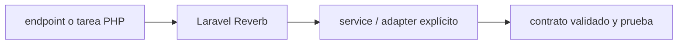

# Laravel Reverb — Vigilio rama compatible Laravel 13

## Qué es, qué hace y cuándo usarla

Servidor WebSocket oficial de Laravel para broadcasting. Separa autorización de canales, autenticación y adaptador realtime.

**Ubicación en Vigilio:** usa esta dependencia en su stack propietario; otras skills deben enlazar esta guía, no duplicar sus reglas. **Versión:** la indicada en el encabezado es la línea documentada; consultar `technology/versions.md` y el lockfile antes de copiar APIs o aprobar un upgrade.

> **Guía propia de Laravel Reverb (backend-php).** Estado a **2026-10-25**: rama compatible Laravel 13. Versión del proyecto consumidor = `pnpm-lock.yaml` / `composer.lock` / imagen o manifest. Fuente: [documentación oficial](https://laravel.com/docs/13.x/reverb). Fuente normativa transversal de versiones: [versions.md](../versions.md). **No implica instalación automática ni upgrade aprobado.**

## Objetivo, responsabilidad y dónde usar

Canales privados/presencia con autorización, rate limit, no duplicar lógica de dominio en listener.

**Uso:** aplicar solo si está declarada y resulta pertinente al consumidor; ver [política de adopción y DRY](README.md).

### Diagrama de integración (Mermaid)



El flujo muestra la **responsabilidad arquitectónica** de la librería; no representa llamadas reales de red para todas las operaciones.


## Instalación o verificación

```bash
composer require laravel/reverb
```

**Gate de instalación:** consultar [procedimiento compartido](README.md#protocolo-de-adopción-y-actualización); estos comandos son indicativos, no ejecuciones sobre un consumidor.

## ✅ Correcto — uso actual y ejemplo de referencia

**Nota técnica (no es código ejecutable):** Reverb para broadcasting en Laravel; canal privado autorizado por usuario. Event: ShouldBroadcast con canales privados controlados.

**Por qué:** Canales privados/presencia con autorización, rate limit, no duplicar lógica de dominio en listener.

## ❌ Incorrecto — patrón legacy, inseguro o mal ubicado

**Nota técnica (no es código ejecutable):** ❌ broadcasting de datos privados en canales públicos.

**Riesgo:** confundir versiones o responsabilidades y obtener un contrato incorrecto.

## Nuevas capacidades, migración y breaking changes

Compat clientes Echo/pusher protocol, TLS/proxy, scaling; revisar release del framework.

Aplicar el [protocolo de migración común](README.md#protocolo-de-adopción-y-actualización), sin asumir que una release nueva está desplegada.

## Buenas prácticas, seguridad, rendimiento y operación

Consultar la [política transversal de librerías](README.md) para seguridad, versionado, evidencia y revisión de contratos. Para esta librería, además, aplicar las verificaciones concretas que se detallan a continuación.

## Gates de aceptación y compatibilidad

Pruebas authorizer, reconexión, colas, cross-tenant.

Estado de prueba de estos ejemplos documentales: **NOT_RUN** en aplicaciones consumidoras; ver [criterios de evidencia](README.md#criterios-de-validación).


## Referencias

- [Documentación oficial y migración de Laravel Reverb](https://laravel.com/docs/13.x/reverb)
- [Matriz y baseline de versiones](../versions.md)
- [Calidad de código canónica](../../foundations/engineering/code-quality.md)


## Recetario operativo ampliado — laravel-reverb (2026-10-25)

### API actual: dos tareas reales que debe saber ejecutar una skill

1. **Reverb WebSockets con broadcasting, channels privados/presence y auth server-side.**
2. **Configurar heartbeat, publish/subscribe y scaling por Redis cuando aplique.**

### Migración desde versiones anteriores: decisión concreta

- **Qué cambia o se debe revisar:** No usar Pusher hosted assumptions si Reverb self-host requiere supervisor/capacity.

### Responsabilidades y capas

Transporte realtime, no dominio; eventos publicados desde Application/outbox.

**✅ Correcto:** mantener la integración encapsulada, alinear los nombres del negocio con Vigilio y depender de un contrato estable.

**❌ Incorrecto:** importar internals de la librería desde Domain, declarar `any` para resolver un upgrade, o duplicar reglas ya propietarias de otra tecnología.

### Seguridad, resiliencia y rendimiento

- No emitir PII en canales públicos ni confiar en channel name enviado.

### Test de aceptación específico y evidencia mínima

- **Escenario comprobable:** Test auth canal privado, reconexión y estado de múltiples pods.


## Guía operativa detallada — 8 casos y 4 antipatrones

### Ocho ejemplos de la API y casos de uso relevantes

Los fragmentos siguientes ilustran **operaciones independientes**. Variables, imports, provider, extensión y configuración se completan en el proyecto consumidor; **no están certificados como un archivo único compilable**. Cuando hay comentarios `#`, son pasos de integración o configuración y no APIs inventadas.

#### Ejemplo 1. Instalar

**✅ Correcto — instalar**

```bash
php artisan install:broadcasting
```


#### Ejemplo 2. Iniciar Reverb

**✅ Correcto — iniciar reverb**

```bash
php artisan reverb:start
```


#### Ejemplo 3. Escala

**✅ Correcto — escala**

```bash
php artisan reverb:start --debug
```


#### Ejemplo 4. Evento

**✅ Correcto — evento**

```php
class ProductProcessed implements ShouldBroadcast { public function broadcastOn(): Channel { return new PrivateChannel('products'); } }
```


#### Ejemplo 5. Canales privados

**✅ Correcto — canales privados**

```php
Broadcast::channel('products.{product_id}', fn ($user, $product_id) => canView($user, $product_id));
```


#### Ejemplo 6. Cliente Echo

**✅ Correcto — cliente echo**

**Nota técnica (no es código ejecutable):** Config Echo broadcaster reverb con envs seguros.


#### Ejemplo 7. Server env

**✅ Correcto — server env**

**Nota técnica (no es código ejecutable):** REVERB_APP_ID / KEY / SECRET desde gestor secretos.


#### Ejemplo 8. Producción

**✅ Correcto — producción**

**Nota técnica (no es código ejecutable):** Configurar reverse proxy TLS, límites y supervisor.


### Cuatro antipatrones frecuentes y su sustitución

#### Antipatrón 1 — riesgo y alternativa

**❌ Incorrecto**

```php
new Channel("tenant:" . $tenant_id) # privado
```

**Por qué está mal:** El patrón «new Channel("tenant:" . $tenant_id) # privado» es riesgoso: puede permitir acceso a recursos no autorizados o de otro tenant.

**✅ Correcto**

```php
new PrivateChannel("tenant:" . $tenant_id)
```

**Por qué mejora:** El patrón «new PrivateChannel("tenant:" . $tenant_id)» mejora el caso: se fuerza autorización en el borde/servidor y se limita el acceso por recurso.

#### Antipatrón 2 — riesgo y alternativa

**❌ Incorrecto — Broadcast antes de commit crítico.**

**Por qué está mal:** El patrón «Broadcast antes de commit crítico» es riesgoso: la elección «Broadcast antes de commit crítico» puede incumplir los requisitos operativos de laravel-reverb.

**✅ Correcto — AfterCommit cuando corresponda.**

**Por qué mejora:** El patrón «AfterCommit cuando corresponda» mejora el caso: la alternativa «AfterCommit cuando corresponda» establece el comportamiento esperado de laravel-reverb.

#### Antipatrón 3 — riesgo y alternativa

**❌ Incorrecto — Reverb abierto a orígenes arbitrarios.**

**Por qué está mal:** El patrón «Reverb abierto a orígenes arbitrarios» es riesgoso: la elección «Reverb abierto a orígenes arbitrarios» puede incumplir los requisitos operativos de laravel-reverb.

**✅ Correcto — Allowlist origins y auth.**

**Por qué mejora:** El patrón «Allowlist origins y auth» mejora el caso: la alternativa «Allowlist origins y auth» establece el comportamiento esperado de laravel-reverb.

#### Antipatrón 4 — riesgo y alternativa

**❌ Incorrecto — No supervisar proceso websocket.**

**Por qué está mal:** El patrón «No supervisar proceso websocket» es riesgoso: la elección «No supervisar proceso websocket» puede incumplir los requisitos operativos de laravel-reverb.

**✅ Correcto — Supervisor + readiness.**

**Por qué mejora:** El patrón «Supervisor + readiness» mejora el caso: la alternativa «Supervisor + readiness» establece el comportamiento esperado de laravel-reverb.

### Versión estable, breaking changes y verificación

- **Versión estable exacta:** no se declara un parche universal cuando no hay verificación específica de su registry/release. Consultar el encabezado de esta guía, `technology/versions.md` y el manifiesto del servicio. **Estado de patch: VERIFY_LOCKFILE**.
- **Migración:** identificar major anterior, APIs retiradas/cambiadas, peer dependencies, requisitos de runtime, cambios de tipos, ejecución CI y plan de rollback. Si no hay prueba sobre el consumidor, **NOT_RUN**, no PASS.
- **Versiones previas:** el ejemplo marcado ❌ en esta guía explica al menos una incompatibilidad o un uso obsoleto; no trasplantar APIs de otras versiones.
- **Tests:** probar al menos happy path, error, seguridad/permiso y compatibilidad con el runtime donde aplique; solo activar nuevas capacidades mediante una PR versionada.

### Fuentes oficiales y referencias al final

- [Referencia propia oficial](https://laravel.com/docs/13.x/reverb)
- [Matriz canónica de versiones](../versions.md)
- [Política de adopción de librerías](README.md)

## Guía de compatibilidad y evaluación por versión (2026-10-25)

**Estado del patch exacto:** `VERIFY_LOCKFILE`. La guía documenta la familia de APIs; **no se ha verificado hoy el patch estable preciso de esta dependencia**. Consultar la fuente oficial enlazada al inicio y el lockfile antes de generar código o aprobar un upgrade.

### Checklist específico de esta librería

- **Migración/compatibilidad:** No usar Pusher hosted assumptions si Reverb self-host requiere supervisor/capacity.
- **Prueba propia:** Test auth canal privado, reconexión y estado de múltiples pods.
- **Límite de responsabilidad:** usar esta librería solo en su adaptador o capa propietaria; consultar los ejemplos de API y antipatrones anteriores antes de cambiar llamadas públicas.

**Gate de aprobación:** leer la referencia oficial y resolver la versión del consumidor, ejecutar typecheck y pruebas específicas, registrar PASS/FAIL/NOT_RUN/BLOCKED. No confundir esta guía con validación de un consumidor real. [Procedimiento único de adopción](README.md#protocolo-de-adopción-y-actualización).

