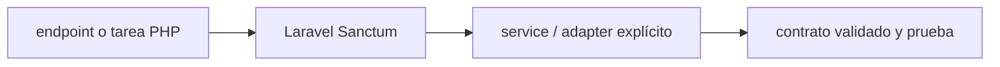

# Laravel Sanctum — Vigilio línea compatible Laravel 13

## Qué es, qué hace y cuándo usarla

Autenticación ligera de Laravel para SPA con cookies/sesión y API tokens. Autenticación no reemplaza Policies/Gates ni aislamiento tenant.

**Ubicación en Vigilio:** usa esta dependencia en su stack propietario; otras skills deben enlazar esta guía, no duplicar sus reglas. **Versión:** la indicada en el encabezado es la línea documentada; consultar `technology/versions.md` y el lockfile antes de copiar APIs o aprobar un upgrade.

> **Guía propia de Laravel Sanctum (backend-php).** Estado a **2026-10-25**: línea compatible Laravel 13. Versión del proyecto consumidor = `pnpm-lock.yaml` / `composer.lock` / imagen o manifest. Fuente: [documentación oficial](https://laravel.com/docs/13.x/sanctum). Fuente normativa transversal de versiones: [versions.md](../versions.md). **No implica instalación automática ni upgrade aprobado.**

## Objetivo, responsabilidad y dónde usar

Authn vs Authz: policies, tenant derivado de user autenticado, tokens no en localStorage sin análisis.

**Uso:** aplicar solo si está declarada y resulta pertinente al consumidor; ver [política de adopción y DRY](README.md).

### Diagrama de integración (Mermaid)



El flujo muestra la **responsabilidad arquitectónica** de la librería; no representa llamadas reales de red para todas las operaciones.


## Instalación o verificación

```bash
composer require laravel/sanctum
```

**Gate de instalación:** consultar [procedimiento compartido](README.md#protocolo-de-adopción-y-actualización); estos comandos son indicativos, no ejecuciones sobre un consumidor.

## ✅ Correcto — uso actual y ejemplo de referencia

```php
// middleware auth:sanctum, abilities y policies por recurso
Route::middleware('auth:sanctum')->get('/products', [ProductController::class, 'listProducts']);
```

**Por qué:** Authn vs Authz: policies, tenant derivado de user autenticado, tokens no en localStorage sin análisis.

## ❌ Incorrecto — patrón legacy, inseguro o mal ubicado

```php
// ❌ pensar que autenticación implica autorización de tenant
ProductRecord::findOrFail($product_id);
```

**Riesgo:** confundir versiones o responsabilidades y obtener un contrato incorrecto.

## Nuevas capacidades, migración y breaking changes

Revisar cambios de cookie-based SPA auth, token abilities y stateful domains entre versiones.

Aplicar el [protocolo de migración común](README.md#protocolo-de-adopción-y-actualización), sin asumir que una release nueva está desplegada.

## Buenas prácticas, seguridad, rendimiento y operación

Consultar la [política transversal de librerías](README.md) para seguridad, versionado, evidencia y revisión de contratos. Para esta librería, además, aplicar las verificaciones concretas que se detallan a continuación.

## Gates de aceptación y compatibilidad

Pruebas 401/403, CSRF SPA, tokens revocados y tenant isolation.

Estado de prueba de estos ejemplos documentales: **NOT_RUN** en aplicaciones consumidoras; ver [criterios de evidencia](README.md#criterios-de-validación).


## Referencias

- [Documentación oficial y migración de Laravel Sanctum](https://laravel.com/docs/13.x/sanctum)
- [Matriz y baseline de versiones](../versions.md)
- [Calidad de código canónica](../../foundations/engineering/code-quality.md)


## Recetario operativo ampliado — laravel-sanctum (2026-10-25)

### API actual: dos tareas reales que debe saber ejecutar una skill

1. **Definir token abilities y/o autenticación cookie SPA según cliente.**
2. **CSRF, cookies SameSite, guards y expiración coherente con deployment.**

### Migración desde versiones anteriores: decisión concreta

- **Qué cambia o se debe revisar:** No tratar API tokens personales como reemplazo automático de cookie SPA.

### Responsabilidades y capas

Auth capa HTTP, policy por recurso sigue fuera de Sanctum.

**✅ Correcto:** mantener la integración encapsulada, alinear los nombres del negocio con Vigilio y depender de un contrato estable.

**❌ Incorrecto:** importar internals de la librería desde Domain, declarar `any` para resolver un upgrade, o duplicar reglas ya propietarias de otra tecnología.

### Seguridad, resiliencia y rendimiento

- Tokens revocables, scopes mínimos, no persistir tokens en web sin analizar XSS.

### Test de aceptación específico y evidencia mínima

- **Escenario comprobable:** Probar 401/403, CSRF, logout, token expiration y tenant.


## Guía operativa detallada — 8 casos y 4 antipatrones

### Ocho ejemplos de la API y casos de uso relevantes

Los fragmentos siguientes ilustran **operaciones independientes**. Variables, imports, provider, extensión y configuración se completan en el proyecto consumidor; **no están certificados como un archivo único compilable**. Cuando hay comentarios `#`, son pasos de integración o configuración y no APIs inventadas.

#### Ejemplo 1. Instalar API

**✅ Correcto — instalar api**

```bash
php artisan install:api
```


#### Ejemplo 2. Emitir token

**✅ Correcto — emitir token**

```php
$token = $user->createToken('mobile', ['products:read'])->plainTextToken;
```


#### Ejemplo 3. Token ability

**✅ Correcto — token ability**

```php
if (!$request->user()->tokenCan('products:read')) abort(403);
```


#### Ejemplo 4. Revocar token

**✅ Correcto — revocar token**

```php
$request->user()->currentAccessToken()?->delete();
```


#### Ejemplo 5. Middleware

**✅ Correcto — middleware**

```php
Route::middleware('auth:sanctum')->get('/me', fn (Request $request) => $request->user());
```


#### Ejemplo 6. Estado SPA

**✅ Correcto — estado spa**

**Nota técnica (no es código ejecutable):** SPA first-party: cookies + CSRF + CORS configurados.


#### Ejemplo 7. Limitar tokens

**✅ Correcto — limitar tokens**

**Nota técnica (no es código ejecutable):** Definir expiración y habilidades por producto.


#### Ejemplo 8. Restringir recursos

**✅ Correcto — restringir recursos**

**Nota técnica (no es código ejecutable):** Policy per-tenant incluso con token válido.


### Cuatro antipatrones frecuentes y su sustitución

#### Antipatrón 1 — riesgo y alternativa

**❌ Incorrecto**

```php
$user->createToken("all", ["*"]) # indiscriminado
```

**Por qué está mal:** Expone credenciales o confunde autenticación con autorización; puede ocasionar filtración o acceso indebido.

**✅ Correcto**

```php
$user->createToken("read", ["products:read"])
```

**Por qué mejora:** El patrón «$user->createToken("read", ["products:read"])» mejora el caso: las credenciales quedan fuera del código o bajo un mecanismo de acceso controlado.

#### Antipatrón 2 — riesgo y alternativa

**❌ Incorrecto — Confiar tokenCan sin Policy.**

**Por qué está mal:** Expone credenciales o confunde autenticación con autorización; puede ocasionar filtración o acceso indebido.

**✅ Correcto — Policy por tenant/recurso.**

**Por qué mejora:** Separa permisos y secretos del código de negocio y permite comprobar el acceso mínimo.

#### Antipatrón 3 — riesgo y alternativa

**❌ Incorrecto — Guardar token móvil en AsyncStorage.**

**Por qué está mal:** Expone credenciales o confunde autenticación con autorización; puede ocasionar filtración o acceso indebido.

**✅ Correcto — SecureStore/Keychain.**

**Por qué mejora:** El patrón «SecureStore/Keychain» mejora el caso: las credenciales quedan fuera del código o bajo un mecanismo de acceso controlado.

#### Antipatrón 4 — riesgo y alternativa

**❌ Incorrecto — Olvidar revocar tokens en logout.**

**Por qué está mal:** Expone credenciales o confunde autenticación con autorización; puede ocasionar filtración o acceso indebido.

**✅ Correcto**

```php
$request->user()->currentAccessToken()?->delete()
```

**Por qué mejora:** El patrón «$request->user()->currentAccessToken()?->delete()» mejora el caso: las credenciales quedan fuera del código o bajo un mecanismo de acceso controlado.

### Versión estable, breaking changes y verificación

- **Versión estable exacta:** no se declara un parche universal cuando no hay verificación específica de su registry/release. Consultar el encabezado de esta guía, `technology/versions.md` y el manifiesto del servicio. **Estado de patch: VERIFY_LOCKFILE**.
- **Migración:** identificar major anterior, APIs retiradas/cambiadas, peer dependencies, requisitos de runtime, cambios de tipos, ejecución CI y plan de rollback. Si no hay prueba sobre el consumidor, **NOT_RUN**, no PASS.
- **Versiones previas:** el ejemplo marcado ❌ en esta guía explica al menos una incompatibilidad o un uso obsoleto; no trasplantar APIs de otras versiones.
- **Tests:** probar al menos happy path, error, seguridad/permiso y compatibilidad con el runtime donde aplique; solo activar nuevas capacidades mediante una PR versionada.

### Fuentes oficiales y referencias al final

- [Referencia propia oficial](https://laravel.com/docs/13.x/sanctum)
- [Matriz canónica de versiones](../versions.md)
- [Política de adopción de librerías](README.md)

## Guía de compatibilidad y evaluación por versión (2026-10-25)

**Estado del patch exacto:** `VERIFY_LOCKFILE`. La guía documenta la familia de APIs; **no se ha verificado hoy el patch estable preciso de esta dependencia**. Consultar la fuente oficial enlazada al inicio y el lockfile antes de generar código o aprobar un upgrade.

### Checklist específico de esta librería

- **Migración/compatibilidad:** No tratar API tokens personales como reemplazo automático de cookie SPA.
- **Prueba propia:** Probar 401/403, CSRF, logout, token expiration y tenant.
- **Límite de responsabilidad:** usar esta librería solo en su adaptador o capa propietaria; consultar los ejemplos de API y antipatrones anteriores antes de cambiar llamadas públicas.

**Gate de aprobación:** leer la referencia oficial y resolver la versión del consumidor, ejecutar typecheck y pruebas específicas, registrar PASS/FAIL/NOT_RUN/BLOCKED. No confundir esta guía con validación de un consumidor real. [Procedimiento único de adopción](README.md#protocolo-de-adopción-y-actualización).

