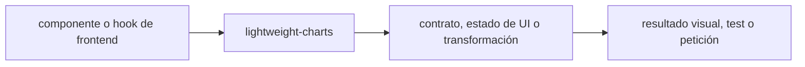

# lightweight-charts — guía version-aware Vigilio

## Qué es, qué hace y cuándo usarla

Biblioteca de gráficos financieros ligeros de TradingView. Renderiza series OHLC/precios, requiere manejo correcto de tiempo y resize.

**Ubicación en Vigilio:** usa esta dependencia en su stack propietario; otras skills deben enlazar esta guía, no duplicar sus reglas. **Versión:** la indicada en el encabezado es la línea documentada; consultar `technology/versions.md` y el lockfile antes de copiar APIs o aprobar un upgrade.

**Stack propietario:** Frontend web / MFE. **Versión objetivo:** 5.2.x según referencia del stack; patch por lockfile; versión instalada siempre desde lockfile/manifest. [Documentación oficial](https://tradingview.github.io/lightweight-charts/docs). [Matriz de versiones](../versions.md).

## Responsabilidad y arquitectura

Lectura desde API/TanStack Query, no desde estado visual del chart. Limpiar chart en unmount, actualizar serie sin reinstanciar, limitar puntos y agregar downsampling.

No duplicar las reglas generales de SOLID, DDD y manejo de dependencias: [política de librerías](README.md). Al crear código, leer el API de la versión instalada, no solo un ejemplo de blog.

### Diagrama de integración (Mermaid)



El flujo muestra la **responsabilidad arquitectónica** de la librería; no representa llamadas reales de red para todas las operaciones.


## ✅ Correcto — ejemplo actual

```typescript
import { createChart, CandlestickSeries } from 'lightweight-charts';
const chart = createChart(container,{autoSize:true});
const series = chart.addSeries(CandlestickSeries,{upColor:'#1DCC8A'});
series.setData(candles);
new ResizeObserver(()=>chart.timeScale().fitContent()).observe(container);
// cleanup React/Preact: chart.remove(); observer.disconnect()
```

## ❌ Incorrecto — legado o mal uso

```typescript
// ❌ API de v4 incompatible con v5:
const series = chart.addCandlestickSeries();
```

## Migración, nuevas APIs y compatibilidad

v4→v5: cambia la creación de series a `chart.addSeries(CandlestickSeries, ...)`. Verificar versión concreta, manejo de ResizeObserver, tipos de tiempo y adaptadores de datos.

## Calidad, seguridad, performance y verificaciones

Test gráfico lifecycle, memoria, SSR import dinámico, dark mode, cambios de dimensiones y a11y alternativo textual.

La adopción exige manifest/lockfile, pruebas runtime, seguridad, CI y rollback. Resultado real en consumidores de esta guía: **NOT_RUN**. No instalar nuevas dependencias solamente por estar catalogadas.

## Fuentes

- [Página oficial y referencias](https://tradingview.github.io/lightweight-charts/docs)
- [Protocolo de adopción](README.md#protocolo-de-adopción-y-actualización)
- [Calidad transversal](../../foundations/engineering/code-quality.md)


## Recetario operativo ampliado — lightweight-charts (2026-10-25)

### API actual: dos tareas reales que debe saber ejecutar una skill

1. **Crear chart con `createChart(container, options)` y serie según API mayor instalada.**
2. **Liberar listeners/`chart.remove()` al desmontar componente.**

### Migración desde versiones anteriores: decisión concreta

- **Qué cambia o se debe revisar:** API de addSeries cambió respecto de ejemplos antiguos; consultar release del major.

### Responsabilidades y capas

UI charts web, jamás fuente de datos ni SQL.

**✅ Correcto:** mantener la integración encapsulada, alinear los nombres del negocio con Vigilio y depender de un contrato estable.

**❌ Incorrecto:** importar internals de la librería desde Domain, declarar `any` para resolver un upgrade, o duplicar reglas ya propietarias de otra tecnología.

### Seguridad, resiliencia y rendimiento

- Grandes series con `setData` innecesario; usar update incremental tras verificación.

### Test de aceptación específico y evidencia mínima

- **Escenario comprobable:** Prueba resize, cleanup, timezone, gaps/NaN y mobile interaction.


## Guía operativa detallada — 8 casos y 4 antipatrones

### Ocho ejemplos de la API y casos de uso relevantes

Los fragmentos siguientes ilustran **operaciones independientes**. Variables, imports, provider, extensión y configuración se completan en el proyecto consumidor; **no están certificados como un archivo único compilable**. Cuando hay comentarios `#`, son pasos de integración o configuración y no APIs inventadas.

#### Ejemplo 1. Crear chart

**✅ Correcto — crear chart**

```typescript
const chart = createChart(container, { autoSize: true });
```


#### Ejemplo 2. Añadir velas

**✅ Correcto — añadir velas**

```typescript
const candle_series = chart.addSeries(CandlestickSeries, { upColor: '#16a34a' });
```


#### Ejemplo 3. Datos OHLC

**✅ Correcto — datos ohlc**

```typescript
candle_series.setData(candles);
```


#### Ejemplo 4. Volumen

**✅ Correcto — volumen**

```typescript
const volume_series = chart.addSeries(HistogramSeries);
```


#### Ejemplo 5. Actualizar último

**✅ Correcto — actualizar último**

```typescript
candle_series.update(last_candle);
```


#### Ejemplo 6. Ajustar ancho

**✅ Correcto — ajustar ancho**

```typescript
chart.timeScale().fitContent();
```


#### Ejemplo 7. Resize

**✅ Correcto — resize**

```typescript
const observer = new ResizeObserver(() => chart.timeScale().fitContent());
```


#### Ejemplo 8. Cleanup

**✅ Correcto — cleanup**

```typescript
observer.disconnect(); chart.remove();
```


### Cuatro antipatrones frecuentes y su sustitución

#### Antipatrón 1 — riesgo y alternativa

**❌ Incorrecto**

```typescript
chart.addCandlestickSeries() // v4
```

**Por qué está mal:** Reutiliza una firma o convención de otra versión sin verificar compatibilidad con la línea documentada.

**✅ Correcto**

```typescript
chart.addSeries(CandlestickSeries)
```

**Por qué mejora:** El patrón «chart.addSeries(CandlestickSeries)» mejora el caso: se utiliza la API apropiada para el major documentado y se comprueba el lockfile.

#### Antipatrón 2 — riesgo y alternativa

**❌ Incorrecto — Recrear chart en cada render.**

**Por qué está mal:** El patrón «Recrear chart en cada render» es riesgoso: mezcla responsabilidades de interfaz y navegación o genera comportamiento inconsistente.

**✅ Correcto — Crear una vez y actualizar series.**

**Por qué mejora:** El patrón «Crear una vez y actualizar series» mejora el caso: la interfaz utiliza la API adecuada y separa presentación, estado y comunicación.

#### Antipatrón 3 — riesgo y alternativa

**❌ Incorrecto — No ejecutar chart.remove.**

**Por qué está mal:** El patrón «No ejecutar chart.remove» es riesgoso: la elección «No ejecutar chart.remove» puede incumplir los requisitos operativos de lightweight-charts.

**✅ Correcto**

```typescript
chart.remove()
```

**Por qué mejora:** El patrón «chart.remove()» mejora el caso: la alternativa «chart.remove()» establece el comportamiento esperado de lightweight-charts.

#### Antipatrón 4 — riesgo y alternativa

**❌ Incorrecto — Renderizar 1M puntos sin agregación.**

**Por qué está mal:** Omite un control operativo necesario, por lo que el comportamiento puede ser inseguro o difícil de verificar.

**✅ Correcto — Resampling/ventana visible.**

**Por qué mejora:** El patrón «Resampling/ventana visible» mejora el caso: el cambio pasa por gates automáticos y aprobación de riesgos operativos.

### Versión estable, breaking changes y verificación

- **Versión estable exacta:** no se declara un parche universal cuando no hay verificación específica de su registry/release. Consultar el encabezado de esta guía, `technology/versions.md` y el manifiesto del servicio. **Estado de patch: VERIFY_LOCKFILE**.
- **Migración:** identificar major anterior, APIs retiradas/cambiadas, peer dependencies, requisitos de runtime, cambios de tipos, ejecución CI y plan de rollback. Si no hay prueba sobre el consumidor, **NOT_RUN**, no PASS.
- **Versiones previas:** el ejemplo marcado ❌ en esta guía explica al menos una incompatibilidad o un uso obsoleto; no trasplantar APIs de otras versiones.
- **Tests:** probar al menos happy path, error, seguridad/permiso y compatibilidad con el runtime donde aplique; solo activar nuevas capacidades mediante una PR versionada.

### Fuentes oficiales y referencias al final

- [Referencia propia oficial](https://tradingview.github.io/lightweight-charts/docs)
- [Matriz canónica de versiones](../versions.md)
- [Política de adopción de librerías](README.md)

## Guía de compatibilidad y evaluación por versión (2026-10-25)

**Estado del patch exacto:** `VERIFY_LOCKFILE`. La guía documenta la familia de APIs; **no se ha verificado hoy el patch estable preciso de esta dependencia**. Consultar la fuente oficial enlazada al inicio y el lockfile antes de generar código o aprobar un upgrade.

### Checklist específico de esta librería

- **Migración/compatibilidad:** API de addSeries cambió respecto de ejemplos antiguos; consultar release del major.
- **Prueba propia:** Prueba resize, cleanup, timezone, gaps/NaN y mobile interaction.
- **Límite de responsabilidad:** usar esta librería solo en su adaptador o capa propietaria; consultar los ejemplos de API y antipatrones anteriores antes de cambiar llamadas públicas.

**Gate de aprobación:** leer la referencia oficial y resolver la versión del consumidor, ejecutar typecheck y pruebas específicas, registrar PASS/FAIL/NOT_RUN/BLOCKED. No confundir esta guía con validación de un consumidor real. [Procedimiento único de adopción](README.md#protocolo-de-adopción-y-actualización).

