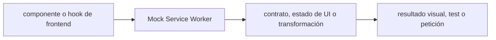

# Mock Service Worker — Vigilio v2 (verificar patch)

## Qué es, qué hace y cuándo usarla

Mock Service Worker intercepta HTTP en tests y desarrollo. Permite probar contratos y estados sin mockear internals de hooks.

**Ubicación en Vigilio:** usa esta dependencia en su stack propietario; otras skills deben enlazar esta guía, no duplicar sus reglas. **Versión:** la indicada en el encabezado es la línea documentada; consultar `technology/versions.md` y el lockfile antes de copiar APIs o aprobar un upgrade.

> **Guía propia de Mock Service Worker (testing).** Estado a **2026-10-25**: v2 (verificar patch). Versión del proyecto consumidor = `pnpm-lock.yaml` / `composer.lock` / imagen o manifest. Fuente: [documentación oficial](https://mswjs.io/docs/migrations/1.x-to-2.x/). Fuente normativa transversal de versiones: [versions.md](../versions.md). **No implica instalación automática ni upgrade aprobado.**

## Objetivo, responsabilidad y dónde usar

Mocks del borde de red, no del algoritmo interno de React Query.

**Uso:** aplicar solo si está declarada y resulta pertinente al consumidor; ver [política de adopción y DRY](README.md).

### Diagrama de integración (Mermaid)



El flujo muestra la **responsabilidad arquitectónica** de la librería; no representa llamadas reales de red para todas las operaciones.


## Instalación o verificación

```bash
pnpm add -D msw
```

**Gate de instalación:** consultar [procedimiento compartido](README.md#protocolo-de-adopción-y-actualización); estos comandos son indicativos, no ejecuciones sobre un consumidor.

## ✅ Correcto — uso actual y ejemplo de referencia

```typescript
import { http, HttpResponse } from 'msw';
export const handlers=[http.get('/api/products',()=>HttpResponse.json({count:0,next:null,previous:null,results:[]}))];
```

**Por qué:** Mocks del borde de red, no del algoritmo interno de React Query.

## ❌ Incorrecto — patrón legacy, inseguro o mal ubicado

```typescript
// ❌ v1 API nueva mezclada con v2
rest.get('/api/products', (req,res,ctx)=>res(ctx.json([])));
```

**Riesgo:** confundir versiones o responsabilidades y obtener un contrato incorrecto.

## Nuevas capacidades, migración y breaking changes

v1→v2 `rest`→`http`, `res/ctx`→`HttpResponse`; migrar handlers, request body y tests Node/browser.

Aplicar el [protocolo de migración común](README.md#protocolo-de-adopción-y-actualización), sin asumir que una release nueva está desplegada.

## Buenas prácticas, seguridad, rendimiento y operación

Consultar la [política transversal de librerías](README.md) para seguridad, versionado, evidencia y revisión de contratos. Para esta librería, además, aplicar las verificaciones concretas que se detallan a continuación.

## Gates de aceptación y compatibilidad

Casos 401/403/409/429/500, delay, retries y abort/cancel.

Estado de prueba de estos ejemplos documentales: **NOT_RUN** en aplicaciones consumidoras; ver [criterios de evidencia](README.md#criterios-de-validación).


## Referencias

- [Documentación oficial y migración de Mock Service Worker](https://mswjs.io/docs/migrations/1.x-to-2.x/)
- [Matriz y baseline de versiones](../versions.md)
- [Calidad de código canónica](../../foundations/engineering/code-quality.md)


## Recetario operativo ampliado — msw (2026-10-25)

### API actual: dos tareas reales que debe saber ejecutar una skill

1. **MSW v2: `http.get/post` con `HttpResponse.json`, interceptores de navegador y node.**
2. **Compartir handlers entre tests y story-like demos sin simular reglas de dominio incorrectas.**

### Migración desde versiones anteriores: decisión concreta

- **Qué cambia o se debe revisar:** Migrar `rest.get` / `res(ctx.json(...))` de MSW v1 a `http`/`HttpResponse`.

### Responsabilidades y capas

Mocks HTTP en test; no reemplazan validación del servidor.

**✅ Correcto:** mantener la integración encapsulada, alinear los nombres del negocio con Vigilio y depender de un contrato estable.

**❌ Incorrecto:** importar internals de la librería desde Domain, declarar `any` para resolver un upgrade, o duplicar reglas ya propietarias de otra tecnología.

### Seguridad, resiliencia y rendimiento

- No interceptar en producción accidentalmente ni ocultar faltantes de API.

### Test de aceptación específico y evidencia mínima

- **Escenario comprobable:** Prueba 200/400/401/409, network error y shape Zod real.

### Ejemplo de integración vigente (fragmento adicional)

```typescript
import { http, HttpResponse } from 'msw';
export const handlers = [
  http.get('/api/products', () => HttpResponse.json({count:0,next:null,previous:null,results:[]})),
  http.post('/api/products', () => HttpResponse.json({message:'conflict'}, {status:409})),
];
```

**Nota:** los fragmentos muestran la API específica y requieren imports/providers/fixtures del consumidor; no se certifica compilación por el solo hecho de aparecer aquí.


## Guía operativa detallada — 8 casos y 4 antipatrones

### Ocho ejemplos de la API y casos de uso relevantes

Los fragmentos siguientes ilustran **operaciones independientes**. Variables, imports, provider, extensión y configuración se completan en el proyecto consumidor; **no están certificados como un archivo único compilable**. Cuando hay comentarios `#`, son pasos de integración o configuración y no APIs inventadas.

#### Ejemplo 1. Setup browser

**✅ Correcto — setup browser**

```typescript
const worker = setupWorker(http.get('/api/products', () => HttpResponse.json({ count: 0, results: [] })));
```


#### Ejemplo 2. Start

**✅ Correcto — start**

```typescript
await worker.start();
```


#### Ejemplo 3. GET handler

**✅ Correcto — get handler**

```typescript
http.get('/api/products/:product_id', ({ params }) => HttpResponse.json({ id: params.product_id }));
```


#### Ejemplo 4. POST handler

**✅ Correcto — post handler**

```typescript
http.post('/api/products', async ({ request }) => HttpResponse.json(await request.json(), { status: 201 }));
```


#### Ejemplo 5. Error

**✅ Correcto — error**

```typescript
http.get('/api/failed', () => HttpResponse.json({ error: 'FAIL' }, { status: 500 }));
```


#### Ejemplo 6. Server tests

**✅ Correcto — server tests**

```typescript
const server = setupServer(...handlers);
```


#### Ejemplo 7. Reset

**✅ Correcto — reset**

```typescript
afterEach(() => server.resetHandlers());
```


#### Ejemplo 8. Close

**✅ Correcto — close**

```typescript
afterAll(() => server.close());
```


### Cuatro antipatrones frecuentes y su sustitución

#### Antipatrón 1 — riesgo y alternativa

**❌ Incorrecto**

```typescript
rest.get("/api/products", handler) // v1
```

**Por qué está mal:** El patrón «rest.get("/api/products", handler) // v1» es riesgoso: puede mezclar firmas incompatibles o ejecutar una API retirada en la versión instalada.

**✅ Correcto**

```typescript
http.get("/api/products", resolver)
```

**Por qué mejora:** El patrón «http.get("/api/products", resolver)» mejora el caso: se utiliza la API apropiada para el major documentado y se comprueba el lockfile.

#### Antipatrón 2 — riesgo y alternativa

**❌ Incorrecto**

```typescript
res(ctx.json(payload)) // v1
```

**Por qué está mal:** El patrón «res(ctx.json(payload)) // v1» es riesgoso: puede mezclar firmas incompatibles o ejecutar una API retirada en la versión instalada.

**✅ Correcto**

```typescript
HttpResponse.json(payload)
```

**Por qué mejora:** El patrón «HttpResponse.json(payload)» mejora el caso: se utiliza la API apropiada para el major documentado y se comprueba el lockfile.

#### Antipatrón 3 — riesgo y alternativa

**❌ Incorrecto — Mockear hooks en vez de HTTP.**

**Por qué está mal:** El patrón «Mockear hooks en vez de HTTP» es riesgoso: mezcla responsabilidades de interfaz y navegación o genera comportamiento inconsistente.

**✅ Correcto — Mock MSW al nivel red.**

**Por qué mejora:** El patrón «Mock MSW al nivel red» mejora el caso: la interfaz utiliza la API adecuada y separa presentación, estado y comunicación.

#### Antipatrón 4 — riesgo y alternativa

**❌ Incorrecto — Dejar handlers entre tests.**

**Por qué está mal:** El patrón «Dejar handlers entre tests» es riesgoso: la implementación puede fallar sin que el flujo crítico o la accesibilidad lo detecte.

**✅ Correcto**

```typescript
server.resetHandlers()
```

**Por qué mejora:** El patrón «server.resetHandlers()» mejora el caso: el comportamiento se verifica con pruebas y criterios observables.

### Versión estable, breaking changes y verificación

- **Versión estable exacta:** no se declara un parche universal cuando no hay verificación específica de su registry/release. Consultar el encabezado de esta guía, `technology/versions.md` y el manifiesto del servicio. **Estado de patch: VERIFY_LOCKFILE**.
- **Migración:** identificar major anterior, APIs retiradas/cambiadas, peer dependencies, requisitos de runtime, cambios de tipos, ejecución CI y plan de rollback. Si no hay prueba sobre el consumidor, **NOT_RUN**, no PASS.
- **Versiones previas:** el ejemplo marcado ❌ en esta guía explica al menos una incompatibilidad o un uso obsoleto; no trasplantar APIs de otras versiones.
- **Tests:** probar al menos happy path, error, seguridad/permiso y compatibilidad con el runtime donde aplique; solo activar nuevas capacidades mediante una PR versionada.

### Fuentes oficiales y referencias al final

- [Referencia propia oficial](https://mswjs.io/docs/migrations/1.x-to-2.x/)
- [Matriz canónica de versiones](../versions.md)
- [Política de adopción de librerías](README.md)

## Guía de compatibilidad y evaluación por versión (2026-10-25)

**Estado del patch exacto:** `VERIFY_LOCKFILE`. La guía documenta la familia de APIs; **no se ha verificado hoy el patch estable preciso de esta dependencia**. Consultar la fuente oficial enlazada al inicio y el lockfile antes de generar código o aprobar un upgrade.

### Checklist específico de esta librería

- **Migración/compatibilidad:** Migrar `rest.get` / `res(ctx.json(...))` de MSW v1 a `http`/`HttpResponse`.
- **Prueba propia:** Prueba 200/400/401/409, network error y shape Zod real.
- **Límite de responsabilidad:** usar esta librería solo en su adaptador o capa propietaria; consultar los ejemplos de API y antipatrones anteriores antes de cambiar llamadas públicas.

**Gate de aprobación:** leer la referencia oficial y resolver la versión del consumidor, ejecutar typecheck y pruebas específicas, registrar PASS/FAIL/NOT_RUN/BLOCKED. No confundir esta guía con validación de un consumidor real. [Procedimiento único de adopción](README.md#protocolo-de-adopción-y-actualización).

