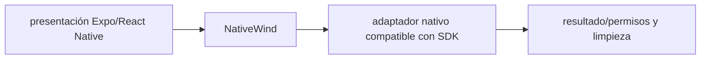

# NativeWind — guía version-aware Vigilio

## Qué es, qué hace y cuándo usarla

Utilidades estilo Tailwind adaptadas a React Native. Requiere configuración compatible con la versión Expo/RN, no CSS web directamente.

**Ubicación en Vigilio:** usa esta dependencia en su stack propietario; otras skills deben enlazar esta guía, no duplicar sus reglas. **Versión:** la indicada en el encabezado es la línea documentada; consultar `technology/versions.md` y el lockfile antes de copiar APIs o aprobar un upgrade.

**Stack propietario:** Expo / React Native. **Versión objetivo:** compatibilidad con Expo SDK 58 POR VERIFICAR en el consumidor; SDK 57 es histórico, no presumir major; versión instalada siempre desde lockfile/manifest. [Documentación oficial](https://www.nativewind.dev/). [Matriz de versiones](../versions.md).

## Responsabilidad y arquitectura

UI tokens alineados conceptualmente pero build nativo propio; reducir clases dinámicas; a11y RN.

No duplicar las reglas generales de SOLID, DDD y manejo de dependencias: [política de librerías](README.md). Al crear código, leer el API de la versión instalada, no solo un ejemplo de blog.

### Diagrama de integración (Mermaid)



El flujo muestra la **responsabilidad arquitectónica** de la librería; no representa llamadas reales de red para todas las operaciones.


## ✅ Correcto — ejemplo actual

```tsx
// Verificar preset/Babel/Metro del major resuelto antes de usarlo.
import { View, Text } from 'react-native';
<View className="flex-1 bg-slate-950 p-4"><Text className="text-white">Productos</Text></View>
```

## ❌ Incorrecto — legado o mal uso

```tsx
// ❌ aplicar configuración Tailwind Web v4 directamente sin adapter NativeWind
import '@tailwindcss/vite';
```

## Migración, nuevas APIs y compatibilidad

NativeWind no equivale a Tailwind CSS web; compatibilidad de versiones con RN, Babel/Metro y utilidades difiere. Una guía de v4 web NO certifica NativeWind.

## Calidad, seguridad, performance y verificaciones

Tests Android/iOS, dark mode, style scanning y Expo doctor.

La adopción exige manifest/lockfile, pruebas runtime, seguridad, CI y rollback. Resultado real en consumidores de esta guía: **NOT_RUN**. No instalar nuevas dependencias solamente por estar catalogadas.

## Fuentes

- [Página oficial y referencias](https://www.nativewind.dev/)
- [Protocolo de adopción](README.md#protocolo-de-adopción-y-actualización)
- [Calidad transversal](../../foundations/engineering/code-quality.md)


## Recetario operativo ampliado — nativewind (2026-10-25)

### API actual: dos tareas reales que debe saber ejecutar una skill

1. **Configurar NativeWind/Tailwind según versión compatible con Expo SDK y Babel.**
2. **Usar className soportado por componentes RN; tokens accesibles y tema.**

### Migración desde versiones anteriores: decisión concreta

- **Qué cambia o se debe revisar:** No trasladar plugins web Tailwind v4 a NativeWind sin matriz de compat.

### Responsabilidades y capas

Styling nativo RN; no CSS de navegador puro.

**✅ Correcto:** mantener la integración encapsulada, alinear los nombres del negocio con Vigilio y depender de un contrato estable.

**❌ Incorrecto:** importar internals de la librería desde Domain, declarar `any` para resolver un upgrade, o duplicar reglas ya propietarias de otra tecnología.

### Seguridad, resiliencia y rendimiento

- Clases dinámicas no detectadas, incompatibilidad Metro/Reanimated.

### Test de aceptación específico y evidencia mínima

- **Escenario comprobable:** Smoke iOS/Android, dark mode, visual regressions y build release.


## Guía operativa detallada — 8 casos y 4 antipatrones

### Ocho ejemplos de la API y casos de uso relevantes

Los fragmentos siguientes ilustran **operaciones independientes**. Variables, imports, provider, extensión y configuración se completan en el proyecto consumidor; **no están certificados como un archivo único compilable**. Cuando hay comentarios `#`, son pasos de integración o configuración y no APIs inventadas.

#### Ejemplo 1. Componente

**✅ Correcto — componente**

```tsx
const Card = () => <View className="rounded-lg p-4 bg-white" />;
```


#### Ejemplo 2. Texto

**✅ Correcto — texto**

```tsx
const Label = () => <Text className="font-semibold text-slate-900" />;
```


#### Ejemplo 3. Espaciado

**✅ Correcto — espaciado**

```tsx
const Content = () => <View className="flex-1 gap-4 px-4" />;
```


#### Ejemplo 4. Oscuro

**✅ Correcto — oscuro**

```tsx
const Page = () => <View className="bg-white dark:bg-slate-950" />;
```


#### Ejemplo 5. Estado disabled

**✅ Correcto — estado disabled**

```tsx
const Button = () => <Pressable disabled={disabled} className="opacity-50" />;
```


#### Ejemplo 6. Tokens compartidos

**✅ Correcto — tokens compartidos**

**Nota técnica (no es código ejecutable):** Mantener tokens semánticos, validar compilación nativa del major.


#### Ejemplo 7. Componentes de imagen

**✅ Correcto — componentes de imagen**

**Nota técnica (no es código ejecutable):** Usar Image React Native con className solo si adapter lo soporta.


#### Ejemplo 8. Gate

**✅ Correcto — gate**

```tsx
npx expo-doctor
```


### Cuatro antipatrones frecuentes y su sustitución

#### Antipatrón 1 — riesgo y alternativa

**❌ Incorrecto**

```tsx
import tailwindcss from "@tailwindcss/vite" // configuración Expo
```

**Por qué está mal:** El patrón «import tailwindcss from "@tailwindcss/vite" // configuración Expo» es riesgoso: puede mezclar firmas incompatibles o ejecutar una API retirada en la versión instalada.

**✅ Correcto — Configurar NativeWind/Metro para versión RN instalada.**

**Por qué mejora:** El patrón «Configurar NativeWind/Metro para versión RN instalada» mejora el caso: se utiliza la API apropiada para el major documentado y se comprueba el lockfile.

#### Antipatrón 2 — riesgo y alternativa

**❌ Incorrecto — Asumir className soportado en cualquier componente externo.**

**Por qué está mal:** El patrón «Asumir className soportado en cualquier componente externo» es riesgoso: mezcla responsabilidades de interfaz y navegación o genera comportamiento inconsistente.

**✅ Correcto — Usar adapter cssInterop si corresponde.**

**Por qué mejora:** El patrón «Usar adapter cssInterop si corresponde» mejora el caso: la interfaz utiliza la API adecuada y separa presentación, estado y comunicación.

#### Antipatrón 3 — riesgo y alternativa

**❌ Incorrecto — Strings dinámicos de clases invisibles.**

**Por qué está mal:** El patrón «Strings dinámicos de clases invisibles» es riesgoso: la elección «Strings dinámicos de clases invisibles» puede incumplir los requisitos operativos de nativewind.

**✅ Correcto — Enumerar clases detectables.**

**Por qué mejora:** El patrón «Enumerar clases detectables» mejora el caso: la alternativa «Enumerar clases detectables» establece el comportamiento esperado de nativewind.

#### Antipatrón 4 — riesgo y alternativa

**❌ Incorrecto — No probar iOS/Android.**

**Por qué está mal:** El patrón «No probar iOS/Android» es riesgoso: puede elevar el coste de runtime, causar fallos de despliegue o empaquetar dependencias no deseadas.

**✅ Correcto**

```tsx
npx expo-doctor # más device builds
```

**Por qué mejora:** El patrón «npx expo-doctor # más device builds» mejora el caso: el build y los recursos se verifican mediante gates de despliegue y rendimiento.

### Versión estable, breaking changes y verificación

- **Versión estable exacta:** no se declara un parche universal cuando no hay verificación específica de su registry/release. Consultar el encabezado de esta guía, `technology/versions.md` y el manifiesto del servicio. **Estado de patch: VERIFY_LOCKFILE**.
- **Migración:** identificar major anterior, APIs retiradas/cambiadas, peer dependencies, requisitos de runtime, cambios de tipos, ejecución CI y plan de rollback. Si no hay prueba sobre el consumidor, **NOT_RUN**, no PASS.
- **Versiones previas:** el ejemplo marcado ❌ en esta guía explica al menos una incompatibilidad o un uso obsoleto; no trasplantar APIs de otras versiones.
- **Tests:** probar al menos happy path, error, seguridad/permiso y compatibilidad con el runtime donde aplique; solo activar nuevas capacidades mediante una PR versionada.

### Fuentes oficiales y referencias al final

- [Referencia propia oficial](https://www.nativewind.dev/)
- [Matriz canónica de versiones](../versions.md)
- [Política de adopción de librerías](README.md)

## Guía de compatibilidad y evaluación por versión (2026-10-25)

**Estado del patch exacto:** `VERIFY_LOCKFILE`. La guía documenta la familia de APIs; **no se ha verificado hoy el patch estable preciso de esta dependencia**. Consultar la fuente oficial enlazada al inicio y el lockfile antes de generar código o aprobar un upgrade.

### Checklist específico de esta librería

- **Migración/compatibilidad:** No trasladar plugins web Tailwind v4 a NativeWind sin matriz de compat.
- **Prueba propia:** Smoke iOS/Android, dark mode, visual regressions y build release.
- **Límite de responsabilidad:** usar esta librería solo en su adaptador o capa propietaria; consultar los ejemplos de API y antipatrones anteriores antes de cambiar llamadas públicas.

**Gate de aprobación:** leer la referencia oficial y resolver la versión del consumidor, ejecutar typecheck y pruebas específicas, registrar PASS/FAIL/NOT_RUN/BLOCKED. No confundir esta guía con validación de un consumidor real. [Procedimiento único de adopción](README.md#protocolo-de-adopción-y-actualización).

