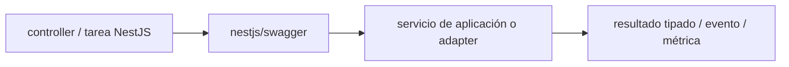

# @nestjs/swagger — guía version-aware Vigilio

## Qué es, qué hace y cuándo usarla

Integración NestJS para documentación OpenAPI. Documenta contratos HTTP y operationId semánticos; no sustituye validación real.

**Ubicación en Vigilio:** usa esta dependencia en su stack propietario; otras skills deben enlazar esta guía, no duplicar sus reglas. **Versión:** la indicada en el encabezado es la línea documentada; consultar `technology/versions.md` y el lockfile antes de copiar APIs o aprobar un upgrade.

**Stack propietario:** Backend NestJS / Node. **Versión objetivo:** versión compatible NestJS 12, Zod 4 y Scalar; versión instalada siempre desde lockfile/manifest. [Documentación oficial](https://docs.nestjs.com/openapi/introduction). [Matriz de versiones](../versions.md).

## Responsabilidad y arquitectura

operationId semánticos; docs derivadas de DTO y no a la inversa; acceso restringido según threat model.

No duplicar las reglas generales de SOLID, DDD y manejo de dependencias: [política de librerías](README.md). Al crear código, leer el API de la versión instalada, no solo un ejemplo de blog.

### Diagrama de integración (Mermaid)



El flujo muestra la **responsabilidad arquitectónica** de la librería; no representa llamadas reales de red para todas las operaciones.


## ✅ Correcto — ejemplo actual

```typescript
const config = new DocumentBuilder().setTitle('Products API').setVersion('1.0').build();
const document = SwaggerModule.createDocument(app,config);
SwaggerModule.setup('api-docs',app,document);
// DTO types Zod requieren adaptador OpenAPI compatible (si aplica)
```

## ❌ Incorrecto — legado o mal uso

**Nota técnica (no es código ejecutable):** ❌ decorar clases para duplicar manualmente campos Zod y divergir del runtime.

## Migración, nuevas APIs y compatibilidad

Plugins/versionado de decoradores, schemas y OpenAPI 3.1 varían por release; validar compat `nestjs-zod` y generador.

## Calidad, seguridad, performance y verificaciones

Contrato OpenAPI snapshot, Zod errors, docs de unauthorized y compat frontend.

La adopción exige manifest/lockfile, pruebas runtime, seguridad, CI y rollback. Resultado real en consumidores de esta guía: **NOT_RUN**. No instalar nuevas dependencias solamente por estar catalogadas.

## Fuentes

- [Página oficial y referencias](https://docs.nestjs.com/openapi/introduction)
- [Protocolo de adopción](README.md#protocolo-de-adopción-y-actualización)
- [Calidad transversal](../../foundations/engineering/code-quality.md)


## Recetario operativo ampliado — nestjs-swagger (2026-10-25)

### API actual: dos tareas reales que debe saber ejecutar una skill

1. **Generar `SwaggerModule.createDocument()` con tags y `operationId` semánticos.**
2. **Adaptar Zod DTO para OpenAPI usando una única fuente de campos.**

### Migración desde versiones anteriores: decisión concreta

- **Qué cambia o se debe revisar:** Adaptadores Swagger cambian junto con Nest/Zod; no mezclar DTO docs y response runtime.

### Responsabilidades y capas

Presentación/documentación; no fuente de SQL o reglas de negocio.

**✅ Correcto:** mantener la integración encapsulada, alinear los nombres del negocio con Vigilio y depender de un contrato estable.

**❌ Incorrecto:** importar internals de la librería desde Domain, declarar `any` para resolver un upgrade, o duplicar reglas ya propietarias de otra tecnología.

### Seguridad, resiliencia y rendimiento

- Exposición de Swagger en prod protegida y sin PII de ejemplos.

### Test de aceptación específico y evidencia mínima

- **Escenario comprobable:** Diff OpenAPI, tests request/response, codigos 401/403/409 y ETag.

### Ejemplo de integración vigente (fragmento adicional)

```typescript
const config = new DocumentBuilder().setTitle('Vigilio API').setVersion('1.0').build();
const openapi_document = SwaggerModule.createDocument(app, config);
SwaggerModule.setup('/api/docs', app, openapi_document);
// Tests: operationId=listProducts, 400/401/403/409 y respuesta compartida.
```

**Nota:** los fragmentos muestran la API específica y requieren imports/providers/fixtures del consumidor; no se certifica compilación por el solo hecho de aparecer aquí.


## Guía operativa detallada — 8 casos y 4 antipatrones

### Ocho ejemplos de la API y casos de uso relevantes

Los fragmentos siguientes ilustran **operaciones independientes**. Variables, imports, provider, extensión y configuración se completan en el proyecto consumidor; **no están certificados como un archivo único compilable**. Cuando hay comentarios `#`, son pasos de integración o configuración y no APIs inventadas.

#### Ejemplo 1. Bootstrap builder

**✅ Correcto — bootstrap builder**

```typescript
const config = new DocumentBuilder().setTitle('Vigilio API').setVersion('1.0').build();
```


#### Ejemplo 2. Crear spec

**✅ Correcto — crear spec**

```typescript
const document = SwaggerModule.createDocument(app, config);
```


#### Ejemplo 3. Publicar UI

**✅ Correcto — publicar ui**

```typescript
SwaggerModule.setup('/docs', app, document);
```


#### Ejemplo 4. Tag

**✅ Correcto — tag**

```typescript
@ApiTags('Products')
```


#### Ejemplo 5. Bearer

**✅ Correcto — bearer**

```typescript
@ApiBearerAuth()
```


#### Ejemplo 6. OperationId

**✅ Correcto — operationid**

```typescript
@ApiOperation({ operationId: 'listProducts' })
```


#### Ejemplo 7. Response

**✅ Correcto — response**

```typescript
@ApiOkResponse({ type: ListProductsResponseDocDto })
```


#### Ejemplo 8. Persistir contrato

**✅ Correcto — persistir contrato**

```typescript
writeFileSync('openapi.json', JSON.stringify(document));
```


### Cuatro antipatrones frecuentes y su sustitución

#### Antipatrón 1 — riesgo y alternativa

**❌ Incorrecto**

```typescript
operationId: "index"
```

**Por qué está mal:** El patrón «operationId: "index"» es riesgoso: la consulta puede producir resultados incorrectos, lentitud o aislamiento insuficiente de datos.

**✅ Correcto**

```typescript
operationId: "listProducts"
```

**Por qué mejora:** El patrón «operationId: "listProducts"» mejora el caso: la consulta o el contrato se valida y mide sobre datos representativos.

#### Antipatrón 2 — riesgo y alternativa

**❌ Incorrecto — DTO Swagger duplicado a mano.**

**Por qué está mal:** El patrón «DTO Swagger duplicado a mano» es riesgoso: puede aceptar entradas inválidas o duplicar contratos difíciles de mantener.

**✅ Correcto — Derivar OpenAPI del contrato validado.**

**Por qué mejora:** Convierte la condición en un control verificable mediante validación o pruebas.

#### Antipatrón 3 — riesgo y alternativa

**❌ Incorrecto — UI docs sin restricciones si API privada.**

**Por qué está mal:** Omite un control operativo necesario, por lo que el comportamiento puede ser inseguro o difícil de verificar.

**✅ Correcto — Proteger docs por ambiente/auth.**

**Por qué mejora:** El patrón «Proteger docs por ambiente/auth» mejora el caso: el cambio pasa por gates automáticos y aprobación de riesgos operativos.

#### Antipatrón 4 — riesgo y alternativa

**❌ Incorrecto — Actualizar contrato sin diff OpenAPI.**

**Por qué está mal:** Omite un control operativo necesario, por lo que el comportamiento puede ser inseguro o difícil de verificar.

**✅ Correcto — Snapshot y compare en CI.**

**Por qué mejora:** El patrón «Snapshot y compare en CI» mejora el caso: se exige revisión de cambios, retención y un plan de reversión o recuperación.

### Versión estable, breaking changes y verificación

- **Versión estable exacta:** no se declara un parche universal cuando no hay verificación específica de su registry/release. Consultar el encabezado de esta guía, `technology/versions.md` y el manifiesto del servicio. **Estado de patch: VERIFY_LOCKFILE**.
- **Migración:** identificar major anterior, APIs retiradas/cambiadas, peer dependencies, requisitos de runtime, cambios de tipos, ejecución CI y plan de rollback. Si no hay prueba sobre el consumidor, **NOT_RUN**, no PASS.
- **Versiones previas:** el ejemplo marcado ❌ en esta guía explica al menos una incompatibilidad o un uso obsoleto; no trasplantar APIs de otras versiones.
- **Tests:** probar al menos happy path, error, seguridad/permiso y compatibilidad con el runtime donde aplique; solo activar nuevas capacidades mediante una PR versionada.

### Fuentes oficiales y referencias al final

- [Referencia propia oficial](https://docs.nestjs.com/openapi/introduction)
- [Matriz canónica de versiones](../versions.md)
- [Política de adopción de librerías](README.md)

## Guía de compatibilidad y evaluación por versión (2026-10-25)

**Estado del patch exacto:** `VERIFY_LOCKFILE`. La guía documenta la familia de APIs; **no se ha verificado hoy el patch estable preciso de esta dependencia**. Consultar la fuente oficial enlazada al inicio y el lockfile antes de generar código o aprobar un upgrade.

### Checklist específico de esta librería

- **Migración/compatibilidad:** Adaptadores Swagger cambian junto con Nest/Zod; no mezclar DTO docs y response runtime.
- **Prueba propia:** Diff OpenAPI, tests request/response, codigos 401/403/409 y ETag.
- **Límite de responsabilidad:** usar esta librería solo en su adaptador o capa propietaria; consultar los ejemplos de API y antipatrones anteriores antes de cambiar llamadas públicas.

**Gate de aprobación:** leer la referencia oficial y resolver la versión del consumidor, ejecutar typecheck y pruebas específicas, registrar PASS/FAIL/NOT_RUN/BLOCKED. No confundir esta guía con validación de un consumidor real. [Procedimiento único de adopción](README.md#protocolo-de-adopción-y-actualización).

