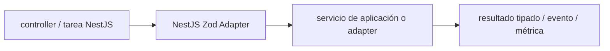

# NestJS + Zod Adapter — Vigilio línea compatible NestJS 12 / Zod 4

## Qué es, qué hace y cuándo usarla

Adaptador entre NestJS y contratos Zod. Habilita integración de validación/documentación sin llevar clases Nest al paquete frontend compartido.

**Ubicación en Vigilio:** usa esta dependencia en su stack propietario; otras skills deben enlazar esta guía, no duplicar sus reglas. **Versión:** la indicada en el encabezado es la línea documentada; consultar `technology/versions.md` y el lockfile antes de copiar APIs o aprobar un upgrade.

> **Guía propia de NestJS + Zod Adapter (backend-node).** Estado a **2026-10-25**: línea compatible NestJS 12 / Zod 4. Versión del proyecto consumidor = `pnpm-lock.yaml` / `composer.lock` / imagen o manifest. Fuente: [documentación oficial](https://github.com/BenLorantfy/nestjs-zod). Fuente normativa transversal de versiones: [versions.md](../versions.md). **No implica instalación automática ni upgrade aprobado.**

## Objetivo, responsabilidad y dónde usar

Mantener adaptador Nest solo en Presentation docs/; backend no exporta clase Swagger al frontend.

**Uso:** aplicar solo si está declarada y resulta pertinente al consumidor; ver [política de adopción y DRY](README.md).

### Diagrama de integración (Mermaid)



El flujo muestra la **responsabilidad arquitectónica** de la librería; no representa llamadas reales de red para todas las operaciones.


## Instalación o verificación

```bash
pnpm add nestjs-zod zod
```

**Gate de instalación:** consultar [procedimiento compartido](README.md#protocolo-de-adopción-y-actualización); estos comandos son indicativos, no ejecuciones sobre un consumidor.

## ✅ Correcto — uso actual y ejemplo de referencia

```typescript
// HTTP DTO único incluye Zod y tipo inferido
export const registerProductRequestDto=productSchema.pick({nro_poliza:true});
export type RegisterProductRequestDto=z.output<typeof registerProductRequestDto>;
// adaptar a documentación con clase específica si Swagger lo exige
```

**Por qué:** Mantener adaptador Nest solo en Presentation docs/; backend no exporta clase Swagger al frontend.

## ❌ Incorrecto — patrón legacy, inseguro o mal ubicado

```typescript
// ❌ inventar que export type valida por sí solo
@Body() input: RegisterProductRequestDto;
```

**Riesgo:** confundir versiones o responsabilidades y obtener un contrato incorrecto.

## Nuevas capacidades, migración y breaking changes

El pipe/adapter exacto depende de versión `nestjs-zod` y Zod 4; `createZodDto` es clase runtime distinta de type-only DTO, no mezclar en shared contract.

Aplicar el [protocolo de migración común](README.md#protocolo-de-adopción-y-actualización), sin asumir que una release nueva está desplegada.

## Buenas prácticas, seguridad, rendimiento y operación

Consultar la [política transversal de librerías](README.md) para seguridad, versionado, evidencia y revisión de contratos. Para esta librería, además, aplicar las verificaciones concretas que se detallan a continuación.

## Gates de aceptación y compatibilidad

Probar 400/422, serialización, interoperabilidad Scalar/Swagger, transform y errors.

Estado de prueba de estos ejemplos documentales: **NOT_RUN** en aplicaciones consumidoras; ver [criterios de evidencia](README.md#criterios-de-validación).


## Referencias

- [Documentación oficial y migración de NestJS + Zod Adapter](https://github.com/BenLorantfy/nestjs-zod)
- [Matriz y baseline de versiones](../versions.md)
- [Calidad de código canónica](../../foundations/engineering/code-quality.md)


## Recetario operativo ampliado — nestjs-zod (2026-10-25)

### API actual: dos tareas reales que debe saber ejecutar una skill

1. **Elegir integración de validación de Zod compatible con NestJS y OpenAPI.**
2. **Pipes/global boundary; DTO Zod en mismo archivo que su tipo; clases docs solo adaptador.**

### Migración desde versiones anteriores: decisión concreta

- **Qué cambia o se debe revisar:** No asumir que `createZodDto` valida por sí solo en todos los setups.

### Responsabilidades y capas

Borde HTTP; Domain/Repository no importan NestZod.

**✅ Correcto:** mantener la integración encapsulada, alinear los nombres del negocio con Vigilio y depender de un contrato estable.

**❌ Incorrecto:** importar internals de la librería desde Domain, declarar `any` para resolver un upgrade, o duplicar reglas ya propietarias de otra tecnología.

### Seguridad, resiliencia y rendimiento

- Parsing input no equivale a authz; test de coerción, desconocidos y response.

### Test de aceptación específico y evidencia mínima

- **Escenario comprobable:** Test E2E bad input 400, outputs, docs y consumo contrato browser-safe.


## Guía operativa detallada — 8 casos y 4 antipatrones

### Ocho ejemplos de la API y casos de uso relevantes

Los fragmentos siguientes ilustran **operaciones independientes**. Variables, imports, provider, extensión y configuración se completan en el proyecto consumidor; **no están certificados como un archivo único compilable**. Cuando hay comentarios `#`, son pasos de integración o configuración y no APIs inventadas.

#### Ejemplo 1. DTO source

**✅ Correcto — dto source**

```typescript
export const registerUserRequestDto = userSchema.pick({ email: true }).extend({ password: z.string().min(12) });
```


#### Ejemplo 2. Tipo TS

**✅ Correcto — tipo ts**

```typescript
export type RegisterUserRequestDto = z.output<typeof registerUserRequestDto>;
```


#### Ejemplo 3. Parse borde

**✅ Correcto — parse borde**

```typescript
const input = registerUserRequestDto.parse(raw_body);
```


#### Ejemplo 4. Adaptador opcional

**✅ Correcto — adaptador opcional**

```typescript
class RegisterUserDoc extends createZodDto(registerUserRequestDto) {}
```


#### Ejemplo 5. Estandar Schema

**✅ Correcto — estandar schema**

**Nota técnica (no es código ejecutable):** Usar pipe de validación compatible con versión Nest, no duplicar reglas.


#### Ejemplo 6. Respuesta

**✅ Correcto — respuesta**

```typescript
export const userResponseDto = userSchema.pick({ id: true, email: true });
```


#### Ejemplo 7. OpenAPI

**✅ Correcto — openapi**

**Nota técnica (no es código ejecutable):** Derivar spec desde el mismo Zod, probar generated schema.


#### Ejemplo 8. Compartir tipos

**✅ Correcto — compartir tipos**

**Nota técnica (no es código ejecutable):** Frontend importa DTO ligero; no clases Nest del backend.


### Cuatro antipatrones frecuentes y su sustitución

#### Antipatrón 1 — riesgo y alternativa

**❌ Incorrecto**

```typescript
type RegisterUserRequestDto = { email: string }
```

**Por qué está mal:** El patrón «type RegisterUserRequestDto = { email: string }» es riesgoso: puede elevar el coste de runtime, causar fallos de despliegue o empaquetar dependencias no deseadas.

**✅ Correcto**

```typescript
type RegisterUserRequestDto = z.output<typeof registerUserRequestDto>
```

**Por qué mejora:** El patrón «type RegisterUserRequestDto = z.output<typeof registerUserRequestDto>» mejora el caso: el build y los recursos se verifican mediante gates de despliegue y rendimiento.

#### Antipatrón 2 — riesgo y alternativa

**❌ Incorrecto — Schema Request separado solo para nombre validator.**

**Por qué está mal:** El patrón «Schema Request separado solo para nombre validator» es riesgoso: puede elevar el coste de runtime, causar fallos de despliegue o empaquetar dependencias no deseadas.

**✅ Correcto — Zod runtime + type en *.dto.ts.**

**Por qué mejora:** El patrón «Zod runtime + type en *.dto.ts» mejora el caso: el build y los recursos se verifican mediante gates de despliegue y rendimiento.

#### Antipatrón 3 — riesgo y alternativa

**❌ Incorrecto — Respuesta parseada solo para tipar.**

**Por qué está mal:** El patrón «Respuesta parseada solo para tipar» es riesgoso: puede aceptar entradas inválidas o duplicar contratos difíciles de mantener.

**✅ Correcto — Tipo inferido y validación en borde externo.**

**Por qué mejora:** Convierte la condición en un control verificable mediante validación o pruebas.

#### Antipatrón 4 — riesgo y alternativa

**❌ Incorrecto — Publicar clase createZodDto a React.**

**Por qué está mal:** El patrón «Publicar clase createZodDto a React» es riesgoso: puede permitir acceso a recursos no autorizados o de otro tenant.

**✅ Correcto — Compartir DTO Zod plano sin dependencia Nest.**

**Por qué mejora:** El patrón «Compartir DTO Zod plano sin dependencia Nest» mejora el caso: se fuerza autorización en el borde/servidor y se limita el acceso por recurso.

### Versión estable, breaking changes y verificación

- **Versión estable exacta:** no se declara un parche universal cuando no hay verificación específica de su registry/release. Consultar el encabezado de esta guía, `technology/versions.md` y el manifiesto del servicio. **Estado de patch: VERIFY_LOCKFILE**.
- **Migración:** identificar major anterior, APIs retiradas/cambiadas, peer dependencies, requisitos de runtime, cambios de tipos, ejecución CI y plan de rollback. Si no hay prueba sobre el consumidor, **NOT_RUN**, no PASS.
- **Versiones previas:** el ejemplo marcado ❌ en esta guía explica al menos una incompatibilidad o un uso obsoleto; no trasplantar APIs de otras versiones.
- **Tests:** probar al menos happy path, error, seguridad/permiso y compatibilidad con el runtime donde aplique; solo activar nuevas capacidades mediante una PR versionada.

### Fuentes oficiales y referencias al final

- [Referencia propia oficial](https://github.com/BenLorantfy/nestjs-zod)
- [Matriz canónica de versiones](../versions.md)
- [Política de adopción de librerías](README.md)

## Guía de compatibilidad y evaluación por versión (2026-10-25)

**Estado del patch exacto:** `VERIFY_LOCKFILE`. La guía documenta la familia de APIs; **no se ha verificado hoy el patch estable preciso de esta dependencia**. Consultar la fuente oficial enlazada al inicio y el lockfile antes de generar código o aprobar un upgrade.

### Checklist específico de esta librería

- **Migración/compatibilidad:** No asumir que `createZodDto` valida por sí solo en todos los setups.
- **Prueba propia:** Test E2E bad input 400, outputs, docs y consumo contrato browser-safe.
- **Límite de responsabilidad:** usar esta librería solo en su adaptador o capa propietaria; consultar los ejemplos de API y antipatrones anteriores antes de cambiar llamadas públicas.

**Gate de aprobación:** leer la referencia oficial y resolver la versión del consumidor, ejecutar typecheck y pruebas específicas, registrar PASS/FAIL/NOT_RUN/BLOCKED. No confundir esta guía con validación de un consumidor real. [Procedimiento único de adopción](README.md#protocolo-de-adopción-y-actualización).

