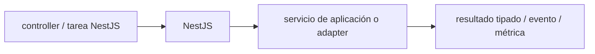

# NestJS — Vigilio 11.x (conservador) / 12.2.0 (candidato) con Express default

## Qué es, qué hace y cuándo usarla

Framework Node/TypeScript modular basado en DI para APIs y jobs. El framework pertenece a bordes y composición, no a Domain.

**Ubicación en Vigilio:** usa esta dependencia en su stack propietario; otras skills deben enlazar esta guía, no duplicar sus reglas. **Versión:** la indicada en el encabezado es la línea documentada; consultar `technology/versions.md` y el lockfile antes de copiar APIs o aprobar un upgrade.

> **Guía propia de NestJS (backend-node).** Estado a **2026-11-01**: 11.x (estable conservador) / 12.2.0 (candidato). Adaptador por defecto: Express; Fastify opt-in explícito. Versión del proyecto consumidor = `pnpm-lock.yaml` / `composer.lock` / imagen o manifest. Fuente: [documentación oficial](https://docs.nestjs.com/). Fuente normativa transversal de versiones: [versions.md](../versions.md). **No implica instalación automática ni upgrade aprobado.**

## Objetivo, responsabilidad y dónde usar

Controller delgado; Application service con caso de uso; Domain entidad e invariantes; Repository Port e Infra Drizzle. Inyección constructor en camelCase; variables ordinarias snake_case.

**Uso:** aplicar solo si está declarada y resulta pertinente al consumidor; ver [política de adopción y DRY](README.md).

### Diagrama de integración (Mermaid)



El flujo muestra la **responsabilidad arquitectónica** de la librería; no representa llamadas reales de red para todas las operaciones.


## Instalación o verificación

```bash
pnpm add @nestjs/common @nestjs/core
```

**Gate de instalación:** consultar [procedimiento compartido](README.md#protocolo-de-adopción-y-actualización); estos comandos son indicativos, no ejecuciones sobre un consumidor.

## ✅ Correcto — uso actual y ejemplo de referencia

```typescript
@Injectable()
export class ProductService {
  constructor(@Inject(PRODUCT_REPOSITORY) private readonly productRepository: ProductRepository) {}
  async listProducts(criteria: ProductCriteria){return this.productRepository.findByCriteria(criteria);}
}
@Controller('products')
export class ProductController {
  constructor(private readonly productService: ProductService) {}
  @Get() listProducts(@Query() query: ListProductsQueryDto) { /* validar DTO runtime mediante pipe */ }
}
```

**Por qué:** Controller delgado; Application service con caso de uso; Domain entidad e invariantes; Repository Port e Infra Drizzle. Inyección constructor en camelCase; variables ordinarias snake_case.

## ❌ Incorrecto — patrón legacy, inseguro o mal ubicado

```typescript
// ❌ controller con consultas Drizzle y reglas de negocio embebidas
@Get() async index(){ return db.select().from(products); }
```

**Riesgo:** confundir versiones o responsabilidades y obtener un contrato incorrecto.

## Nuevas capacidades, migración y breaking changes

11→12 verificar módulos, DI, pipes, providers, platform adapters y Swagger plugins. No asumir que un type DTO valida HTTP en runtime.

Aplicar el [protocolo de migración común](README.md#protocolo-de-adopción-y-actualización), sin asumir que una release nueva está desplegada.

## Buenas prácticas, seguridad, rendimiento y operación

Consultar la [política transversal de librerías](README.md) para seguridad, versionado, evidencia y revisión de contratos. Para esta librería, además, aplicar las verificaciones concretas que se detallan a continuación.

## Gates de aceptación y compatibilidad

Tests DI, pipes, OpenAPI, authz, tenant, exceptions y memory-leaks del ciclo de vida.

Estado de prueba de estos ejemplos documentales: **NOT_RUN** en aplicaciones consumidoras; ver [criterios de evidencia](README.md#criterios-de-validación).


## Referencias

- [Documentación oficial y migración de NestJS](https://docs.nestjs.com/)
- [Matriz y baseline de versiones](../versions.md)
- [Calidad de código canónica](../../foundations/engineering/code-quality.md)


## Recetario operativo ampliado — nestjs (2026-10-25)

### API actual: dos tareas reales que debe saber ejecutar una skill

1. **Controllers delgados y DI con token para interfaces TS.**
2. **Módulos por feature; guards, filters, interceptors y lifecycle providers probados.**

### Migración desde versiones anteriores: decisión concreta

- **Qué cambia o se debe revisar:** Migrar major Nest antes de usar pipes/decorators nuevos; verificar versión del runtime.

### Responsabilidades y capas

Adaptación framework; reglas Domain independientes de Nest.

**✅ Correcto:** mantener la integración encapsulada, alinear los nombres del negocio con Vigilio y depender de un contrato estable.

**❌ Incorrecto:** importar internals de la librería desde Domain, declarar `any` para resolver un upgrade, o duplicar reglas ya propietarias de otra tecnología.

### Seguridad, resiliencia y rendimiento

- No filtrar errores SQL; authz antes de caso de uso, limiter por endpoint.

### Test de aceptación específico y evidencia mínima

- **Escenario comprobable:** Unit services, E2E HTTP, test provider registration y graceful shutdown.

### Ejemplo de integración vigente (fragmento adicional)

```typescript
@Injectable()
export class ProductService {
  constructor(@Inject(PRODUCT_REPOSITORY) private readonly productRepository: ProductRepository) {}
  async getProduct(product_id: ProductSchema['id']): Promise<ProductSchema> {
    const product = await this.productRepository.findById(product_id);
    if (!product) throw new ProductNotFoundError();
    return product;
  }
}
```

**Nota:** los fragmentos muestran la API específica y requieren imports/providers/fixtures del consumidor; no se certifica compilación por el solo hecho de aparecer aquí.


## Guía operativa detallada — 8 casos y 4 antipatrones

### Ocho ejemplos de la API y casos de uso relevantes

Los fragmentos siguientes ilustran **operaciones independientes**. Variables, imports, provider, extensión y configuración se completan en el proyecto consumidor; **no están certificados como un archivo único compilable**. Cuando hay comentarios `#`, son pasos de integración o configuración y no APIs inventadas.

#### Ejemplo 1. Módulo

**✅ Correcto — módulo**

```typescript
@Module({ controllers: [ProductController], providers: [ProductService] }) export class ProductsModule {}
```


#### Ejemplo 2. Controller

**✅ Correcto — controller**

```typescript
@Controller('products') export class ProductController {}
```


#### Ejemplo 3. GET

**✅ Correcto — get**

```typescript
@Get() listProducts() { return this.productService.listProducts(); }
```


#### Ejemplo 4. POST

**✅ Correcto — post**

```typescript
@Post() registerProduct(@Body() input: RegisterProductRequestDto) { return this.productService.registerProduct(input); }
```


#### Ejemplo 5. DI token

**✅ Correcto — di token**

```typescript
@Inject(PRODUCT_REPOSITORY) private readonly productRepository: ProductRepository
```


#### Ejemplo 6. Guard

**✅ Correcto — guard**

```typescript
@UseGuards(JwtAuthGuard)
```


#### Ejemplo 7. Exception

**✅ Correcto — exception**

```typescript
throw new NotFoundException('Product not found');
```


#### Ejemplo 8. Health

**✅ Correcto — health**

```typescript
@Get('/health/ready') readiness() { return { ok: true }; }
```


### Cuatro antipatrones frecuentes y su sustitución

#### Antipatrón 1 — riesgo y alternativa

**❌ Incorrecto**

```typescript
@Get() index() {}
```

**Por qué está mal:** El patrón «@Get() index() {}» es riesgoso: la consulta puede producir resultados incorrectos, lentitud o aislamiento insuficiente de datos.

**✅ Correcto**

```typescript
@Get() listProducts() {}
```

**Por qué mejora:** El patrón «@Get() listProducts() {}» mejora el caso: la consulta o el contrato se valida y mide sobre datos representativos.

#### Antipatrón 2 — riesgo y alternativa

**❌ Incorrecto**

```typescript
constructor(private readonly product_repository: ProductRepository) {}
```

**Por qué está mal:** El patrón «constructor(private readonly product_repository: ProductRepository) {}» es riesgoso: la elección «constructor(private readonly product_repository: ProductRepository) {}» puede incumplir los requisitos operativos de nestjs.

**✅ Correcto**

```typescript
constructor(private readonly productRepository: ProductRepository) {}
```

**Por qué mejora:** El patrón «constructor(private readonly productRepository: ProductRepository) {}» mejora el caso: la alternativa «constructor(private readonly productRepository: ProductRepository) {}» establece el comportamiento esperado de nestjs.

#### Antipatrón 3 — riesgo y alternativa

**❌ Incorrecto — Repository ORM directo en Controller.**

**Por qué está mal:** El patrón «Repository ORM directo en Controller» es riesgoso: la elección «Repository ORM directo en Controller» puede incumplir los requisitos operativos de nestjs.

**✅ Correcto — Inyectar caso de uso de Application.**

**Por qué mejora:** El patrón «Inyectar caso de uso de Application» mejora el caso: la alternativa «Inyectar caso de uso de Application» establece el comportamiento esperado de nestjs.

#### Antipatrón 4 — riesgo y alternativa

**❌ Incorrecto — DTO transportado hasta Domain.**

**Por qué está mal:** El patrón «DTO transportado hasta Domain» es riesgoso: puede aceptar entradas inválidas o duplicar contratos difíciles de mantener.

**✅ Correcto — Mapear comando/input interno.**

**Por qué mejora:** El patrón «Mapear comando/input interno» mejora el caso: el contrato queda tipado y validado en el borde que recibe datos externos.

### Versión estable, breaking changes y verificación

- **Versión estable exacta:** no se declara un parche universal cuando no hay verificación específica de su registry/release. Consultar el encabezado de esta guía, `technology/versions.md` y el manifiesto del servicio. **Estado de patch: VERIFY_LOCKFILE**.
- **Migración:** identificar major anterior, APIs retiradas/cambiadas, peer dependencies, requisitos de runtime, cambios de tipos, ejecución CI y plan de rollback. Si no hay prueba sobre el consumidor, **NOT_RUN**, no PASS.
- **Versiones previas:** el ejemplo marcado ❌ en esta guía explica al menos una incompatibilidad o un uso obsoleto; no trasplantar APIs de otras versiones.
- **Tests:** probar al menos happy path, error, seguridad/permiso y compatibilidad con el runtime donde aplique; solo activar nuevas capacidades mediante una PR versionada.

### Fuentes oficiales y referencias al final

- [Referencia propia oficial](https://docs.nestjs.com/)
- [Matriz canónica de versiones](../versions.md)
- [Política de adopción de librerías](README.md)

## Guía de compatibilidad y evaluación por versión (2026-10-25)

**Estado del patch exacto:** `VERIFY_LOCKFILE`. La guía documenta la familia de APIs; **no se ha verificado hoy el patch estable preciso de esta dependencia**. Consultar la fuente oficial enlazada al inicio y el lockfile antes de generar código o aprobar un upgrade.

### Checklist específico de esta librería

- **Migración/compatibilidad:** Migrar major Nest antes de usar pipes/decorators nuevos; verificar versión del runtime.
- **Prueba propia:** Unit services, E2E HTTP, test provider registration y graceful shutdown.
- **Límite de responsabilidad:** usar esta librería solo en su adaptador o capa propietaria; consultar los ejemplos de API y antipatrones anteriores antes de cambiar llamadas públicas.

**Gate de aprobación:** leer la referencia oficial y resolver la versión del consumidor, ejecutar typecheck y pruebas específicas, registrar PASS/FAIL/NOT_RUN/BLOCKED. No confundir esta guía con validación de un consumidor real. [Procedimiento único de adopción](README.md#protocolo-de-adopción-y-actualización).

