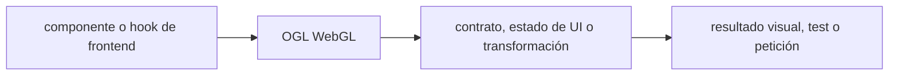

# OGL WebGL — guía version-aware Vigilio

## Qué es, qué hace y cuándo usarla

Biblioteca WebGL compacta para renderizado 3D en navegador. Encapsula shaders, buffers y limpieza de recursos sin mezclar con lógica de negocio.

**Ubicación en Vigilio:** usa esta dependencia en su stack propietario; otras skills deben enlazar esta guía, no duplicar sus reglas. **Versión:** la indicada en el encabezado es la línea documentada; consultar `technology/versions.md` y el lockfile antes de copiar APIs o aprobar un upgrade.

**Stack propietario:** Frontend web / MFE. **Versión objetivo:** 1.0.x; referencia MFE previa 1.0.11; versión instalada siempre desde lockfile/manifest. [Documentación oficial](https://github.com/oframe/ogl). [Matriz de versiones](../versions.md).

## Responsabilidad y arquitectura

WebGL visual opcional, lazy-load, prefers-reduced-motion, fallback 2D/canvas y aislado de casos de uso.

No duplicar las reglas generales de SOLID, DDD y manejo de dependencias: [política de librerías](README.md). Al crear código, leer el API de la versión instalada, no solo un ejemplo de blog.

### Diagrama de integración (Mermaid)



El flujo muestra la **responsabilidad arquitectónica** de la librería; no representa llamadas reales de red para todas las operaciones.


## ✅ Correcto — ejemplo actual

```typescript
import { Renderer, Camera, Transform } from 'ogl';
const renderer = new Renderer({alpha:true});
const scene = new Transform();
const camera = new Camera(renderer.gl);
// montar renderer.gl.canvas en componente lazy; en cleanup cancelar RAF y liberar recursos.
```

## ❌ Incorrecto — legado o mal uso

```typescript
// ❌ canvas creado en cada render sin destruir WebGL context
const renderer = new Renderer();
```

## Migración, nuevas APIs y compatibilidad

Comprobar API y shaders de la versión instalada, no copiar demos antiguos sin validación de uniforms, resize y cleanup.

## Calidad, seguridad, performance y verificaciones

Test FPS, memory, context lost/restore, SSR/dynamic imports y fallback móvil.

La adopción exige manifest/lockfile, pruebas runtime, seguridad, CI y rollback. Resultado real en consumidores de esta guía: **NOT_RUN**. No instalar nuevas dependencias solamente por estar catalogadas.

## Fuentes

- [Página oficial y referencias](https://github.com/oframe/ogl)
- [Protocolo de adopción](README.md#protocolo-de-adopción-y-actualización)
- [Calidad transversal](../../foundations/engineering/code-quality.md)


## Recetario operativo ampliado — ogl (2026-10-25)

### API actual: dos tareas reales que debe saber ejecutar una skill

1. **Gestionar WebGL renderer/program/mesh con resize y `requestAnimationFrame` controlado.**
2. **Cleanup GPU buffers y cancel RAF en desmontaje.**

### Migración desde versiones anteriores: decisión concreta

- **Qué cambia o se debe revisar:** OGL APIs WebGL difieren de Three.js; no mezclar componentes como equivalentes.

### Responsabilidades y capas

Vista gráfica WebGL en frontend, no lógica de aplicación.

**✅ Correcto:** mantener la integración encapsulada, alinear los nombres del negocio con Vigilio y depender de un contrato estable.

**❌ Incorrecto:** importar internals de la librería desde Domain, declarar `any` para resolver un upgrade, o duplicar reglas ya propietarias de otra tecnología.

### Seguridad, resiliencia y rendimiento

- Context loss, DPR excesivo, navegadores sin WebGL.

### Test de aceptación específico y evidencia mínima

- **Escenario comprobable:** Test fallback, dispose, mobile GPU y performance budget.


## Guía operativa detallada — 8 casos y 4 antipatrones

### Ocho ejemplos de la API y casos de uso relevantes

Los fragmentos siguientes ilustran **operaciones independientes**. Variables, imports, provider, extensión y configuración se completan en el proyecto consumidor; **no están certificados como un archivo único compilable**. Cuando hay comentarios `#`, son pasos de integración o configuración y no APIs inventadas.

#### Ejemplo 1. Renderer

**✅ Correcto — renderer**

```typescript
const renderer = new Renderer({ alpha: true });
```


#### Ejemplo 2. Escena

**✅ Correcto — escena**

```typescript
const scene = new Transform();
```


#### Ejemplo 3. Cámara

**✅ Correcto — cámara**

```typescript
const camera = new Camera(renderer.gl);
```


#### Ejemplo 4. Geometría

**✅ Correcto — geometría**

```typescript
const geometry = new Triangle(renderer.gl);
```


#### Ejemplo 5. Shader

**✅ Correcto — shader**

```typescript
const program = new Program(renderer.gl, { vertex, fragment });
```


#### Ejemplo 6. Mesh

**✅ Correcto — mesh**

```typescript
const mesh = new Mesh(renderer.gl, { geometry, program });
```


#### Ejemplo 7. Render

**✅ Correcto — render**

```typescript
renderer.render({ scene, camera });
```


#### Ejemplo 8. Cleanup

**✅ Correcto — cleanup**

```typescript
cancelAnimationFrame(frame_id); renderer.gl.getExtension('WEBGL_lose_context')?.loseContext();
```


### Cuatro antipatrones frecuentes y su sustitución

#### Antipatrón 1 — riesgo y alternativa

**❌ Incorrecto**

```typescript
new Renderer() // cada render
```

**Por qué está mal:** El patrón «new Renderer() // cada render» es riesgoso: puede publicar cambios sin evidencia suficiente ni una revisión del impacto.

**✅ Correcto — Inicializar Renderer en effect/mount una vez.**

**Por qué mejora:** El patrón «Inicializar Renderer en effect/mount una vez» mejora el caso: el cambio pasa por gates automáticos y aprobación de riesgos operativos.

#### Antipatrón 2 — riesgo y alternativa

**❌ Incorrecto — Loop RAF sin cleanup.**

**Por qué está mal:** Omite un control operativo necesario, por lo que el comportamiento puede ser inseguro o difícil de verificar.

**✅ Correcto**

```typescript
cancelAnimationFrame(frame_id)
```

**Por qué mejora:** El patrón «cancelAnimationFrame(frame_id)» mejora el caso: la alternativa «cancelAnimationFrame(frame_id)» establece el comportamiento esperado de ogl.

#### Antipatrón 3 — riesgo y alternativa

**❌ Incorrecto — Sin fallback para WebGL unavailable.**

**Por qué está mal:** Omite un control operativo necesario, por lo que el comportamiento puede ser inseguro o difícil de verificar.

**✅ Correcto — Renderizar fallback accesible.**

**Por qué mejora:** El patrón «Renderizar fallback accesible» mejora el caso: el comportamiento se verifica con pruebas y criterios observables.

#### Antipatrón 4 — riesgo y alternativa

**❌ Incorrecto — Render full resolution en low-end.**

**Por qué está mal:** El patrón «Render full resolution en low-end» es riesgoso: mezcla responsabilidades de interfaz y navegación o genera comportamiento inconsistente.

**✅ Correcto — DPR acotado y medido.**

**Por qué mejora:** El patrón «DPR acotado y medido» mejora el caso: la interfaz utiliza la API adecuada y separa presentación, estado y comunicación.

### Versión estable, breaking changes y verificación

- **Versión estable exacta:** no se declara un parche universal cuando no hay verificación específica de su registry/release. Consultar el encabezado de esta guía, `technology/versions.md` y el manifiesto del servicio. **Estado de patch: VERIFY_LOCKFILE**.
- **Migración:** identificar major anterior, APIs retiradas/cambiadas, peer dependencies, requisitos de runtime, cambios de tipos, ejecución CI y plan de rollback. Si no hay prueba sobre el consumidor, **NOT_RUN**, no PASS.
- **Versiones previas:** el ejemplo marcado ❌ en esta guía explica al menos una incompatibilidad o un uso obsoleto; no trasplantar APIs de otras versiones.
- **Tests:** probar al menos happy path, error, seguridad/permiso y compatibilidad con el runtime donde aplique; solo activar nuevas capacidades mediante una PR versionada.

### Fuentes oficiales y referencias al final

- [Referencia propia oficial](https://github.com/oframe/ogl)
- [Matriz canónica de versiones](../versions.md)
- [Política de adopción de librerías](README.md)

## Guía de compatibilidad y evaluación por versión (2026-10-25)

**Estado del patch exacto:** `VERIFY_LOCKFILE`. La guía documenta la familia de APIs; **no se ha verificado hoy el patch estable preciso de esta dependencia**. Consultar la fuente oficial enlazada al inicio y el lockfile antes de generar código o aprobar un upgrade.

### Checklist específico de esta librería

- **Migración/compatibilidad:** OGL APIs WebGL difieren de Three.js; no mezclar componentes como equivalentes.
- **Prueba propia:** Test fallback, dispose, mobile GPU y performance budget.
- **Límite de responsabilidad:** usar esta librería solo en su adaptador o capa propietaria; consultar los ejemplos de API y antipatrones anteriores antes de cambiar llamadas públicas.

**Gate de aprobación:** leer la referencia oficial y resolver la versión del consumidor, ejecutar typecheck y pruebas específicas, registrar PASS/FAIL/NOT_RUN/BLOCKED. No confundir esta guía con validación de un consumidor real. [Procedimiento único de adopción](README.md#protocolo-de-adopción-y-actualización).

