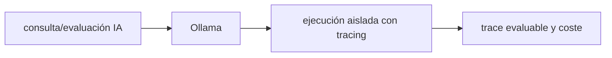

# Ollama — Vigilio versión de runtime local por imagen/digest

## Qué es, qué hace y cuándo usarla

Runtime para ejecutar y servir modelos LLM y embeddings localmente mediante HTTP. Deben fijarse modelos/digests y vigilar memoria, latencia y privacidad.

**Ubicación en Vigilio:** usa esta dependencia en su stack propietario; otras skills deben enlazar esta guía, no duplicar sus reglas. **Versión:** la indicada en el encabezado es la línea documentada; consultar `technology/versions.md` y el lockfile antes de copiar APIs o aprobar un upgrade.

> **Guía propia de Ollama (ai).** Estado a **2026-10-25**: versión de runtime local por imagen/digest. Versión del proyecto consumidor = `pnpm-lock.yaml` / `composer.lock` / imagen o manifest. Fuente: [documentación oficial](https://docs.ollama.com/). Fuente normativa transversal de versiones: [versions.md](../versions.md). **No implica instalación automática ni upgrade aprobado.**

## Objetivo, responsabilidad y dónde usar

Control VRAM, quantization, batch embedding, cuotas/timeout y seguridad local.

**Uso:** aplicar solo si está declarada y resulta pertinente al consumidor; ver [política de adopción y DRY](README.md).

### Diagrama de integración (Mermaid)



El flujo muestra la **responsabilidad arquitectónica** de la librería; no representa llamadas reales de red para todas las operaciones.


## Instalación o verificación

```bash
instalar runtime y pull modelos con digest/version
```

**Gate de instalación:** consultar [procedimiento compartido](README.md#protocolo-de-adopción-y-actualización); estos comandos son indicativos, no ejecuciones sobre un consumidor.

## ✅ Correcto — uso actual y ejemplo de referencia

```typescript
# modelo embeddings elegido y dimensiones fijadas por colección
ollama list
# registrar embedding_model y dimensiones en metadatos
```

**Por qué:** Control VRAM, quantization, batch embedding, cuotas/timeout y seguridad local.

## ❌ Incorrecto — patrón legacy, inseguro o mal ubicado

**Nota técnica (no es código ejecutable):** ❌ cambiar embeddings en DB sin reindexación.

**Riesgo:** confundir versiones o responsabilidades y obtener un contrato incorrecto.

## Nuevas capacidades, migración y breaking changes

Modelos cambian independentemente de Ollama; no confundir runtime con versión del modelo.

Aplicar el [protocolo de migración común](README.md#protocolo-de-adopción-y-actualización), sin asumir que una release nueva está desplegada.

## Buenas prácticas, seguridad, rendimiento y operación

Consultar la [política transversal de librerías](README.md) para seguridad, versionado, evidencia y revisión de contratos. Para esta librería, además, aplicar las verificaciones concretas que se detallan a continuación.

## Gates de aceptación y compatibilidad

Quality eval, dims consistentes, throughput, memory y prompt injection tests.

Estado de prueba de estos ejemplos documentales: **NOT_RUN** en aplicaciones consumidoras; ver [criterios de evidencia](README.md#criterios-de-validación).


## Referencias

- [Documentación oficial y migración de Ollama](https://docs.ollama.com/)
- [Matriz y baseline de versiones](../versions.md)
- [Calidad de código canónica](../../foundations/engineering/code-quality.md)


## Recetario operativo ampliado — ollama (2026-10-25)

### API actual: dos tareas reales que debe saber ejecutar una skill

1. **Ejecutar modelos por tag/digest fijado; versionar dimensión de embeddings.**
2. **Configurar concurrency, memory, timeouts y endpoint localhost protegido.**

### Migración desde versiones anteriores: decisión concreta

- **Qué cambia o se debe revisar:** No cambiar embedding model/dimension sin reindexar pgvector.

### Responsabilidades y capas

Runtime de inferencia/adapters AI, no Domain.

**✅ Correcto:** mantener la integración encapsulada, alinear los nombres del negocio con Vigilio y depender de un contrato estable.

**❌ Incorrecto:** importar internals de la librería desde Domain, declarar `any` para resolver un upgrade, o duplicar reglas ya propietarias de otra tecnología.

### Seguridad, resiliencia y rendimiento

- Model pulls y APIs remotas pueden filtrar datos; auth y rate limit.

### Test de aceptación específico y evidencia mínima

- **Escenario comprobable:** Test capacidad, truncation, tokens, embed dims y recovery.


## Guía operativa detallada — 8 casos y 4 antipatrones

### Ocho ejemplos de la API y casos de uso relevantes

Los fragmentos siguientes ilustran **operaciones independientes**. Variables, imports, provider, extensión y configuración se completan en el proyecto consumidor; **no están certificados como un archivo único compilable**. Cuando hay comentarios `#`, son pasos de integración o configuración y no APIs inventadas.

#### Ejemplo 1. Descargar modelo

**✅ Correcto — descargar modelo**

```bash
ollama pull qwen3-embedding
```


#### Ejemplo 2. Listar

**✅ Correcto — listar**

```bash
ollama list
```


#### Ejemplo 3. Servir

**✅ Correcto — servir**

```bash
ollama serve
```


#### Ejemplo 4. Generar

**✅ Correcto — generar**

```bash
curl http://localhost:11434/api/generate -d '{"model":"llama3.2","prompt":"Hola","stream":false}'
```


#### Ejemplo 5. Chat

**✅ Correcto — chat**

```bash
curl http://localhost:11434/api/chat -d '{"model":"llama3.2","messages":[{"role":"user","content":"Hola"}]}'
```


#### Ejemplo 6. Embedding

**✅ Correcto — embedding**

```bash
curl http://localhost:11434/api/embed -d '{"model":"qwen3-embedding","input":"contrato"}'
```


#### Ejemplo 7. Eliminar modelo

**✅ Correcto — eliminar modelo**

```bash
ollama rm <nombre-modelo>
```


#### Ejemplo 8. Version

**✅ Correcto — version**

```bash
ollama --version
```


### Cuatro antipatrones frecuentes y su sustitución

#### Antipatrón 1 — riesgo y alternativa

**❌ Incorrecto**

```bash
curl http://0.0.0.0:11434/api/generate # sin auth/seguridad
```

**Por qué está mal:** Omite un control operativo necesario, por lo que el comportamiento puede ser inseguro o difícil de verificar.

**✅ Correcto — Bind local o proxy autenticado.**

**Por qué mejora:** El patrón «Bind local o proxy autenticado» mejora el caso: la alternativa «Bind local o proxy autenticado» establece el comportamiento esperado de ollama.

#### Antipatrón 2 — riesgo y alternativa

**❌ Incorrecto — Generar embeddings con modelos diferentes sin reprocesar.**

**Por qué está mal:** Omite un control operativo necesario, por lo que el comportamiento puede ser inseguro o difícil de verificar.

**✅ Correcto — Versionar embedding_model y dimensión.**

**Por qué mejora:** El patrón «Versionar embedding_model y dimensión» mejora el caso: se utiliza la API apropiada para el major documentado y se comprueba el lockfile.

#### Antipatrón 3 — riesgo y alternativa

**❌ Incorrecto — Guardar prompt con secretos en logs.**

**Por qué está mal:** Expone credenciales o confunde autenticación con autorización; puede ocasionar filtración o acceso indebido.

**✅ Correcto — Redactar datos antes de logging.**

**Por qué mejora:** El patrón «Redactar datos antes de logging» mejora el caso: las credenciales quedan fuera del código o bajo un mecanismo de acceso controlado.

#### Antipatrón 4 — riesgo y alternativa

**❌ Incorrecto — Asumir modelos disponibles.**

**Por qué está mal:** El patrón «Asumir modelos disponibles» es riesgoso: la elección «Asumir modelos disponibles» puede incumplir los requisitos operativos de ollama.

**✅ Correcto**

```bash
ollama list # y gate de pull/sha
```

**Por qué mejora:** Convierte la condición en un control verificable mediante validación o pruebas.

### Versión estable, breaking changes y verificación

- **Versión estable exacta:** no se declara un parche universal cuando no hay verificación específica de su registry/release. Consultar el encabezado de esta guía, `technology/versions.md` y el manifiesto del servicio. **Estado de patch: VERIFY_LOCKFILE**.
- **Migración:** identificar major anterior, APIs retiradas/cambiadas, peer dependencies, requisitos de runtime, cambios de tipos, ejecución CI y plan de rollback. Si no hay prueba sobre el consumidor, **NOT_RUN**, no PASS.
- **Versiones previas:** el ejemplo marcado ❌ en esta guía explica al menos una incompatibilidad o un uso obsoleto; no trasplantar APIs de otras versiones.
- **Tests:** probar al menos happy path, error, seguridad/permiso y compatibilidad con el runtime donde aplique; solo activar nuevas capacidades mediante una PR versionada.

### Fuentes oficiales y referencias al final

- [Referencia propia oficial](https://docs.ollama.com/)
- [Matriz canónica de versiones](../versions.md)
- [Política de adopción de librerías](README.md)

## Guía de compatibilidad y evaluación por versión (2026-10-25)

**Estado del patch exacto:** `VERIFY_LOCKFILE`. La guía documenta la familia de APIs; **no se ha verificado hoy el patch estable preciso de esta dependencia**. Consultar la fuente oficial enlazada al inicio y el lockfile antes de generar código o aprobar un upgrade.

### Checklist específico de esta librería

- **Migración/compatibilidad:** No cambiar embedding model/dimension sin reindexar pgvector.
- **Prueba propia:** Test capacidad, truncation, tokens, embed dims y recovery.
- **Límite de responsabilidad:** usar esta librería solo en su adaptador o capa propietaria; consultar los ejemplos de API y antipatrones anteriores antes de cambiar llamadas públicas.

**Gate de aprobación:** leer la referencia oficial y resolver la versión del consumidor, ejecutar typecheck y pruebas específicas, registrar PASS/FAIL/NOT_RUN/BLOCKED. No confundir esta guía con validación de un consumidor real. [Procedimiento único de adopción](README.md#protocolo-de-adopción-y-actualización).

## Integración IA/RAG moderna — 2026

Para usar embeddings reales consulta [Qwen3 Embedding](qwen3-embedding.md). **No asumir endpoint de reranking equivalente a `/api/embed`**: ver [Qwen3 Reranker](qwen3-reranker.md).

✅ **Correcto:** revisar API instalada/digest, seguridad y datos del consumidor. ❌ **Incorrecto:** copiar endpoint legacy o presentar pruebas documentales como compilación real.
