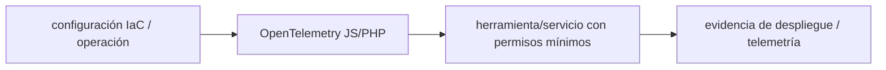

# OpenTelemetry JS/PHP — Vigilio SDK y semantic conventions por compatibilidad

## Qué es, qué hace y cuándo usarla

Estándar e instrumentación de trazas, métricas y contexto distribuido. Usa OTLP y sampling sin exponer datos sensibles ni alta cardinalidad.

**Ubicación en Vigilio:** usa esta dependencia en su stack propietario; otras skills deben enlazar esta guía, no duplicar sus reglas. **Versión:** la indicada en el encabezado es la línea documentada; consultar `technology/versions.md` y el lockfile antes de copiar APIs o aprobar un upgrade.

> **Guía propia de OpenTelemetry JS/PHP (observability).** Estado a **2026-10-25**: SDK y semantic conventions por compatibilidad. Versión del proyecto consumidor = `pnpm-lock.yaml` / `composer.lock` / imagen o manifest. Fuente: [documentación oficial](https://opentelemetry.io/docs/). Fuente normativa transversal de versiones: [versions.md](../versions.md). **No implica instalación automática ni upgrade aprobado.**

## Objetivo, responsabilidad y dónde usar

Trace context W3C, sampling, spans de negocio, exporters OTLP, PII; métricas de baja cardinalidad.

**Uso:** aplicar solo si está declarada y resulta pertinente al consumidor; ver [política de adopción y DRY](README.md).

### Diagrama de integración (Mermaid)



El flujo muestra la **responsabilidad arquitectónica** de la librería; no representa llamadas reales de red para todas las operaciones.


## Instalación o verificación

```bash
elegir SDK/exporter por runtime; revisar versiones
```

**Gate de instalación:** consultar [procedimiento compartido](README.md#protocolo-de-adopción-y-actualización); estos comandos son indicativos, no ejecuciones sobre un consumidor.

## ✅ Correcto — uso actual y ejemplo de referencia

```typescript
// Atributos seguros de operación (no información sensible)
const span = tracer.startSpan('products.listProducts');
try { return await application.listProducts(criteria); }
finally { span.end(); }
```

**Por qué:** Trace context W3C, sampling, spans de negocio, exporters OTLP, PII; métricas de baja cardinalidad.

## ❌ Incorrecto — patrón legacy, inseguro o mal ubicado

```typescript
// ❌ tracing con secrets o datos personales arbitrarios
span.setAttribute('authorization.token', token);
```

**Riesgo:** confundir versiones o responsabilidades y obtener un contrato incorrecto.

## Nuevas capacidades, migración y breaking changes

SDKs y auto-instrumentation evolucionan por separado; no mezclar API stable e instrumentation experimental sin revisar.

Aplicar el [protocolo de migración común](README.md#protocolo-de-adopción-y-actualización), sin asumir que una release nueva está desplegada.

## Buenas prácticas, seguridad, rendimiento y operación

Consultar la [política transversal de librerías](README.md) para seguridad, versionado, evidencia y revisión de contratos. Para esta librería, además, aplicar las verificaciones concretas que se detallan a continuación.

## Gates de aceptación y compatibilidad

Verificar traces end-to-end, idempotent initialization, exports OTLP y latencia p95.

Estado de prueba de estos ejemplos documentales: **NOT_RUN** en aplicaciones consumidoras; ver [criterios de evidencia](README.md#criterios-de-validación).


## Referencias

- [Documentación oficial y migración de OpenTelemetry JS/PHP](https://opentelemetry.io/docs/)
- [Matriz y baseline de versiones](../versions.md)
- [Calidad de código canónica](../../foundations/engineering/code-quality.md)


## Recetario operativo ampliado — opentelemetry (2026-10-25)

### API actual: dos tareas reales que debe saber ejecutar una skill

1. **Instrumentar spans de HTTP/DB y propagar `traceparent` en requests.**
2. **Usar semantic conventions compatibles y exportar traces/métricas según SDK.**

### Migración desde versiones anteriores: decisión concreta

- **Qué cambia o se debe revisar:** OTel JS/PHP 1.x/2.x y semconv evolucionan; no importar paquetes deprecated por blog.

### Responsabilidades y capas

Plataforma observabilidad; negocio solo context/span mediante ports.

**✅ Correcto:** mantener la integración encapsulada, alinear los nombres del negocio con Vigilio y depender de un contrato estable.

**❌ Incorrecto:** importar internals de la librería desde Domain, declarar `any` para resolver un upgrade, o duplicar reglas ya propietarias de otra tecnología.

### Seguridad, resiliencia y rendimiento

- PII y high-cardinality; sampling parent-based, no labels tenant únicos.

### Test de aceptación específico y evidencia mínima

- **Escenario comprobable:** Test context propagation service→DB→worker, sampling y collector unavailable.

### Ejemplo de integración vigente (fragmento adicional)

```typescript
const span = tracer.startSpan('products.listProducts');
try {
  return await productService.listProducts(criteria);
} catch (error) {
  span.recordException(error as Error);
  throw error;
} finally {
  span.end();
}
```

**Nota:** los fragmentos muestran la API específica y requieren imports/providers/fixtures del consumidor; no se certifica compilación por el solo hecho de aparecer aquí.


## Guía operativa detallada — 8 casos y 4 antipatrones

### Ocho ejemplos de la API y casos de uso relevantes

Los fragmentos siguientes ilustran **operaciones independientes**. Variables, imports, provider, extensión y configuración se completan en el proyecto consumidor; **no están certificados como un archivo único compilable**. Cuando hay comentarios `#`, son pasos de integración o configuración y no APIs inventadas.

#### Ejemplo 1. Instrumentar Node

**✅ Correcto — instrumentar node**

```typescript
import { NodeSDK } from '@opentelemetry/sdk-node';
```


#### Ejemplo 2. Iniciar

**✅ Correcto — iniciar**

```typescript
const sdk = new NodeSDK({ traceExporter }); await sdk.start();
```


#### Ejemplo 3. Tracer

**✅ Correcto — tracer**

```typescript
const tracer = trace.getTracer('products');
```


#### Ejemplo 4. Span

**✅ Correcto — span**

```typescript
await tracer.startActiveSpan('products.listProducts', async (span) => { try { return await work(); } finally { span.end(); } });
```


#### Ejemplo 5. Atributo bajo cardinalidad

**✅ Correcto — atributo bajo cardinalidad**

```typescript
span.setAttribute('operation', 'listProducts');
```


#### Ejemplo 6. Propagar contexto

**✅ Correcto — propagar contexto**

```typescript
propagation.inject(context.active(), carrier);
```


#### Ejemplo 7. Errores

**✅ Correcto — errores**

```typescript
span.recordException(error);
```


#### Ejemplo 8. Shutdown

**✅ Correcto — shutdown**

```typescript
await sdk.shutdown();
```


### Cuatro antipatrones frecuentes y su sustitución

#### Antipatrón 1 — riesgo y alternativa

**❌ Incorrecto**

```typescript
span.setAttribute("tenant_id", tenant_id) # metric label sin control
```

**Por qué está mal:** Omite un control operativo necesario, por lo que el comportamiento puede ser inseguro o difícil de verificar.

**✅ Correcto**

```typescript
span.setAttribute("tenant.scope", "authorized")
```

**Por qué mejora:** El patrón «span.setAttribute("tenant.scope", "authorized")» mejora el caso: se fuerza autorización en el borde/servidor y se limita el acceso por recurso.

#### Antipatrón 2 — riesgo y alternativa

**❌ Incorrecto — Olvidarse span.end().**

**Por qué está mal:** Omite un control operativo necesario, por lo que el comportamiento puede ser inseguro o difícil de verificar.

**✅ Correcto — Try/finally span.end().**

**Por qué mejora:** El patrón «Try/finally span.end()» mejora el caso: la observabilidad conserva contexto útil sin usar identificadores sensibles como etiquetas masivas.

#### Antipatrón 3 — riesgo y alternativa

**❌ Incorrecto — Exporter OTLP endpoint público sin TLS.**

**Por qué está mal:** Omite un control operativo necesario, por lo que el comportamiento puede ser inseguro o difícil de verificar.

**✅ Correcto — TLS/autenticación endpoint.**

**Por qué mejora:** El patrón «TLS/autenticación endpoint» mejora el caso: el cambio pasa por gates automáticos y aprobación de riesgos operativos.

#### Antipatrón 4 — riesgo y alternativa

**❌ Incorrecto — Semantic conventions mezcladas versiones.**

**Por qué está mal:** El patrón «Semantic conventions mezcladas versiones» es riesgoso: puede mezclar firmas incompatibles o ejecutar una API retirada en la versión instalada.

**✅ Correcto — Fijar compatible SDK/semconv.**

**Por qué mejora:** El patrón «Fijar compatible SDK/semconv» mejora el caso: se utiliza la API apropiada para el major documentado y se comprueba el lockfile.

### Versión estable, breaking changes y verificación

- **Versión estable exacta:** no se declara un parche universal cuando no hay verificación específica de su registry/release. Consultar el encabezado de esta guía, `technology/versions.md` y el manifiesto del servicio. **Estado de patch: VERIFY_LOCKFILE**.
- **Migración:** identificar major anterior, APIs retiradas/cambiadas, peer dependencies, requisitos de runtime, cambios de tipos, ejecución CI y plan de rollback. Si no hay prueba sobre el consumidor, **NOT_RUN**, no PASS.
- **Versiones previas:** el ejemplo marcado ❌ en esta guía explica al menos una incompatibilidad o un uso obsoleto; no trasplantar APIs de otras versiones.
- **Tests:** probar al menos happy path, error, seguridad/permiso y compatibilidad con el runtime donde aplique; solo activar nuevas capacidades mediante una PR versionada.

### Fuentes oficiales y referencias al final

- [Referencia propia oficial](https://opentelemetry.io/docs/)
- [Matriz canónica de versiones](../versions.md)
- [Política de adopción de librerías](README.md)

## Guía de compatibilidad y evaluación por versión (2026-10-25)

**Estado del patch exacto:** `VERIFY_LOCKFILE`. La guía documenta la familia de APIs; **no se ha verificado hoy el patch estable preciso de esta dependencia**. Consultar la fuente oficial enlazada al inicio y el lockfile antes de generar código o aprobar un upgrade.

### Checklist específico de esta librería

- **Migración/compatibilidad:** OTel JS/PHP 1.x/2.x y semconv evolucionan; no importar paquetes deprecated por blog.
- **Prueba propia:** Test context propagation service→DB→worker, sampling y collector unavailable.
- **Límite de responsabilidad:** usar esta librería solo en su adaptador o capa propietaria; consultar los ejemplos de API y antipatrones anteriores antes de cambiar llamadas públicas.

**Gate de aprobación:** leer la referencia oficial y resolver la versión del consumidor, ejecutar typecheck y pruebas específicas, registrar PASS/FAIL/NOT_RUN/BLOCKED. No confundir esta guía con validación de un consumidor real. [Procedimiento único de adopción](README.md#protocolo-de-adopción-y-actualización).

