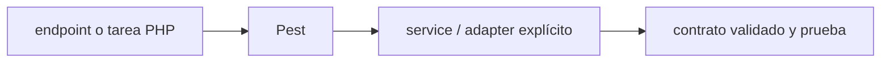

# Pest — Vigilio 5.3.x; requiere PHP 8.4+

## Qué es, qué hace y cuándo usarla

Framework de tests PHP con sintaxis expresiva construido sobre PHPUnit. La compatibilidad con PHP y Laravel debe resolverse antes de elegir major.

**Ubicación en Vigilio:** usa esta dependencia en su stack propietario; otras skills deben enlazar esta guía, no duplicar sus reglas. **Versión:** la indicada en el encabezado es la línea documentada; consultar `technology/versions.md` y el lockfile antes de copiar APIs o aprobar un upgrade.

> **Guía propia de Pest (testing-php).** Estado a **2026-10-25**: 5.3.x; requiere PHP 8.4+. Versión del proyecto consumidor = `pnpm-lock.yaml` / `composer.lock` / imagen o manifest. Fuente: [documentación oficial](https://pestphp.com/docs/installation). Fuente normativa transversal de versiones: [versions.md](../versions.md). **No implica instalación automática ni upgrade aprobado.**

## Objetivo, responsabilidad y dónde usar

Domain unit sin DB, Feature HTTP con PostgreSQL real, integración cache/jobs.

**Uso:** aplicar solo si está declarada y resulta pertinente al consumidor; ver [política de adopción y DRY](README.md).

### Diagrama de integración (Mermaid)



El flujo muestra la **responsabilidad arquitectónica** de la librería; no representa llamadas reales de red para todas las operaciones.


## Instalación o verificación

```bash
composer require pestphp/pest --dev
```

**Gate de instalación:** consultar [procedimiento compartido](README.md#protocolo-de-adopción-y-actualización); estos comandos son indicativos, no ejecuciones sobre un consumidor.

## ✅ Correcto — uso actual y ejemplo de referencia

```php
test('cancela pedido pendiente',function(){
  $order = new OrderEntity(/* fixtures */);
  $order->cancel();
  expect($order->getStatus())->toBe(OrderStatus::Cancelled);
});
```

**Por qué:** Domain unit sin DB, Feature HTTP con PostgreSQL real, integración cache/jobs.

## ❌ Incorrecto — patrón legacy, inseguro o mal ubicado

**Nota técnica (no es código ejecutable):** ❌ afirmar que Pest 5 funciona en PHP 8.3 sin probar constraints.

**Riesgo:** confundir versiones o responsabilidades y obtener un contrato incorrecto.

## Nuevas capacidades, migración y breaking changes

Pest 4→5: PHP >=8.4 y PHPUnit compatibles; revisar plugins y snapshots. El uso exacto de fixtures varía por proyecto.

Aplicar el [protocolo de migración común](README.md#protocolo-de-adopción-y-actualización), sin asumir que una release nueva está desplegada.

## Buenas prácticas, seguridad, rendimiento y operación

Consultar la [política transversal de librerías](README.md) para seguridad, versionado, evidencia y revisión de contratos. Para esta librería, además, aplicar las verificaciones concretas que se detallan a continuación.

## Gates de aceptación y compatibilidad

Composer platform, coverage, factories, authz y paralelización.

Estado de prueba de estos ejemplos documentales: **NOT_RUN** en aplicaciones consumidoras; ver [criterios de evidencia](README.md#criterios-de-validación).


## Referencias

- [Documentación oficial y migración de Pest](https://pestphp.com/docs/installation)
- [Matriz y baseline de versiones](../versions.md)
- [Calidad de código canónica](../../foundations/engineering/code-quality.md)


## Recetario operativo ampliado — pest (2026-10-25)

### API actual: dos tareas reales que debe saber ejecutar una skill

1. **Pest Feature y Unit comparten assertions Laravel, datasets y expectations.**
2. **Evitar dependencias a DB en tests de dominio puros; mock adapter port.**

### Migración desde versiones anteriores: decisión concreta

- **Qué cambia o se debe revisar:** Pest 5 exige PHP >=8.4; lock PHP 8.3 impide upgrade mayor.

### Responsabilidades y capas

Pruebas PHP/Laravel; no mezclar con Vitest JS.

**✅ Correcto:** mantener la integración encapsulada, alinear los nombres del negocio con Vigilio y depender de un contrato estable.

**❌ Incorrecto:** importar internals de la librería desde Domain, declarar `any` para resolver un upgrade, o duplicar reglas ya propietarias de otra tecnología.

### Seguridad, resiliencia y rendimiento

- Tests paralelos no deben compartir estado/DB; fixture determinista.

### Test de aceptación específico y evidencia mínima

- **Escenario comprobable:** Unit, feature 401/403, concurrency, migrations y mutation testing cuando valga.

### Ejemplo de integración vigente (fragmento adicional)

```php
it('impide consultar productos de otro tenant', function () {
    $this->actingAs($this->tenant_a_user)
        ->getJson('/api/products/'.$this->tenant_b_product->id)
        ->assertNotFound();
});
```

**Nota:** los fragmentos muestran la API específica y requieren imports/providers/fixtures del consumidor; no se certifica compilación por el solo hecho de aparecer aquí.


## Guía operativa detallada — 8 casos y 4 antipatrones

### Ocho ejemplos de la API y casos de uso relevantes

Los fragmentos siguientes ilustran **operaciones independientes**. Variables, imports, provider, extensión y configuración se completan en el proyecto consumidor; **no están certificados como un archivo único compilable**. Cuando hay comentarios `#`, son pasos de integración o configuración y no APIs inventadas.

#### Ejemplo 1. Suite

**✅ Correcto — suite**

```php
it('registers product', function () { expect(true)->toBeTrue(); });
```


#### Ejemplo 2. HTTP Feature

**✅ Correcto — http feature**

```php
$this->postJson('/api/products', $payload)->assertCreated();
```


#### Ejemplo 3. Dataset

**✅ Correcto — dataset**

```php
it('rejects status', function ($status) { expect($status)->not->toBe('invalid'); })->with(['pendiente']);
```


#### Ejemplo 4. Mock

**✅ Correcto — mock**

```php
$service = Mockery::mock(ProductService::class);
```


#### Ejemplo 5. Model database

**✅ Correcto — model database**

```php
ProductRecord::factory()->create(['tenant_id' => $tenant_id]);
```


#### Ejemplo 6. Exception

**✅ Correcto — exception**

```php
expect(fn () => $entity->cancel())->toThrow(OrderAlreadyShippedError::class);
```


#### Ejemplo 7. Ejecutar

**✅ Correcto — ejecutar**

```bash
php artisan test
```


#### Ejemplo 8. Cobertura

**✅ Correcto — cobertura**

```bash
php artisan test --coverage
```


### Cuatro antipatrones frecuentes y su sustitución

#### Antipatrón 1 — riesgo y alternativa

**❌ Incorrecto**

```php
it("works", fn ()
```

**Por qué está mal:** El patrón «it("works", fn ()» es riesgoso: la consulta puede producir resultados incorrectos, lentitud o aislamiento insuficiente de datos.

**✅ Correcto**

```php
expect(true)->toBeTrue()) // para probar DB => # aserciones contra comportamiento del endpoint real
```

**Por qué mejora:** El patrón «expect(true)->toBeTrue()) // para probar DB => # aserciones contra comportamiento del endpoint real» mejora el caso: la consulta o el contrato se valida y mide sobre datos representativos.

#### Antipatrón 2 — riesgo y alternativa

**❌ Incorrecto — Tests que dependen del orden.**

**Por qué está mal:** El patrón «Tests que dependen del orden» es riesgoso: la consulta puede producir resultados incorrectos, lentitud o aislamiento insuficiente de datos.

**✅ Correcto — Factories y DB reset por test.**

**Por qué mejora:** Convierte la condición en un control verificable mediante validación o pruebas.

#### Antipatrón 3 — riesgo y alternativa

**❌ Incorrecto — Omitir negative cases.**

**Por qué está mal:** Omite un control operativo necesario, por lo que el comportamiento puede ser inseguro o difícil de verificar.

**✅ Correcto — Probar 401/403/409/422.**

**Por qué mejora:** El patrón «Probar 401/403/409/422» mejora el caso: la alternativa «Probar 401/403/409/422» establece el comportamiento esperado de pest.

#### Antipatrón 4 — riesgo y alternativa

**❌ Incorrecto — Pest5 con PHP8.3.**

**Por qué está mal:** El patrón «Pest5 con PHP8.3» es riesgoso: puede mezclar firmas incompatibles o ejecutar una API retirada en la versión instalada.

**✅ Correcto — Migrar PHP >=8.4 o usar major compatible.**

**Por qué mejora:** El patrón «Migrar PHP >=8.4 o usar major compatible» mejora el caso: se utiliza la API apropiada para el major documentado y se comprueba el lockfile.

### Versión estable, breaking changes y verificación

- **Versión estable exacta:** no se declara un parche universal cuando no hay verificación específica de su registry/release. Consultar el encabezado de esta guía, `technology/versions.md` y el manifiesto del servicio. **Estado de patch: VERIFY_LOCKFILE**.
- **Migración:** identificar major anterior, APIs retiradas/cambiadas, peer dependencies, requisitos de runtime, cambios de tipos, ejecución CI y plan de rollback. Si no hay prueba sobre el consumidor, **NOT_RUN**, no PASS.
- **Versiones previas:** el ejemplo marcado ❌ en esta guía explica al menos una incompatibilidad o un uso obsoleto; no trasplantar APIs de otras versiones.
- **Tests:** probar al menos happy path, error, seguridad/permiso y compatibilidad con el runtime donde aplique; solo activar nuevas capacidades mediante una PR versionada.

### Fuentes oficiales y referencias al final

- [Referencia propia oficial](https://pestphp.com/docs/installation)
- [Matriz canónica de versiones](../versions.md)
- [Política de adopción de librerías](README.md)

## Guía de compatibilidad y evaluación por versión (2026-10-25)

**Estado del patch exacto:** `VERIFY_LOCKFILE`. La guía documenta la familia de APIs; **no se ha verificado hoy el patch estable preciso de esta dependencia**. Consultar la fuente oficial enlazada al inicio y el lockfile antes de generar código o aprobar un upgrade.

### Checklist específico de esta librería

- **Migración/compatibilidad:** Pest 5 exige PHP >=8.4; lock PHP 8.3 impide upgrade mayor.
- **Prueba propia:** Unit, feature 401/403, concurrency, migrations y mutation testing cuando valga.
- **Límite de responsabilidad:** usar esta librería solo en su adaptador o capa propietaria; consultar los ejemplos de API y antipatrones anteriores antes de cambiar llamadas públicas.

**Gate de aprobación:** leer la referencia oficial y resolver la versión del consumidor, ejecutar typecheck y pruebas específicas, registrar PASS/FAIL/NOT_RUN/BLOCKED. No confundir esta guía con validación de un consumidor real. [Procedimiento único de adopción](README.md#protocolo-de-adopción-y-actualización).

