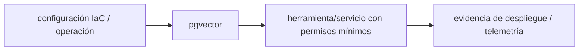

# pgvector — Vigilio 0.8.7 propuesta; verificar extensión realmente instalada

## Qué es, qué hace y cuándo usarla

Extensión PostgreSQL para vectores y búsqueda por similitud. Complementa datos relacionales con índices y filtros de autorización tenant.

**Ubicación en Vigilio:** usa esta dependencia en su stack propietario; otras skills deben enlazar esta guía, no duplicar sus reglas. **Versión:** la indicada en el encabezado es la línea documentada; consultar `technology/versions.md` y el lockfile antes de copiar APIs o aprobar un upgrade.

> **Guía propia de pgvector (data).** Estado a **2026-10-25**: 0.8.7 propuesta; verificar extensión realmente instalada. Versión del proyecto consumidor = `pnpm-lock.yaml` / `composer.lock` / imagen o manifest. Fuente: [documentación oficial](https://github.com/pgvector/pgvector). Fuente normativa transversal de versiones: [versions.md](../versions.md). **No implica instalación automática ni upgrade aprobado.**

## Objetivo, responsabilidad y dónde usar

Filtrar tenant/ACL; metadata externa y modelos versionados; reingesta idempotente.

**Uso:** aplicar solo si está declarada y resulta pertinente al consumidor; ver [política de adopción y DRY](README.md).

### Diagrama de integración (Mermaid)



El flujo muestra la **responsabilidad arquitectónica** de la librería; no representa llamadas reales de red para todas las operaciones.


## Instalación o verificación

```bash
CREATE EXTENSION IF NOT EXISTS vector;
```

**Gate de instalación:** consultar [procedimiento compartido](README.md#protocolo-de-adopción-y-actualización); estos comandos son indicativos, no ejecuciones sobre un consumidor.

## ✅ Correcto — uso actual y ejemplo de referencia

```sql
CREATE EXTENSION IF NOT EXISTS vector;
CREATE TABLE embeddings (id uuid PRIMARY KEY, tenant_id uuid NOT NULL, embedding vector(1536));
-- elegir HNSW tras benchmark y filtros de tenant/ACL
CREATE INDEX ON embeddings USING hnsw (embedding vector_cosine_ops);
```

**Por qué:** Filtrar tenant/ACL; metadata externa y modelos versionados; reingesta idempotente.

## ❌ Incorrecto — patrón legacy, inseguro o mal ubicado

**Nota técnica (no es código ejecutable):** -- ❌ combinar vectores con dimensiones/modelos distintos sin reindexar -- ❌ exponer búsquedas cross-tenant.

**Riesgo:** confundir versiones o responsabilidades y obtener un contrato incorrecto.

## Nuevas capacidades, migración y breaking changes

Cambiar modelo embedding o métrica obliga revisión de dimensiones, normalización e índices. hnsw/ivfflat con tradeoffs distintos.

Aplicar el [protocolo de migración común](README.md#protocolo-de-adopción-y-actualización), sin asumir que una release nueva está desplegada.

## Buenas prácticas, seguridad, rendimiento y operación

Consultar la [política transversal de librerías](README.md) para seguridad, versionado, evidencia y revisión de contratos. Para esta librería, además, aplicar las verificaciones concretas que se detallan a continuación.

## Gates de aceptación y compatibilidad

Recall@k, precisión, latencia, tamaño index, permisos, migraciones y reindexación.

Estado de prueba de estos ejemplos documentales: **NOT_RUN** en aplicaciones consumidoras; ver [criterios de evidencia](README.md#criterios-de-validación).


## Referencias

- [Documentación oficial y migración de pgvector](https://github.com/pgvector/pgvector)
- [Matriz y baseline de versiones](../versions.md)
- [Calidad de código canónica](../../foundations/engineering/code-quality.md)


## Recetario operativo ampliado — pgvector (2026-10-25)

### API actual: dos tareas reales que debe saber ejecutar una skill

1. **Guardar embeddings con dimensión/version/modelo y ACL en SQL.**
2. **Comparar ivfflat vs hnsw con EXPLAIN y filtros tenant antes de elegir índice.**

### Migración desde versiones anteriores: decisión concreta

- **Qué cambia o se debe revisar:** No mezclar dimensiones ni distancia coseno/L2; backfill y reindex por cambio de modelo.

### Responsabilidades y capas

Infra PostgreSQL/RAG; no fuente de autorización de documentos.

**✅ Correcto:** mantener la integración encapsulada, alinear los nombres del negocio con Vigilio y depender de un contrato estable.

**❌ Incorrecto:** importar internals de la librería desde Domain, declarar `any` para resolver un upgrade, o duplicar reglas ya propietarias de otra tecnología.

### Seguridad, resiliencia y rendimiento

- ANN top-K puede omitir resultados filtrados; validar recall/latencia.

### Test de aceptación específico y evidencia mínima

- **Escenario comprobable:** Recall@k, ranking exacto vs ANN y query plan con tenant ACL.

### Ejemplo de integración vigente (fragmento adicional)

```sql
-- Ejemplo SQL: dimensión solo si coincide con modelo de embeddings
SELECT document_id FROM document_embeddings
WHERE tenant_id = $1 AND acl_group_id = ANY($2)
ORDER BY embedding <=> $3 LIMIT 10;
-- Medir recall vs búsqueda exacta antes de añadir HNSW.
```

**Nota:** los fragmentos muestran la API específica y requieren imports/providers/fixtures del consumidor; no se certifica compilación por el solo hecho de aparecer aquí.


## Guía operativa detallada — 8 casos y 4 antipatrones

### Ocho ejemplos de la API y casos de uso relevantes

Los fragmentos siguientes ilustran **operaciones independientes**. Variables, imports, provider, extensión y configuración se completan en el proyecto consumidor; **no están certificados como un archivo único compilable**. Cuando hay comentarios `#`, son pasos de integración o configuración y no APIs inventadas.

#### Ejemplo 1. Extensión

**✅ Correcto — extensión**

```sql
CREATE EXTENSION IF NOT EXISTS vector;
```


#### Ejemplo 2. Tabla

**✅ Correcto — tabla**

```sql
CREATE TABLE documents (id uuid PRIMARY KEY, embedding vector(1536));
```


#### Ejemplo 3. Insert

**✅ Correcto — insert**

```sql
INSERT INTO documents (id, embedding) VALUES ($1, $2::vector);
```


#### Ejemplo 4. Coseno

**✅ Correcto — coseno**

```sql
SELECT id FROM documents ORDER BY embedding <=> $1::vector LIMIT 10;
```


#### Ejemplo 5. L2

**✅ Correcto — l2**

```sql
SELECT id FROM documents ORDER BY embedding <-> $1::vector LIMIT 10;
```


#### Ejemplo 6. HNSW

**✅ Correcto — hnsw**

```sql
CREATE INDEX documents_embedding_hnsw ON documents USING hnsw (embedding vector_cosine_ops);
```


#### Ejemplo 7. Filtro ACL

**✅ Correcto — filtro acl**

```sql
SELECT id FROM documents WHERE tenant_id = $1 ORDER BY embedding <=> $2 LIMIT 10;
```


#### Ejemplo 8. Explain

**✅ Correcto — explain**

```sql
EXPLAIN (ANALYZE, BUFFERS) SELECT id FROM documents ORDER BY embedding <=> $1::vector LIMIT 10;
```


### Cuatro antipatrones frecuentes y su sustitución

#### Antipatrón 1 — riesgo y alternativa

**❌ Incorrecto**

```sql
ORDER BY embedding <-> $1 # si se eligió cosine_ops
```

**Por qué está mal:** El patrón «ORDER BY embedding <-> $1 # si se eligió cosine_ops» es riesgoso: la elección «ORDER BY embedding <-> $1 # si se eligió cosine_ops» puede incumplir los requisitos operativos de pgvector.

**✅ Correcto**

```sql
ORDER BY embedding <=> $1
```

**Por qué mejora:** El patrón «ORDER BY embedding <=> $1» mejora el caso: la alternativa «ORDER BY embedding <=> $1» establece el comportamiento esperado de pgvector.

#### Antipatrón 2 — riesgo y alternativa

**❌ Incorrecto — No filtrar tenant.**

**Por qué está mal:** El patrón «No filtrar tenant» es riesgoso: puede permitir acceso a recursos no autorizados o de otro tenant.

**✅ Correcto**

```sql
WHERE tenant_id = $1 ORDER BY embedding <=> $2
```

**Por qué mejora:** El patrón «WHERE tenant_id = $1 ORDER BY embedding <=> $2» mejora el caso: se fuerza autorización en el borde/servidor y se limita el acceso por recurso.

#### Antipatrón 3 — riesgo y alternativa

**❌ Incorrecto — Cambiar modelo sin regenerar embeddings.**

**Por qué está mal:** Omite un control operativo necesario, por lo que el comportamiento puede ser inseguro o difícil de verificar.

**✅ Correcto — Versionar model_id y dimension.**

**Por qué mejora:** El patrón «Versionar model_id y dimension» mejora el caso: se utiliza la API apropiada para el major documentado y se comprueba el lockfile.

#### Antipatrón 4 — riesgo y alternativa

**❌ Incorrecto — Índice HNSW sin medir recall.**

**Por qué está mal:** Omite un control operativo necesario, por lo que el comportamiento puede ser inseguro o difícil de verificar.

**✅ Correcto — Comparar recall/latencia bajo filtros reales.**

**Por qué mejora:** El patrón «Comparar recall/latencia bajo filtros reales» mejora el caso: el cambio pasa por gates automáticos y aprobación de riesgos operativos.

### Versión estable, breaking changes y verificación

- **Versión estable exacta:** no se declara un parche universal cuando no hay verificación específica de su registry/release. Consultar el encabezado de esta guía, `technology/versions.md` y el manifiesto del servicio. **Estado de patch: VERIFY_LOCKFILE**.
- **Migración:** identificar major anterior, APIs retiradas/cambiadas, peer dependencies, requisitos de runtime, cambios de tipos, ejecución CI y plan de rollback. Si no hay prueba sobre el consumidor, **NOT_RUN**, no PASS.
- **Versiones previas:** el ejemplo marcado ❌ en esta guía explica al menos una incompatibilidad o un uso obsoleto; no trasplantar APIs de otras versiones.
- **Tests:** probar al menos happy path, error, seguridad/permiso y compatibilidad con el runtime donde aplique; solo activar nuevas capacidades mediante una PR versionada.

### Fuentes oficiales y referencias al final

- [Referencia propia oficial](https://github.com/pgvector/pgvector)
- [Matriz canónica de versiones](../versions.md)
- [Política de adopción de librerías](README.md)

## Guía de compatibilidad y evaluación por versión (2026-10-25)

**Estado del patch exacto:** `VERIFY_LOCKFILE`. La guía documenta la familia de APIs; **no se ha verificado hoy el patch estable preciso de esta dependencia**. Consultar la fuente oficial enlazada al inicio y el lockfile antes de generar código o aprobar un upgrade.

### Checklist específico de esta librería

- **Migración/compatibilidad:** No mezclar dimensiones ni distancia coseno/L2; backfill y reindex por cambio de modelo.
- **Prueba propia:** Recall@k, ranking exacto vs ANN y query plan con tenant ACL.
- **Límite de responsabilidad:** usar esta librería solo en su adaptador o capa propietaria; consultar los ejemplos de API y antipatrones anteriores antes de cambiar llamadas públicas.

**Gate de aprobación:** leer la referencia oficial y resolver la versión del consumidor, ejecutar typecheck y pruebas específicas, registrar PASS/FAIL/NOT_RUN/BLOCKED. No confundir esta guía con validación de un consumidor real. [Procedimiento único de adopción](README.md#protocolo-de-adopción-y-actualización).

## Integración IA/RAG moderna — 2026

Para el SQL de recuperación FTS + vector con fusión RRF, ACL y benchmarks, seguir el [estándar propietario](../../standards/ai/hybrid-rag-postgresql.md); esta guía se limita a operaciones propias de pgvector.

✅ **Correcto:** revisar API instalada/digest, seguridad y datos del consumidor. ❌ **Incorrecto:** copiar endpoint legacy o presentar pruebas documentales como compilación real.
