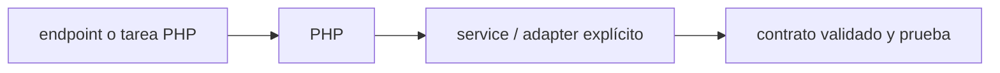

# PHP — Vigilio 8.5.12 (recomendado seguridad) / 8.4.27 (alternativa soportada)

## Qué es, qué hace y cuándo usarla

Lenguaje utilizado en Laravel y servicios PHP. Su código debe usar tipos, enums, excepciones y análisis estático sin depender de funciones obsoletas.

**Ubicación en Vigilio:** usa esta dependencia en su stack propietario; otras skills deben enlazar esta guía, no duplicar sus reglas. **Versión:** la indicada en el encabezado es la línea documentada; consultar `technology/versions.md` y el lockfile antes de copiar APIs o aprobar un upgrade.

> **Guía propia de PHP (backend-php).** Estado a **2026-11-01**: 8.5.12 (recomendado seguridad) / 8.4.27 (alternativa soportada). Versión del proyecto consumidor = `pnpm-lock.yaml` / `composer.lock` / imagen o manifest. Fuente: [documentación oficial](https://www.php.net/manual/en/). Fuente normativa transversal de versiones: [versions.md](../versions.md). **No implica instalación automática ni upgrade aprobado.**

## Objetivo, responsabilidad y dónde usar

strict_types, readonly, enums, exceptions, DateTimeImmutable, dinero decimal/enteros, prepared statements. No mezclar Domain con Eloquent.

**Uso:** aplicar solo si está declarada y resulta pertinente al consumidor; ver [política de adopción y DRY](README.md).

### Diagrama de integración (Mermaid)



El flujo muestra la **responsabilidad arquitectónica** de la librería; no representa llamadas reales de red para todas las operaciones.


## Instalación o verificación

```bash
composer check-platform-reqs; php -v
```

**Gate de instalación:** consultar [procedimiento compartido](README.md#protocolo-de-adopción-y-actualización); estos comandos son indicativos, no ejecuciones sobre un consumidor.

## ✅ Correcto — uso actual y ejemplo de referencia

```php
<?php
declare(strict_types=1);
enum ProductStatus: string { case Pendiente='pendiente'; case Anulado='anulado'; }
final readonly class ProductInput { public function __construct(public string $nro_poliza) {} }
function calculatePremium(int $amount_cents): int { return intdiv($amount_cents * 118, 100); }
```

**Por qué:** strict_types, readonly, enums, exceptions, DateTimeImmutable, dinero decimal/enteros, prepared statements. No mezclar Domain con Eloquent.

## ❌ Incorrecto — patrón legacy, inseguro o mal ubicado

```php
<?php
// ❌ código dinámico difícil de analizar o inseguro
$price = $_GET['price']; eval($price);
$money = (float) $_POST['amount'];
```

**Riesgo:** confundir versiones o responsabilidades y obtener un contrato incorrecto.

## Nuevas capacidades, migración y breaking changes

8.3→8.4→8.5: revisar notas oficiales deprecations, cambios de tipos/reflexión, drivers/extensions y Composer platform. No indicar que algo se eliminó sin fuente de versión.

Aplicar el [protocolo de migración común](README.md#protocolo-de-adopción-y-actualización), sin asumir que una release nueva está desplegada.

## Buenas prácticas, seguridad, rendimiento y operación

Consultar la [política transversal de librerías](README.md) para seguridad, versionado, evidencia y revisión de contratos. Para esta librería, además, aplicar las verificaciones concretas que se detallan a continuación.

## Gates de aceptación y compatibilidad

composer audit/check-platform-reqs, Pint, PHPStan/Larastan, Pest y pruebas de integridad con Postgres.

Estado de prueba de estos ejemplos documentales: **NOT_RUN** en aplicaciones consumidoras; ver [criterios de evidencia](README.md#criterios-de-validación).


## Referencias

- [Documentación oficial y migración de PHP](https://www.php.net/manual/en/)
- [Matriz y baseline de versiones](../versions.md)
- [Calidad de código canónica](../../foundations/engineering/code-quality.md)


## Recetario operativo ampliado — php (2026-10-25)

### API actual: dos tareas reales que debe saber ejecutar una skill

1. **Preferir `declare(strict_types=1)`, enums backed, readonly y excepciones tipadas.**
2. **Tipos explícitos, no arrays mágicos para DTOs, parametrización SQL, nunca eval.**

### Migración desde versiones anteriores: decisión concreta

- **Qué cambia o se debe revisar:** PHP 8.3/8.4/8.5 cambian syntax/features; validar extensions y composer lock.

### Responsabilidades y capas

Lenguaje PHP, no duplicar tutorial Laravel ni pipeline.

**✅ Correcto:** mantener la integración encapsulada, alinear los nombres del negocio con Vigilio y depender de un contrato estable.

**❌ Incorrecto:** importar internals de la librería desde Domain, declarar `any` para resolver un upgrade, o duplicar reglas ya propietarias de otra tecnología.

### Seguridad, resiliencia y rendimiento

- `unserialize` de entrada no fiable y coerciones, SSRF en HTTP.

### Test de aceptación específico y evidencia mínima

- **Escenario comprobable:** PHPStan/Larastan, Pest/PHPUnit, Pint y seguridad dependencies.

### Ejemplo de integración vigente (fragmento adicional)

```php
declare(strict_types=1);
enum ProductStatus: string { case Pendiente = 'pendiente'; case Procesado = 'procesado'; }
final readonly class ProductCriteria {
    public function __construct(public string $tenant_id, public int $limit) {}
}
// No usar eval(), dynamic properties o strings mágicas para estados.
```

**Nota:** los fragmentos muestran la API específica y requieren imports/providers/fixtures del consumidor; no se certifica compilación por el solo hecho de aparecer aquí.


## Guía operativa detallada — 8 casos y 4 antipatrones

### Ocho ejemplos de la API y casos de uso relevantes

Los fragmentos siguientes ilustran **operaciones independientes**. Variables, imports, provider, extensión y configuración se completan en el proyecto consumidor; **no están certificados como un archivo único compilable**. Cuando hay comentarios `#`, son pasos de integración o configuración y no APIs inventadas.

#### Ejemplo 1. Strict types

**✅ Correcto — strict types**

```php
declare(strict_types=1);
```


#### Ejemplo 2. Enum

**✅ Correcto — enum**

```php
enum ProductStatus: string { case Pending = 'pendiente'; }
```


#### Ejemplo 3. Readonly

**✅ Correcto — readonly**

```php
final readonly class ProductId { public function __construct(public string $value) {} }
```


#### Ejemplo 4. Nullsafe

**✅ Correcto — nullsafe**

```php
$name = $user?->profile?->name;
```


#### Ejemplo 5. Match

**✅ Correcto — match**

```php
$label = match ($status) { ProductStatus::Pending => 'En cola' };
```


#### Ejemplo 6. Named args

**✅ Correcto — named args**

```php
$service->getProduct(product_id: $product_id);
```


#### Ejemplo 7. Exceptions

**✅ Correcto — exceptions**

```php
throw new DomainException('Transición inválida');
```


#### Ejemplo 8. PHPStan

**✅ Correcto — phpstan**

```bash
vendor/bin/phpstan analyse --memory-limit=1G
```


### Cuatro antipatrones frecuentes y su sustitución

#### Antipatrón 1 — riesgo y alternativa

**❌ Incorrecto**

```php
$status = "pending"; // por toda la aplicación
```

**Por qué está mal:** El patrón «$status = "pending"; // por toda la aplicación» es riesgoso: puede publicar cambios sin evidencia suficiente ni una revisión del impacto.

**✅ Correcto**

```php
enum ProductStatus: string { case Pending = "pending"; }
```

**Por qué mejora:** El patrón «enum ProductStatus: string { case Pending = "pending"; }» mejora el caso: el cambio pasa por gates automáticos y aprobación de riesgos operativos.

#### Antipatrón 2 — riesgo y alternativa

**❌ Incorrecto**

```php
function fetch($id) { return $db->query("SELECT...$id"); }
```

**Por qué está mal:** El patrón «function fetch($id) { return $db->query("SELECT...$id"); }» es riesgoso: puede exponer datos obsoletos o mezclar estados de usuarios, sesiones y consultas diferentes.

**✅ Correcto — Consultas SQL con bindings/prepared statements.**

**Por qué mejora:** El patrón «Consultas SQL con bindings/prepared statements» mejora el caso: el estado se identifica e invalida con criterios explícitos y verificables.

#### Antipatrón 3 — riesgo y alternativa

**❌ Incorrecto**

```php
catch (Exception $e) { }
```

**Por qué está mal:** El patrón «catch (Exception $e) { }» es riesgoso: la elección «catch (Exception $e) { }» puede incumplir los requisitos operativos de php.

**✅ Correcto**

```php
catch (DomainException $error) { throw $error; }
```

**Por qué mejora:** El patrón «catch (DomainException $error) { throw $error; }» mejora el caso: la alternativa «catch (DomainException $error) { throw $error; }» establece el comportamiento esperado de php.

#### Antipatrón 4 — riesgo y alternativa

**❌ Incorrecto — Type mixed everywhere.**

**Por qué está mal:** El patrón «Type mixed everywhere» es riesgoso: puede aceptar entradas inválidas o duplicar contratos difíciles de mantener.

**✅ Correcto — Typed params/return y PHPStan.**

**Por qué mejora:** El patrón «Typed params/return y PHPStan» mejora el caso: el contrato queda tipado y validado en el borde que recibe datos externos.

### Versión estable, breaking changes y verificación

- **Versión estable exacta:** no se declara un parche universal cuando no hay verificación específica de su registry/release. Consultar el encabezado de esta guía, `technology/versions.md` y el manifiesto del servicio. **Estado de patch: VERIFY_LOCKFILE**.
- **Migración:** identificar major anterior, APIs retiradas/cambiadas, peer dependencies, requisitos de runtime, cambios de tipos, ejecución CI y plan de rollback. Si no hay prueba sobre el consumidor, **NOT_RUN**, no PASS.
- **Versiones previas:** el ejemplo marcado ❌ en esta guía explica al menos una incompatibilidad o un uso obsoleto; no trasplantar APIs de otras versiones.
- **Tests:** probar al menos happy path, error, seguridad/permiso y compatibilidad con el runtime donde aplique; solo activar nuevas capacidades mediante una PR versionada.

### Fuentes oficiales y referencias al final

- [Referencia propia oficial](https://www.php.net/manual/en/)
- [Matriz canónica de versiones](../versions.md)
- [Política de adopción de librerías](README.md)

## Guía de compatibilidad y evaluación por versión (2026-10-25)

**Release contrastada para esta familia:** `PHP 8.5.12`. Fuente: [publicación oficial](https://www.php.net/downloads.php). **Cambio clave:** php 8.4.27 como alternativa; extensiones/composer/phpstan deben ser compatibles.

### Checklist específico de esta librería

- `declare(strict_types=1)` y backed enums/readonly para conceptos estables; no DTOs que mezclen Eloquent y Domain.
- Usar métodos `camelCase`, variables PHP en `snake_case` por convención Vigilio, tipos PascalCase.
- Evitar consultas N+1 y masa de modelos Eloquent para cargas grandes; streams/chunks, benchmarks y claves compuestas.

**Gate de aprobación:** leer la referencia oficial y resolver la versión del consumidor, ejecutar typecheck y pruebas específicas, registrar PASS/FAIL/NOT_RUN/BLOCKED. No confundir esta guía con validación de un consumidor real. [Procedimiento único de adopción](README.md#protocolo-de-adopción-y-actualización).

## Contratos PHP actuales y tipos de dominio

```php
<?php
declare(strict_types=1);

enum OrderStatus: string { case Pending = 'pending'; case Cancelled = 'cancelled'; case Shipped = 'shipped'; }

final class OrderEntity
{
    public function __construct(public readonly string $id, private OrderStatus $status) {}

    public function cancel(): void
    {
        if ($this->status === OrderStatus::Cancelled) return; // Solo si negocio aprueba idempotencia.
        if ($this->status === OrderStatus::Shipped) throw new DomainException('Order already shipped');
        $this->status = OrderStatus::Cancelled;
    }
}
```

✅ Correcto: backed enum, tipado y regla en agregado. ❌ Incorrecto: arrays sin contrato, strings mágicos de estado por Controller, Eloquent en Domain, `mixed` indiscriminado para evadir PHPStan. [PHP 8.5](https://www.php.net/releases/8.5/en.php).
