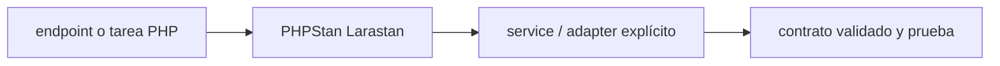

# PHPStan + Larastan — Vigilio línea compatible PHP 8.4/8.5 y Laravel 13

## Qué es, qué hace y cuándo usarla

Análisis estático para PHP/Laravel. Detecta errores de tipos y acceso a APIs antes de runtime; necesita nivel y baseline controlados.

**Ubicación en Vigilio:** usa esta dependencia en su stack propietario; otras skills deben enlazar esta guía, no duplicar sus reglas. **Versión:** la indicada en el encabezado es la línea documentada; consultar `technology/versions.md` y el lockfile antes de copiar APIs o aprobar un upgrade.

> **Guía propia de PHPStan + Larastan (testing-php).** Estado a **2026-10-25**: línea compatible PHP 8.4/8.5 y Laravel 13. Versión del proyecto consumidor = `pnpm-lock.yaml` / `composer.lock` / imagen o manifest. Fuente: [documentación oficial](https://github.com/larastan/larastan). Fuente normativa transversal de versiones: [versions.md](../versions.md). **No implica instalación automática ni upgrade aprobado.**

## Objetivo, responsabilidad y dónde usar

Revisar niveles por riesgo, baseline de deuda con owner/fecha, PHPDoc genéricos.

**Uso:** aplicar solo si está declarada y resulta pertinente al consumidor; ver [política de adopción y DRY](README.md).

### Diagrama de integración (Mermaid)



El flujo muestra la **responsabilidad arquitectónica** de la librería; no representa llamadas reales de red para todas las operaciones.


## Instalación o verificación

```bash
composer require --dev "phpstan/phpstan:^2.0" "larastan/larastan:^3.13"
```

**Gate de instalación:** consultar [procedimiento compartido](README.md#protocolo-de-adopción-y-actualización); estos comandos son indicativos, no ejecuciones sobre un consumidor.

## ✅ Correcto — uso actual y ejemplo de referencia

```php
// phpstan.neon
includes:
  - vendor/larastan/larastan/extension.neon
parameters:
  level: 8
  paths: [app]
```

**Por qué:** Revisar niveles por riesgo, baseline de deuda con owner/fecha, PHPDoc genéricos.

## ❌ Incorrecto — patrón legacy, inseguro o mal ubicado

**Nota técnica (no es código ejecutable):** ❌ @phpstan-ignore-next-line sin justificación ni issue ❌ suponer tipos implícitos equivalen a tipos comprobados.

**Riesgo:** confundir versiones o responsabilidades y obtener un contrato incorrecto.

## Nuevas capacidades, migración y breaking changes

Larastan 2.x quedó obsoleto para Laravel 13; se exige Larastan 3.x (^3.13.2) junto a PHPStan 2.x. Compat de Larastan depende de Laravel/Illuminate y PHPStan; migrar extension.neon si cambia.

Aplicar el [protocolo de migración común](README.md#protocolo-de-adopción-y-actualización), sin asumir que una release nueva está desplegada.

## Buenas prácticas, seguridad, rendimiento y operación

Consultar la [política transversal de librerías](README.md) para seguridad, versionado, evidencia y revisión de contratos. Para esta librería, además, aplicar las verificaciones concretas que se detallan a continuación.

## Gates de aceptación y compatibilidad

Gate analyse, baseline sin regresiones, tipos de Eloquent, response DTO.

Estado de prueba de estos ejemplos documentales: **NOT_RUN** en aplicaciones consumidoras; ver [criterios de evidencia](README.md#criterios-de-validación).


## Referencias

- [Documentación oficial y migración de PHPStan + Larastan](https://github.com/larastan/larastan)
- [Matriz y baseline de versiones](../versions.md)
- [Calidad de código canónica](../../foundations/engineering/code-quality.md)


## Recetario operativo ampliado — phpstan-larastan (2026-10-25)

### API actual: dos tareas reales que debe saber ejecutar una skill

1. **Configurar level y baseline temporal explícita por deuda heredada.**
2. **Aumentar strictness por módulos, generics PHPDoc en collections/DTO arrays.**

### Migración desde versiones anteriores: decisión concreta

- **Qué cambia o se debe revisar:** Larastan compatible con Laravel/PHP/Type aliases; no copiar config mayor distinta.

### Responsabilidades y capas

Análisis estático, no validador runtime ni test.

**✅ Correcto:** mantener la integración encapsulada, alinear los nombres del negocio con Vigilio y depender de un contrato estable.

**❌ Incorrecto:** importar internals de la librería desde Domain, declarar `any` para resolver un upgrade, o duplicar reglas ya propietarias de otra tecnología.

### Seguridad, resiliencia y rendimiento

- Baseline infinito oculta issues; limitar nuevos errores a 0.

### Test de aceptación específico y evidencia mínima

- **Escenario comprobable:** `vendor/bin/phpstan analyse` y revisar diff de baseline.


## Guía operativa detallada — 8 casos y 4 antipatrones

### Ocho ejemplos de la API y casos de uso relevantes

Los fragmentos siguientes ilustran **operaciones independientes**. Variables, imports, provider, extensión y configuración se completan en el proyecto consumidor; **no están certificados como un archivo único compilable**. Cuando hay comentarios `#`, son pasos de integración o configuración y no APIs inventadas.

#### Ejemplo 1. PHPStan

**✅ Correcto — phpstan**

```bash
vendor/bin/phpstan analyse
```


#### Ejemplo 2. Config

**✅ Correcto — config**

**Nota técnica (no es código ejecutable):** Phpstan.neon: includes: [vendor/larastan/larastan/extension.neon].


#### Ejemplo 3. Nivel estricto

**✅ Correcto — nivel estricto**

**Nota técnica (no es código ejecutable):** Phpstan.neon: parameters: { level: max }.


#### Ejemplo 4. Escaneo módulo

**✅ Correcto — escaneo módulo**

```bash
vendor/bin/phpstan analyse app/Products
```


#### Ejemplo 5. Baseline

**✅ Correcto — baseline**

```bash
vendor/bin/phpstan analyse --generate-baseline
```


#### Ejemplo 6. CI

**✅ Correcto — ci**

```bash
vendor/bin/phpstan analyse --no-progress
```


#### Ejemplo 7. Stubs

**✅ Correcto — stubs**

**Nota técnica (no es código ejecutable):** Añadir stubFiles para APIs dinámicas verificadas.


#### Ejemplo 8. Suppress local

**✅ Correcto — suppress local**

**Nota técnica (no es código ejecutable):** Phpstan-ignore-next-line con justificación y issue link.


### Cuatro antipatrones frecuentes y su sustitución

#### Antipatrón 1 — riesgo y alternativa

**❌ Incorrecto — Ignorar todo app/**.**

**Por qué está mal:** El patrón «Ignorar todo app/» es riesgoso: puede publicar cambios sin evidencia suficiente ni una revisión del impacto.

**✅ Correcto — Baseline acotado y reducción programada.**

**Por qué mejora:** El patrón «Baseline acotado y reducción programada» mejora el caso: el cambio pasa por gates automáticos y aprobación de riesgos operativos.

#### Antipatrón 2 — riesgo y alternativa

**❌ Incorrecto — Generar baseline y no revisarlo.**

**Por qué está mal:** El patrón «Generar baseline y no revisarlo» es riesgoso: la elección «Generar baseline y no revisarlo» puede incumplir los requisitos operativos de phpstan-larastan.

**✅ Correcto — Auditar suppressions en PR.**

**Por qué mejora:** El patrón «Auditar suppressions en PR» mejora el caso: la alternativa «Auditar suppressions en PR» establece el comportamiento esperado de phpstan-larastan.

#### Antipatrón 3 — riesgo y alternativa

**❌ Incorrecto — Omitir tipos en Data/Collections.**

**Por qué está mal:** Omite un control operativo necesario, por lo que el comportamiento puede ser inseguro o difícil de verificar.

**✅ Correcto — PHPDoc generics / typed readonly DTO.**

**Por qué mejora:** El patrón «PHPDoc generics / typed readonly DTO» mejora el caso: el contrato queda tipado y validado en el borde que recibe datos externos.

#### Antipatrón 4 — riesgo y alternativa

**❌ Incorrecto — Usar phpstan como tests runtime.**

**Por qué está mal:** El patrón «Usar phpstan como tests runtime» es riesgoso: la implementación puede fallar sin que el flujo crítico o la accesibilidad lo detecte.

**✅ Correcto**

```bash
php artisan test
```

**Por qué mejora:** Convierte la condición en un control verificable mediante validación o pruebas.

### Versión estable, breaking changes y verificación

- **Versión estable exacta:** no se declara un parche universal cuando no hay verificación específica de su registry/release. Consultar el encabezado de esta guía, `technology/versions.md` y el manifiesto del servicio. **Estado de patch: VERIFY_LOCKFILE**.
- **Migración:** identificar major anterior, APIs retiradas/cambiadas, peer dependencies, requisitos de runtime, cambios de tipos, ejecución CI y plan de rollback. Si no hay prueba sobre el consumidor, **NOT_RUN**, no PASS.
- **Versiones previas:** el ejemplo marcado ❌ en esta guía explica al menos una incompatibilidad o un uso obsoleto; no trasplantar APIs de otras versiones.
- **Tests:** probar al menos happy path, error, seguridad/permiso y compatibilidad con el runtime donde aplique; solo activar nuevas capacidades mediante una PR versionada.

### Fuentes oficiales y referencias al final

- [Referencia propia oficial](https://github.com/larastan/larastan)
- [Matriz canónica de versiones](../versions.md)
- [Política de adopción de librerías](README.md)

## Guía de compatibilidad y evaluación por versión (2026-10-25)

**Estado del patch exacto:** `VERIFY_LOCKFILE`. La guía documenta la familia de APIs; **no se ha verificado hoy el patch estable preciso de esta dependencia**. Consultar la fuente oficial enlazada al inicio y el lockfile antes de generar código o aprobar un upgrade.

### Checklist específico de esta librería

- **Migración/compatibilidad:** Larastan compatible con Laravel/PHP/Type aliases; no copiar config mayor distinta.
- **Prueba propia:** `vendor/bin/phpstan analyse` y revisar diff de baseline.
- **Límite de responsabilidad:** usar esta librería solo en su adaptador o capa propietaria; consultar los ejemplos de API y antipatrones anteriores antes de cambiar llamadas públicas.

**Gate de aprobación:** leer la referencia oficial y resolver la versión del consumidor, ejecutar typecheck y pruebas específicas, registrar PASS/FAIL/NOT_RUN/BLOCKED. No confundir esta guía con validación de un consumidor real. [Procedimiento único de adopción](README.md#protocolo-de-adopción-y-actualización).

