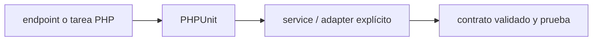

# PHPUnit — Vigilio rama resuelta por Laravel/Pest/PHP

## Qué es, qué hace y cuándo usarla

Framework de pruebas unitarias/integración PHP. Aisla fixtures y verifica errores, autorización y transacciones de forma reproducible.

**Ubicación en Vigilio:** usa esta dependencia en su stack propietario; otras skills deben enlazar esta guía, no duplicar sus reglas. **Versión:** la indicada en el encabezado es la línea documentada; consultar `technology/versions.md` y el lockfile antes de copiar APIs o aprobar un upgrade.

> **Guía propia de PHPUnit (testing-php).** Estado a **2026-10-25**: rama resuelta por Laravel/Pest/PHP. Versión del proyecto consumidor = `pnpm-lock.yaml` / `composer.lock` / imagen o manifest. Fuente: [documentación oficial](https://docs.phpunit.de/). Fuente normativa transversal de versiones: [versions.md](../versions.md). **No implica instalación automática ni upgrade aprobado.**

## Objetivo, responsabilidad y dónde usar

Pruebas verifican comportamiento; evitar mocks en el objeto bajo prueba.

**Uso:** aplicar solo si está declarada y resulta pertinente al consumidor; ver [política de adopción y DRY](README.md).

### Diagrama de integración (Mermaid)



El flujo muestra la **responsabilidad arquitectónica** de la librería; no representa llamadas reales de red para todas las operaciones.


## Instalación o verificación

```bash
composer require --dev phpunit/phpunit
```

**Gate de instalación:** consultar [procedimiento compartido](README.md#protocolo-de-adopción-y-actualización); estos comandos son indicativos, no ejecuciones sobre un consumidor.

## ✅ Correcto — uso actual y ejemplo de referencia

**Nota técnica (no es código ejecutable):** Vendor/bin/phpunit --testsuite Unit Configurar suites Unit/Feature y DB con aislamiento.

**Por qué:** Pruebas verifican comportamiento; evitar mocks en el objeto bajo prueba.

## ❌ Incorrecto — patrón legacy, inseguro o mal ubicado

**Nota técnica (no es código ejecutable):** ❌ dependencias fijas incompatibles con Pest/framework.

**Riesgo:** confundir versiones o responsabilidades y obtener un contrato incorrecto.

## Nuevas capacidades, migración y breaking changes

PHPUnit 11 culminó soporte estándar en febrero de 2026. Para Laravel 13 y PHP 8.4/8.5 se usa PHPUnit 12.x / 13.x (gestionado vía Pest 5). Ciertos major PHPUnit cambian atributos y deprecations; no mezclar annotations antiguas sin versión.

Aplicar el [protocolo de migración común](README.md#protocolo-de-adopción-y-actualización), sin asumir que una release nueva está desplegada.

## Buenas prácticas, seguridad, rendimiento y operación

Consultar la [política transversal de librerías](README.md) para seguridad, versionado, evidencia y revisión de contratos. Para esta librería, además, aplicar las verificaciones concretas que se detallan a continuación.

## Gates de aceptación y compatibilidad

suite unit/integration, composer.lock y php extension xdebug/pcov.

Estado de prueba de estos ejemplos documentales: **NOT_RUN** en aplicaciones consumidoras; ver [criterios de evidencia](README.md#criterios-de-validación).


## Referencias

- [Documentación oficial y migración de PHPUnit](https://docs.phpunit.de/)
- [Matriz y baseline de versiones](../versions.md)
- [Calidad de código canónica](../../foundations/engineering/code-quality.md)


## Recetario operativo ampliado — phpunit (2026-10-25)

### API actual: dos tareas reales que debe saber ejecutar una skill

1. **Tests independientes, data providers y mocks solo en bordes definidos.**
2. **Database tests con fixtures, cobertura y timeouts reales; evita tests frágiles.**

### Migración desde versiones anteriores: decisión concreta

- **Qué cambia o se debe revisar:** PHPUnit 10/11/12/13 tienen cambios API; pin compatible con PHP/Framework.

### Responsabilidades y capas

Runner PHP; no produce contratos HTTP.

**✅ Correcto:** mantener la integración encapsulada, alinear los nombres del negocio con Vigilio y depender de un contrato estable.

**❌ Incorrecto:** importar internals de la librería desde Domain, declarar `any` para resolver un upgrade, o duplicar reglas ya propietarias de otra tecnología.

### Seguridad, resiliencia y rendimiento

- Aserciones contra implementación privada son frágiles; test de efectos públicos.

### Test de aceptación específico y evidencia mínima

- **Escenario comprobable:** Unit, HTTP integration, transaction isolation, mutation gate cuando aporte.


## Guía operativa detallada — 8 casos y 4 antipatrones

### Ocho ejemplos de la API y casos de uso relevantes

Los fragmentos siguientes ilustran **operaciones independientes**. Variables, imports, provider, extensión y configuración se completan en el proyecto consumidor; **no están certificados como un archivo único compilable**. Cuando hay comentarios `#`, son pasos de integración o configuración y no APIs inventadas.

#### Ejemplo 1. Suite

**✅ Correcto — suite**

```php
final class ProductTest extends TestCase {}
```


#### Ejemplo 2. Aserción

**✅ Correcto — aserción**

```php
self::assertSame('pendiente', $product->getStatus()->value);
```


#### Ejemplo 3. Excepción

**✅ Correcto — excepción**

```php
$this->expectException(ProductAlreadyProcessedError::class);
```


#### Ejemplo 4. Data provider

**✅ Correcto — data provider**

**Nota técnica (no es código ejecutable):** [DataProvider('invalidStatuses')].


#### Ejemplo 5. Mock interface

**✅ Correcto — mock interface**

```php
$repository = $this->createMock(ProductRepository::class);
```


#### Ejemplo 6. Ejecutar

**✅ Correcto — ejecutar**

```bash
vendor/bin/phpunit
```


#### Ejemplo 7. Filtrar

**✅ Correcto — filtrar**

```bash
vendor/bin/phpunit --filter ProductTest
```


#### Ejemplo 8. Cobertura

**✅ Correcto — cobertura**

```bash
vendor/bin/phpunit --coverage-text
```


### Cuatro antipatrones frecuentes y su sustitución

#### Antipatrón 1 — riesgo y alternativa

**❌ Incorrecto**

```php
$this->assertTrue(true) # test vacío
```

**Por qué está mal:** El patrón «$this->assertTrue(true) # test vacío» es riesgoso: la implementación puede fallar sin que el flujo crítico o la accesibilidad lo detecte.

**✅ Correcto**

```php
self::assertSame($expected, $actual)
```

**Por qué mejora:** El patrón «self::assertSame($expected, $actual)» mejora el caso: el comportamiento se verifica con pruebas y criterios observables.

#### Antipatrón 2 — riesgo y alternativa

**❌ Incorrecto — Mocks de internals Eloquent exclusivamente.**

**Por qué está mal:** El patrón «Mocks de internals Eloquent exclusivamente» es riesgoso: la consulta puede producir resultados incorrectos, lentitud o aislamiento insuficiente de datos.

**✅ Correcto — Pruebas con DB para persistencia.**

**Por qué mejora:** El patrón «Pruebas con DB para persistencia» mejora el caso: la consulta o el contrato se valida y mide sobre datos representativos.

#### Antipatrón 3 — riesgo y alternativa

**❌ Incorrecto — Estado global entre tests.**

**Por qué está mal:** El patrón «Estado global entre tests» es riesgoso: puede exponer datos obsoletos o mezclar estados de usuarios, sesiones y consultas diferentes.

**✅ Correcto — Fixtures y reset de DB/clock.**

**Por qué mejora:** El patrón «Fixtures y reset de DB/clock» mejora el caso: el estado se identifica e invalida con criterios explícitos y verificables.

#### Antipatrón 4 — riesgo y alternativa

**❌ Incorrecto — No probar errores de negocio.**

**Por qué está mal:** El patrón «No probar errores de negocio» es riesgoso: puede publicar cambios sin evidencia suficiente ni una revisión del impacto.

**✅ Correcto**

```php
$this->expectException(OrderAlreadyShippedError::class)
```

**Por qué mejora:** El patrón «$this->expectException(OrderAlreadyShippedError::class)» mejora el caso: el cambio pasa por gates automáticos y aprobación de riesgos operativos.

### Versión estable, breaking changes y verificación

- **Versión estable exacta:** no se declara un parche universal cuando no hay verificación específica de su registry/release. Consultar el encabezado de esta guía, `technology/versions.md` y el manifiesto del servicio. **Estado de patch: VERIFY_LOCKFILE**.
- **Migración:** identificar major anterior, APIs retiradas/cambiadas, peer dependencies, requisitos de runtime, cambios de tipos, ejecución CI y plan de rollback. Si no hay prueba sobre el consumidor, **NOT_RUN**, no PASS.
- **Versiones previas:** el ejemplo marcado ❌ en esta guía explica al menos una incompatibilidad o un uso obsoleto; no trasplantar APIs de otras versiones.
- **Tests:** probar al menos happy path, error, seguridad/permiso y compatibilidad con el runtime donde aplique; solo activar nuevas capacidades mediante una PR versionada.

### Fuentes oficiales y referencias al final

- [Referencia propia oficial](https://docs.phpunit.de/)
- [Matriz canónica de versiones](../versions.md)
- [Política de adopción de librerías](README.md)

## Guía de compatibilidad y evaluación por versión (2026-10-25)

**Estado del patch exacto:** `VERIFY_LOCKFILE`. La guía documenta la familia de APIs; **no se ha verificado hoy el patch estable preciso de esta dependencia**. Consultar la fuente oficial enlazada al inicio y el lockfile antes de generar código o aprobar un upgrade.

### Checklist específico de esta librería

- **Migración/compatibilidad:** PHPUnit 10/11/12/13 tienen cambios API; pin compatible con PHP/Framework.
- **Prueba propia:** Unit, HTTP integration, transaction isolation, mutation gate cuando aporte.
- **Límite de responsabilidad:** usar esta librería solo en su adaptador o capa propietaria; consultar los ejemplos de API y antipatrones anteriores antes de cambiar llamadas públicas.

**Gate de aprobación:** leer la referencia oficial y resolver la versión del consumidor, ejecutar typecheck y pruebas específicas, registrar PASS/FAIL/NOT_RUN/BLOCKED. No confundir esta guía con validación de un consumidor real. [Procedimiento único de adopción](README.md#protocolo-de-adopción-y-actualización).

