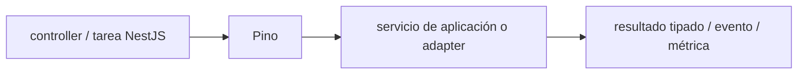

# Pino — Vigilio línea instalada y adaptador Nest versionado

## Qué es, qué hace y cuándo usarla

Logger JSON de alto rendimiento para Node/NestJS. Usa niveles, redacción de secretos y correlation IDs; no registrar PII.

**Ubicación en Vigilio:** usa esta dependencia en su stack propietario; otras skills deben enlazar esta guía, no duplicar sus reglas. **Versión:** la indicada en el encabezado es la línea documentada; consultar `technology/versions.md` y el lockfile antes de copiar APIs o aprobar un upgrade.

> **Guía propia de Pino (backend-node).** Estado a **2026-10-25**: línea instalada y adaptador Nest versionado. Versión del proyecto consumidor = `pnpm-lock.yaml` / `composer.lock` / imagen o manifest. Fuente: [documentación oficial](https://getpino.io/#/). Fuente normativa transversal de versiones: [versions.md](../versions.md). **No implica instalación automática ni upgrade aprobado.**

## Objetivo, responsabilidad y dónde usar

Logs estructurados, redacción, request correlation, sampling y no alta cardinalidad en métricas.

**Uso:** aplicar solo si está declarada y resulta pertinente al consumidor; ver [política de adopción y DRY](README.md).

### Diagrama de integración (Mermaid)



El flujo muestra la **responsabilidad arquitectónica** de la librería; no representa llamadas reales de red para todas las operaciones.


## Instalación o verificación

```bash
pnpm add pino pino-http
```

**Gate de instalación:** consultar [procedimiento compartido](README.md#protocolo-de-adopción-y-actualización); estos comandos son indicativos, no ejecuciones sobre un consumidor.

## ✅ Correcto — uso actual y ejemplo de referencia

```typescript
// logging estructurado (redactar campos sensitivos)
const logger = pino({ redact:['req.headers.authorization','password','token'] });
logger.info({product_id,correlation_id},'product registered');
```

**Por qué:** Logs estructurados, redacción, request correlation, sampling y no alta cardinalidad en métricas.

## ❌ Incorrecto — patrón legacy, inseguro o mal ubicado

```typescript
// ❌ loggear cuerpos completos con secretos
console.log(req.headers.authorization, req.body);
```

**Riesgo:** confundir versiones o responsabilidades y obtener un contrato incorrecto.

## Nuevas capacidades, migración y breaking changes

Cambio de mayor requiere adaptar transport/serializers, pino-http y hooks Nest; no copiar configuraciones obsoletas.

Aplicar el [protocolo de migración común](README.md#protocolo-de-adopción-y-actualización), sin asumir que una release nueva está desplegada.

## Buenas prácticas, seguridad, rendimiento y operación

Consultar la [política transversal de librerías](README.md) para seguridad, versionado, evidencia y revisión de contratos. Para esta librería, además, aplicar las verificaciones concretas que se detallan a continuación.

## Gates de aceptación y compatibilidad

Test redacción, costo, trace linkage y fallos de transport.

Estado de prueba de estos ejemplos documentales: **NOT_RUN** en aplicaciones consumidoras; ver [criterios de evidencia](README.md#criterios-de-validación).


## Referencias

- [Documentación oficial y migración de Pino](https://getpino.io/#/)
- [Matriz y baseline de versiones](../versions.md)
- [Calidad de código canónica](../../foundations/engineering/code-quality.md)


## Recetario operativo ampliado — pino (2026-10-25)

### API actual: dos tareas reales que debe saber ejecutar una skill

1. **Logs JSON estructurados con redaction y level por environment.**
2. **logger child por request con correlation ID; request body por allowlist.**

### Migración desde versiones anteriores: decisión concreta

- **Qué cambia o se debe revisar:** Adapter Nest/Pino versionar juntos, no usar `console.log` como observabilidad prod.

### Responsabilidades y capas

Logs de infraestructura, sin decisión de dominio.

**✅ Correcto:** mantener la integración encapsulada, alinear los nombres del negocio con Vigilio y depender de un contrato estable.

**❌ Incorrecto:** importar internals de la librería desde Domain, declarar `any` para resolver un upgrade, o duplicar reglas ya propietarias de otra tecnología.

### Seguridad, resiliencia y rendimiento

- Tokens, contraseñas y PII nunca serializadas; buffers/streams backpressure.

### Test de aceptación específico y evidencia mínima

- **Escenario comprobable:** Smoke logs parser, redaction, correlation y carga.


## Guía operativa detallada — 8 casos y 4 antipatrones

### Ocho ejemplos de la API y casos de uso relevantes

Los fragmentos siguientes ilustran **operaciones independientes**. Variables, imports, provider, extensión y configuración se completan en el proyecto consumidor; **no están certificados como un archivo único compilable**. Cuando hay comentarios `#`, son pasos de integración o configuración y no APIs inventadas.

#### Ejemplo 1. Logger

**✅ Correcto — logger**

```typescript
const logger = pino({ level: 'info' });
```


#### Ejemplo 2. Child context

**✅ Correcto — child context**

```typescript
const request_logger = logger.child({ request_id });
```


#### Ejemplo 3. Structured log

**✅ Correcto — structured log**

```typescript
request_logger.info({ event: 'products.listProducts' }, 'completed');
```


#### Ejemplo 4. Error

**✅ Correcto — error**

```typescript
logger.error({ err: error }, 'request failed');
```


#### Ejemplo 5. Redact

**✅ Correcto — redact**

```typescript
pino({ redact: ['req.headers.authorization', 'password'] });
```


#### Ejemplo 6. Test

**✅ Correcto — test**

```typescript
const logger = pino({ level: 'silent' });
```


#### Ejemplo 7. Nivel runtime

**✅ Correcto — nivel runtime**

```typescript
pino({ level: process.env.LOG_LEVEL ?? 'info' });
```


#### Ejemplo 8. Flush

**✅ Correcto — flush**

```typescript
logger.flush?.();
```


### Cuatro antipatrones frecuentes y su sustitución

#### Antipatrón 1 — riesgo y alternativa

**❌ Incorrecto**

```typescript
logger.info(`User ${email} logged in`)
```

**Por qué está mal:** El patrón «logger.info(`User ${email} logged in`)» es riesgoso: la telemetría puede perder trazabilidad, crecer en cardinalidad o filtrar valores sensibles.

**✅ Correcto**

```typescript
logger.info({ user_scope: "authenticated" }, "login")
```

**Por qué mejora:** El patrón «logger.info({ user_scope: "authenticated" }, "login")» mejora el caso: la observabilidad conserva contexto útil sin usar identificadores sensibles como etiquetas masivas.

#### Antipatrón 2 — riesgo y alternativa

**❌ Incorrecto**

```typescript
console.log(secret)
```

**Por qué está mal:** Expone credenciales o confunde autenticación con autorización; puede ocasionar filtración o acceso indebido.

**✅ Correcto**

```typescript
logger.info({ event: "auth.success" }, "ok")
```

**Por qué mejora:** El patrón «logger.info({ event: "auth.success" }, "ok")» mejora el caso: las credenciales quedan fuera del código o bajo un mecanismo de acceso controlado.

#### Antipatrón 3 — riesgo y alternativa

**❌ Incorrecto — Registrar cada request cuerpo completo.**

**Por qué está mal:** El patrón «Registrar cada request cuerpo completo» es riesgoso: puede elevar el coste de runtime, causar fallos de despliegue o empaquetar dependencias no deseadas.

**✅ Correcto — Redactar payload y reducir volumen.**

**Por qué mejora:** El patrón «Redactar payload y reducir volumen» mejora el caso: el build y los recursos se verifican mediante gates de despliegue y rendimiento.

#### Antipatrón 4 — riesgo y alternativa

**❌ Incorrecto — JSON stringify error sin stack.**

**Por qué está mal:** Omite un control operativo necesario, por lo que el comportamiento puede ser inseguro o difícil de verificar.

**✅ Correcto**

```typescript
logger.error({ err: error }, "failed")
```

**Por qué mejora:** El patrón «logger.error({ err: error }, "failed")» mejora el caso: la observabilidad conserva contexto útil sin usar identificadores sensibles como etiquetas masivas.

### Versión estable, breaking changes y verificación

- **Versión estable exacta:** no se declara un parche universal cuando no hay verificación específica de su registry/release. Consultar el encabezado de esta guía, `technology/versions.md` y el manifiesto del servicio. **Estado de patch: VERIFY_LOCKFILE**.
- **Migración:** identificar major anterior, APIs retiradas/cambiadas, peer dependencies, requisitos de runtime, cambios de tipos, ejecución CI y plan de rollback. Si no hay prueba sobre el consumidor, **NOT_RUN**, no PASS.
- **Versiones previas:** el ejemplo marcado ❌ en esta guía explica al menos una incompatibilidad o un uso obsoleto; no trasplantar APIs de otras versiones.
- **Tests:** probar al menos happy path, error, seguridad/permiso y compatibilidad con el runtime donde aplique; solo activar nuevas capacidades mediante una PR versionada.

### Fuentes oficiales y referencias al final

- [Referencia propia oficial](https://getpino.io/#/)
- [Matriz canónica de versiones](../versions.md)
- [Política de adopción de librerías](README.md)

## Guía de compatibilidad y evaluación por versión (2026-10-25)

**Estado del patch exacto:** `VERIFY_LOCKFILE`. La guía documenta la familia de APIs; **no se ha verificado hoy el patch estable preciso de esta dependencia**. Consultar la fuente oficial enlazada al inicio y el lockfile antes de generar código o aprobar un upgrade.

### Checklist específico de esta librería

- **Migración/compatibilidad:** Adapter Nest/Pino versionar juntos, no usar `console.log` como observabilidad prod.
- **Prueba propia:** Smoke logs parser, redaction, correlation y carga.
- **Límite de responsabilidad:** usar esta librería solo en su adaptador o capa propietaria; consultar los ejemplos de API y antipatrones anteriores antes de cambiar llamadas públicas.

**Gate de aprobación:** leer la referencia oficial y resolver la versión del consumidor, ejecutar typecheck y pruebas específicas, registrar PASS/FAIL/NOT_RUN/BLOCKED. No confundir esta guía con validación de un consumidor real. [Procedimiento único de adopción](README.md#protocolo-de-adopción-y-actualización).

