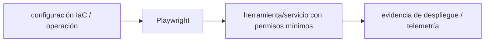

# Playwright — Vigilio 1.64.1 estable verificado

## Qué es, qué hace y cuándo usarla

Automatización E2E de navegadores reales. Prueba rutas, autenticación, accesibilidad y flujos críticos con esperas por eventos, no sleeps.

**Ubicación en Vigilio:** usa esta dependencia en su stack propietario; otras skills deben enlazar esta guía, no duplicar sus reglas. **Versión:** la indicada en el encabezado es la línea documentada; consultar `technology/versions.md` y el lockfile antes de copiar APIs o aprobar un upgrade.

> **Guía propia de Playwright (testing).** Estado a **2026-11-01**: 1.64.1 estable verificado. Versión del proyecto consumidor = `pnpm-lock.yaml` / `composer.lock` / imagen o manifest. Fuente: [documentación oficial](https://playwright.dev/docs/intro). Fuente normativa transversal de versiones: [versions.md](../versions.md). **No implica instalación automática ni upgrade aprobado.**

## Objetivo, responsabilidad y dónde usar

Seleccionar por rol/label, traces en retry, autenticación controlada, datos aislados y casos de permisos por tenant.

**Uso:** aplicar solo si está declarada y resulta pertinente al consumidor; ver [política de adopción y DRY](README.md).

### Diagrama de integración (Mermaid)



El flujo muestra la **responsabilidad arquitectónica** de la librería; no representa llamadas reales de red para todas las operaciones.


## Instalación o verificación

```bash
pnpm add -D @playwright/test && pnpm exec playwright install --with-deps
```

**Gate de instalación:** consultar [procedimiento compartido](README.md#protocolo-de-adopción-y-actualización); estos comandos son indicativos, no ejecuciones sobre un consumidor.

## ✅ Correcto — uso actual y ejemplo de referencia

```typescript
import { test, expect } from '@playwright/test';
test('registro',async({page})=>{await page.goto('/products/new'); await page.getByLabel('Número de póliza').fill('POL-42'); await page.getByRole('button',{name:'Registrar'}).click(); await expect(page.getByText('POL-42')).toBeVisible();});
```

**Por qué:** Seleccionar por rol/label, traces en retry, autenticación controlada, datos aislados y casos de permisos por tenant.

## ❌ Incorrecto — patrón legacy, inseguro o mal ubicado

```typescript
// ❌ selectores CSS frágiles o waitForTimeout fijo
await page.waitForTimeout(5000);
```

**Riesgo:** confundir versiones o responsabilidades y obtener un contrato incorrecto.

## Nuevas capacidades, migración y breaking changes

Actualizar navegadores empaquetados con versión Playwright, snapshots, APIs y reporte; fijar versiones de CI/driver consistentes.

Aplicar el [protocolo de migración común](README.md#protocolo-de-adopción-y-actualización), sin asumir que una release nueva está desplegada.

## Buenas prácticas, seguridad, rendimiento y operación

Consultar la [política transversal de librerías](README.md) para seguridad, versionado, evidencia y revisión de contratos. Para esta librería, además, aplicar las verificaciones concretas que se detallan a continuación.

## Gates de aceptación y compatibilidad

Tests cross-browser, mobile viewport, uploads, trazas, accesibilidad, flaky rate y secretos redactados.

Estado de prueba de estos ejemplos documentales: **NOT_RUN** en aplicaciones consumidoras; ver [criterios de evidencia](README.md#criterios-de-validación).


## E2E real de un endpoint protegido

```typescript
import {test,expect} from '@playwright/test';
test('deniega un producto de otro tenant', async ({ request }) => {
  const response = await request.get('/api/products/other-tenant-id');
  expect([403,404]).toContain(response.status());
});
```

Criterios de arquitectura: usar cuentas de prueba aisladas por tenant, secretos en CI, no snapshots sobre datos aleatorios, asserts por role/label en UI. Trazas y capturas solo en failure o retry según política.

## Referencias

- [Documentación oficial y migración de Playwright](https://playwright.dev/docs/intro)
- [Matriz y baseline de versiones](../versions.md)
- [Calidad de código canónica](../../foundations/engineering/code-quality.md)


## Recetario operativo ampliado — playwright (2026-10-25)

### API actual: dos tareas reales que debe saber ejecutar una skill

1. **Locators por role/testid y `expect` auto-wait, fixtures aisladas.**
2. **Config proyectos por navegador y trace on-first-retry; auth state segura.**

### Migración desde versiones anteriores: decisión concreta

- **Qué cambia o se debe revisar:** `page.waitForTimeout` no sustituye waits semánticos; revisar fixtures major.

### Responsabilidades y capas

E2E browser/móvil web; no reemplaza contract/backend tests.

**✅ Correcto:** mantener la integración encapsulada, alinear los nombres del negocio con Vigilio y depender de un contrato estable.

**❌ Incorrecto:** importar internals de la librería desde Domain, declarar `any` para resolver un upgrade, o duplicar reglas ya propietarias de otra tecnología.

### Seguridad, resiliencia y rendimiento

- Evitar secretos guardados en trace/report y flakiness por tiempo fijo.

### Test de aceptación específico y evidencia mínima

- **Escenario comprobable:** Critical flows login/list/register/error, cross-browser y replay de trace.

### Ejemplo de integración vigente (fragmento adicional)

```typescript
import { test, expect } from '@playwright/test';
test('registrar producto', async ({ page }) => {
  await page.goto('/products/new');
  await page.getByLabel('Número de póliza').fill('POL-123');
  await page.getByRole('button', { name: 'Registrar' }).click();
  await expect(page.getByRole('status')).toContainText('registrado');
});
```

**Nota:** los fragmentos muestran la API específica y requieren imports/providers/fixtures del consumidor; no se certifica compilación por el solo hecho de aparecer aquí.


## Guía operativa detallada — 8 casos y 4 antipatrones

### Ocho ejemplos de la API y casos de uso relevantes

Los fragmentos siguientes ilustran **operaciones independientes**. Variables, imports, provider, extensión y configuración se completan en el proyecto consumidor; **no están certificados como un archivo único compilable**. Cuando hay comentarios `#`, son pasos de integración o configuración y no APIs inventadas.

#### Ejemplo 1. Abrir página

**✅ Correcto — abrir página**

```typescript
await page.goto('/products');
```


#### Ejemplo 2. Selector accesible

**✅ Correcto — selector accesible**

```typescript
await page.getByRole('button', { name: 'Registrar' }).click();
```


#### Ejemplo 3. Esperar datos

**✅ Correcto — esperar datos**

```typescript
await expect(page.getByRole('heading', { name: 'Productos' })).toBeVisible();
```


#### Ejemplo 4. Formulario

**✅ Correcto — formulario**

```typescript
await page.getByLabel('Nro póliza').fill('POL-001');
```


#### Ejemplo 5. Interceptar

**✅ Correcto — interceptar**

```typescript
await page.route('**/api/products', async (route) => route.fulfill({ json: { count: 0, results: [] } }));
```


#### Ejemplo 6. Captura

**✅ Correcto — captura**

```typescript
await page.screenshot({ path: 'artifacts/products.png' });
```


#### Ejemplo 7. Varias pantallas

**✅ Correcto — varias pantallas**

```typescript
test.use({ viewport: { width: 390, height: 844 } });
```


#### Ejemplo 8. Trace

**✅ Correcto — trace**

**Nota técnica (no es código ejecutable):** Playwright.config: use: { trace: 'on-first-retry' }.


### Cuatro antipatrones frecuentes y su sustitución

#### Antipatrón 1 — riesgo y alternativa

**❌ Incorrecto**

```typescript
page.locator(".btn-primary:nth-child(3)")
```

**Por qué está mal:** El patrón «page.locator(".btn-primary:nth-child(3)")» es riesgoso: la elección «page.locator(".btn-primary:nth-child(3)")» puede incumplir los requisitos operativos de playwright.

**✅ Correcto**

```typescript
page.getByRole("button", { name: "Registrar" })
```

**Por qué mejora:** El patrón «page.getByRole("button", { name: "Registrar" })» mejora el caso: la alternativa «page.getByRole("button", { name: "Registrar" })» establece el comportamiento esperado de playwright.

#### Antipatrón 2 — riesgo y alternativa

**❌ Incorrecto**

```typescript
page.waitForTimeout(5000)
```

**Por qué está mal:** El patrón «page.waitForTimeout(5000)» es riesgoso: la elección «page.waitForTimeout(5000)» puede incumplir los requisitos operativos de playwright.

**✅ Correcto**

```typescript
await expect(page.getByRole("heading", { name: "Productos" })).toBeVisible()
```

**Por qué mejora:** El patrón «await expect(page.getByRole("heading", { name: "Productos" })).toBeVisible()» mejora el caso: la alternativa «await expect(page.getByRole("heading", { name: "Productos" })).toBeVisible(» establece el comportamiento esperado de playwright.

#### Antipatrón 3 — riesgo y alternativa

**❌ Incorrecto — Tests con credenciales reales.**

**Por qué está mal:** El patrón «Tests con credenciales reales» es riesgoso: los secretos o datos privados quedan expuestos en código, logs o artefactos de despliegue.

**✅ Correcto — Fixtures users segregados por ambiente.**

**Por qué mejora:** El patrón «Fixtures users segregados por ambiente» mejora el caso: las credenciales quedan fuera del código o bajo un mecanismo de acceso controlado.

#### Antipatrón 4 — riesgo y alternativa

**❌ Incorrecto — No guardar trace fallo.**

**Por qué está mal:** El patrón «No guardar trace fallo» es riesgoso: puede duplicar efectos, perder trabajos o saturar consumidores durante reintentos.

**✅ Correcto — Trace: on-first-retry.**

**Por qué mejora:** El patrón «Trace: on-first-retry» mejora el caso: la ejecución se controla con idempotencia, límites y evidencia de errores.

### Versión estable, breaking changes y verificación

- **Versión estable exacta:** no se declara un parche universal cuando no hay verificación específica de su registry/release. Consultar el encabezado de esta guía, `technology/versions.md` y el manifiesto del servicio. **Estado de patch: VERIFY_LOCKFILE**.
- **Migración:** identificar major anterior, APIs retiradas/cambiadas, peer dependencies, requisitos de runtime, cambios de tipos, ejecución CI y plan de rollback. Si no hay prueba sobre el consumidor, **NOT_RUN**, no PASS.
- **Versiones previas:** el ejemplo marcado ❌ en esta guía explica al menos una incompatibilidad o un uso obsoleto; no trasplantar APIs de otras versiones.
- **Tests:** probar al menos happy path, error, seguridad/permiso y compatibilidad con el runtime donde aplique; solo activar nuevas capacidades mediante una PR versionada.

### Fuentes oficiales y referencias al final

- [Referencia propia oficial](https://playwright.dev/docs/intro)
- [Matriz canónica de versiones](../versions.md)
- [Política de adopción de librerías](README.md)

## Guía de compatibilidad y evaluación por versión (2026-10-25)

**Release contrastada para esta familia:** `1.64.1`. Fuente: [publicación oficial](https://pypi.org/project/playwright/1.64.1/). **Cambio clave:** Versión Python confirmada; verificar independientemente @playwright/test npm en consumidor.

### Checklist específico de esta librería

- Fijar versión de `@playwright/test` desde lockfile npm: la release PyPI no demuestra el patch JS.
- Usar getByRole/getByLabel y expect(locator), jamás waitForTimeout fijo para sincronización de estado.
- Hacer trace on-first-retry y subir artefactos en CI; aislar datos por tenant.

**Gate de aprobación:** leer la referencia oficial y resolver la versión del consumidor, ejecutar typecheck y pruebas específicas, registrar PASS/FAIL/NOT_RUN/BLOCKED. No confundir esta guía con validación de un consumidor real. [Procedimiento único de adopción](README.md#protocolo-de-adopción-y-actualización).

## Test E2E accesible y resistente a timing

```typescript
import { test, expect } from '@playwright/test';

test('listar productos autorizados', async ({ page }) => {
  await page.goto('/products');
  await expect(page.getByRole('heading', { name: /productos/i })).toBeVisible();
  await expect(page.getByRole('table')).toBeVisible();
});
```

Este test requiere fixture de autenticación y data semilla, no son suministrados por la librería. Preferir `getByRole`, respuestas deterministas con mocks MSW solo cuando es test de UI, y PostgreSQL real en integración E2E. ❌ Incorrecto: `waitForTimeout(5000)` para sincronización arbitraria, credenciales en repositorio o compartir fixtures privados. [Playwright docs](https://playwright.dev/docs/best-practices).
