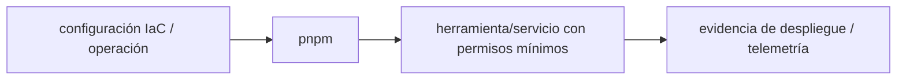

# pnpm — Vigilio 12.15 (línea mayor estable, gate de adopción)

## Qué es, qué hace y cuándo usarla

Gestor de paquetes JavaScript con workspaces y lockfile determinista. Versiones por proyecto y builds reproducibles con frozen lockfile.

**Ubicación en Vigilio:** usa esta dependencia en su stack propietario; otras skills deben enlazar esta guía, no duplicar sus reglas. **Versión:** la indicada en el encabezado es la línea documentada; consultar `technology/versions.md` y el lockfile antes de copiar APIs o aprobar un upgrade.

> **Guía propia de pnpm (toolchain).** Estado a **2026-10-25**: 12.15 (línea mayor estable, gate de adopción). Versión del proyecto consumidor = `pnpm-lock.yaml` / `composer.lock` / imagen o manifest. Fuente: [documentación oficial](https://pnpm.io/motivation). Fuente normativa transversal de versiones: [versions.md](../versions.md). **No implica instalación automática ni upgrade aprobado.**

## Objetivo, responsabilidad y dónde usar

Un solo packageManager por workspace, lockfile comiteado, registry y firmas/edad mínima de dependencias, builds reproducibles.

**Uso:** aplicar solo si está declarada y resulta pertinente al consumidor; ver [política de adopción y DRY](README.md).

### Diagrama de integración (Mermaid)



El flujo muestra la **responsabilidad arquitectónica** de la librería; no representa llamadas reales de red para todas las operaciones.


## Instalación o verificación

```bash
corepack enable && corepack prepare pnpm@12.15 --activate
```

**Gate de instalación:** consultar [procedimiento compartido](README.md#protocolo-de-adopción-y-actualización); estos comandos son indicativos, no ejecuciones sobre un consumidor.

## ✅ Correcto — uso actual y ejemplo de referencia

```typescript
// package.json
{ "packageManager": "pnpm@12.15.0", "scripts":{"typecheck":"tsc --noEmit"} }
// CI
pnpm install --frozen-lockfile
pnpm -r test
```

**Por qué:** Un solo packageManager por workspace, lockfile comiteado, registry y firmas/edad mínima de dependencias, builds reproducibles.

## ❌ Incorrecto — patrón legacy, inseguro o mal ubicado

```typescript
pnpm install --no-frozen-lockfile
// ❌ en CI de producción sin control de lockfile
```

**Riesgo:** confundir versiones o responsabilidades y obtener un contrato incorrecto.

## Nuevas capacidades, migración y breaking changes

v11→v12: revisar configuración de workspace, store, lockfile, políticas de dependencias y cambios de manejo de scripts. La línea 12.15 trae include para configuraciones y control de integridad; upgrade requiere prueba de monorepo.

Aplicar el [protocolo de migración común](README.md#protocolo-de-adopción-y-actualización), sin asumir que una release nueva está desplegada.

## Buenas prácticas, seguridad, rendimiento y operación

Consultar la [política transversal de librerías](README.md) para seguridad, versionado, evidencia y revisión de contratos. Para esta librería, además, aplicar las verificaciones concretas que se detallan a continuación.

## Gates de aceptación y compatibilidad

CI install frozen, auditoría, offline/cache, builds workspace y chequeo de integrity/lockfile diffs.

Estado de prueba de estos ejemplos documentales: **NOT_RUN** en aplicaciones consumidoras; ver [criterios de evidencia](README.md#criterios-de-validación).


## Referencias

- [Documentación oficial y migración de pnpm](https://pnpm.io/motivation)
- [Matriz y baseline de versiones](../versions.md)
- [Calidad de código canónica](../../foundations/engineering/code-quality.md)


## Recetario operativo ampliado — pnpm (2026-10-25)

### API actual: dos tareas reales que debe saber ejecutar una skill

1. **`pnpm install --frozen-lockfile` en CI; `corepack`/packageManager fijado.**
2. **Workspace catalogs y override auditado, peer dependency control.**

### Migración desde versiones anteriores: decisión concreta

- **Qué cambia o se debe revisar:** Migrar major pnpm requiere revisar lockfile version y Node compatible.

### Responsabilidades y capas

Toolchain JS/TS, distinto de Composer y Docker runtime.

**✅ Correcto:** mantener la integración encapsulada, alinear los nombres del negocio con Vigilio y depender de un contrato estable.

**❌ Incorrecto:** importar internals de la librería desde Domain, declarar `any` para resolver un upgrade, o duplicar reglas ya propietarias de otra tecnología.

### Seguridad, resiliencia y rendimiento

- Scripts de dependencia y supply chain; registry auth mínimo.

### Test de aceptación específico y evidencia mínima

- **Escenario comprobable:** Fresh install sin network mutation, peer check y build/test matrix.

### Ejemplo de integración vigente (fragmento adicional)

```bash
corepack enable
pnpm install --frozen-lockfile
pnpm audit --prod
pnpm -r typecheck
pnpm -r test
```

**Nota:** los fragmentos muestran la API específica y requieren imports/providers/fixtures del consumidor; no se certifica compilación por el solo hecho de aparecer aquí.


## Guía operativa detallada — 8 casos y 4 antipatrones

### Ocho ejemplos de la API y casos de uso relevantes

Los fragmentos siguientes ilustran **operaciones independientes**. Variables, imports, provider, extensión y configuración se completan en el proyecto consumidor; **no están certificados como un archivo único compilable**. Cuando hay comentarios `#`, son pasos de integración o configuración y no APIs inventadas.

#### Ejemplo 1. Versión

**✅ Correcto — versión**

```bash
pnpm --version
```


#### Ejemplo 2. Instalación determinista

**✅ Correcto — instalación determinista**

```bash
pnpm install --frozen-lockfile
```


#### Ejemplo 3. Añadir dependency

**✅ Correcto — añadir dependency**

```bash
pnpm add zod
```


#### Ejemplo 4. Dev dependency

**✅ Correcto — dev dependency**

```bash
pnpm add -D typescript
```


#### Ejemplo 5. Workspace

**✅ Correcto — workspace**

```bash
pnpm --filter @vigilio/web test
```


#### Ejemplo 6. Auditoría

**✅ Correcto — auditoría**

```bash
pnpm audit
```


#### Ejemplo 7. Version graph

**✅ Correcto — version graph**

```bash
pnpm why zod
```


#### Ejemplo 8. Ejecutar script

**✅ Correcto — ejecutar script**

```bash
pnpm run typecheck
```


### Cuatro antipatrones frecuentes y su sustitución

#### Antipatrón 1 — riesgo y alternativa

**❌ Incorrecto**

```bash
pnpm install # mutable en CI
```

**Por qué está mal:** El patrón «pnpm install # mutable en CI» es riesgoso: puede publicar cambios sin evidencia suficiente ni una revisión del impacto.

**✅ Correcto**

```bash
pnpm install --frozen-lockfile
```

**Por qué mejora:** El patrón «pnpm install --frozen-lockfile» mejora el caso: el cambio pasa por gates automáticos y aprobación de riesgos operativos.

#### Antipatrón 2 — riesgo y alternativa

**❌ Incorrecto**

```bash
pnpm add lib@latest # upgrade ciego
```

**Por qué está mal:** El patrón «pnpm add lib@latest # upgrade ciego» es riesgoso: puede mezclar firmas incompatibles o ejecutar una API retirada en la versión instalada.

**✅ Correcto**

```bash
pnpm add lib@<version-compatible-verificada>
```

**Por qué mejora:** El patrón «pnpm add lib@<version-compatible-verificada>» mejora el caso: se utiliza la API apropiada para el major documentado y se comprueba el lockfile.

#### Antipatrón 3 — riesgo y alternativa

**❌ Incorrecto — Instalar pnpm global no fijado.**

**Por qué está mal:** El patrón «Instalar pnpm global no fijado» es riesgoso: la elección «Instalar pnpm global no fijado» puede incumplir los requisitos operativos de pnpm.

**✅ Correcto — Usar corepack/packageManager en repo.**

**Por qué mejora:** El patrón «Usar corepack/packageManager en repo» mejora el caso: la alternativa «Usar corepack/packageManager en repo» establece el comportamiento esperado de pnpm.

#### Antipatrón 4 — riesgo y alternativa

**❌ Incorrecto — Duplicar versiones en workspaces.**

**Por qué está mal:** El patrón «Duplicar versiones en workspaces» es riesgoso: puede mezclar firmas incompatibles o ejecutar una API retirada en la versión instalada.

**✅ Correcto — Catálogo y overrides justificadas.**

**Por qué mejora:** El patrón «Catálogo y overrides justificadas» mejora el caso: se utiliza la API apropiada para el major documentado y se comprueba el lockfile.

### Versión estable, breaking changes y verificación

- **Versión estable exacta:** no se declara un parche universal cuando no hay verificación específica de su registry/release. Consultar el encabezado de esta guía, `technology/versions.md` y el manifiesto del servicio. **Estado de patch: VERIFY_LOCKFILE**.
- **Migración:** identificar major anterior, APIs retiradas/cambiadas, peer dependencies, requisitos de runtime, cambios de tipos, ejecución CI y plan de rollback. Si no hay prueba sobre el consumidor, **NOT_RUN**, no PASS.
- **Versiones previas:** el ejemplo marcado ❌ en esta guía explica al menos una incompatibilidad o un uso obsoleto; no trasplantar APIs de otras versiones.
- **Tests:** probar al menos happy path, error, seguridad/permiso y compatibilidad con el runtime donde aplique; solo activar nuevas capacidades mediante una PR versionada.

### Fuentes oficiales y referencias al final

- [Referencia propia oficial](https://pnpm.io/motivation)
- [Matriz canónica de versiones](../versions.md)
- [Política de adopción de librerías](README.md)

## Guía de compatibilidad y evaluación por versión (2026-10-25)

**Release contrastada para esta familia:** `12.15.0`. Fuente: [publicación oficial](https://pnpm.io/blog/releases/12.15.0). **Cambio clave:** 12.x major: lockfile y Node; include de configuraciones workspace.

### Checklist específico de esta librería

- No subir major con `pnpm install` directo sobre un monorepo: aprobar diff de lockfile/corepack en CI.
- pnpm 12.15 permite configuración `include` en workspace, cada setting con un propietario.
- `pnpm install --frozen-lockfile` en CI; gate de integrity/supply chain.

**Gate de aprobación:** leer la referencia oficial y resolver la versión del consumidor, ejecutar typecheck y pruebas específicas, registrar PASS/FAIL/NOT_RUN/BLOCKED. No confundir esta guía con validación de un consumidor real. [Procedimiento único de adopción](README.md#protocolo-de-adopción-y-actualización).

## Migración de pnpm 11 → 12 sin romper el monorepo

```bash
corepack enable
pnpm --version
pnpm install --frozen-lockfile
pnpm -r exec node --version
```

✅ Correcto: actualizar `packageManager`, Corepack, runner, lockfile y caches en **la misma PR**, revisar workspace/peers, ejecutar typecheck+tests de consumidor. pnpm 12.15 añade configuración modular mediante `include` en `pnpm-workspace.yaml`; cada setting tiene un propietario. ❌ Incorrecto: regenerar el lockfile con major nuevo sin comparar diffs o permitir `latest` sin gate en CI. [Notas 12.15](https://pnpm.io/blog/releases/12.15.0).
