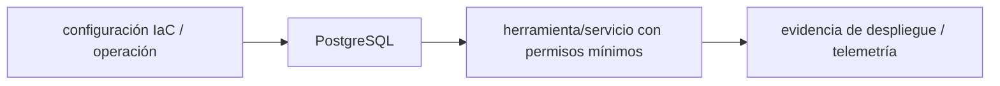

# PostgreSQL — Vigilio 18.x (18.6 reportada; confirmar compatibilidad del servidor)

## Qué es, qué hace y cuándo usarla

Base de datos SQL relacional con MVCC, índices y transacciones. Optimizar con EXPLAIN y estadísticas antes de crear índices por intuición.

**Ubicación en Vigilio:** usa esta dependencia en su stack propietario; otras skills deben enlazar esta guía, no duplicar sus reglas. **Versión:** la indicada en el encabezado es la línea documentada; consultar `technology/versions.md` y el lockfile antes de copiar APIs o aprobar un upgrade.

> **Guía propia de PostgreSQL (data).** Estado a **2026-10-25**: 18.x (18.6 reportada; confirmar compatibilidad del servidor). Versión del proyecto consumidor = `pnpm-lock.yaml` / `composer.lock` / imagen o manifest. Fuente: [documentación oficial](https://www.postgresql.org/docs/current/). Fuente normativa transversal de versiones: [versions.md](../versions.md). **No implica instalación automática ni upgrade aprobado.**

## Objetivo, responsabilidad y dónde usar

Revisar SQL canónico [sql-performance](../../standards/data/sql-performance.md) para 85 prácticas; aquí solo PostgreSQL y compatibilidad.

**Uso:** aplicar solo si está declarada y resulta pertinente al consumidor; ver [política de adopción y DRY](README.md).

### Diagrama de integración (Mermaid)



El flujo muestra la **responsabilidad arquitectónica** de la librería; no representa llamadas reales de red para todas las operaciones.


## Instalación o verificación

```bash
usar imágenes de base de datos aprobadas, migraciones verificadas
```

**Gate de instalación:** consultar [procedimiento compartido](README.md#protocolo-de-adopción-y-actualización); estos comandos son indicativos, no ejecuciones sobre un consumidor.

## ✅ Correcto — uso actual y ejemplo de referencia

```sql
-- índice compuesto para tenant y listados filtrados
CREATE INDEX CONCURRENTLY IF NOT EXISTS idx_products_tenant_status_id
ON products (tenant_id, estado, id);
EXPLAIN (ANALYZE, BUFFERS)
SELECT id, nro_poliza FROM products WHERE tenant_id = $1 ORDER BY id LIMIT $2;
```

**Por qué:** Revisar SQL canónico [sql-performance](../../standards/data/sql-performance.md) para 85 prácticas; aquí solo PostgreSQL y compatibilidad.

## ❌ Incorrecto — patrón legacy, inseguro o mal ubicado

```typescript
-- ❌ full scan repetido e inserción fila a fila de 1M registros sin medir
SELECT * FROM products OFFSET 900000 LIMIT 25;
```

**Riesgo:** confundir versiones o responsabilidades y obtener un contrato incorrecto.

## Nuevas capacidades, migración y breaking changes

17→18 requiere pruebas de extensiones pgvector, drivers, backups y cambios de plan. No ejecutar CREATE INDEX CONCURRENTLY dentro de transacción genérica.

Aplicar el [protocolo de migración común](README.md#protocolo-de-adopción-y-actualización), sin asumir que una release nueva está desplegada.

## Buenas prácticas, seguridad, rendimiento y operación

Consultar la [política transversal de librerías](README.md) para seguridad, versionado, evidencia y revisión de contratos. Para esta librería, además, aplicar las verificaciones concretas que se detallan a continuación.

## Gates de aceptación y compatibilidad

Benchmark EXPLAIN; pg_stat_statements, locks, VACUUM/ANALYZE, backups, restore y migraciones de extensión.

Estado de prueba de estos ejemplos documentales: **NOT_RUN** en aplicaciones consumidoras; ver [criterios de evidencia](README.md#criterios-de-validación).


## Referencias

- [Documentación oficial y migración de PostgreSQL](https://www.postgresql.org/docs/current/)
- [Matriz y baseline de versiones](../versions.md)
- [Calidad de código canónica](../../foundations/engineering/code-quality.md)


## Recetario operativo ampliado — postgresql (2026-10-25)

### API actual: dos tareas reales que debe saber ejecutar una skill

1. **Índices composite según WHERE/ORDER BY, `EXPLAIN (ANALYZE, BUFFERS)`.**
2. **`COPY` para gran ingest, upserts idempotentes, operaciones chunked y vacuum stats.**

### Migración desde versiones anteriores: decisión concreta

- **Qué cambia o se debe revisar:** PG 17→18 revisar extensión pgvector/driver, collation/plan y backup restore.

### Responsabilidades y capas

BD infraestructura; no mezclar códigos Nest/Laravel fuera de enlaces.

**✅ Correcto:** mantener la integración encapsulada, alinear los nombres del negocio con Vigilio y depender de un contrato estable.

**❌ Incorrecto:** importar internals de la librería desde Domain, declarar `any` para resolver un upgrade, o duplicar reglas ya propietarias de otra tecnología.

### Seguridad, resiliencia y rendimiento

- Locks, RLS, tenant, SQL injection, WAL/autovacuum, backups PITR.

### Test de aceptación específico y evidencia mínima

- **Escenario comprobable:** Bench ingest, plans, deadlocks, replica lag y restore DR.

### Ejemplo de integración vigente (fragmento adicional)

```sql
EXPLAIN (ANALYZE, BUFFERS)
SELECT id, nro_poliza FROM products
WHERE tenant_id = $1 AND estado = 'pendiente'
ORDER BY id LIMIT 25;
CREATE INDEX CONCURRENTLY IF NOT EXISTS products_tenant_estado_id
ON products(tenant_id, estado, id);
```

**Nota:** los fragmentos muestran la API específica y requieren imports/providers/fixtures del consumidor; no se certifica compilación por el solo hecho de aparecer aquí.


## Guía operativa detallada — 8 casos y 4 antipatrones

### Ocho ejemplos de la API y casos de uso relevantes

Los fragmentos siguientes ilustran **operaciones independientes**. Variables, imports, provider, extensión y configuración se completan en el proyecto consumidor; **no están certificados como un archivo único compilable**. Cuando hay comentarios `#`, son pasos de integración o configuración y no APIs inventadas.

#### Ejemplo 1. Plan real

**✅ Correcto — plan real**

```sql
EXPLAIN (ANALYZE, BUFFERS) SELECT * FROM products WHERE tenant_id = $1;
```


#### Ejemplo 2. Índice compuesto

**✅ Correcto — índice compuesto**

```sql
CREATE INDEX CONCURRENTLY idx_products_tenant_state ON products (tenant_id, estado);
```


#### Ejemplo 3. INSERT batch

**✅ Correcto — insert batch**

```sql
INSERT INTO products (id, tenant_id) VALUES ($1, $2), ($3, $4);
```


#### Ejemplo 4. COPY

**✅ Correcto — copy**

```sql
COPY products FROM STDIN WITH (FORMAT csv, HEADER true);
```


#### Ejemplo 5. UPSERT

**✅ Correcto — upsert**

```sql
INSERT INTO products(id, tenant_id) VALUES ($1, $2) ON CONFLICT (id) DO NOTHING;
```


#### Ejemplo 6. Keyset

**✅ Correcto — keyset**

```sql
SELECT * FROM products WHERE tenant_id=$1 AND id>$2 ORDER BY id LIMIT 50;
```


#### Ejemplo 7. Locks

**✅ Correcto — locks**

```sql
SELECT * FROM pg_stat_activity WHERE wait_event_type='Lock';
```


#### Ejemplo 8. Métricas SQL

**✅ Correcto — métricas sql**

```sql
SELECT query, calls, mean_exec_time FROM pg_stat_statements ORDER BY total_exec_time DESC LIMIT 10;
```


### Cuatro antipatrones frecuentes y su sustitución

#### Antipatrón 1 — riesgo y alternativa

**❌ Incorrecto**

```sql
SELECT * FROM products; # sin tenant ni filtros
```

**Por qué está mal:** Omite un control operativo necesario, por lo que el comportamiento puede ser inseguro o difícil de verificar.

**✅ Correcto**

```sql
SELECT id FROM products WHERE tenant_id=$1;
```

**Por qué mejora:** El patrón «SELECT id FROM products WHERE tenant_id=$1» mejora el caso: se fuerza autorización en el borde/servidor y se limita el acceso por recurso.

#### Antipatrón 2 — riesgo y alternativa

**❌ Incorrecto**

```sql
OFFSET 100000 LIMIT 50
```

**Por qué está mal:** El patrón «OFFSET 100000 LIMIT 50» es riesgoso: la consulta puede producir resultados incorrectos, lentitud o aislamiento insuficiente de datos.

**✅ Correcto**

```sql
WHERE id>$cursor ORDER BY id LIMIT 50
```

**Por qué mejora:** El patrón «WHERE id>$cursor ORDER BY id LIMIT 50» mejora el caso: la consulta o el contrato se valida y mide sobre datos representativos.

#### Antipatrón 3 — riesgo y alternativa

**❌ Incorrecto — Hacer 1M inserts uno por uno.**

**Por qué está mal:** El patrón «Hacer 1M inserts uno por uno» es riesgoso: puede publicar cambios sin evidencia suficiente ni una revisión del impacto.

**✅ Correcto — COPY/batches y transacción acotada.**

**Por qué mejora:** El patrón «COPY/batches y transacción acotada» mejora el caso: el cambio pasa por gates automáticos y aprobación de riesgos operativos.

#### Antipatrón 4 — riesgo y alternativa

**❌ Incorrecto — Índices por intuición sin EXPLAIN.**

**Por qué está mal:** Omite un control operativo necesario, por lo que el comportamiento puede ser inseguro o difícil de verificar.

**✅ Correcto**

```sql
EXPLAIN (ANALYZE, BUFFERS) SELECT ...;
```

**Por qué mejora:** El patrón «EXPLAIN (ANALYZE, BUFFERS) SELECT ...» mejora el caso: la consulta o el contrato se valida y mide sobre datos representativos.

### Versión estable, breaking changes y verificación

- **Versión estable exacta:** no se declara un parche universal cuando no hay verificación específica de su registry/release. Consultar el encabezado de esta guía, `technology/versions.md` y el manifiesto del servicio. **Estado de patch: VERIFY_LOCKFILE**.
- **Migración:** identificar major anterior, APIs retiradas/cambiadas, peer dependencies, requisitos de runtime, cambios de tipos, ejecución CI y plan de rollback. Si no hay prueba sobre el consumidor, **NOT_RUN**, no PASS.
- **Versiones previas:** el ejemplo marcado ❌ en esta guía explica al menos una incompatibilidad o un uso obsoleto; no trasplantar APIs de otras versiones.
- **Tests:** probar al menos happy path, error, seguridad/permiso y compatibilidad con el runtime donde aplique; solo activar nuevas capacidades mediante una PR versionada.

### Fuentes oficiales y referencias al final

- [Referencia propia oficial](https://www.postgresql.org/docs/current/)
- [Matriz canónica de versiones](../versions.md)
- [Política de adopción de librerías](README.md)

## Guía de compatibilidad y evaluación por versión (2026-10-25)

**Estado del patch exacto:** `VERIFY_LOCKFILE`. La guía documenta la familia de APIs; **no se ha verificado hoy el patch estable preciso de esta dependencia**. Consultar la fuente oficial enlazada al inicio y el lockfile antes de generar código o aprobar un upgrade.

### Checklist específico de esta librería

- **Migración/compatibilidad:** PG 17→18 revisar extensión pgvector/driver, collation/plan y backup restore.
- **Prueba propia:** Bench ingest, plans, deadlocks, replica lag y restore DR.
- **Límite de responsabilidad:** usar esta librería solo en su adaptador o capa propietaria; consultar los ejemplos de API y antipatrones anteriores antes de cambiar llamadas públicas.

**Gate de aprobación:** leer la referencia oficial y resolver la versión del consumidor, ejecutar typecheck y pruebas específicas, registrar PASS/FAIL/NOT_RUN/BLOCKED. No confundir esta guía con validación de un consumidor real. [Procedimiento único de adopción](README.md#protocolo-de-adopción-y-actualización).

## Integración IA/RAG moderna — 2026

Búsqueda textual `tsvector`, `GIN`, `websearch_to_tsquery` y pgvector se integran en la [guía Hybrid RAG](../../standards/ai/hybrid-rag-postgresql.md); no reutilizar SQL RAG sin ACL documental.

✅ **Correcto:** revisar API instalada/digest, seguridad y datos del consumidor. ❌ **Incorrecto:** copiar endpoint legacy o presentar pruebas documentales como compilación real.
