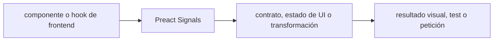

# Preact Signals — Vigilio línea instalada + compat Preact 11

## Qué es, qué hace y cuándo usarla

Primitivas reactivas de estado basadas en signals para Preact y otros entornos. El estado de UI no sustituye el estado remoto cacheado.

**Ubicación en Vigilio:** usa esta dependencia en su stack propietario; otras skills deben enlazar esta guía, no duplicar sus reglas. **Versión:** la indicada en el encabezado es la línea documentada; consultar `technology/versions.md` y el lockfile antes de copiar APIs o aprobar un upgrade.

> **Guía propia de Preact Signals (frontend).** Estado a **2026-10-25**: línea instalada + compat Preact 11. Versión del proyecto consumidor = `pnpm-lock.yaml` / `composer.lock` / imagen o manifest. Fuente: [documentación oficial](https://preactjs.com/guide/v10/signals/). Fuente normativa transversal de versiones: [versions.md](../versions.md). **No implica instalación automática ni upgrade aprobado.**

## Objetivo, responsabilidad y dónde usar

Estado client UI mínimo; server state via Query; evitar suscripciones duplicadas y ciclos.

**Uso:** aplicar solo si está declarada y resulta pertinente al consumidor; ver [política de adopción y DRY](README.md).

### Diagrama de integración (Mermaid)



El flujo muestra la **responsabilidad arquitectónica** de la librería; no representa llamadas reales de red para todas las operaciones.


## Instalación o verificación

```bash
pnpm add @preact/signals
```

**Gate de instalación:** consultar [procedimiento compartido](README.md#protocolo-de-adopción-y-actualización); estos comandos son indicativos, no ejecuciones sobre un consumidor.

## ✅ Correcto — uso actual y ejemplo de referencia

```typescript
import { signal, computed } from '@preact/signals';
const count = signal(0);
const doubled = computed(()=>count.value*2);
count.value += 1;
```

**Por qué:** Estado client UI mínimo; server state via Query; evitar suscripciones duplicadas y ciclos.

## ❌ Incorrecto — patrón legacy, inseguro o mal ubicado

```typescript
// ❌ colocar secretos/token sin protección en estado serializado
const token = signal(localStorage.getItem('refresh_token'));
```

**Riesgo:** confundir versiones o responsabilidades y obtener un contrato incorrecto.

## Nuevas capacidades, migración y breaking changes

API Signals independiente de hook React; compat `@preact/signals-react` requiere su matriz correspondiente.

Aplicar el [protocolo de migración común](README.md#protocolo-de-adopción-y-actualización), sin asumir que una release nueva está desplegada.

## Buenas prácticas, seguridad, rendimiento y operación

Consultar la [política transversal de librerías](README.md) para seguridad, versionado, evidencia y revisión de contratos. Para esta librería, además, aplicar las verificaciones concretas que se detallan a continuación.

## Gates de aceptación y compatibilidad

Tests actualizaciones, recursos liberados, SSR hydration y desuscripción.

Estado de prueba de estos ejemplos documentales: **NOT_RUN** en aplicaciones consumidoras; ver [criterios de evidencia](README.md#criterios-de-validación).


## Referencias

- [Documentación oficial y migración de Preact Signals](https://preactjs.com/guide/v10/signals/)
- [Matriz y baseline de versiones](../versions.md)
- [Calidad de código canónica](../../foundations/engineering/code-quality.md)


## Recetario operativo ampliado — preact-signals (2026-10-25)

### API actual: dos tareas reales que debe saber ejecutar una skill

1. **Crear `signal`, `computed`, `effect` donde corresponda y limpiar efectos.**
2. **Separar estado UI local de TanStack Query server state.**

### Migración desde versiones anteriores: decisión concreta

- **Qué cambia o se debe revisar:** Versiones Signals/Preact nuevas pueden cambiar behavior de hooks; migrar tests UI.

### Responsabilidades y capas

Frontend local state, no contrato HTTP.

**✅ Correcto:** mantener la integración encapsulada, alinear los nombres del negocio con Vigilio y depender de un contrato estable.

**❌ Incorrecto:** importar internals de la librería desde Domain, declarar `any` para resolver un upgrade, o duplicar reglas ya propietarias de otra tecnología.

### Seguridad, resiliencia y rendimiento

- Effects no limpiados provocan leaks, no guardar secretos en signals.

### Test de aceptación específico y evidencia mínima

- **Escenario comprobable:** Tests subscribers, teardown, React/Preact integration y SSR hydration.


## Guía operativa detallada — 8 casos y 4 antipatrones

### Ocho ejemplos de la API y casos de uso relevantes

Los fragmentos siguientes ilustran **operaciones independientes**. Variables, imports, provider, extensión y configuración se completan en el proyecto consumidor; **no están certificados como un archivo único compilable**. Cuando hay comentarios `#`, son pasos de integración o configuración y no APIs inventadas.

#### Ejemplo 1. Signal

**✅ Correcto — signal**

```typescript
const count = signal(0);
```


#### Ejemplo 2. Computed

**✅ Correcto — computed**

```typescript
const doubled = computed(() => count.value * 2);
```


#### Ejemplo 3. Escribir

**✅ Correcto — escribir**

```typescript
count.value += 1;
```


#### Ejemplo 4. Effect

**✅ Correcto — effect**

```typescript
const dispose = effect(() => console.log(count.value));
```


#### Ejemplo 5. Cleanup

**✅ Correcto — cleanup**

```typescript
dispose();
```


#### Ejemplo 6. Derivar

**✅ Correcto — derivar**

```typescript
const selected_product = computed(() => products.value.find(p => p.id === selected_id.value));
```


#### Ejemplo 7. JSX

**✅ Correcto — jsx**

```typescript
const Counter = () => <button onClick={() => count.value++}>{count}</button>;
```


#### Ejemplo 8. Estado por sesión

**✅ Correcto — estado por sesión**

**Nota técnica (no es código ejecutable):** Limpiar señales con datos privados cuando cambie usuario/tenant.


### Cuatro antipatrones frecuentes y su sustitución

#### Antipatrón 1 — riesgo y alternativa

**❌ Incorrecto**

```typescript
const count = {value:0} # sin suscripción
```

**Por qué está mal:** Omite un control operativo necesario, por lo que el comportamiento puede ser inseguro o difícil de verificar.

**✅ Correcto**

```typescript
const count = signal(0)
```

**Por qué mejora:** El patrón «const count = signal(0)» mejora el caso: el cambio pasa por gates automáticos y aprobación de riesgos operativos.

#### Antipatrón 2 — riesgo y alternativa

**❌ Incorrecto**

```typescript
count.value = count.value + 1 # dentro de render
```

**Por qué está mal:** El patrón «count.value = count.value + 1 # dentro de render» es riesgoso: puede publicar cambios sin evidencia suficiente ni una revisión del impacto.

**✅ Correcto — Escribir en evento/acción.**

**Por qué mejora:** El patrón «Escribir en evento/acción» mejora el caso: el cambio pasa por gates automáticos y aprobación de riesgos operativos.

#### Antipatrón 3 — riesgo y alternativa

**❌ Incorrecto — Effect sin dispose en lib compartida.**

**Por qué está mal:** Omite un control operativo necesario, por lo que el comportamiento puede ser inseguro o difícil de verificar.

**✅ Correcto**

```typescript
const dispose = effect(callback); dispose();
```

**Por qué mejora:** El patrón «const dispose = effect(callback); dispose()» mejora el caso: la alternativa «const dispose = effect(callback); dispose()» establece el comportamiento esperado de preact-signals.

#### Antipatrón 4 — riesgo y alternativa

**❌ Incorrecto — Estado usuario global tras logout.**

**Por qué está mal:** El patrón «Estado usuario global tras logout» es riesgoso: puede exponer datos obsoletos o mezclar estados de usuarios, sesiones y consultas diferentes.

**✅ Correcto — Reset de señales privadas.**

**Por qué mejora:** El patrón «Reset de señales privadas» mejora el caso: el estado se identifica e invalida con criterios explícitos y verificables.

### Versión estable, breaking changes y verificación

- **Versión estable exacta:** no se declara un parche universal cuando no hay verificación específica de su registry/release. Consultar el encabezado de esta guía, `technology/versions.md` y el manifiesto del servicio. **Estado de patch: VERIFY_LOCKFILE**.
- **Migración:** identificar major anterior, APIs retiradas/cambiadas, peer dependencies, requisitos de runtime, cambios de tipos, ejecución CI y plan de rollback. Si no hay prueba sobre el consumidor, **NOT_RUN**, no PASS.
- **Versiones previas:** el ejemplo marcado ❌ en esta guía explica al menos una incompatibilidad o un uso obsoleto; no trasplantar APIs de otras versiones.
- **Tests:** probar al menos happy path, error, seguridad/permiso y compatibilidad con el runtime donde aplique; solo activar nuevas capacidades mediante una PR versionada.

### Fuentes oficiales y referencias al final

- [Referencia propia oficial](https://preactjs.com/guide/v10/signals/)
- [Matriz canónica de versiones](../versions.md)
- [Política de adopción de librerías](README.md)

## Guía de compatibilidad y evaluación por versión (2026-10-25)

**Estado del patch exacto:** `VERIFY_LOCKFILE`. La guía documenta la familia de APIs; **no se ha verificado hoy el patch estable preciso de esta dependencia**. Consultar la fuente oficial enlazada al inicio y el lockfile antes de generar código o aprobar un upgrade.

### Checklist específico de esta librería

- **Migración/compatibilidad:** Versiones Signals/Preact nuevas pueden cambiar behavior de hooks; migrar tests UI.
- **Prueba propia:** Tests subscribers, teardown, React/Preact integration y SSR hydration.
- **Límite de responsabilidad:** usar esta librería solo en su adaptador o capa propietaria; consultar los ejemplos de API y antipatrones anteriores antes de cambiar llamadas públicas.

**Gate de aprobación:** leer la referencia oficial y resolver la versión del consumidor, ejecutar typecheck y pruebas específicas, registrar PASS/FAIL/NOT_RUN/BLOCKED. No confundir esta guía con validación de un consumidor real. [Procedimiento único de adopción](README.md#protocolo-de-adopción-y-actualización).

